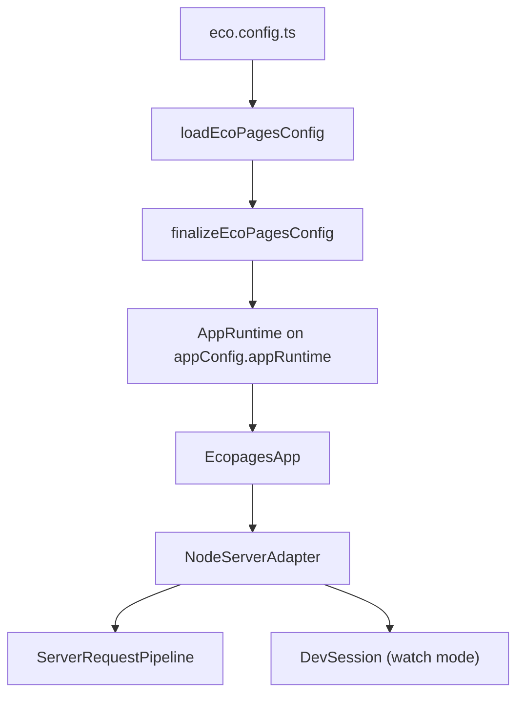

# App runtime

Every command starts the same way: one `eco.config.ts` is loaded, finalized into an `EcoPagesAppConfig`, and given one `AppRuntime` that holds all per-app state. `createApp()` wraps that config in an `EcopagesApp`, which owns route registration and one `NodeServerAdapter` for the Node HTTP host. Watch mode adds a `DevSession`.

Two apps in one process never share state: each config load finalizes a new config and runtime. Only the imported config module and pure memo caches are shared.

## Loading the config

`resolveEcoConfigPath()` picks the config module in this order: an explicit `configFile`, `ECOPAGES_CONFIG_FILE`, the emitted `eco.config.mjs` beside a running production server bundle, `<cwd>/eco.config.ts`, then the emitted config in `distDir`. Production startup therefore loads the config the build emitted even when the source config is still present.

The generated `dist/server/app.mjs` loader records its folder before it imports the application bundle, and `createApp()` reads it through `getProductionServerBundleDir()`. Node scopes the folder to that import with `AsyncLocalStorage`, so a host wrapper can import the entry and two bundles in one process each see their own. Bun does not carry `AsyncLocalStorage` into `import()`, so the loader also records the last bundle folder on `globalThis` as a fallback.

`loadEcoPagesConfig()` imports the module once per resolved path and finalizes a new config on every call. A config factory, `defineConfig(() => ({ ... }))`, runs for each app and creates fresh Integrations, Processors and loaders. An object config holds plugin instances, so finalizing it for a second app throws and asks for a factory. The `directories` option replaces `distDir` and `workDir`, as the Lit static-render worker does to load the config for the build it renders.

When the config loads from source, `config-module-files.ts` lists it and the project files it imports as `absolutePaths.configModuleFiles`; packages, files outside `rootDir` and unresolved imports stay out. Build-input fingerprints hash these files, and `ecopages dev` restarts when one changes, so an edit to a plugin options module takes effect like an edit to the config. A Component the config imports loses hot reload for the same reason.

`server-config-bundle.ts` emits `dist/server/eco.config.mjs`. Its `import.meta` points at the emitted file; development server builds still rewrite `import.meta` to sources.

## Finalization

`finalizeEcoPagesConfig()` is the only finalization path; `loadEcoPagesConfig()` and `createApp()` both end there. It is exported from `@ecopages/core/config` for workspace packages and tests. App code never calls it, so user docs leave it out. In order, it:

1. Applies defaults: `rootDir` from `cwd`, `baseUrl` from `ECOPAGES_BASE_URL` then `http://localhost:3000`, `absolutePaths.config` as `<rootDir>/eco.config.ts`.
2. Appends the core HTML Pages Integration unless a user Integration declares `.html` (see [HTML Pages](/dev/html-pages)), then rejects repeated Integration names and extensions, an Integration extension that ends in an endpoint file marker, and repeated Processor or loader names. A `headers` rule must have a `/`-anchored `source` that uses only `*` and `**` and valid header names and values; the error names the rule's index.
3. Resolves absolute paths, including the semantic `html.*` and error-page templates. Each prefers a file on disk, then a unique source key recorded in `dist/server/server-modules.json`, so `ecopages start` from a copied `dist/` still finds `404.html`, then the first Integration extension. Two matches for one basename, such as `html.tsx` and `html.html`, are an error.
4. Calls `createAppRuntime()`, which seals the build manifest. Plugin ordering and duplicate plugin names are covered in [Plugin pipeline](/dev/plugin-pipeline).

## AppRuntime

`createAppRuntime()` builds the runtime once and stores it on `appConfig.appRuntime`; a second call returns the same object. `requireAppRuntime()` throws `Missing app runtime` for a config that skipped finalization. The server adapter, route renderer factory and static builder take the runtime in their constructors instead of reading module-global state.

| Concern | Fields |
| --- | --- |
| Build | `buildAdapter` (Rolldown, the only build path), `buildManifest`, `buildQueue` (one for the runtime's lifetime, so identical builds share one in-flight result), `buildInputIndex` |
| Server modules | `moduleLoader`, `routeModuleBuildCaches`, `serverInvalidation` (a generation counter dev caches compare), `productionServerModules` |
| Production | `processedAssets` (the asset ledger, see [Ledger and start](/dev/ledger-and-start)), `processedStylesheets` (the stylesheets the Processor produced, shared by every path that processes one, see [Plugin pipeline](/dev/plugin-pipeline#stylesheet-processors)), `productionBuildId`, `staticGenerationActive` (true during `ecopages build`, so an asset that cannot be processed fails the build) |
| Rendering | `pageBrowserGraphSession`, `pageCache` (`null` until the server adapter stores one), `htmlPageModuleScripts`, `htmlPageWarnings`, `customElementSsrPreloadScopes`, `requestPipelineMetrics` |
| Integrations | `integrationActivations`, `globalScriptResolution` (read-only, see below), `runtimeAssetsPrepared`, `hmrAttachedToIntegrations` |
| Development | `developmentInvalidation` (created once on first use and shared by the Project Watcher and `HmrManager`), `developmentStylesheets` (created once on first use, shared by the Project Watcher and the dev transform server), `hmr` (set while a dev session's HMR manager runs) |
| Host | `origin` (starts as `baseUrl`, updated once the server binds) |

`globalScriptResolution` fixes, for the runtime's lifetime, when an Integration activation resolves its global scripts (`integrationDependencies`). `createAppRuntime()` sets it from the `globalScriptResolution` option of `finalizeEcoPagesConfig()` and `loadEcoPagesConfig()`; without one, it is `'browser-build'` when the process runs `ecopages build` or `ecopages preview` without `--serve-only` (read by `resolveEntryCommand()`, the parser `parseCliArgs()` uses), and `'activation'` otherwise. An `'activation'` runtime resolves them right after each successful `setup()`; a `'browser-build'` runtime leaves them to `resolveIntegrationDependencies()` after its app-wide browser build. Activations are memoized, so the first caller starts the one activation of an Integration; the strategy no longer depends on which caller that is. The Lit static-render worker loads its config with `'browser-build'`, and a test that builds in process passes it too. [Build pipeline](/dev/build-pipeline) covers the build side.

## Starting and stopping

`createApp()` resolves the config and CLI mode once and returns the `EcopagesApp`. The app moves through `idle`, `starting`, `ready`, `stopping` and `stopped`:

- Concurrent `start()` and `fetch()` calls share one readiness promise.
- `stop()` during startup lets the step in flight finish, then releases what startup created, including a server that finished binding. The interrupted `start()` resolves without a server, or rejects when that step failed.
- A `start()` or `fetch()` called while `stop()` runs waits for it, then creates a fresh server adapter on the same `AppRuntime`. A further `stop()` during that wait cancels it.
- `stop()` (force, the default) closes every open connection, WebSockets included, so it completes while browsers stay connected. `stop(false)` waits for connections to end.

Before readiness, watch mode waits for every Integration warmup attempt and for the Project Watcher's first filesystem subscription; non-watch network startup activates Integrations; production startup restores the listed route browser graphs and checks every listed output. Request-only `app.fetch()` activates only the Integrations a request uses. Watch mode runs each request and Page prewarm inside the build queue's request scope.

Watch mode creates a `DevSession` after the server binds. It owns the Project Watcher, `HmrManager`, client bridge, background Page prewarm and Dev Toolbar runtime, and its one `dispose()` stops them before Integration teardown. Prewarm renders `devPrewarmPaths`, including paths Processors append in `setup()`, de-duplicated and in the background; a path that fails is logged at debug level and skipped.

Shutdown cancels queued prewarms, waits for active prewarm renders, page-cache regenerations and Integration `setup()` calls in flight, then calls `teardown()` on activated Integrations. Every step runs even when an earlier one fails, and the errors are reported together. Serving never starts the Lit static-export worker; `teardown()` stops one left by a static export in the same process. When shutdown rejects during a standalone development restart, the adapter logs the error chain and still exits with the restart code, since the CLI starts a fresh server either way.

The adapter layer only carries transport. Config finalization, build manifest assembly, server module loading, invalidation and route rendering stay in their own layers.

## Request order

`ServerRequestPipeline` tries, in order, Explicit Routes (`apiHandlers`), `app.static` routes, then the Route Registry match, a Page or an endpoint file. Endpoint files never join `apiHandlers`; their loading and checks are in [Routing](/dev/routing). Configured `headers` rules apply where responses leave the adapter, on the app server and on preview: a matching rule replaces a same-named header and leaves the rest.

`ApiRequestPipeline.handleError` resolves API handler errors and any error that escapes the request pipeline: a thrown `Response`, then a client abort (499), then `app.onError`, then `HttpError`, then a logged 500. `app.fetch()` therefore always resolves with a `Response`. A Page render failure renders the error page instead and never reaches `app.onError`.

On Node, `attachNodeHttpWebSocketUpgrades` handles `/_hmr` (dev only) and user WebSocket routes and destroys any other upgrade. A user route runs `context()` before completing the upgrade; a rejection answers 403, or the status of a thrown `HttpError`, and the client never sees `open`. A failure after the upgrade, such as in `onConnect`, closes with 1011.

The production build bundles the server entry when the app registers an Explicit Route or a WebSocket handler (`needsServerBundle`, decided when the adapter is constructed) or when the Route Registry holds an endpoint route (decided in `ServerStaticBuilder.build()`). Static file serving, including its cache policy, is described in [Caching](/docs/server/caching).

`validateRequest()` runs the declared Standard Schema validators for params, query, headers and body concurrently. A declared body validator always runs, even when the parsed body is `undefined`, so a required schema rejects an empty body. The API request pipeline parses the request and builds the response around it.

## Diagnostics

`createAppRuntime()` gives each app its own request-pipeline metrics: counters for page-module loading, MDX transforms, collection builds and route-render phases. With `ECOPAGES_REQUEST_PIPELINE_METRICS`, `ECOPAGES_ROLLDOWN_BUILD_METRICS` or `ECOPAGES_LOGGER_DEBUG` enabled, the response cache coordinator writes the snapshot to the `x-ecopages-pipeline-metrics` header; with none set, recording does nothing. `startup-trace.ts` reports startup phases and the build parallelism the build queue and static export use. The variables are listed in the [CLI README](https://github.com/ecopages/ecopages/blob/main/packages/ecopages/README.md#debug-logging-and-startup-trace).

## Test fixture app

`packages/core/__fixtures__/app` is a minimal project for unit tests. `createFixtureAppConfig()` finalizes its config (pass `configFile: 'eco.config.ts'` to go through the real loader, or `rootDir` to use a copy), and `createFixtureApp()` returns an app with optional `serverOptions`. `@ecopages/testing` `createTestAppConfig()` does the same for an in-memory user config.

Parallel suites read the folder, so a test that edits sources or writes build output (`.eco`, `dist`) runs against `copyFixtureApp()`: a temporary copy with `node_modules` linked and top-level `dist`, `dist-*`, `.eco` and `.eco-*` left out, which the test removes afterwards. `copy-fixture-app.ts` imports only Node built-ins, so other packages and the e2e suites import it by relative path and pass another app folder or a destination.
