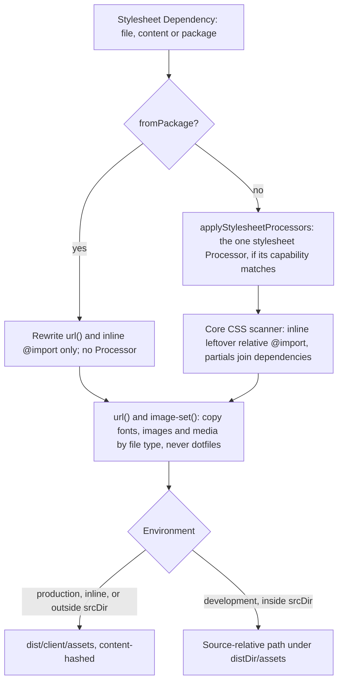

# Asset processing

`AssetProcessingService` turns a declared asset, a script or stylesheet from a file, inline content or a package, into the file or inline content a Page links. Route preparation calls it for every Dependency it collects; [From graph to HTML](/dev/graph-to-html) covers how its results become the Page Package, and [Ledger and start](/dev/ledger-and-start) how production records and later replays them.

## One service per Integration

Each Integration creates its own service in `setup()`, and calls it with itself as the owner, so its optional `prepareAssetDependencies()` hook runs on the list before dispatch; a call without an owning Integration passes `undefined`. All services of an app share the processed-asset ledger on `AppRuntime`.

The service dispatches each asset to one of five processors by kind and source: content, file and node-module scripts, content and file stylesheets. It holds the only processed-asset cache, keyed by `getAssetDependencyKey`, the dependency identity that deduplication and the ledger use too. File outputs keep their source path, so development can check freshness.

In development, each applied change batch is announced on the build-input index, and every service evicts the cached assets whose source or bundled inputs the batch touched. Shared layout styles are therefore not rebuilt per navigated page, and a bundle is never served after one of its imports changed.

## How a stylesheet is processed

## Where outputs land

| Asset | Output |
| --- | --- |
| A bundled script with HMR on | Its dev-transform URL, compiled when the browser requests it |
| A bundled script | `dist/client/assets`, under Rolldown's `[name]-[hash]` name |
| An unbundled file inside `srcDir`, in development | Its source-relative path, with a TypeScript extension turned into `.js` |
| An unbundled file outside `srcDir`, or any unbundled file in production | `dist/client/assets`, named by a hash of its bytes (`writeHashedBrowserAsset`) |

A file outside `srcDir` has no source-relative path that stays inside `dist/`, which is why it always gets a hashed name; the write checks containment before creating the file. A stylesheet's relative `@import`s are inlined and its `url()` references emitted before it is written, whether or not a Processor ran; that, and package stylesheets, are covered in [PostCSS processor](/dev/postcss-processor) and [Pages, layouts and components](/dev/pages-layouts-components#package-stylesheets).

## Grouped script bundles

Scripts that carry a `groupedBundle`, such as Page Browser Graph scripts and lazy entries, are built together, one build per group, through one processing path for file and content entries. A grouped build carries every entry's external modules, `define` values and plugin instances; conflicting `define` values fail before bundling. Each entry's output is found by its exact facade, so Pages named `blog` and `blog-post` never pick up each other's output. A grouped result is cached only when complete and reused only while its whole dependency-key set matches, so entries from differently composed Pages never mix. In production these scripts come from the app-wide browser build instead; see [Build pipeline](/dev/build-pipeline#the-app-wide-browser-graph).

## Failures

A processor error, grouped or not, rejects `processDependencies`, so the build or the request fails with the bundler's message and a Page is never written without a script it declared. Any asset in `ecopages dev` is the exception, covered next. A missing processor or a missing source file is logged and skipped. One exception keeps a production server serving: outside static generation (`staticGenerationActive`), a processor error there is logged and the Page renders without the asset, because a request-time rebuild can fail for reasons the build did not, such as a deploy without sources.

### A broken asset in development

`ecopages dev` stays usable while a stylesheet or a script is broken. `keepsLastGoodOutput` (`last-good-output.ts`) is the one place that decides it: a development `NODE_ENV` outside static generation. Stylesheets, scripts and the build requests of stylesheet imports all ask it. There an asset that fails does not reject `processDependencies`. The service logs the error, shows it in the browser overlay through `IHmrManager.reportBuildError` with a message that names the kind and the source, and answers with the last good output of that dependency, so the Page renders with the asset it had. The file of a source-relative asset is still on disk, since a failed transform or bundle writes nothing. An asset that never processed since the dev server started has no last good output, so the Page renders without its link or script tag; core does not emit an empty placeholder file. The next request after a good save processes the asset again and serves the new output.

The rule covers every script the service builds while it answers a Page request: content scripts, inline file scripts, classic scripts, node-module scripts, and grouped bundles, which fall back to the last good bundle of the same group (`groupedBundle.id`) as a whole. A bundled file script in development is not built here at all: the file-script processor registers it with the HMR manager and the [dev transform server](/dev/dev-server) compiles it when the browser asks, with the same rule. A Page module, or a Component module a Page imports, that fails to build on the server is outside it: the Page cannot render without its module, so that request still fails with the bundler's message.

`ecopages build`, `ecopages start` and any static generation keep the rules above: a build fails loudly, and a production server drops only the asset.
