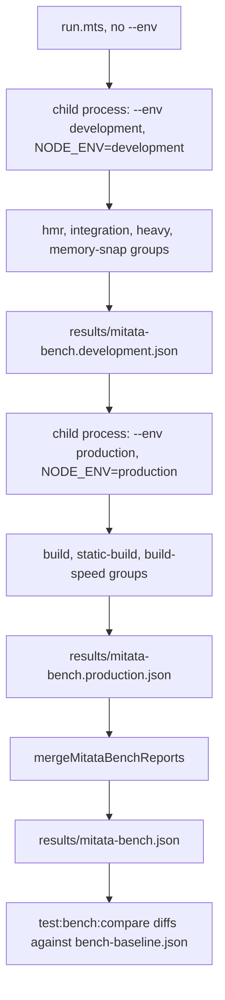
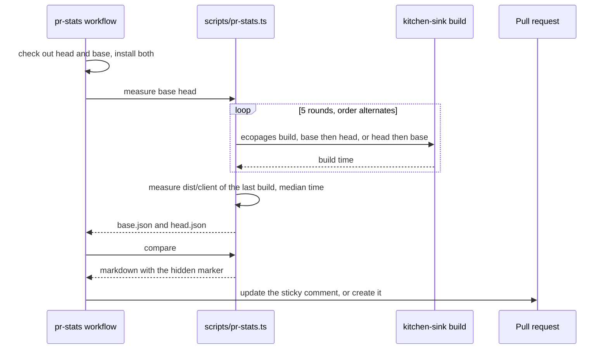

# Benchmarks and CI

Performance work in Ecopages is checked against the kitchen-sink app (`playground/kitchen-sink`), the demo that uses every Integration and Processor, not against synthetic fixtures. Three things measure it: benches a maintainer runs by hand, a stats comment CI posts on every pull request, and the gate that decides whether a change merges. The unit suites (`pnpm test:vitest`) and the Playwright end-to-end suites (`pnpm test:e2e`) have no dev page of their own; this page covers only how they gate a merge.

## The kitchen-sink bench

`pnpm test:bench` runs mitata scenarios from `playground/kitchen-sink/bench/`, gated by `ECOPAGES_BENCH=1` so default CI never runs it. Each group runs under the `NODE_ENV` it measures, and each environment runs in its own process:

Why one process per environment: `react` picks its development or production build from `NODE_ENV` on first import, and the kitchen-sink config imports it, so switching `NODE_ENV` inside one process would pair the development `react` with the production `react-dom/server` and break renders. The environments run one after the other so they do not compete for CPU. Scenario names must be unique across environments.

| Environment | Groups | Measures |
| --- | --- | --- |
| `development` | `hmr-bench`, `integration-bench`, `heavy-bench`, `memory-snap-bench` | dev-server rebuilds through the browser bundle service |
| `production` | `build-bench`, `static-build-bench`, `build-speed-bench` | production bundles, server entry and route-module compiles, `StaticSiteGenerator.run`, a full `buildStatic` |

A cold `buildStatic` scenario creates a fresh config, and so a fresh app runtime, for every iteration, as `ecopages build` does in a new process. The route-module scenarios use their own `dist/__bench-route-modules__` directories, because under `NODE_ENV=production` the module loader imports from the server-modules map a finished build leaves behind and would time a cached import. `static-build-unified-graph-parity.test.ts` builds with the server-modules map on and off (`ECOPAGES_UNIFIED_PAGES_GRAPH`) and compares the HTML. `pnpm test:bench:baseline` regenerates the committed `results/bench-baseline.json`; update it only when a change moves the numbers on purpose and quote the deltas in the pull request.

## The other benches

| Command | What it does |
| --- | --- |
| `pnpm test:bench:ssr` | `ssr-bench.mts` builds the kitchen-sink once with `ssr-bench.eco.config.ts`, starts `ecopages start` on a free port as a child process and drives each route with autocannon: a warm-up, then a timed run at fixed connections. The config turns the page cache off, so every request renders; `--cache` keeps it on and measures the hit path. The child is stopped and the build removed even when the run fails, and a route that reports an error, timeout or non-2xx fails the run. `--runtime bun` measures Bun. |
| `pnpm test:bench:hmr` | `hmr-e2e-bench.mts` starts a dev server on a private copy and times a page edit and a CSS-discovery edit from the source write to the change in the browser. |
| `pnpm test:bench:startup` | `startup/run.mjs` times dev start to first interactive page in isolated artifact scopes. |
| `pnpm test:bench:docs` | `scripts/benchmark-docs-dev.mjs` drives the docs app's development journey in a browser against a running or started server. |

The SSR bench is not part of the mitata run, because autocannon owns its timing. Without the page cache, the numbers in the README are per-request render cost, not a cache lookup.

## Pull request stats

`.github/workflows/pr-stats.yml` runs on every pull request into `next` or `main` and comments the size and build time of the kitchen-sink client output, base against head.

`measurePair()` builds each side cold five times, deleting `dist` and `.eco` first, and alternates which side goes first each round, so a runner that warms up or slows down during the job moves both medians alike. Sizes come from the last build's `dist/client`: source maps and the precompressed `.gz` and `.br` copies are left out of every total, since users are not served maps and the copies would count each file twice. The comment opens with a context line (what kitchen-sink is, and that totals sum every page and asset rather than what one visitor downloads), then leads with the JavaScript a browser loads per page. For each page, `measurePages()` reads the built HTML, takes its module scripts and modulepreloads, follows the static `import` and `from` specifiers through the chunks, and sums the gzip size of each file once. Dynamic `import()` is not followed. Files named `vendor-*` (one chunk per installed package) count as vendor, everything else as app, and the vendor chunk names are listed. The table shows the smallest, median and largest page (error pages aside) plus `/`, `/react-lab`, `/variant-lit` and `/api-lab`, as base to head, and marks vendor, app or total growing more than 5%, so app code growth shows even when vendor is unchanged. Vendor chunks are shared across pages and stay cached across deploys, so a returning visitor mostly downloads the app part. Build time follows, labelled informational because the runner is shared. A collapsed section holds the totals: JavaScript, CSS and HTML raw and gzip, static assets (images, fonts and other files) raw only, the raw total of all files in `dist/client`, and the vendor share of all JavaScript. Source maps and the precompressed `.gz` and `.br` copies are left out of every number. A second collapsed list shows the largest JavaScript files, and JavaScript files new in the head over 50 kB gzip are listed, matched by name with the content hash removed. The comment is posted only for pull requests from the repository itself; a fork gets the job summary.

## CI gate

The suites and what each job runs are described in [Testing](/dev/testing). `ci.yml` runs on every pull request and on pushes to `next` and `main`. The `fast` job runs `pnpm run test:ci:fast` (ignore, template, lint, format, typecheck and unit checks), then builds every template and recipe fixture. The `windows` job typechecks, runs the production smoke start and the unit suites on Windows. Playwright runs in four shards behind one `e2e` job that fails if a shard failed, and docs end-to-end tests run only when docs inputs changed.
