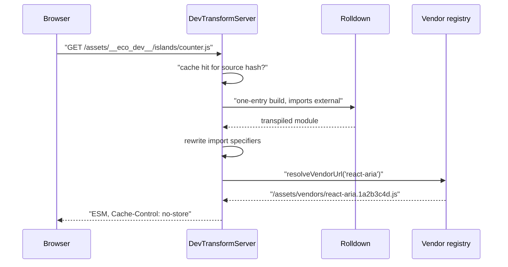
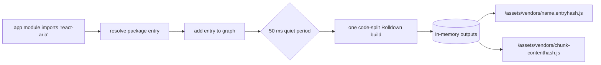
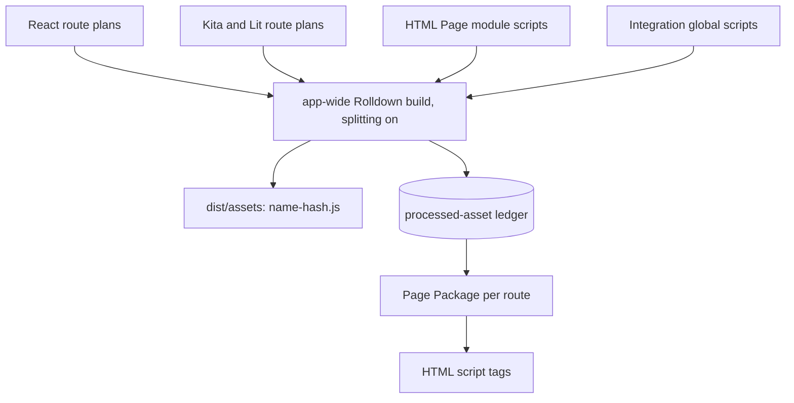

# Browser module graph

Every browser module an app ships has exactly one URL. Development and production reach that rule in opposite ways. In development, the dev transform server compiles each source module on request and serves it at a URL derived from its path, while bare package imports go to a prebundled vendor graph. In production, `ecopages build` bundles the scripts of every Page in one app-wide build with code splitting, so each shared module lands in one content-hashed chunk. Either way, route preparation collects a Page's scripts into its Page Package, and the HTML transform writes their tags.

The rule exists because browsers key ES modules by URL. Two URLs for one file mean two module instances: duplicated state, two copies of a framework runtime, and islands that cannot see each other's context.

## Development: the transform server

`DevTransformServer` (`dev/transform-server/dev-transform-server.ts`) serves browser ESM on demand during `ecopages dev`. The HMR manager owns one instance and registers into it every module that needs a browser URL: page and island modules an Integration hydrates (React calls `registerEntrypoint`), and every bundled file script, which the file-script processor sends to the HMR manager instead of bundling while HMR is on.

Registration only computes a URL; nothing compiles until the browser asks for it. That keeps startup and the first render independent of how many modules a Page reaches.

### URL shape

| Source location | URL |
| --- | --- |
| Under `srcDir` | `/assets/__eco_dev__/<path relative to srcDir>.js` |
| In a linked workspace package | `/assets/__eco_dev__/@fs/<absolute path>.js` |
| A stylesheet imported from a module | the same shapes, keeping `.css` |

The `.ts`, `.tsx`, `.jsx`, `.mdx` and `.md` extensions become `.js`, and path segments are URL-encoded. To resolve a request, the server first checks its registered URLs, then decodes the path and tries the source extensions in order (`.tsx`, `.ts`, `.jsx`, `.js`, `.mdx`, `.md`). This lazy lookup serves page modules that client-side navigation requests before any server render registered them. A path that leaves `srcDir` and the workspace package roots never resolves.

The `@fs` form exists so a module from a linked package, such as a React island in a shared UI package, can hydrate on a Page of another Integration without being published to `node_modules` first.

### Compiling one module

`DevTransformBundler` runs a Rolldown build with a single entry on the `hmr` lane. The `ecopages-dev-transform-externalize-imports` plugin marks every import external, so only the requested file is compiled; namespaced imports such as `ecopages:images` stay internal so their virtual-module plugins can inline them. The Integration that claims the module through its `DevTransformBundleContributor` adds its own plugins, for example a client-graph boundary or the MDX loader.

The server keeps one cache entry per source file, keyed by the file's content hash, and one in-flight compile per source. A result is committed only if the source did not change or get invalidated while it compiled; otherwise the request compiles again. That way a rapid edit never caches stale code under a newer hash. A stylesheet needs no build: it becomes `export default "<css>"`, since real stylesheet delivery goes through Dependencies.

A failed compile answers `500` with the error text and reports it to the HMR manager, which shows it in the page. See [HMR and navigation](/dev/hmr-and-navigation) for how errors and updates reach the browser.

### Import rewriting

`rewriteModuleImports` parses the compiled module and rewrites each static import, re-export and literal `import()` specifier, checking in this order:

1. A specifier in an Integration's browser runtime manifest (for example `react`) becomes that runtime's fixed public URL.
2. A `node:` builtin fails the module with an error that points at the importer's browser exports or client-graph boundary.
3. A relative or absolute path, or a tsconfig path alias, becomes the target's transform URL plus `?v=<content hash>`.
4. Any other bare specifier goes to the vendor registry.

The `?v=` query makes the browser treat an edited dependency as a new module, so a soft HMR update picks up changed layouts and components without a full reload. The pathname itself never changes, so a module keeps one identity per content version. Relative module `Worker` and `SharedWorker` URLs are rewritten the same way. Every resolved local import is reported back to the HMR manager as a dependency of the module, which drives invalidation.

## Development: the vendor graph

Bare package imports are not compiled one by one. `DevTransformVendorRegistry` prebundles them, the way Vite pre-bundles dependencies. A package can contain hundreds of internal files and CommonJS modules the browser cannot load, and one request per file would make cold loads slow.

Every known dependency entry, meaning each package file an app module imports by a bare specifier, is an entry of one code-split build per vendor graph. A module that two entries reach, such as a file shared by a package root and its subpath or a CommonJS module several packages `require()`, lands in one shared chunk that the entries import relatively. Building all entries together is what keeps one module identity per package inside the graph; separate builds per package would duplicate the shared code.

There are two graphs because a build takes one list of resolve conditions: `@ecopages/core` resolves browser-first (`browser`, `module`, `import`, `default`) so its browser entry wins, and every other package resolves module-first. A package both graphs reach loads once per graph.

| Behavior | Rule |
| --- | --- |
| Entry URL | `/assets/vendors/<specifier>.<hash of entry path>.js`, stable across rebuilds, so URLs already embedded in served modules stay valid |
| Chunk URL | `/assets/vendors/<name>-<content hash>.js` |
| Batching | a new entry schedules a rebuild after a 50 ms quiet period, so the bare imports of one page load share one build |
| Storage | outputs stay in process memory; nothing is written under `dist` |
| Seeding | known specifiers are written to `dev-vendor-entries.json` in the work directory; the next process seeds from it and builds the full graph on its first request instead of rebuilding and reloading |
| Failures | a failed graph build retries entry by entry; failing entries answer `500` with the prebundle error and the rest build without them |
| Changes | when a rebuild changes or drops a file a browser already received, the HMR manager broadcasts `reload`, since mixing old and new chunks could load a module twice |
| Caching | responses carry `Cache-Control: no-cache` and a content `ETag`, so the browser revalidates and gets `304` while the content holds |

Vendor builds leave out the app's build plugins and run only the vendor plugins contributors supply, such as runtime rewrites. Because bundles live only in memory, a process restart rebuilds them from the installed packages, so a change to a transitive dependency takes effect even when the importing package's version stays the same.

## Production: one URL per module

`ecopages build` builds the browser client once for the whole app. `prebuildProductionPageBrowserGraphs` asks every Integration renderer to plan its routes, which collects the scripts they would bundle without processing them. `buildAppBrowserClient` then bundles all of those in one build: component scripts, Page Browser Graph dependencies, island and lazy entries, each Integration's global scripts and the module scripts of HTML Pages.

Because every entry is in one build with code splitting, a module that several Pages reach, across Integrations and HTML shell scripts, becomes one chunk with one URL and is evaluated once, including across browser-router navigations. Per-Page builds would inline shared code into each Page's bundle and give the same module a different URL per Page.

Each entry is named `client-<hash of its dependency key>` (`html-<hash of path>` for an HTML module script), and every output name carries a content hash. Only build-wide options split entries into separate builds: `define`, `minify`, `treeshaking` and excluded app build plugins. Plugins do not split them: a module has one URL and so one compiled form, so the build runs every plugin any entry declares, and each plugin decides by the module itself whether to handle it. The plugin side is covered in [Plugin pipeline](/dev/plugin-pipeline).

Package imports are bundled into the same chunks. The exception is a specifier in an Integration's browser runtime manifest: the browser runtime plugin marks it external and points it at the runtime's fixed public URL, the same URL the dev import rewriter uses, so every Page shares one copy of the framework runtime.

The build writes outputs to `dist/assets`, gzips each `.js` and `.css` file and records every content-hashed output, so the server answers them with `Cache-Control: public, max-age=31536000, immutable`. Each entry's output goes into the processed-asset ledger under the dependency key of every declaration that named it. `ecopages start` restores and seals that ledger and never compiles; [Build and start](/dev/build-and-start) covers the ledger and the sealed start.

## From graph to HTML: the Page Package

Route preparation builds one Page Package per render, before any Component renders. `PageBrowserGraphService` resolves the route's Page Browser Graph: it processes the Integration's contribution and splits the result into entry assets and dynamic chunks. In production, every grouped script resolves to the output the app-wide build recorded. In development, the graph is built on first request and cached in `page-browser-graph-session` until a tracked dependency changes, and its file scripts and Integration page modules point at transform URLs. A grouped script that no app-wide build recorded builds as one grouped bundle for that route, which no other route reuses.

`createPagePackage` merges those graph assets with the processed Dependencies of every Component the route reached, then sorts them into the page script, the page stylesheet, inline assets, separate assets and dynamic chunks. Three kinds of asset get no tag:

- an asset marked `excludeFromHtml`, such as an island entry that another script imports;
- a `runtime` asset, which modules import by URL;
- a source file already bundled into the page script or page stylesheet.

The HTML transform appends the remaining assets to `<head>` or `<body>` by position; stylesheets always go to `<head>`. It never writes a tag for a Page Browser Graph dynamic chunk: the entry that needs it imports it. Rendering cannot add assets to the package; an HTML Page writes the tags of its own declared assets into its markup instead.
