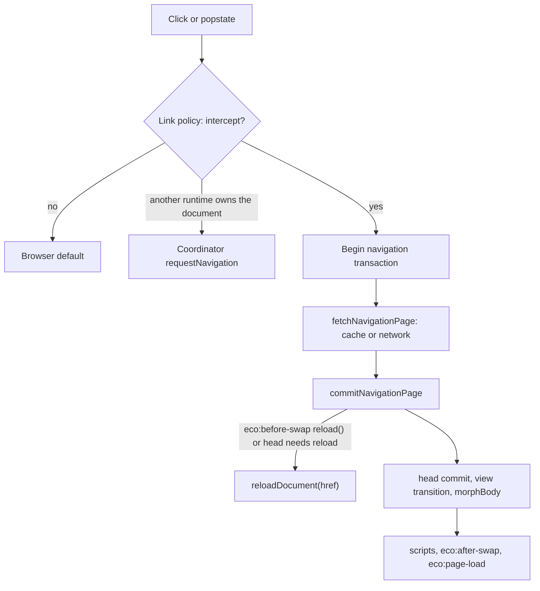
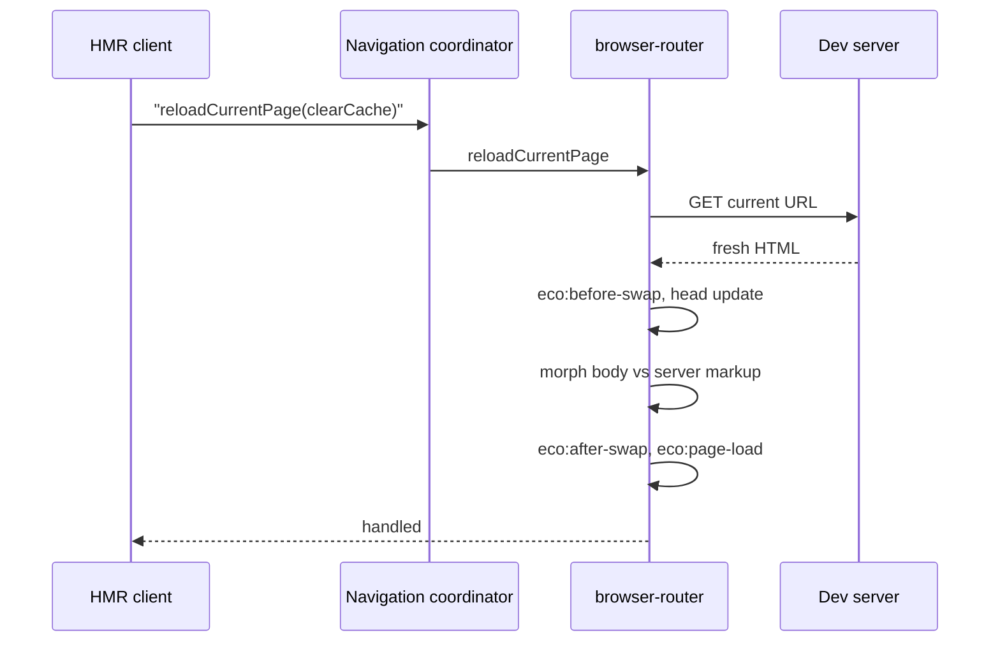

# Browser router

`@ecopages/browser-router` is the client navigation runtime for MPA-style pages (server-rendered HTML, Lit, vanilla JS, React islands). It intercepts same-origin links, fetches the next document and morphs its body into the live one. It does not own the pipeline: fetching, head reconciliation, script activation, view transitions and lifecycle events live in `packages/core/src/router/client/` and are shared with [React router](/dev/react-router). Browser-router supplies the page swap (`morphBody`), the prefetch cache policy and the document-level options. Ownership, handoff and transactions are covered in [Navigation](/dev/navigation); this page covers what the router does with them.

`createRouter()` stores one `EcoRouter` on `window.__ecopages_browser_router__` and returns it on every later call, so a layout script re-run through `data-eco-rerun` does not register a second set of listeners. `start()` registers the router with the navigation coordinator as owner `browser-router`, with `navigate`, `handoffNavigation`, `reloadCurrentPage`, `cleanupBeforeHandoff` and `enableReloadStatePreservation`.

## Link interception

Listeners are capture-phase `pointerdown` and `click` on `document`, plus `popstate`. `getLinkNavigationDecision()` in core is the one policy: it declines modified clicks, non-left clicks, a `target` other than `_self`, `data-eco-reload`, `download`, `#` and `javascript:` hrefs, cross-origin and static-asset URLs, and same-page hash links. The anchor is found through `composedPath()`, so links inside shadow roots work.

`pointerdown` records the intended href with a timestamp. If a navigation is already in flight, the click is queued: the router cancels the running transaction and, once it settles, replays the queued href through `decideQueuedNavigationReplay()` (skipped when it is the same page with the same hash). The recorded intent also recovers the href when the DOM changed between press and click, for up to one second. Why: during a rapid sequence of clicks the last one should win, and a swap must not turn the link under the pointer into something else.

When another runtime owns the document (`isAnotherNavigationRuntimeActive()`), the click is stopped and routed through `requestNavigation()`, so a page shell with both routers has one navigating at a time.

## Fetch, cache and prefetch

`fetchNavigationPage()` (core) fetches with `Accept: text/html` and `cache: 'no-store'`, accepts only `text/html` or `application/xhtml+xml` responses, keeps the requested fragment across redirects, and parses with `DOMParser`, adding an `<base data-eco-injected>` for the final URL when the page has none. The HTML cache is a module-level map in core shared by both runtimes. A non-HTML or failed response throws, and the router falls back to `reloadDocument`.

`PrefetchManager` fills the cache ahead of clicks: an `IntersectionObserver` for viewport links and delegated hover/focus listeners for intent (`strategy: 'intent'` does both, 65 ms hover delay), `requestIdleCallback` scheduling, `respectDataSaver`, and per-link `data-eco-prefetch`, `data-eco-prefetch-delay` and `data-eco-no-prefetch`. It also warms new stylesheets with low-priority fetches. `cacheVisitedPage()` stores the HTML of the page being left or loaded, and the copy is never refreshed in the background. Why: a revisit should render immediately, and a refetch on every load would add a request without fixing a stale copy. With `prefetch: false` the router sets `bypassCache` on every fetch, because the shared cache would otherwise serve the first copy for the whole session.

## The commit

`NavigationCommit.commit()` calls core's `commitNavigationPage()`, which runs in a fixed order and checks for staleness after every await:

1. Dispatch `eco:before-swap` on `document`. A listener calling `event.detail.reload()` aborts the swap and the router calls `reloadDocument`.
2. `prepareNavigationHead()` diffs the incoming `<head>` against the live one and stages new stylesheets as unattached `<link>` elements until they load, so the swap never paints unstyled. It requests a full document load when a stylesheet fails or its cascade order cannot be kept, or when a persisted head element would be reordered. The head is keyed by tag and identity (meta name, link rel and href, script identity, style id); elements marked persisted are never removed.
3. Clean up the outgoing owner if the incoming document belongs to a different one (`data-eco-document-owner`).
4. Inside `runNavigationViewTransition()`: update history (`pushState` for `forward` when `updateHistory` is on, `replaceState` for `replace`), commit the head, sync allowed `<html>` attributes (default `lang`, `dir`, `data-eco-document-owner`) and run `morphBody()`.
5. Adopt the incoming document owner, activate scripts (new head scripts, then `data-eco-rerun` scripts, then body scripts, in order), run `manageWindowScroll()`.
6. Dispatch `eco:after-swap`, then schedule `eco:page-load` on the next animation frame unless a newer navigation superseded this one. The router schedules it once at `start()` too.

`isSuperseded` differs from `!isCurrent` on purpose: a navigation that completed normally still owes its `eco:page-load`; only a newer navigation cancels it.

### View transitions

`runNavigationViewTransition()` only calls `document.startViewTransition` when the option is on, the browser supports it, and the current or incoming document has `data-view-transition` elements. When the option is on it first ensures the root styles that opt the document out of the UA root group (no lighter flash on dark themes); without a transition it swaps directly. The transition wraps the morph; it never decides whether persisted elements survive.

### Body morph

`morphBody()` runs morphdom with a custom node key: only elements carrying the persist attribute have a key, so repeated `id`s elsewhere never cause mismatches. A persisted element returns `false` from `onBeforeElUpdated` and is never touched when its ancestors stay compatible. Hydrated or light-DOM custom elements are replaced after morphdom finishes (replacing during traversal makes morphdom skip siblings) so the browser runs the full `disconnectedCallback` and `connectedCallback` cycle; light-DOM ones are also re-created when added. Declarative shadow DOM templates are attached by hand afterwards, because browsers process them only during the initial parse.

When the incoming page has a `data-eco-rerun` script (and this is not a reload), unpersisted elements are refreshed instead, except the body, the persisted path and the custom-element descendants on it. Why: a rerun script re-attaches handlers, and retained nodes would stack them; a persisted element's ancestors must stay, so those nodes remain attached and the script must register idempotently.

## Soft reload

A soft reload refetches the current URL and commits it into the live document instead of reloading it. The HMR client (see [HMR client](/dev/hmr-client)) calls `reloadCurrentPage()` on the navigation coordinator, which forwards it to the registered runtime of the active owner (browser-router or react-router).

In browser-router, `reloadCurrentPage` returns `false` while a navigation is pending, which makes the client fall back to a full reload. With `clearCache` it evicts the page from its prefetch cache and bypasses the cache on fetch, because the cached HTML predates the edit. It navigates with direction `replace`, `reload: true`, and no full-document fallback, so a failed soft reload reports unhandled instead of navigating away. The commit runs the same pipeline as a link navigation, so `eco:before-swap`, `eco:after-swap` and `eco:page-load` fire on every soft reload; code that must run after each HMR refresh can listen for `eco:page-load`.

Dev-transform local imports carry a content-hash `?v=` query, so after invalidation a re-imported page or layout resolves to a new ESM module-map key and the soft reload picks up the new code.

## State preservation

Two mechanisms keep state across a soft reload in browser-router.

**`data-eco-persist`.** An element carrying the persist attribute (or the configured `persistAttribute`) is never updated by the morph and is keyed by its persist value, so it survives every navigation and every soft reload when its ancestor structure stays compatible.

**Server-markup comparison.** When the HMR client starts it calls `enableReloadStatePreservation()`, and browser-router starts recording, for each live body element, a detached copy of the server markup it came from. On a reload of the same URL, `morphBody()` compares each element's previous server markup with its incoming server markup, not with the live element:

- Unchanged markup: the element is kept as it is, with its state, children, shadow root and runtime attributes.
- Changed custom element: replaced, so the browser runs its full lifecycle.
- Changed plain element: morphed, keeping its live attributes when its own server attributes did not change.

Why compare server markup: the live element always differs from fresh HTML once a component or script has touched it, so a live comparison would replace every hydrated component on every save. Why opt in: copying the body costs work on each commit, and production navigation never needs it, so only development pays for it.

Rerun scripts do not refresh elements on a reload, since replacing an ancestor would drop the unchanged elements inside it; a `data-eco-rerun` script must register handlers idempotently. Known limits: the first save after a full load compares against the body as the router found it at start, so a component that rendered before then is replaced once; and state follows tree position, so identical sibling hosts can trade state when an earlier sibling is inserted or removed. react-router implements `reloadCurrentPage` but not server-markup tracking.
