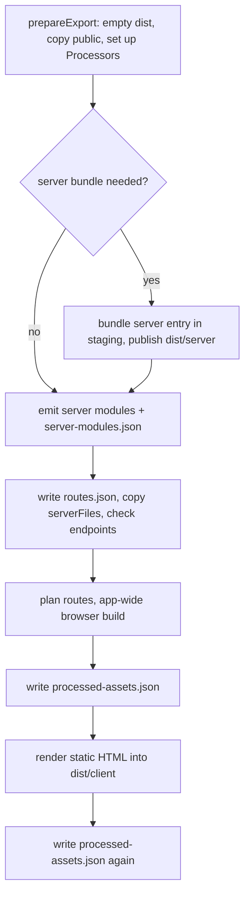
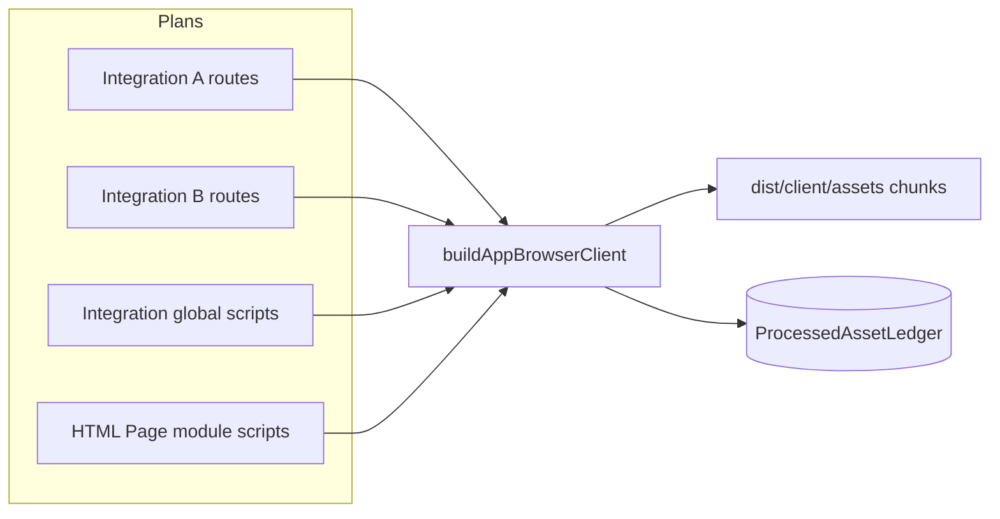
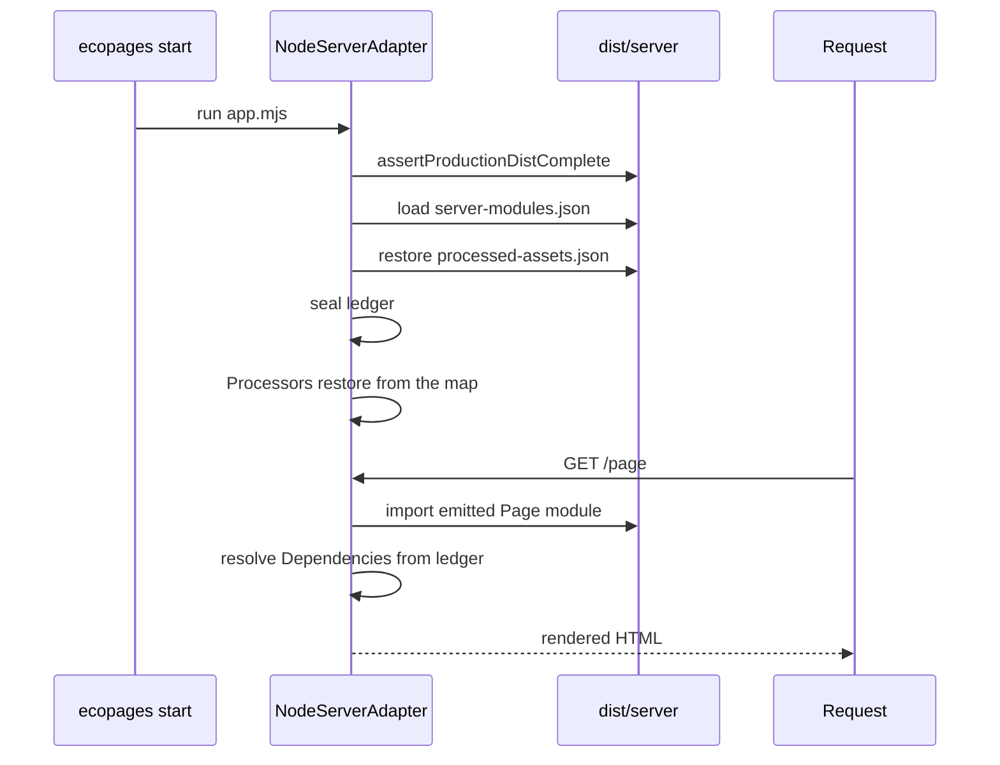

# Build and start

`ecopages build` does all the compiling a production app will ever need: it emits every server module, bundles the browser code of every Page in one app-wide build, renders the static export, and writes a record of every processed asset. `ecopages start` restores those records and serves requests from them. It still renders Pages per request, but it never runs the bundler, never runs a Processor and never writes into `dist/`. Anything the build did not produce is an error that says to run `ecopages build` again, not a fallback compile.

This page follows one build from an empty `dist/` to a sealed server. Development compiles from source on demand instead; see [Browser graph](/dev/browser-graph) and [HMR and navigation](/dev/hmr-and-navigation).

## What build produces

`ServerStaticBuilder.build()` runs these steps in order:

| Artifact | Location | Written by |
| --- | --- | --- |
| Static HTML, public files | `dist/client/` | static-site generator, `prepareExport` |
| Browser assets and chunks | `dist/client/assets/` | app-wide browser build, asset processing |
| Server entry loader and bundle | `dist/server/app.mjs`, `app.bundle.mjs` | `bundleServerEntry` |
| Emitted config | `dist/server/eco.config.mjs` | `bundleEcoConfigModule` |
| Deploy manifest | `dist/server/manifest.json` | `writeServerBundleDeployManifest` |
| Emitted server modules | `dist/server/` | `emitProductionServerModules` |
| Server-modules map | `dist/server/server-modules.json` | `writeProductionServerModulesManifest` |
| Filesystem route list | `dist/server/routes.json` | `writeProductionRouteList` |
| Processed-asset ledger | `dist/server/processed-assets.json` | `writeProductionAssetLedger` |

Every build starts from an empty `dist/`. Why: each build renders from source in a fresh process, so nothing in an earlier output is reusable, and a clean directory cannot mix two builds.

Only an app with API handlers, WebSocket handlers or endpoint files bundles a server entry. A static-only app gets `dist/client/` and is served by a static host or `ecopages preview`; `ecopages start` refuses it with a message that says so.

### One build id

`ensureProductionBuildId()` creates one random id per build and stamps it into `manifest.json`, `routes.json`, `server-modules.json` and `processed-assets.json`. Why: `ecopages start` compares them and refuses a `dist/` whose files come from different builds.

### Staged server bundle

The server entry and emitted config are bundled into a sibling staging directory, and the deploy manifest is written there before the directory replaces `dist/server/`. Why: a failed bundle leaves the previous server generation intact. Server modules are emitted after that publication, so publishing cannot wipe them.

### Portable paths

The deploy manifest names the server entry and emitted config relative to `dist/server/`. The server-modules map keys each module by its root-relative source path, and the ledger stores root-relative paths. Why: the deployed folder can move to another machine or directory; only `dist/client/`, `dist/server/` and `node_modules/` must keep their relative positions.

## Server modules

`emitProductionServerModules()` collects every server entry once (`collectServerModuleEntries`): Page templates including dynamic ones, Layouts, the Html shell, `app.static` views, error pages, and each Processor's `listProductionServerModuleEntries()`. It bundles them in one Rolldown server build with `preserveModules`, then records each source in `server-modules.json`.

Pages of an Integration that implements `compilePageModule`, such as HTML Pages, stay out of the Rolldown graph. Each compiles in process and is stored as a `-html.json` record that the Integration's `reviveCompiledPageModule` restores at load time.

Emit then imports the bundled modules to find `ssr: true` scripts the entries did not name. A script already inside the first output maps to it; otherwise a second emit adds it. Why: preserved modules keep their output path across both emits, so a module imported after the first emit is never evaluated from a second copy. Integrations are activated before that import, which is why an Integration that needs process globals installs them in `setup()`.

In production, `PageModuleImportService.importModule()` imports from this map whenever it exists. A missing key or file throws `No compiled server module for <source>. Run ecopages build.`. A path outside the deploy root still matches the longest recorded key it ends with, so an `identity.file` captured on the build machine resolves on the server.

## The app-wide browser graph

Before rendering any HTML, the static-site generator calls `prebuildProductionPageBrowserGraphs()` with every route instance the server could serve:

- each Page the export renders, with its Params
- each Dynamic Page entry from `staticPaths`, which runs `staticProps` so prop-dependent Dependencies are built
- a parameter-free instance of every non-exact Page route template and every view the server entry imports, without data hooks
- each `app.static` route instance

Each Integration renderer plans its instances with `planProductionRoutes()`. Planning processes nothing: it lists the bundleable scripts of the Page Browser Graph and the island and lazy entries, each prepared exactly as asset processing would prepare it. Why: preparation is a pure function of the dependency, so the key the plan records is the key rendering looks up later.

`buildAppBrowserClient()` turns every plan, each Integration's global scripts and the HTML Page module scripts into entries of one Rolldown browser build with code splitting. Why: a module that several Pages reach, across Integrations, becomes one chunk and is evaluated once. Browser runtime assets keep their fixed URLs and stay out of this build; [Browser graph](/dev/browser-graph) covers the vendor graph.

Only `define`, `minify`, `treeshaking` and plugin exclusions split entries into separate builds. Why: those options apply to a whole build. Plugins and external modules do not split it, because a module has one URL and therefore one compiled form; the build runs every plugin any entry declares, once each. [Plugin pipeline](/dev/plugin-pipeline) covers how those plugins reach Rolldown.

A route that fails to plan is reported, not fatal on its own. A concrete instance becomes a page failure; a route template only warns, and `ecopages start` then fails the requests that need a dependency only that plan would have recorded.

## The processed-asset ledger

`ProcessedAssetLedger`, stored on `AppRuntime.processedAssets`, maps a dependency key (`getAssetDependencyKey`) to the emitted asset. Two writers fill it during a build:

- `buildAppBrowserClient()` records each entry's output under the key of every dependency that declared it, then records every emitted file, chunks included, as `browserOutputs`.
- `AssetProcessingService` records every dependency it processes in production, stylesheets and content scripts included, as each one lands in its cache.

After the app-wide build, each planned route runs its preparation, so asset processing records every remaining dependency those routes are served with. A bundleable script the build already produced resolves to the recorded output instead of being bundled again. Inline assets keep their content and drop `filepath`, since no file reaches `dist/`.

`writeProductionAssetLedger()` writes the ledger, plus the HTML module-script URLs by root-relative source, to `dist/server/processed-assets.json`. It runs right after prebuild, because the Lit static-render worker restores the ledger, unsealed, during the export. When the build has a server bundle, it runs again after rendering to add what rendering processed. A failed generation clears the file. Why: a later `ecopages start` must never seal a partial build.

## What start restores

`ecopages start` does not load `eco.config.ts`. `createLaunchPlan()` finds the one directory with `server/manifest.json` (or the `--dist-dir` given), points the process at the emitted config the deploy manifest names, and runs `dist/server/app.mjs`. That loader records its directory, which marks the start as one from a complete `dist/`.

`NodeServerAdapter.initializeResources()` then:

1. Calls `assertProductionDistComplete()`: one build id across the manifests, the server entry, emitted config, route list, every listed server module and every ledger output must exist. It reads no source.
2. Loads the server-modules map with `requireProductionServerModules()`.
3. Restores the ledger with `restoreProductionBrowserBuild(appConfig, { seal: true })` and refreshes each Integration's resolved global scripts from it.
4. Runs `setupAppRuntimePlugins` with `skipProcessorSetup`, so each Processor calls `restoreProductionRuntime()` instead of `setup()`. Why: the deploy may hold no sources to scan, and the build already produced everything a Processor generates.

It does not copy the public directory or touch `dist/`, because the build already did. The route registry loads its routes from `routes.json` instead of scanning the pages directory.

## What start refuses

Once sealed, `AssetProcessingService.processDependencies()` is a pure lookup. It returns the recorded output of every dependency and runs no processor, writes no file and gzips nothing. Island and lazy entries resolve through the same ledger. Why: a request-time compile on the server could fail for reasons the build did not, and could serve output that differs from what the build verified.

| Missing at start | Result |
| --- | --- |
| A `dist/` file, or mismatched build ids | Startup fails: `... Run ecopages build again.` |
| A `server-modules.json` entry or its file | Request fails: `No compiled server module for <source>. Run ecopages build.` |
| A dependency the ledger does not record | Request fails: `The production build did not record the <kind> <name>. Run ecopages build again.` |
| A recorded output removed from `dist/` | Request fails: `The production build recorded <file> but it is missing.` |
| A ledger in an older format, or the earlier `browser-client-manifest.json` | Startup fails and asks for a new build |
| `processed-assets.json` itself | Startup continues unsealed and processes assets on request. A build always writes the file, so only a deploy that drops it reaches this case |

Only a start from a complete `dist/` restores and seals the ledger. Why: any other start must not serve stale outputs for a source edited after the build. For how content collections join this map, see [Content and integrations](/dev/content-and-integrations).
