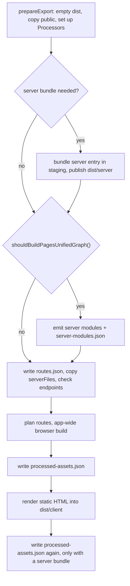
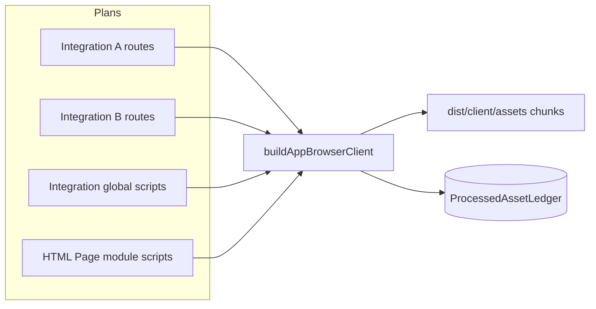

# Build pipeline

`ecopages build` does all the compiling a production app will ever need: it emits every server module, bundles the browser code of every Page in one app-wide build, renders the static export, and writes a record of every processed asset. This page follows one build from an empty `dist/` to the files `ecopages start` needs. [Ledger and start](/dev/ledger-and-start) covers the processed-asset ledger and the sealed server. Development compiles from source on demand instead; see [Dev server](/dev/dev-server).

## What build produces

`ServerStaticBuilder.build()` runs these steps in order:

| Artifact | Location | Written by |
| --- | --- | --- |
| Static HTML, public files | `dist/client/` | static-site generator, `prepareExport` |
| Browser assets and chunks | `dist/client/assets/` | app-wide browser build, asset processing |
| Server entry loader and bundle | `dist/server/app.mjs`, `app.bundle.mjs` | `bundleServerEntry` |
| Emitted config | `dist/server/eco.config.mjs` | `bundleEcoConfigModule` |
| Deploy manifest | `dist/server/manifest.json` | `writeServerBundleDeployManifest` |
| Emitted server modules | `dist/server/` | `emitProductionServerModules` |
| Server-modules map | `dist/server/server-modules.json` | `writeProductionServerModulesManifest` |
| Filesystem route list | `dist/server/routes.json` | `writeProductionRouteList` |
| Processed-asset ledger | `dist/server/processed-assets.json` | `writeProductionAssetLedger` |

Every build starts from an empty `dist/`. Why: each build renders from source in a fresh process, so nothing in an earlier output is reusable.

Only an app with API handlers, WebSocket handlers or endpoint files bundles a server entry. A static-only app gets `dist/client/` and is served by a static host or `ecopages preview`; `ecopages start` refuses it with a message that says so.

### One build id

`ensureProductionBuildId()` creates one random id per build and stamps it into `manifest.json`, `routes.json`, `server-modules.json` and `processed-assets.json`. Why: `ecopages start` compares them and refuses a `dist/` whose files come from different builds.

### Staged server bundle

The server entry and emitted config are bundled into a sibling staging directory, and the deploy manifest is written there before the directory replaces `dist/server/`. Why: a failed bundle leaves the previous server generation intact. Server modules are emitted after that publication, so publishing cannot wipe them.

### Portable paths

The deploy manifest names the server entry and emitted config relative to `dist/server/`. The server-modules map keys each module by its root-relative source path, and the ledger stores root-relative paths. Why: the deployed folder can move to another machine or directory; only `dist/client/`, `dist/server/` and `node_modules/` must keep their relative positions.

## Server modules

Production builds emit server modules unless `ECOPAGES_UNIFIED_PAGES_GRAPH` is `false` or `0` (`shouldBuildPagesUnifiedGraph()`), an opt-out the bench parity suite uses; `ecopages start` still requires the map. `emitProductionServerModules()` collects every server entry once (`collectServerModuleEntries`): Page templates including dynamic ones, Layouts, the Html shell, `app.static` views, error pages, and each Processor's `listProductionServerModuleEntries()`. It bundles them in one Rolldown server build with `preserveModules`, then records each source in `server-modules.json`.

Pages of an Integration that implements `compilePageModule`, such as HTML Pages, stay out of the Rolldown graph. Each compiles in process and is stored as a `-html.json` record that the Integration's `reviveCompiledPageModule` restores at load time.

Emit then imports the bundled modules to find `ssr: true` scripts the entries did not name. A script already inside the first output maps to it; otherwise a second emit adds it. Why: preserved modules keep their output path across both emits, so a module imported after the first emit is never evaluated from a second copy. Integrations are activated before that import, which is why an Integration that needs process globals installs them in `setup()`.

In production, `PageModuleImportService.importModule()` imports from this map whenever it exists. A missing key or file throws ``No compiled server module for <source>. Run `ecopages build`.`` A path outside the deploy root still matches the longest recorded key it ends with, so an `identity.file` captured on the build machine resolves on the server.

## The app-wide browser graph

Before rendering any HTML, the static-site generator calls `prebuildProductionPageBrowserGraphs()` with every route instance the server could serve:

- each Page the export renders, with its Params
- each Dynamic Page entry from `staticPaths`, which runs `staticProps` so prop-dependent Dependencies are built
- a parameter-free instance of every non-exact Page route template and every view the server entry imports, without data hooks
- each `app.static` route instance

Each Integration renderer plans its instances with `planProductionRoutes()`. Planning processes nothing: it lists the bundleable scripts of the Page Browser Graph and the island and lazy entries, each prepared as asset processing prepares it.

`buildAppBrowserClient()` turns every plan, each Integration's global scripts and the HTML Page module scripts into entries of one Rolldown browser build with code splitting. Why: a module that several Pages reach, across Integrations, becomes one chunk and is evaluated once. Browser runtime assets keep their fixed URLs and stay out of this build; [Dev server](/dev/dev-server) covers the vendor graph.

Only `define`, `minify`, `treeshaking` and plugin exclusions split entries into separate builds. Why: those options apply to a whole build. Plugins and external modules do not split it, because a module has one URL and therefore one compiled form; the build runs every plugin any entry declares, once each. [Plugin pipeline](/dev/plugin-pipeline) covers how those plugins reach Rolldown.

A route that fails to plan is reported, not fatal on its own. A concrete instance becomes a page failure; a route template only warns, and `ecopages start` then fails the requests that need a dependency only that plan would have recorded.

## Outputs of the browser build

Each entry is named `client-<hash of its dependency key>` (`html-<hash of path>` for an HTML module script), and every output name carries a content hash. Package imports are bundled into the same chunks, except a specifier in an Integration's browser runtime manifest: the browser runtime plugin marks it external and points it at the runtime's fixed public URL, so every Page shares one copy of the framework runtime.

The build writes outputs to `dist/client/assets`, gzips each `.js` and `.css` file and records every output in the processed-asset ledger under the dependency key of every declaration that named it; the server answers hashed files with `Cache-Control: public, max-age=31536000, immutable`. `ecopages start` restores and seals that ledger and never compiles; [Ledger and start](/dev/ledger-and-start) covers both.
