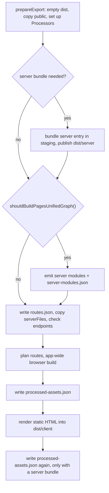
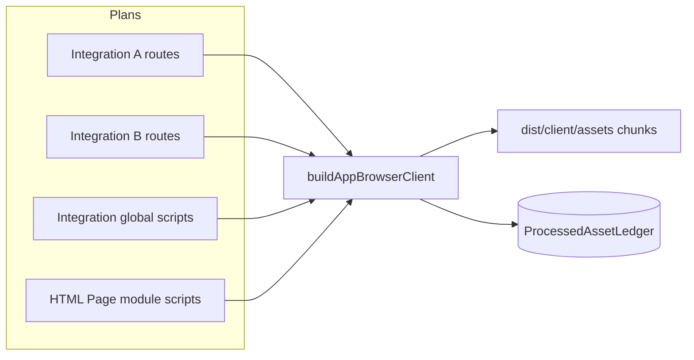

# Build pipeline

`ecopages build` does all the compiling a production app will ever need: it emits every server module, bundles the browser code of every Page in one app-wide build, renders the static export, and writes a record of every processed asset. This page follows one build from an empty `dist/` to the files `ecopages start` needs. [Ledger and start](/dev/ledger-and-start) covers the processed-asset ledger and the sealed server. Development compiles from source on demand instead; see [Dev server](/dev/dev-server).

## What build produces

`ServerStaticBuilder.build()` runs these steps in order:

| Artifact | Location | Written by |
| --- | --- | --- |
| Static HTML, public files | `dist/client/` | static-site generator, `prepareExport` |
| Browser assets and chunks | `dist/client/assets/` | app-wide browser build, asset processing |
| Server entry loader and bundle | `dist/server/app.mjs`, `app.bundle.mjs` | `bundleServerEntry` |
| Emitted config | `dist/server/eco.config.mjs` | `bundleEcoConfigModule` |
| Deploy manifest, and `package.json` with `"type": "module"` so `.js` chunks load as ESM | `dist/server/manifest.json`, `package.json` | `writeServerBundleDeployManifest` |
| Emitted server modules | `dist/server/` | `emitProductionServerModules` |
| Server-modules map | `dist/server/server-modules.json` | `writeProductionServerModulesManifest` |
| Filesystem route list | `dist/server/routes.json` | `writeProductionRouteList` |
| Processed-asset ledger | `dist/server/processed-assets.json` | `writeProductionAssetLedger` |

Every build starts from an empty `dist/`. Why: each build renders from source in a fresh process, so nothing in an earlier output is reusable.

Only an app with API handlers, WebSocket handlers or endpoint files bundles a server entry. A static-only app gets `dist/client/` and is served by a static host or `ecopages preview`; `ecopages start` refuses it with a message that says so.

### One build id

`ensureProductionBuildId()` creates one random id per build and stamps it into `manifest.json`, `routes.json`, `server-modules.json` and `processed-assets.json`. Why: `ecopages start` compares them and refuses a `dist/` whose files come from different builds.

### Staged server bundle

The server entry and emitted config are bundled into a sibling staging directory, and the deploy manifest is written there before the directory replaces `dist/server/`. Why: a failed bundle leaves the previous server generation intact. Server modules are emitted after that publication, so publishing cannot wipe them.

### Portable paths

No file a build writes holds a path of the machine that built it. The deploy manifest names the server entry and emitted config relative to `dist/server/`. The server-modules map keys each module by its root-relative source path, and the ledger stores root-relative paths. Inside the emitted modules:

- the component meta transform writes `identity.file`, discovered stylesheets and watch files relative to the app root, and a package stylesheet as the folder of its importing module and its package path (`src/components|some-lib@1.2.0/css/style.css`);
- the server entry names each imported view relative to the root;
- content collections name their entries relative to the root.

Core resolves them against the app root at load; a package path resolves from its importing module's folder, as Node resolves it. Why: the deployed folder can move to another machine or directory; only `dist/client/`, `dist/server/` and `node_modules/` must keep their relative positions. A dependency upgrade that moves a package to another store folder, as a pnpm version bump does, resolves the same way.

Server builds pass `externalPackages`. Source code is bundled: the app, workspace packages, TypeScript or JSX packages, and Core when it resolves to its source. A compiled package the app declares stays a bare import, so Integration renderers and the server bundle share one instance (one React). Every other compiled package under a `node_modules` folder stays external as a `./` or `../` path from the output directory to the installed file, written by a `resolveId` hook that resolves it with the `node` and `import` conditions. Why: isolated installs do not expose undeclared packages as bare specifiers, and a compiled package may load files relative to itself (a native binding, a sibling file through `createRequire`), which breaks once bundled into another folder. A chunk written below the output directory that imports such a path fails the build. Exceptions:

- `ws`, which needs CommonJS named-export interop, is bundled.
- A package store whose real path has no `node_modules` segment, and a Yarn Plug'n'Play install (`.zip` archives Node cannot import), are bundled.
- On Windows, a package on another drive than the output directory has no relative path and stays external as a `file:` URL.

When externalized packages resolve outside the app root, as in a workspace, the server entry and emitted config builds each log one line naming the output file, the count and the first five packages; [Deployment](/docs/reference/deployment) tells users what to do about it.

## Server modules

Production builds emit server modules unless `ECOPAGES_UNIFIED_PAGES_GRAPH` is `false` or `0` (`shouldBuildPagesUnifiedGraph()`), an opt-out the bench parity suite uses; `ecopages start` still requires the map. `emitProductionServerModules()` collects every server entry once (`collectServerModuleEntries`): Page templates including dynamic ones, Layouts, the Html shell, `app.static` views, error pages, and each Processor's `listProductionServerModuleEntries()`. It bundles them in one Rolldown server build with `preserveModules`, then records each source in `server-modules.json`.

Pages of an Integration that implements `compilePageModule`, such as HTML Pages, stay out of the Rolldown graph. Each compiles in process and is stored as a `-html.json` record that the Integration's `reviveCompiledPageModule` restores at load time.

Emit then imports the bundled modules to find `ssr: true` scripts the entries did not name. A script already inside the first output maps to it; otherwise a second emit adds it. Why: preserved modules keep their output path across both emits, so a module imported after the first emit is never evaluated from a second copy. Integrations are activated before that import, which is why an Integration that needs process globals installs them in `setup()`.

In production, `PageModuleImportService.importModule()` imports from this map whenever it exists. A missing key or file throws ``No compiled server module for <source>. Run `ecopages build`.`` Every key is the source path relative to the app root, the form `identity.file` already has.

## Stylesheet imports

A module imports a stylesheet in one of two ways, and every environment gives each one the same module:

| Import | Module | Where its CSS goes |
| --- | --- | --- |
| `import './card.css'` | removed from app modules by the component meta transform; an empty module when a package keeps it in a server build | the Page, as a Dependency |
| `import styles from './card.css'` | `export default "<processed css>"` | the importer, such as a Lit component's `static styles` |

`compileStylesheetModule(appConfig, file)` builds the second shape: it runs the app's stylesheet Processor through `applyStylesheetProcessors` and default-exports the result. Server and browser build requests pass it in `BuildOptions.stylesheets`, and the stylesheet module plugin (`build/rolldown/stylesheet-module-plugin.ts`) calls it from its `load`. The dev transform server calls it directly ([/dev/dev-server](/dev/dev-server)). So a Lit `ssr: true` component renders the processed CSS inside its declarative shadow root, and hydration adopts the same string.

The plugin tells the two shapes apart in a `transform` that runs after every other plugin: it parses each module that names a stylesheet and lists the stylesheets it imports only for their side effects. Those resolve through the other plugins to an id with a query and load as an empty module; an external result, as in the dev transform server's one-module builds, stays external. Any other stylesheet import compiles. An error the Processor throws fails the build, so `ecopages build` fails on a stylesheet it rejects.

A side-effect import that a package module keeps, one under `node_modules` or outside the app root that discovery never reached, has no Page to reach. In a browser build it fails the build with the "never reaches a Page" error, naming the package module and the import, and asking for the stylesheet in `eco.component({ dependencies: { stylesheets } })`. Outside production, build requests set `BuildOptions.stylesheets.reportUndeliverable`, so `ecopages dev` logs that error once per import and loads an empty module instead. Server builds give it an empty module, since the server never delivers CSS.

## The app-wide browser graph

Before rendering any HTML, the static-site generator calls `prebuildProductionPageBrowserGraphs()` with every route instance the server could serve:

- each Page the export renders, with its Params
- each Dynamic Page entry from `staticPaths`, which runs `staticProps` so prop-dependent Dependencies are built
- a parameter-free instance of every non-exact Page route template and every view the server entry imports, without data hooks
- each `app.static` route instance

Each Integration renderer plans its instances with `planProductionRoutes()`. Planning processes nothing: it lists the bundleable scripts of the Page Browser Graph and the island and lazy entries, each prepared as asset processing prepares it.

`buildAppBrowserClient()` turns every plan, each Integration's global scripts and the HTML Page module scripts into entries of one Rolldown browser build with code splitting. Integration `setup()` resolves no global script. Static generation calls `resolveIntegrationDependencies()` once, after this build, so each global script resolves to its output instead of being bundled on its own into `dist/client`; when the build plans no route, or the run prebuilds no browser graph, the same call bundles them on their own. Why: a module that several Pages reach, across Integrations, becomes one chunk and is evaluated once. Framework packages such as React and its router are bundled like any other import; [Dev server](/dev/dev-server) covers the development vendor graph.

Only `define`, `minify`, `treeshaking` and plugin exclusions split entries into separate builds. Why: those options apply to a whole build. Plugins and external modules do not split it, because a module has one URL and therefore one compiled form; the build runs every plugin any entry declares, once each. [Plugin pipeline](/dev/plugin-pipeline) covers how those plugins reach Rolldown.

A route that fails to plan is reported, not fatal on its own. A concrete instance becomes a page failure; a route template only warns, and `ecopages start` then fails the requests that need a dependency only that plan would have recorded.

## Outputs of the browser build

Each entry is named `client-<hash of its dependency key>` (`html-<hash of path>` for an HTML module script). The key (`getDeclaredDependencyKey`) leaves out `bundle`, `groupedBundle` and the declaring Integration, so a script several Integrations declare is one entry, recorded under each declaration's key, rather than one facade file per Integration of which the ledger keeps one, and every output name carries a content hash. A generated entry, such as a Page hydration script, an island entry or a lazy entry, imports its source files by absolute path, so it lists them as `bundledSourceFilepaths`, and its dependency key hashes its text with those files written relative to the app root, beside its name, which its generator derives from root-relative paths. A moved build keys it the same. Package imports are bundled into the same chunks, framework runtimes included, so every Page and island shares one copy of React through a content-hashed chunk served `immutable`. Rolldown's CommonJS interop gives entries the named exports of a CommonJS package such as React, and every browser build defines `process.env.NODE_ENV` from the current Node environment, so that package picks its production build whatever `minify` says.

The build writes outputs to `dist/client/assets`, gzips each `.js` and `.css` file and records every output in the processed-asset ledger under the dependency key of every declaration that named it; the server answers hashed files with `Cache-Control: public, max-age=31536000, immutable`. `ecopages start` restores and seals that ledger and never compiles; [Ledger and start](/dev/ledger-and-start) covers both.

## Static HTML

The static-site generator renders through the same route matching, render orchestration and asset processing as a request; build mode adds a loop, not a second rendering stack. The Node adapter calls `prepareExport()` during initialization, before the router reads any Page, and `build()` prepares the export itself only when nothing did. Static export uses the build queue's concurrency limit.

A Page's output file depends only on its route and its own source file, never on sibling Pages:

| Route | Output |
| --- | --- |
| `/` | `index.html` |
| A Page whose source file is named `index` (`pages/blog/index.tsx`, `pages/docs/[slug]/index.tsx`) | `<route>/index.html` |
| Any other Page (`pages/blog.tsx`, `[slug].tsx`), explicit static routes, semantic error pages | `<route>.html` |

Static serving and `ecopages start` look up `/blog` as `blog.html`, then `blog/index.html`. Semantic error pages are left out of the Page loop and written once by `route-renderer/error-pages/semantic-error-page-exporter.ts`, so runtime and static output share their source precedence.

A Page that fails to render is logged with its route and stack and collected; the generator finishes the remaining routes and the sitemap, releases every Integration's `staticExport` resources in reverse order, then fails the build with all collected failures. `--keep-going` logs and continues instead. Sitemap eligibility comes from the metadata of each successful render (its active pathnames and `robots.index`), so a written Page is never loaded or rendered again for the sitemap; [Sitemap](/docs/core/sitemap) covers the rules users see.
