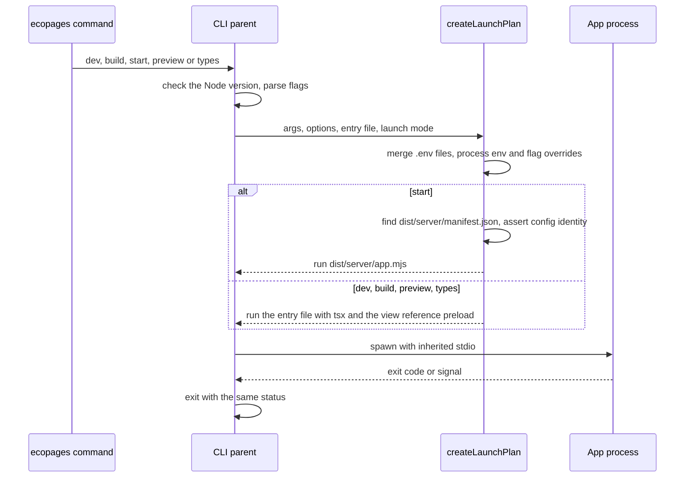
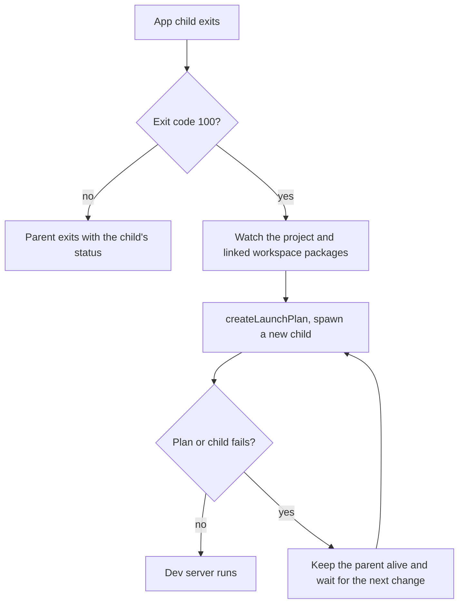

# CLI

`ecopages` is a launcher. It parses a command, decides what process to run, and spawns it; the app process, not the CLI, loads the config, builds and serves. This page covers that hand-off. What each command does once the app runs is in [Build pipeline](/dev/build-pipeline), [Ledger and start](/dev/ledger-and-start) and [Dev server](/dev/dev-server). `init` copies a project template and takes no part in this flow.

## The narrow core entry

The CLI parent process imports `@ecopages/core/cli` and nothing else from core. That entry (`packages/core/src/cli.ts`) re-exports only what planning needs: the dev restart constants, the entry command flags, the env helpers, the config path resolvers and the deploy manifest readers. Why: the `build` and `config` barrels load the bundler, and the parent only plans a launch and waits, so a command should not pay for it twice. `scripts/check-portability.ts` places `cli.ts` in the application layer like the other root entries. A new import in the parent that reaches the `build` or `config` barrel defeats the entry; add what planning needs to `cli.ts` instead.

## From command to process

`createLaunchPlan()` returns the command, arguments and environment:

| Command | Entry argument | Process |
| --- | --- | --- |
| `dev`, `dev:watch` | `--dev` | `app.ts` (or `--entry-file`) through tsx and the preloads; `dev:watch` adds the runtime's `--watch` |
| `build` | `--build` | the same entry; `--keep-going` is forwarded |
| `preview` | `--preview` | the same entry; `--serve-only` skips the rebuild |
| `types` | none | `@ecopages/core/config/write-types`, which loads the config so Processors write their types, then exits |
| `start` | none | `dist/server/app.mjs` of the one build directory, or `--dist-dir`; no source is loaded |

The runtime is Node unless the command came through Bun (`bun dev`, `bunx ecopages`, the Bun user agent), the CLI itself runs on Bun, or `--runtime bun` says so. Node runs the entry with `--import` preloads: `node-require-preload.js` defines a global `require`, tsx compiles TypeScript, and `view-reference-preload.js` loads the user config to learn which Integrations own view modules, so an imported view resolves to its View Reference. Bun gets `run --preload` for the view reference preload alone.

The environment is `.env`, `.env.local`, `.env.<NODE_ENV>` and `.env.<NODE_ENV>.local`, then the parent's own environment, then the overrides the flags set (`ECOPAGES_PORT`, `ECOPAGES_HOSTNAME`, `ECOPAGES_BASE_URL`, `ECOPAGES_CONFIG_FILE`, `ECOPAGES_ENTRY_FILE`, `ECOPAGES_LOGGER_DEBUG`). `start` prefers the emitted `eco.config.mjs` the deploy manifest names unless `--config` or `ECOPAGES_CONFIG_FILE` is explicit, and `assertProductionConfigIdentity()` refuses a `dist/` whose config belongs to another project.

The parent forwards `SIGTERM` and `SIGINT` to the child so it can shut down and release its port, and exits with the child's code. A child ended by a signal exits `128` plus the signal number, so a build killed by the out-of-memory killer does not look like a pass.

## Development restarts

`dev` is the one command the parent supervises. A config or environment change cannot be applied in place, so the app process exits with `ECOPAGES_DEV_RESTART_EXIT_CODE` (100) and the parent launches a new child with `ECOPAGES_DEV_RESTART_REASON` set for its startup log.

The watch starts before the new child, so a fix saved while it loads relaunches at once; a restarted child that exits with an error leaves the parent waiting for the next change instead of ending the session. `resolveDevelopmentRecoveryWatch()` lists what is watched: the project root and every linked workspace package, skipping dependencies, VCS metadata and the default work and build directories as the Project Watcher does. Under `dev:watch` the runtime's own `--watch` owns hard restarts and `ECOPAGES_ENTRY_WATCH` tells core not to exit a second time for the same config change.
