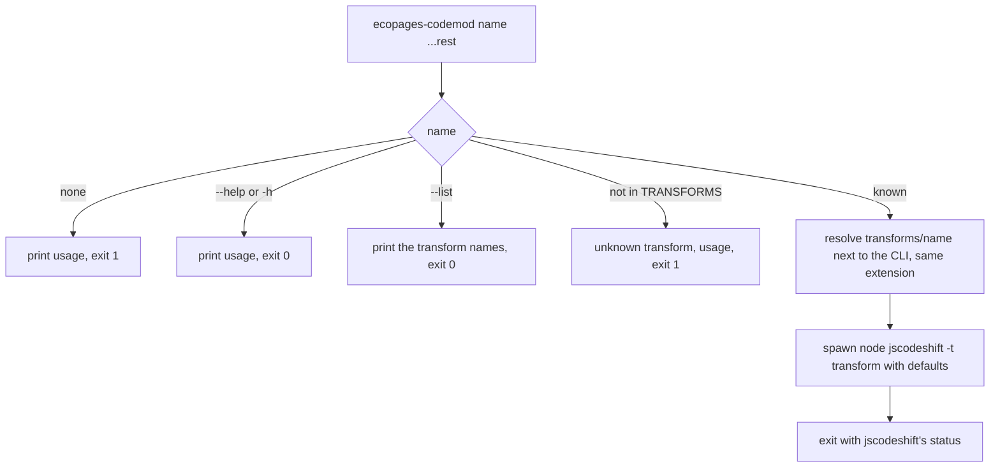

# Codemod

`@ecopages/codemod` migrates an application to the current Ecopages patterns. Each migration is a [jscodeshift](https://github.com/facebook/jscodeshift) transform; the package adds a small launcher so a user runs one without installing jscodeshift or cloning the repository. Users find the commands in the package README and in the upgrade steps of the public docs; this page is for people who write or change a transform. The package follows the release train of the other packages (it is in the `fixed` group of `.changeset/config.json`), so its version matches the `@ecopages/core` you upgrade to. It imports no Ecopages package, which is why the [path convention](/dev#paths) does not apply to it.

## The CLI

```bash
npx @ecopages/codemod <transform> [paths...] [jscodeshift options]
npx @ecopages/codemod --list
```

`run()` in `src/cli.ts` is the whole launcher.



The defaults are `--parser tsx`, `--extensions=ts,tsx,js,jsx` and the path `src`; each applies only when the arguments do not already give a `--parser`, an `--extensions`, or any non-flag path. Everything else is passed to jscodeshift, so `--dry --print` previews and `--silent` quiets it. The transform file keeps the CLI's own extension, so the same code runs from the published `.js` and from the `.ts` sources. A transform name must be a key of the `TRANSFORMS` map, which also supplies the `--list` descriptions and the usage text, so a new transform is registered there. `AFTER_RUN_NOTES` holds a note printed after a transform's run for a breaking change it cannot see in the source; `migrate-radiant-refs` uses it for the scoping of `data-ref` parts. `migrate-middleware-locals` instead prints a migration brief built from its reports.

The `package.json` also defines one `transform:*` script per transform for running from a checkout, and `exports` entries so each transform is importable by its name. The `bin` points at `src/cli.js`, which exists in the published package because `scripts/build-npm-packages.ts` transpiles the `.ts` sources.

## How a transform is built

A transform is a module in `src/transforms/` whose default export is a jscodeshift `transformer(file, api, options)`. It returns the new source, or `null` for a file it did not change, which jscodeshift counts as skipped. Each transform exports `parser = 'tsx'`.

- **Print through `printOptions(source)`** (`print-options.ts`): single quotes, tabs, and the source's own line ending, because Recast otherwise ends reprinted lines with the host's. `migrate-data-hooks.ts` keeps a private copy of the same options with a comment to keep it in step; it has no relative imports, so jscodeshift can run that one file from a URL, as the public upgrade steps do. The raw output indents rewritten lines with extra tabs, so users are told to format afterwards.
- **Or splice the source text.** `migrate-radiant-bindings.ts` and `migrate-radiant-refs.ts` do not reprint through Recast. Adding a type argument to a class's `extends` changes the class node, and Recast then reprints the whole class, re-indenting it and dropping whitespace in JSX text, which changes what renders. They record each change as a replacement between two offsets of the original source and apply them to the text, so every other character stays as written. The helpers live in `source-edits.ts`: offsets come from the node's line and column, since Recast's own offsets drift on tab-indented and CRLF files, and `parseOptions()` returns a new options object for each parse, because jscodeshift writes its parser into the object it is given.
- **Leave what cannot be rewritten safely, and say so.** The transforms call `api.report` (or `console.warn`) for a node they skip, so the old API keeps failing loudly instead of being half-migrated.
- **Be idempotent.** A file already on the new API returns `null`.

## Tests and fixtures

Each transform has a `*.test.ts` beside it in the `shared-core` Vitest project (`packages/codemod/**/*.test.ts`; see [Testing](/dev/testing)). A test runs the transform on a source string with `jscodeshift.withParser('tsx')`, formats the result with Prettier, and compares it to a file.

| Part | Role |
| --- | --- |
| `__fixtures__/<transform>/<name>.input.tsx` | The source before the migration. |
| `__fixtures__/<transform>/<name>.output.tsx` | The expected result. An input with no output file is a case that must return `null`: `already-migrated`, `unsupported`, `unresolvable`. |
| Inline sources | Used where a fixture would hide the point, such as line endings (`\r\n` input must stay `\r\n`). |

A transform that reports a skipped node asserts the report with a spy on `report`. Six transforms have a fixture folder; `migrate-core-entrypoints` tests with inline sources.

## The transforms

| Transform | Migrates |
| --- | --- |
| `migrate-data-hooks` | `staticProps` and `staticPaths` of `eco.page()` to `props` and `paths`, dropping the `{ props }` and `{ paths }` envelopes. It also renames the `GetStaticProps`, `GetStaticPaths` and `StaticPath` types imported from `@ecopages/*` to `GetProps`, `GetPaths` and `PagePath`, and rewrites `pathname.params` reads to `params`. A hook it cannot resolve is left unchanged and reported; a return value it cannot see through becomes `(await value).props` and is reported. |
| `migrate-to-eco-page` | Module-level `getStaticProps`, `getStaticPaths` and `getMetadata` exports and `Page.config = {...}` assignments to one `export default eco.page({ ... })`. It unwraps the legacy `eco.staticProps()`-style wrappers, keeps a declaration that a `typeof` reference still names, and ends by running `migrate-data-hooks`, so a page lands on the current API in one run. A file it cannot turn into a literal `eco.page` call is left unchanged. |
| `migrate-to-eco-component` | `Component.config = {...}` assignments next to a component to `eco.component({ ...config, render })`, carrying the props type. It skips a component that already uses `eco.component`. |
| `migrate-middleware-locals` | `ctx.locals` assignments of a `FileRouteMiddleware` or `Middleware` declaration to `createMiddleware` and `next({ ... })`, when they are unconditional top-level statements before one `return next()`, and the `locals` a literal `cache: 'dynamic'` page reads in `render` to a new `props` hook. It reports the rest by kind: `EcoMiddleware<Context>` forms, assignments it cannot move, pages that declare `requires` or read `locals` in `render`, and each `interface RequestLocals` in a `declare module '@ecopages/core'` block, since the global interface is removed. Reports go to `api.report` and, when `ECOPAGES_CODEMOD_REPORT` names a file, to that file as JSON lines; the CLI prints them as a migration brief with the docs to read and a prompt for a coding agent. |
| `migrate-radiant-bindings` | `@ecopages/radiant` code across Radiant 0.10.0, which removed the `$name` companion bindings and the `bind` option. It finds the reactive members of each class (a `@prop`, `@state`, `@attr` or `@signal` field, as a decorator or a call on `Class.prototype`, and a `this.createReactiveProp` or `this.createReactiveField` member) and decides, as 0.9.0 did, which had a companion: `bind: true`, `bind: 'name'`, or `bind` omitted on a class whose chain of same-file bases reaches `RadiantElement`, `RadiantController` or `FormAssociatedElement` imported from `@ecopages/radiant`. It rewrites a read of that companion on the class's own `this` to `this.$.<member>`, removes literal `bind` options (and an optional options object left empty), removes a `declare` that typed the companion, and adds each rewritten member to the type argument of an `extends RadiantElement` or `extends RadiantController` in a TypeScript file, from the field's annotation (`WritableSignal<T>` gives `T`) or a literal initializer; a named type argument it cannot see is intersected with the new members. It reports, with the line, what it cannot decide: `ReactiveBindingOption` imports, `defineReactiveBinding` and `shouldAutoBindReactiveMembers`, computed `$` keys on `this`, a companion written, destructured or read outside its class, non-literal `bind` or options, a field that shadows the companion, an unknown member type, a read of a member that had no companion, and `$name` reads in a class whose base is in another file. |
| `migrate-radiant-refs` | `@ecopages/radiant` code across the ref/query split of Radiant 0.11.0, which removed the `@query` options object, `cache`, the options form of `createQuery` and `QueryConfig`. It rewrites a `query({ ... })` call, applied as a decorator or to `Class.prototype`, by the release notes' table with no field renames: `{ ref }` to `ref` (`refAll` with `all: true`), named only when the ref differs from the field name as Radiant derives a part name (`partNameOf`, a copy of Radiant's `toKebabCaseAttributeName`), and `{ selector }` to `query(selector)` or `queryAll(selector)`. `createQuery(host, { ref })` becomes `createQuery(host, '[data-ref="name"]')`, the selector the options form built, since it keeps the old unscoped lookup where `getRef` would not. `cache` is dropped, `cache: true` reported. New names are imported from the module that exports them, next to the one the file reads `query` or `createQuery` from (`TARGET_MODULES`), and `query` or `createQuery` is dropped once its uses outside the import, decorators included, are all rewritten. An argument that is not an object literal, or a name the file binds to one, is taken for the new selector form and left alone. It reports `QueryConfig`, options it cannot read, `getReactiveMember(...).set`, controller identifiers with `:`, string `ref` attributes in Radiant or `@ecopages/jsx` files, and `data-hydration-key` values without `:` in files that register controllers. |
| `migrate-core-entrypoints` | Deep imports and re-exports from `@ecopages/core/<subpath>` to the role-based entry (`client`, `build`, `integration`, `processor`, `config`, and a few others), by a subpath table in the file. It also rewrites `import.meta.resolve` and `require.resolve` of those subpaths. Before it rewrites a named import it parses the target entry in the core source it finds by walking up from the working directory to `packages/core/src` and checks the name is exported there; with no core source, or for a namespace, side-effect, wildcard or dynamic access it cannot verify, it leaves the specifier and warns. |

## When to add one

A breaking change with a mechanical migration ships a codemod in the same pull request as its changeset. Before 1.0 such a change is a `minor` bump and carries no alias or fallback, so the codemod is the migration path; see [AGENTS.md](https://github.com/ecopages/ecopages/blob/next/AGENTS.md). To add one:

1. Add `src/transforms/<name>.ts`, with a doc comment showing the before and after, and the `export default` transformer.
2. Add it to `TRANSFORMS` in `src/cli.ts`, a `transform:*` script and an `exports` entry in `package.json`, and a row in the package README with the version that adds it.
3. Add `<name>.test.ts` and fixtures, covering the migrated case, the already-migrated case and each case it skips.
4. Name the transform in the changeset and the upgrade notes, so the release notes of that version point to it.

A change that has no safe mechanical form (a rename that depends on runtime values, say) does not get a transform that guesses; write the manual steps in the upgrade docs instead.
