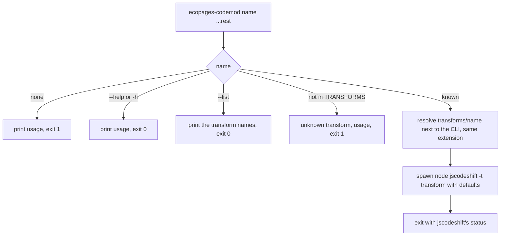

# Codemod

`@ecopages/codemod` migrates an application to the current Ecopages patterns. Each migration is a [jscodeshift](https://github.com/facebook/jscodeshift) transform; the package adds a small launcher so a user runs one without installing jscodeshift or cloning the repository. Users find the commands in the package README and in the upgrade steps of the public docs; this page is for people who write or change a transform. The package follows the release train of the other packages (it is in the `fixed` group of `.changeset/config.json`), so its version matches the `@ecopages/core` you upgrade to. It imports no Ecopages package, which is why the [path convention](/dev#paths) does not apply to it.

## The CLI

```bash
npx @ecopages/codemod <transform> [paths...] [jscodeshift options]
npx @ecopages/codemod --list
```

`run()` in `src/cli.ts` is the whole launcher.



The defaults are `--parser tsx`, `--extensions=ts,tsx,js,jsx` and the path `src`; each applies only when the arguments do not already give a `--parser`, an `--extensions`, or any non-flag path. Everything else is passed to jscodeshift, so `--dry --print` previews and `--silent` quiets it. The transform file keeps the CLI's own extension, so the same code runs from the published `.js` and from the `.ts` sources. A transform name must be a key of the `TRANSFORMS` map, which also supplies the `--list` descriptions and the usage text, so a new transform is registered there.

The `package.json` also defines one `transform:*` script per transform for running from a checkout, and `exports` entries so each transform is importable by its name. The `bin` points at `src/cli.js`, which exists in the published package because `scripts/build-npm-packages.ts` transpiles the `.ts` sources.

## How a transform is built

A transform is a module in `src/transforms/` whose default export is a jscodeshift `transformer(file, api, options)`. It returns the new source, or `null` for a file it did not change, which jscodeshift counts as skipped. Each transform exports `parser = 'tsx'`.

- **Print through `printOptions(source)`** (`print-options.ts`): single quotes, tabs, and the source's own line ending, because Recast otherwise ends reprinted lines with the host's. `migrate-data-hooks.ts` keeps a private copy of the same options with a comment to keep it in step; it has no relative imports, so jscodeshift can run that one file from a URL, as the public upgrade steps do. The raw output indents rewritten lines with extra tabs, so users are told to format afterwards.
- **Leave what cannot be rewritten safely, and say so.** The transforms call `api.report` (or `console.warn`) for a node they skip, so the old API keeps failing loudly instead of being half-migrated.
- **Be idempotent.** A file already on the new API returns `null`.

## Tests and fixtures

Each transform has a `*.test.ts` beside it in the `shared-core` Vitest project (`packages/codemod/**/*.test.ts`; see [Testing](/dev/testing)). A test runs the transform on a source string with `jscodeshift.withParser('tsx')`, formats the result with Prettier, and compares it to a file.

| Part | Role |
| --- | --- |
| `__fixtures__/<transform>/<name>.input.tsx` | The source before the migration. |
| `__fixtures__/<transform>/<name>.output.tsx` | The expected result. An input with no output file is a case that must return `null`: `already-migrated`, `unsupported`, `unresolvable`. |
| Inline sources | Used where a fixture would hide the point, such as line endings (`\r\n` input must stay `\r\n`). |

A transform that reports a skipped node asserts the report with a spy on `report`. Three transforms have a fixture folder; `migrate-core-entrypoints` tests with inline sources.

## The transforms

| Transform | Migrates |
| --- | --- |
| `migrate-data-hooks` | `staticProps` and `staticPaths` of `eco.page()` to `props` and `paths`, dropping the `{ props }` and `{ paths }` envelopes. It also renames the `GetStaticProps`, `GetStaticPaths` and `StaticPath` types imported from `@ecopages/*` to `GetProps`, `GetPaths` and `PagePath`, and rewrites `pathname.params` reads to `params`. A hook it cannot resolve is left unchanged and reported; a return value it cannot see through becomes `(await value).props` and is reported. |
| `migrate-to-eco-page` | Module-level `getStaticProps`, `getStaticPaths` and `getMetadata` exports and `Page.config = {...}` assignments to one `export default eco.page({ ... })`. It unwraps the legacy `eco.staticProps()`-style wrappers, keeps a declaration that a `typeof` reference still names, and ends by running `migrate-data-hooks`, so a page lands on the current API in one run. A file it cannot turn into a literal `eco.page` call is left unchanged. |
| `migrate-to-eco-component` | `Component.config = {...}` assignments next to a component to `eco.component({ ...config, render })`, carrying the props type. It skips a component that already uses `eco.component`. |
| `migrate-core-entrypoints` | Deep imports and re-exports from `@ecopages/core/<subpath>` to the role-based entry (`client`, `build`, `integration`, `processor`, `config`, and a few others), by a subpath table in the file. It also rewrites `import.meta.resolve` and `require.resolve` of those subpaths. Before it rewrites a named import it parses the target entry in the core source it finds by walking up from the working directory to `packages/core/src` and checks the name is exported there; with no core source, or for a namespace, side-effect, wildcard or dynamic access it cannot verify, it leaves the specifier and warns. |

## When to add one

A breaking change with a mechanical migration ships a codemod in the same pull request as its changeset. Before 1.0 such a change is a `minor` bump and carries no alias or fallback, so the codemod is the migration path; see [AGENTS.md](https://github.com/ecopages/ecopages/blob/next/AGENTS.md). To add one:

1. Add `src/transforms/<name>.ts`, with a doc comment showing the before and after, and the `export default` transformer.
2. Add it to `TRANSFORMS` in `src/cli.ts`, a `transform:*` script and an `exports` entry in `package.json`, and a row in the package README with the version that adds it.
3. Add `<name>.test.ts` and fixtures, covering the migrated case, the already-migrated case and each case it skips.
4. Name the transform in the changeset and the upgrade notes, so the release notes of that version point to it.

A change that has no safe mechanical form (a rename that depends on runtime values, say) does not get a transform that guesses; write the manual steps in the upgrade docs instead.
