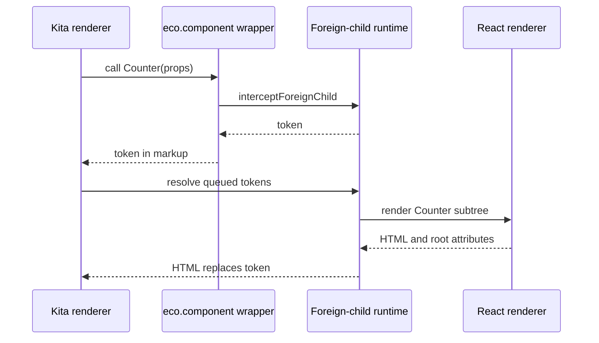
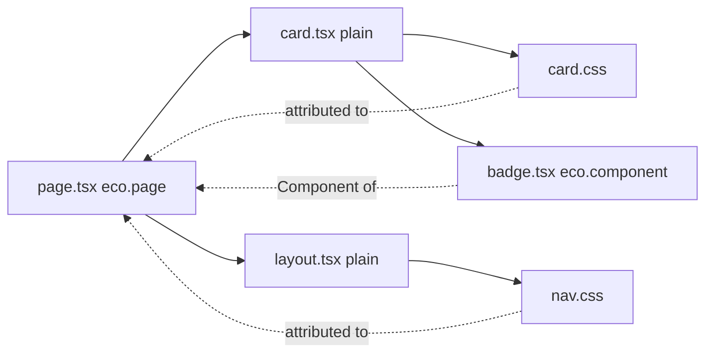
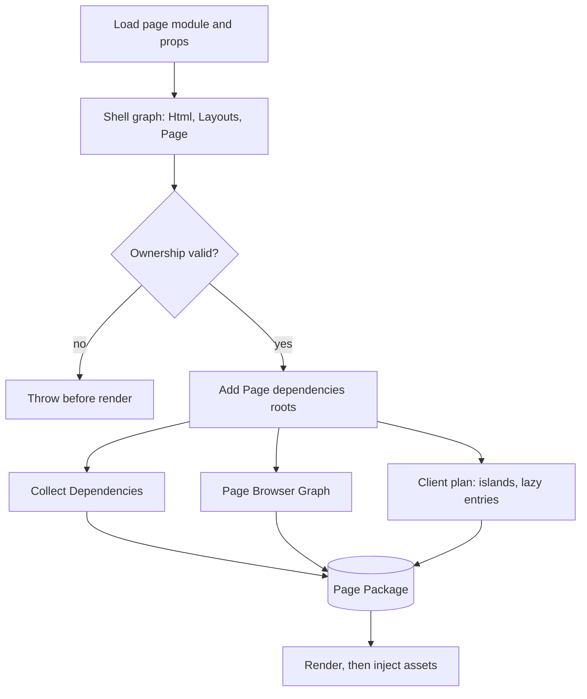

# Content, Processors and Integrations

Integrations turn Page files into HTML; Processors transform assets and generate modules. Between them sits route preparation, which walks the component graph of one Page, collects its Dependencies, plans its islands and builds the Page Package, all before the first Component renders. This page covers the two plugin contracts, the content processor, and how preparation discovers what a Page needs.

## Integrations

An Integration subclasses `IntegrationPlugin` ([`integration-plugin.ts`](https://github.com/ecopages/ecopages/blob/next/packages/core/src/plugins/integration-plugin.ts)). It declares data, and core decides when each hook runs.

| Member | Role |
| --- | --- |
| `name`, `extensions` | The file types it owns. `findIntegrationForFile` picks the Integration with the longest matching extension, so `.kita.tsx` beats `.tsx`. |
| `renderer` | The `IntegrationRenderer` class; `getRenderer()` caches one instance per runtime, shared by route renders, explicit views and Foreign Child handoffs. |
| `jsxImportSource` | The JSX runtime its files compile with; the identity transform prepends it as a pragma. |
| `integrationDependencies` | Global assets added to every Page the Integration takes part in. |
| `plugins(app)` | Build plugins, read once during config finalization. It must do no I/O. |
| `setup()` / `hmr()` / `teardown()` | Runtime activation, development behavior, and release. |
| `staticExport()` | Export-wide work before the first page renders, returning a release. |
| `serverDom`, `acceptsParams`, `bundlesPageDependencies` | Server DOM installer, whether Pages take Params, and whether core may bundle Page assets. |

Why `plugins(app)` is a pure read: config finalization seals one build manifest from every plugin before any runtime exists, so state belongs in `setup()` or in the plugin's own callbacks.

### SSR Policy and hydration

Each Integration owns its SSR Policy: how it renders on the server and what browser bootstrap that output needs. Ecopages JSX, for example, wraps renders in `EcopagesJsxRadiantSsrPolicy`, which loads Radiant's server runtime lazily and only when enabled. React composes the Page and Layouts into one tree and hydrates it with a page bootstrap. Lit prepends its `lit-hydrate-support` module script to its `integrationDependencies`. Why the policy is per Integration: one global browser runtime would ship every framework's bootstrap to every Page.

### Foreign Children and Foreign Subtrees

A Component's owner is `config.integration`, then the build-time `config.identity.integration`, then the inherited owner (`getComponentOwner`). When a declared Component is called during a render whose current Integration differs, the `eco.component()` wrapper asks the active foreign-child runtime to intercept it. The runtime either resolves it at once or, in the queue model, returns a token and records the Component and props. Before the renderer returns, `resolveQueuedForeignSubtreeTokens` asks the owning renderer for each Foreign Subtree and splices its HTML over the token.

Why tokens: a string renderer cannot render a React element inline, so it defers the subtree and keeps one pass per renderer. A route that still contains an unresolved `<eco-marker>` artifact fails in `executePrepared`; there is no route-level fallback.

Only a declared Component can be a Foreign Child. A plain function has no identity, so it renders inline in whatever Integration calls it. Discovery fails the build when a module renders a plain component of another Integration that compiles JSX with a different runtime, and suggests `eco.component()`. Lit, which leaves the runtime to the tsconfig, is not checked.

### Islands

An island is a graph edge where a Component's Integration differs from its parent's, excluding the Html shell. `collectPageClientPlanFromGraph` lists these as `islandEntries`, and `selectHydrationIslandEntries` gives each hydrating Integration only the islands it owns on a Page owned by another Integration; the page owner's own tree is hydrated by its page bootstrap. The page owner asks every other island-hydrating Integration on the plan for its grouped client build, so a React island on a Kita Page still gets a hydration script.

At render, a resolved Foreign Subtree carries a component instance id. `finalizeIslandComponentRender` stamps the root as an Island Host (`data-eco-island`, `data-eco-island-integration`, `data-eco-component-id`) when the result has one root element and the Component's own Dependencies, excluding Foreign Children, include a script. React stamps through `buildIslandHostAttributes`, adds `data-eco-component-key` and base64 `data-eco-props`, and wraps the root in `<eco-island style="display:contents">`. Why one attribute set: devtools and client runtimes find islands without Integration-specific selectors.

See [/dev/browser-graph](/dev/browser-graph) for how island and lazy entries become browser builds.

## Processors

A Processor subclasses `Processor` ([`processor.ts`](https://github.com/ecopages/ecopages/blob/next/packages/core/src/plugins/processor.ts)) and owns asset semantics, not rendering.

| Member | Role |
| --- | --- |
| `capabilities` | Asset kinds (`script`, `stylesheet`, `image`) and extension patterns, with an optional filename filter. They declare ownership. |
| `watch` | Paths and extensions that select changes; `onChanges` runs once per debounced batch. |
| `plugins(app)` | Build plugins, read once at finalization, like an Integration's. |
| `setup()` | Generates files, loads configuration, warms caches. |
| `transformStylesheet(css, file)` | Called for each stylesheet matching a `stylesheet` capability, in registration order, each Processor receiving the previous output. |
| `listProductionServerModuleEntries()` / `restoreProductionRuntime()` | Server modules for `server-modules.json`, and the restore that production `ecopages start` calls instead of `setup()`. |

Why capabilities are separate from watch extensions: a Processor may want change notifications for files it does not own, and ownership decides whether development invalidation skips server modules and HMR for an asset. See [/dev/plugin-pipeline](/dev/plugin-pipeline) for how plugins join the build.

### The content processor

`@ecopages/content-processor` scans configured collection directories, validates frontmatter with a Standard Schema validator, and generates modules under the work directory's cache. Its `ecopages:content` build plugin resolves three virtual specifiers per collection:

- `ecopages:content/<collection>`: entries and metadata, cheap to load during route preparation.
- `ecopages:content/<collection>/server`: `getComponent` and `getEntryDependencies(slug)`, which returns the entry's MDX Component as a page dependency root.
- `ecopages:content/<collection>/component`: a lazy loader; the server graph resolves it to the server module, the browser graph to a browser module.

Why `getEntryDependencies` returns a Component rather than asset paths: preparation collects the entry's assets from its identity like any other Component, so content needs no separate asset path. An entry rendered inside another Integration hands off through the foreign-child runtime when one is installed, and otherwise fails with an ownership error (`invokeContentEntry`).

## How rendering finds what a Page needs

### Build time: identity and discovery

The `eco-component-identity-attribution` plugin runs on every build request. For a module that calls `eco.page()`, `eco.layout()`, `eco.html()` or `eco.component()`, it wraps the factory options with `bindComponentIdentity()` and runs `discoverComponentImports`:

- Static named or default imports of local Eco Components become deferred Component references; named `export { X } from` barrels are followed for the imported binding.
- Relative and aliased side-effect CSS imports become inferred stylesheets and are removed from the output, so the asset pipeline owns CSS delivery.
- Plain local modules (no `eco.*()` call) are walked through their static imports, stopping at Eco modules, packages and `.server` modules. Their side-effect CSS and the Eco Components they import are attributed to the declaration that imports them.
- Every imported Eco module, barrel hop and walked plain module is a watch file.

`export *`, namespace imports, dynamic imports and package CSS are not followed. A plain module's side-effect CSS import that no declaration reaches fails the build in `onEnd`, as does a CSS Module or a package stylesheet in a module discovery reaches.

Why plain components attach to the nearest declared owner: a plain function has no config to carry Dependencies, and the nearest declaration is the first module whose assets route preparation already collects. Discovery is module-scoped, so every declaration in one file shares its discovered imports even when a render branch omits one.

At runtime, `attachDiscoveredDependencies` turns `config.dependencies.components` into a getter that merges explicit Components with discovered ones, keeping only declared Components. Inferred stylesheets stay on the identity, not in the public bag. Why: copying or merging `dependencies` cannot turn an inferred stylesheet into an explicit one, and collection can let explicit declarations win by resolved path.

### Layouts

`eco.page({ layout })` normalizes one Layout or an outer-to-inner array into `config.layouts`. `mergeLayoutDependencies` adds only `eco.layout()` results to `dependencies.components`; a plain Layout function carries no config, so it is composed but not a graph node, and its imports reach the Page through plain-module discovery. Use `eco.layout()` only when a Layout needs browser scripts, `modules`, stylesheet attributes, an `integration` override or rendering by another Integration.

### Route preparation builds the Page Package

`RouteRenderOrchestrator.prepareRenderOptions()` runs before any Component renders:

1. `prepareRouteShellGraph` builds a `PreparedComponentGraph` from the Html shell, Layouts and Page, following `config.dependencies.components` (explicit and discovered). Each node records its owner, identity file and own assets.
2. `OwnershipValidationService` rejects a Foreign Child without identity or with an unregistered owner.
3. The Page's `dependencies` function (for example `getEntryDependencies`) adds request-time roots to the same graph.
4. Dependency collection, the Page Browser Graph, the page client plan, Integration runtimes and lazy-trigger injectors produce the asset list that becomes the Page Package.

Only nodes with an identity file, under parents that also have one, take part in dependency collection. Why the Page Package is fixed before render: island builds, the Page Browser Graph and cache watch paths all need the asset set up front, and a package that rendering could grow would depend on which branches and Integrations happened to run. Renders return HTML and root attributes only, and the HTML transform injects the prepared package.

The graph has a guard. In development, `assertComponentInPreparedGraph` fails a render of a Component with `dependencies` and an identity file that preparation never reached, naming the file. Production does not check, so such a Component renders without its assets.

Production builds run the same preparation in two steps: planning collects bundleable scripts without processing them, and processing runs after the app-wide browser build. See [/dev/build-and-start](/dev/build-and-start). Development invalidation of prepared graphs and cached HTML is covered in [/dev/hmr-and-navigation](/dev/hmr-and-navigation).
