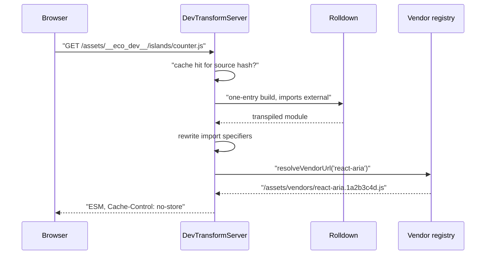
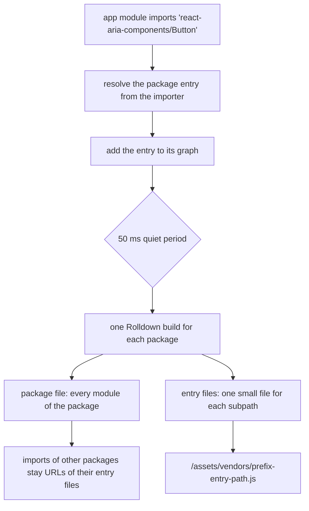

# Dev server

In `ecopages dev` every browser module has exactly one URL, and nothing compiles until the browser asks for it. The dev transform server compiles each source module on request and serves it at a URL derived from its path, while bare package imports go to a prebundled vendor graph. Production reaches the same rule by emitting hashed chunks once per app; see [Build pipeline](/dev/build-pipeline).

The rule exists because browsers key ES modules by URL: two URLs for one file are two module instances.

## The transform server

`DevTransformServer` (`dev/transform-server/dev-transform-server.ts`) serves browser ESM on demand during `ecopages dev`. The HMR manager owns one instance and registers into it every module that needs a browser URL: page and island modules an Integration hydrates (React calls `registerEntrypoint`), and every bundled file script, which the file-script processor sends to the HMR manager instead of bundling while HMR is on.

Registration only computes a URL; nothing compiles until the browser asks for it.

### URL shape

| Source location | URL |
| --- | --- |
| Under `srcDir` | `/assets/__eco_dev__/<path relative to srcDir>.js` |
| In a linked workspace package | `/assets/__eco_dev__/@fs/<absolute path>.js` |
| A stylesheet imported from a module | the same shapes, keeping `.css` |

The `.ts`, `.tsx`, `.jsx`, `.mdx` and `.md` extensions become `.js`, and path segments are URL-encoded. To resolve a request, the server first checks its registered URLs, then decodes the path and tries the source extensions in order (`.tsx`, `.ts`, `.jsx`, `.js`, `.mdx`, `.md`). This lazy lookup serves page modules that client-side navigation requests before any server render registered them. A path that leaves `srcDir` and the workspace package roots never resolves.

The `@fs` form lets an island outside the app folder, such as one from a linked workspace package, still hydrate.

### Compiling one module



`DevTransformBundler` runs a Rolldown build with a single entry on the `hmr` lane. The `ecopages-dev-transform-externalize-imports` plugin marks every import external, so only the requested file is compiled; a specifier with a scheme, such as `ecopages:images`, stays internal so its virtual-module plugin can inline it. The files the build inlined, including those a plugin declared with `addWatchFile`, join the module's dependencies, so an edit to one recompiles the module. The Integration that claims the module through its `DevTransformBundleContributor` adds its own plugins, for example a client-graph boundary or the MDX loader. A request can carry an `eco-variant` query (`ownsModule(path, variant)`, `getModulePlugins(path, variant)`): the server compiles and caches that form of the file apart from the plain one, and an import rewrite keeps the query on the module's URL. React uses it to give a module that other graphs share its own boundary form ([Islands and hydration](/dev/islands-hydration#foreign-subtrees-in-a-hydrated-tree)).

The server keeps one cache entry per source file, keyed by the file's content hash, and one in-flight compile per source. A result is committed only if the source did not change or get invalidated while it compiled; otherwise the request compiles again. A failed compile of a source that changed meanwhile is retried the same way, so its error is neither returned nor reported. A stylesheet a module imports with a binding is not bundled: `compileStylesheetModule` runs the app's stylesheet Processor and answers `export default "<processed css>"`, the same module server builds and browser bundles give the import.

A failed compile reports the error to the HMR manager, which shows it in the page. A module that compiled before, a script or a stylesheet whose Processor throws, answers with its last compiled module instead, so the importer keeps loading and the page keeps its behaviour while the error shows, and the next save that compiles replaces it. A module that never compiled, or whose source was deleted, answers `500` with the error text. The server exists only in `ecopages dev`, so it applies the rule of `keepsLastGoodOutput` ([Asset processing](/dev/asset-processing#a-broken-asset-in-development)) without asking it. The server builds of a Page request (and browser bundles) behave the same in development: `compileModule` of the build request falls back to `DevelopmentStylesheetService.lastGoodModule`, the class map or CSS of the last good output, or an empty module when the stylesheet never compiled, and reports the error; a production build rethrows. The stylesheet failures the development stylesheet service holds are sent after the updates of every HMR batch and replayed to a browser that connects, so a later update does not clear the overlay. See [HMR client](/dev/hmr-client) for how errors and updates reach the browser.

### Import rewriting

`rewriteModuleImports` parses the compiled module and rewrites each static import, re-export and literal `import()` specifier, checking in this order:

1. A `node:` builtin fails the module with an error that points at the importer's browser exports or client-graph boundary.
2. A relative or absolute path, or a tsconfig path alias, becomes the target's transform URL plus `?v=<content hash>`. A stylesheet's version is a hash of the output the development stylesheet service last produced for it, or of its source when the service has none, so it changes when an `@import` partial does.
3. Any other bare specifier, React included, goes to the vendor registry, which resolves it from the importing module's directory.

A vendor entry whose own module is CommonJS, such as `react` or `react-dom/client`, is served with `module.exports` as its default export and no named exports, because that is what Rolldown emits for it. The registry reports which entries are CommonJS (Rolldown's `inputFormat`, recorded by the build), and the rewriter turns a named import of one into a default import plus a destructuring, the way Node reads CommonJS from ESM:

```js
import { useState, version as reactVersion } from 'react';
// becomes
import __eco_cjs_0 from '/assets/vendors/react.1a2b3c4d.js'; const { useState, version: reactVersion } = __eco_cjs_0;
```

The interop matches the one the production build applies (Rolldown's `__toESM` outside Node mode), so a module behaves the same in both: named imports read `module.exports`; `default`, `default as` and a namespace's `default` are `module.exports.default` when the module sets `__esModule`, otherwise `module.exports` itself; a namespace holds the properties plus that `default`; `import()` resolves to the same namespace; and `export { name } from` re-exports the property. The names are read once, when the importer evaluates; CommonJS has no live bindings. `export * from` a CommonJS vendor cannot list names, so it re-exports nothing and logs a warning naming the module. No export names are read from the package at build time.

The same rewrite runs on unbundled module content scripts while HMR is on: the content-script processor passes their source through the HMR manager's `rewriteModuleImports` before it writes the file, so a generated bootstrap such as React's Page entry can import `react` and the router by package name. An inline module script embeds the rewritten source.

The `?v=` query makes the browser treat an edited dependency as a new module, so a soft HMR update picks up changed layouts and components without a full reload. The pathname itself never changes, so a module keeps one identity per content version. Relative module `Worker` and `SharedWorker` URLs (`new Worker(new URL('./x.ts', import.meta.url), { type: 'module' })`) are rewritten the same way, and the worker is served like any other module; the one-module build sets `workerEntries: false` so it does not emit its own worker chunk. A classic worker, or a relative URL that does not resolve or carries a query, fails the module with the same error as a production build. Any other Worker URL, such as a `new URL()` held in a variable, is left as written with a warning naming the file. Every resolved local import is reported back to the HMR manager as a dependency of the module, which drives invalidation.

## The vendor graph

Bare package imports are not compiled one by one. `DevTransformVendorRegistry` prebundles them into process-local files under `/assets/vendors/`, one file for each package.



A bare specifier resolves from the directory of the module that imports it, as Node and the production build resolve it. A dependency that only an integration package declares, such as `@lit-labs/ssr-client` for `@ecopages/lit`, therefore resolves under pnpm's strict layout, where the app root cannot see it. The entry is the file the specifier resolves to: importers that reach the same file share one entry and one URL, so React stays one module, and two installed versions of one package become two entries with two URLs. The registry warns when a package resolves to more than one installed copy, naming each copy and the directories of its importers, so an accidental second React is visible before it fails at runtime.

### One file for each package

The first import from a package builds the whole package, not the module that was imported. The build has one entry for each script in the package's `exports` field that a browser build reaches (the `browser`, `module`, `import` and `default` conditions, wildcard subpaths expanded) and for each file an app imports, and it puts every module of those entries into one chunk named after the package, `<prefix>-<package path>~package.js`. Rolldown writes a small file for each entry that re-exports that entry's own exports from the chunk: `export { a as b } from "./<prefix>-<package path>~package.js"`. An import of a subpath of a package the page already holds therefore adds one small file and changes no file the browser has. Importing a new package adds that package's files and changes none of the others. A package file changes only when the package on disk changes.

A package's file holds that package and no other. An import of another package, such as `radiant-ui` importing `radiant` and `signals`, stays an import of that package's entry file by its URL, so the package loads once with one copy of its module state, and the registry builds the imported package in the same pass. The packages that resolve with different conditions, the browser-first `@ecopages/core` and everything else, are two graphs with their own prefix (`bf-` and `mf-`). An import of `@ecopages/core` from a module-first package is the URL of core's browser-first entry.

Some of what the build does keeps this working:

- **CommonJS dependencies.** An ES module that imports a CommonJS package by name reads it from the package's default export, as an app module does. A CommonJS module cannot import, so its `require('package')` goes through a small virtual module that imports the package's entry file. The imports a JSX transform adds, such as `react/jsx-runtime`, go through the same virtual module. A CommonJS module of a package runs when something requires it, not when the package file loads; the other package that its `require()` names is imported when the package file loads, since the virtual module imports it statically, so a `require()` of another package that fails or is optional is not deferred.
- **Modules that run code when they load.** The package file runs every module in it when it loads, so a subpath whose module (or one it imports from its own package) has a statement that is not a declaration, or an initializer that opens a socket, reads the page or sets a global, does not go into it. The modules that only such subpaths reach are written to a second chunk, `<prefix>-<package path>~effects.js`, that only those subpaths' files import, so the code runs when a page imports one of those subpaths and not before (the chunk is shared, so importing one runs the code of the others), and an import of the subpath later adds no file and changes none.
- **Modules that import a Node builtin.** A subpath whose module, or one it imports from its package, imports a Node builtin would stop the package file from loading, so it stays out of the surface. It is served only when an import asks for it, and then the package file changes once.
- **Subpaths a browser cannot load.** When the whole surface does not build clean, or imports packages nothing has built, each subpath is built alone with its imports inline, and the ones that fail, such as a command line entry that imports Node builtins, stay out of the surface.
- **Imports of other packages that nothing uses.** An import of another package is kept in a package file only when a module uses one of its bindings or imports it for what it does (`import 'package'`), so a server-only package that only code the app never reaches imports is not loaded. A bundle that inlined the package would have dropped it the same way.
- **Packages that ship JSX source.** Which JSX runtime compiles a JSX file depends on its extension, its pragma and the plugins of the build, and React's client-graph boundary reads which entries reach which modules, so the packages that ship JSX source (workspace packages) are built together in one build that keeps one file for each module, named after its path, and leaves the other packages out of its files. A plugin emits each of those modules as a chunk with a strict signature (the public `emitFile`), so a file holds all of its exports whichever entries exist. The output of the boundary plugin depends on which entries the build has, so a file of these packages can still change as entries arrive.
- **Packages without an `exports` field.** Their surface is the files an app imports, so a later import of another file of the package adds it to the package file and changes the package file once. Pages that loaded it reload.
- **Packages above the module limit.** A package with more than `VENDOR_PACKAGE_BUNDLE_MAX_MODULES` JavaScript files (1,000) is built like a package that ships JSX source: one file for each module the app's imports reach, named after the module's path, with no surface. A page then loads the modules it uses, a later import of another module of the package can change a file of the package, and a CommonJS module of the package runs when its file loads rather than when it is required. The number comes from measuring packages of the pnpm store on an Apple M4 (cold build, then the files a page that imports the package loads):

| Package | JS files | One package file | One file per module |
| --- | --- | --- | --- |
| lit | 77 | 194 ms, 8 files, 15 KB gzip | 66 ms, 6 files, 7 KB gzip |
| zod | 248 | 179 ms, 2 files, 125 KB gzip | 87 ms, 96 files, 134 KB gzip |
| react-stately | 672 | 272 ms, 12 files, 137 KB gzip | 138 ms, 187 files, 142 KB gzip |
| drizzle-orm | 888 | 531 ms, 4 files, 38 KB gzip | 66 ms, 23 files, 12 KB gzip |
| react-aria | 3,349 | 1,009 ms, 29 files, 1,007 KB gzip | 278 ms, 946 files, 364 KB gzip |

Up to about 900 files the package file is one to four files and costs at most a second to build; at 3,349 files the file is five megabytes and the per-module build loads a third of the bytes, so the limit sits between them.

### Names and requests

A file is named after its module's path relative to the filesystem root, with each folder joined by `+`, its extension kept, and a prefix for its graph. Any character other than a letter, digit or one of `._@=,-` is written `~<hex>~`, `+` and `~` included, so two paths never share a name and a name is safe in a URL and an import specifier without escaping. A path too long for a file name becomes a digest of the path followed by its last part. An entry's URL is the URL of the file of its module, so it stays the same across rebuilds and the app modules that embed it stay valid.

On ecoshop's cart page, with a cold cache, the package files and their entry files are 21 requests, 1.15 MB raw and 283 KB gzipped, against 15 requests, 0.54 MB and 141 KB for the code-split build this replaces. A reload that revalidates every file takes 69 to 152 ms on localhost, 200 ms with 20 ms of added latency and 450 ms with 50 ms, against 30 ms, 175 ms and 384 ms.

### Rules

A rebuild should not change a file the browser already loaded. A dev-transform contributor declares the bare specifiers its generated modules import (`getVendorEntries`), with a directory inside its own package (`resolveFrom`), and they join the graph before its first build, so a package whose surface is only the files imported has them all in its first build.

| Behavior | Rule |
| --- | --- |
| File URL | `/assets/vendors/<graph prefix>-<module path>.js` for every entry, the path encoded as above; stable across rebuilds, so URLs already embedded in served modules stay valid |
| Batching | a new entry schedules a rebuild after a 50 ms quiet period, so the bare imports of one page load share one build; the import rewriter resolves a module's specifiers at once, so its new bare imports join one build. A package's build is kept until the next invalidation, so a rebuild builds only the packages it adds |
| Storage | outputs stay in process memory; nothing is written under `dist` |
| Seeding | every known specifier and directory pair that reached an entry, failing ones included, is written to `dev-vendor-entries.json` in the work directory; the next process seeds from it and builds the full graph on its first request instead of rebuilding and reloading |
| Failures | a failed graph build retries entry by entry; entries that fail alone answer `500` with the prebundle error and the rest build without them. A graph that fails as a whole, with no single failing entry or a thrown error, logs the error and keeps serving each entry's last good output; an entry without one answers `500` and is retried by a request made 2 s or more later |
| Installs | a change to a lockfile or install manifest (such as `node_modules/.modules.yaml`) of the app or of the nearest ancestor with a lockfile, checked on asset requests at most once per 300 ms, invalidates compiled modules and vendor graphs and resolves each specifier again from every directory that reached its entry, dropping directories that no longer exist, so an install during the session takes effect without a restart; until the rebuild commits, files are served from the previous build |
| Changes | when a rebuild changes or drops a file a browser already received, which happens when a package on disk changes or when a package without an `exports` field gains a file, the HMR manager broadcasts `vendor-change` with the URLs. A page reloads only if it loaded one of them, known from its resource timing entries (the HMR client is the first script of the page, so its `PerformanceObserver` sees every load, which the 250-entry buffer would not keep), since mixing old and new files could load a module twice; other pages carry on. A page first settles a navigation in flight, whose files have no entry until they finish. A page that cannot see its resource timing reloads on any change |
| Caching | responses carry `Cache-Control: no-cache` and a content `ETag`, so the browser revalidates and gets `304` while the content holds |

Vendor builds leave out the app's build plugins and run the externalization plugin above plus the vendor plugins contributors supply, such as React's client-graph boundary. Like every browser build they replace `process.env.NODE_ENV` with the current Node environment, so React's CommonJS entry picks its development build and the other build file is dropped.
