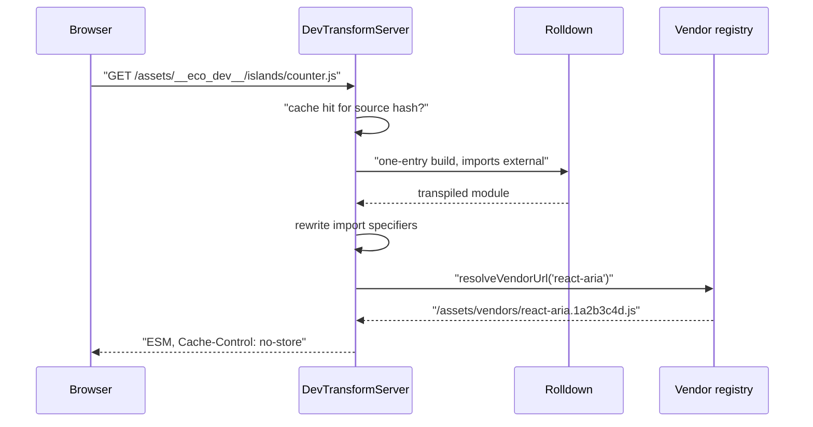
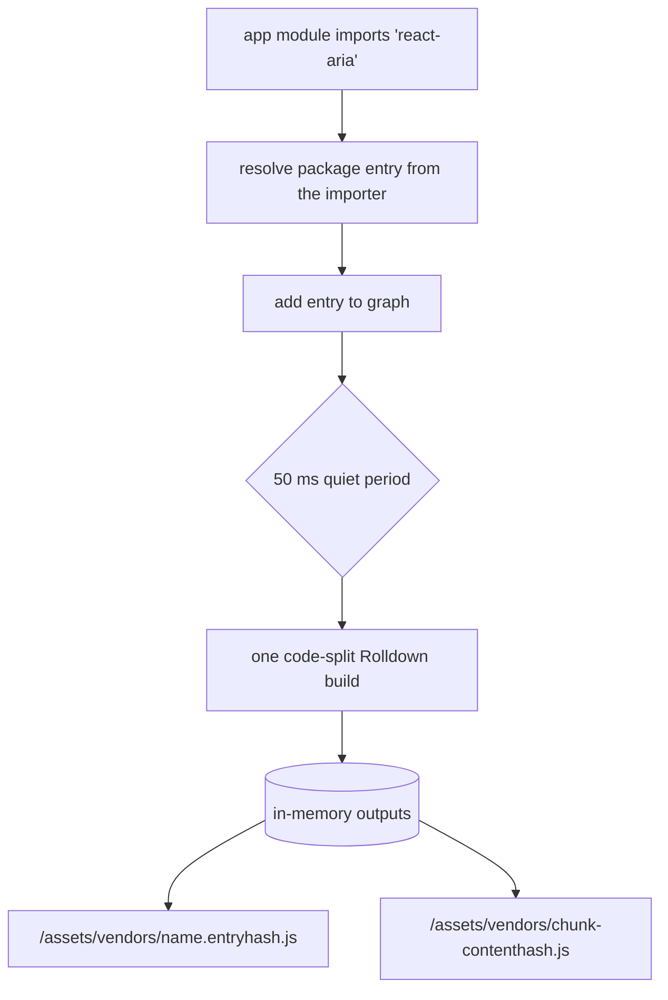

# Dev server

In `ecopages dev` every browser module has exactly one URL, and nothing compiles until the browser asks for it. The dev transform server compiles each source module on request and serves it at a URL derived from its path, while bare package imports go to a prebundled vendor graph. Production reaches the same rule by emitting hashed chunks once per app; see [Build pipeline](/dev/build-pipeline).

The rule exists because browsers key ES modules by URL: two URLs for one file are two module instances.

## The transform server

`DevTransformServer` (`dev/transform-server/dev-transform-server.ts`) serves browser ESM on demand during `ecopages dev`. The HMR manager owns one instance and registers into it every module that needs a browser URL: page and island modules an Integration hydrates (React calls `registerEntrypoint`), and every bundled file script, which the file-script processor sends to the HMR manager instead of bundling while HMR is on.

Registration only computes a URL; nothing compiles until the browser asks for it.

### URL shape

| Source location | URL |
| --- | --- |
| Under `srcDir` | `/assets/__eco_dev__/<path relative to srcDir>.js` |
| In a linked workspace package | `/assets/__eco_dev__/@fs/<absolute path>.js` |
| A stylesheet imported from a module | the same shapes, keeping `.css` |

The `.ts`, `.tsx`, `.jsx`, `.mdx` and `.md` extensions become `.js`, and path segments are URL-encoded. To resolve a request, the server first checks its registered URLs, then decodes the path and tries the source extensions in order (`.tsx`, `.ts`, `.jsx`, `.js`, `.mdx`, `.md`). This lazy lookup serves page modules that client-side navigation requests before any server render registered them. A path that leaves `srcDir` and the workspace package roots never resolves.

The `@fs` form lets an island outside the app folder, such as one from a linked workspace package, still hydrate.

### Compiling one module



`DevTransformBundler` runs a Rolldown build with a single entry on the `hmr` lane. The `ecopages-dev-transform-externalize-imports` plugin marks every import external, so only the requested file is compiled; a specifier with a scheme, such as `ecopages:images`, stays internal so its virtual-module plugin can inline it. The files the build inlined, including those a plugin declared with `addWatchFile`, join the module's dependencies, so an edit to one recompiles the module. The Integration that claims the module through its `DevTransformBundleContributor` adds its own plugins, for example a client-graph boundary or the MDX loader.

The server keeps one cache entry per source file, keyed by the file's content hash, and one in-flight compile per source. A result is committed only if the source did not change or get invalidated while it compiled; otherwise the request compiles again. A stylesheet needs no build: it becomes `export default "<css>"`, since real stylesheet delivery goes through Dependencies.

A failed compile answers `500` with the error text and reports it to the HMR manager, which shows it in the page. See [HMR client](/dev/hmr-client) for how errors and updates reach the browser.

### Import rewriting

`rewriteModuleImports` parses the compiled module and rewrites each static import, re-export and literal `import()` specifier, checking in this order:

1. A `node:` builtin fails the module with an error that points at the importer's browser exports or client-graph boundary.
2. A relative or absolute path, or a tsconfig path alias, becomes the target's transform URL plus `?v=<content hash>`.
3. Any other bare specifier, React included, goes to the vendor registry, which resolves it from the importing module's directory.

A vendor entry whose own module is CommonJS, such as `react` or `react-dom/client`, is served with `module.exports` as its default export and no named exports, because that is what Rolldown emits for it. The registry reports which entries are CommonJS (Rolldown's `inputFormat`, recorded by the build), and the rewriter turns a named import of one into a default import plus a destructuring, the way Node reads CommonJS from ESM:

```js
import { useState, version as reactVersion } from 'react';
// becomes
import __eco_cjs_0 from '/assets/vendors/react.1a2b3c4d.js'; const { useState, version: reactVersion } = __eco_cjs_0;
```

The interop matches the one the production build applies (Rolldown's `__toESM` outside Node mode), so a module behaves the same in both: named imports read `module.exports`; `default`, `default as` and a namespace's `default` are `module.exports.default` when the module sets `__esModule`, otherwise `module.exports` itself; a namespace holds the properties plus that `default`; `import()` resolves to the same namespace; and `export { name } from` re-exports the property. The names are read once, when the importer evaluates; CommonJS has no live bindings. `export * from` a CommonJS vendor cannot list names, so it re-exports nothing and logs a warning naming the module. No export names are read from the package at build time.

The same rewrite runs on unbundled module content scripts while HMR is on: the content-script processor passes their source through the HMR manager's `rewriteModuleImports` before it writes the file, so a generated bootstrap such as React's Page entry can import `react` and the router by package name. An inline module script embeds the rewritten source.

The `?v=` query makes the browser treat an edited dependency as a new module, so a soft HMR update picks up changed layouts and components without a full reload. The pathname itself never changes, so a module keeps one identity per content version. Relative module `Worker` and `SharedWorker` URLs are rewritten the same way. Every resolved local import is reported back to the HMR manager as a dependency of the module, which drives invalidation.

## The vendor graph

Bare package imports are not compiled one by one. `DevTransformVendorRegistry` prebundles them into process-local files under `/assets/vendors/`.



A bare specifier resolves from the directory of the module that imports it, as Node and the production build resolve it. A dependency that only an integration package declares, such as `@lit-labs/ssr-client` for `@ecopages/lit`, therefore resolves under pnpm's strict layout, where the app root cannot see it. The entry is the file the specifier resolves to: importers that reach the same file share one entry and one URL, so React stays one module, and two installed versions of one package become two entries with two URLs. Inside the build, Rolldown resolves an entry's own imports from the entry's real path, so a package's transitive dependencies resolve where its install put them.

Every known dependency entry, meaning each package file a browser module imports by a bare specifier, is an entry of one code-split build per vendor graph. A module that two entries reach, such as a file shared by a package root and its subpath or a CommonJS module several packages `require()`, lands in one shared chunk that the entries import relatively. Inside one graph a module therefore has exactly one chunk.

There are two graphs because a build takes one list of resolve conditions: `@ecopages/core` resolves browser-first (`browser`, `module`, `import`, `default`) so its browser entry wins, and every other package resolves module-first. A module-first package's `@ecopages/core` imports point at core's browser-first entry URLs instead of being bundled, so core loads once; any other package both graphs reach loads once per graph.

A rebuild must not change a file the browser already loaded, or the page reloads. Two rules keep served files stable as packages arrive:

- A dev-transform contributor declares the bare specifiers its generated modules import (`getVendorEntries`), with a directory inside its own package (`resolveFrom`), and they join the graph before its first build. They resolve from that directory, so a dependency only the integration declares is in the first build. React declares `react`, its JSX runtimes, `react-dom`, `react-dom/client`, its bootstraps and the router.
- Each build has a pin entry that re-exports every Rolldown runtime helper and the namespace of every entry with no `import` or `export` statement. The shared runtime chunk then has the same content in every build, and a CommonJS entry exports its `require` function from the first build instead of from the build that adds a second importer.

| Behavior | Rule |
| --- | --- |
| Entry URL | `/assets/vendors/<specifier>.<hash of entry path>.js`, stable across rebuilds, so URLs already embedded in served modules stay valid |
| Chunk URL | `/assets/vendors/<name>-<content hash>.js` |
| Batching | a new entry schedules a rebuild after a 50 ms quiet period, so the bare imports of one page load share one build; the import rewriter resolves a module's specifiers at once, so its new bare imports join one build |
| Storage | outputs stay in process memory; nothing is written under `dist` |
| Seeding | every known specifier and directory pair that reached an entry, failing ones included, is written to `dev-vendor-entries.json` in the work directory; the next process seeds from it and builds the full graph on its first request instead of rebuilding and reloading |
| Failures | a failed graph build retries entry by entry; entries that fail alone answer `500` with the prebundle error and the rest build without them. A graph that fails as a whole, with no single failing entry or a thrown error, logs the error and keeps serving each entry's last good output; an entry without one answers `500` and is retried by a request made 2 s or more later |
| Installs | a change to a lockfile or install manifest (such as `node_modules/.modules.yaml`), checked on asset requests at most once per 300 ms, invalidates compiled modules and vendor graphs and resolves each specifier again from every directory that reached its entry, so an install during the session takes effect without a restart; until the rebuild commits, chunk URLs are served from the previous build |
| Changes | when a rebuild changes or drops a file a browser already received, from that build or an earlier one the rebuild kept it from, the HMR manager broadcasts `reload`, since mixing old and new chunks could load a module twice |
| Caching | responses carry `Cache-Control: no-cache` and a content `ETag`, so the browser revalidates and gets `304` while the content holds |

Vendor builds leave out the app's build plugins and run core's pin and `@ecopages/core` externalization plugins plus the vendor plugins contributors supply, such as React's client-graph boundary. Like every browser build they replace `process.env.NODE_ENV` with the current Node environment, so React's CommonJS entry picks its development build. React, React DOM and the React router are ordinary entries: React DOM's `require('react')` and the router's `react` import resolve to the same module as the `react` entry, one shared chunk.
