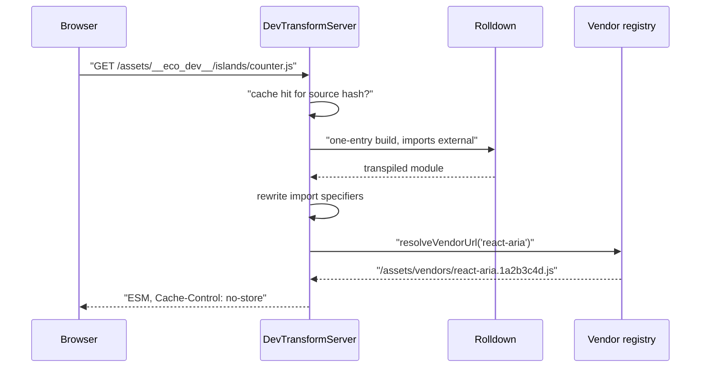
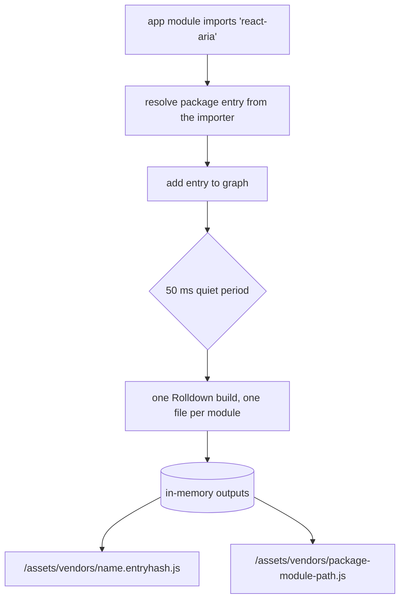

# Dev server

In `ecopages dev` every browser module has exactly one URL, and nothing compiles until the browser asks for it. The dev transform server compiles each source module on request and serves it at a URL derived from its path, while bare package imports go to a prebundled vendor graph. Production reaches the same rule by emitting hashed chunks once per app; see [Build pipeline](/dev/build-pipeline).

The rule exists because browsers key ES modules by URL: two URLs for one file are two module instances.

## The transform server

`DevTransformServer` (`dev/transform-server/dev-transform-server.ts`) serves browser ESM on demand during `ecopages dev`. The HMR manager owns one instance and registers into it every module that needs a browser URL: page and island modules an Integration hydrates (React calls `registerEntrypoint`), and every bundled file script, which the file-script processor sends to the HMR manager instead of bundling while HMR is on.

Registration only computes a URL; nothing compiles until the browser asks for it.

### URL shape

| Source location | URL |
| --- | --- |
| Under `srcDir` | `/assets/__eco_dev__/<path relative to srcDir>.js` |
| In a linked workspace package | `/assets/__eco_dev__/@fs/<absolute path>.js` |
| A stylesheet imported from a module | the same shapes, keeping `.css` |

The `.ts`, `.tsx`, `.jsx`, `.mdx` and `.md` extensions become `.js`, and path segments are URL-encoded. To resolve a request, the server first checks its registered URLs, then decodes the path and tries the source extensions in order (`.tsx`, `.ts`, `.jsx`, `.js`, `.mdx`, `.md`). This lazy lookup serves page modules that client-side navigation requests before any server render registered them. A path that leaves `srcDir` and the workspace package roots never resolves.

The `@fs` form lets an island outside the app folder, such as one from a linked workspace package, still hydrate.

### Compiling one module



`DevTransformBundler` runs a Rolldown build with a single entry on the `hmr` lane. The `ecopages-dev-transform-externalize-imports` plugin marks every import external, so only the requested file is compiled; a specifier with a scheme, such as `ecopages:images`, stays internal so its virtual-module plugin can inline it. The files the build inlined, including those a plugin declared with `addWatchFile`, join the module's dependencies, so an edit to one recompiles the module. The Integration that claims the module through its `DevTransformBundleContributor` adds its own plugins, for example a client-graph boundary or the MDX loader. A request can carry an `eco-variant` query (`ownsModule(path, variant)`, `getModulePlugins(path, variant)`): the server compiles and caches that form of the file apart from the plain one, and an import rewrite keeps the query on the module's URL. React uses it to give a module that other graphs share its own boundary form ([Islands and hydration](/dev/islands-hydration#foreign-subtrees-in-a-hydrated-tree)).

The server keeps one cache entry per source file, keyed by the file's content hash, and one in-flight compile per source. A result is committed only if the source did not change or get invalidated while it compiled; otherwise the request compiles again. A failed compile of a source that changed meanwhile is retried the same way, so its error is neither returned nor reported. A stylesheet a module imports with a binding is not bundled: `compileStylesheetModule` runs the app's stylesheet Processor and answers `export default "<processed css>"`, the same module server builds and browser bundles give the import.

A failed compile reports the error to the HMR manager, which shows it in the page. A module that compiled before, a script or a stylesheet whose Processor throws, answers with its last compiled module instead, so the importer keeps loading and the page keeps its behaviour while the error shows, and the next save that compiles replaces it. A module that never compiled, or whose source was deleted, answers `500` with the error text. The server exists only in `ecopages dev`, so it applies the rule of `keepsLastGoodOutput` ([Asset processing](/dev/asset-processing#a-broken-asset-in-development)) without asking it. The server builds of a Page request (and browser bundles) behave the same in development: `compileModule` of the build request falls back to `DevelopmentStylesheetService.lastGoodModule`, the class map or CSS of the last good output, or an empty module when the stylesheet never compiled, and reports the error; a production build rethrows. The stylesheet failures the development stylesheet service holds are sent after the updates of every HMR batch and replayed to a browser that connects, so a later update does not clear the overlay. See [HMR client](/dev/hmr-client) for how errors and updates reach the browser.

### Import rewriting

`rewriteModuleImports` parses the compiled module and rewrites each static import, re-export and literal `import()` specifier, checking in this order:

1. A `node:` builtin fails the module with an error that points at the importer's browser exports or client-graph boundary.
2. A relative or absolute path, or a tsconfig path alias, becomes the target's transform URL plus `?v=<content hash>`. A stylesheet's version is a hash of the output the development stylesheet service last produced for it, or of its source when the service has none, so it changes when an `@import` partial does.
3. Any other bare specifier, React included, goes to the vendor registry, which resolves it from the importing module's directory.

A vendor entry whose own module is CommonJS, such as `react` or `react-dom/client`, is served with `module.exports` as its default export and no named exports, because that is what Rolldown emits for it. The registry reports which entries are CommonJS (Rolldown's `inputFormat`, recorded by the build), and the rewriter turns a named import of one into a default import plus a destructuring, the way Node reads CommonJS from ESM:

```js
import { useState, version as reactVersion } from 'react';
// becomes
import __eco_cjs_0 from '/assets/vendors/react.1a2b3c4d.js'; const { useState, version: reactVersion } = __eco_cjs_0;
```

The interop matches the one the production build applies (Rolldown's `__toESM` outside Node mode), so a module behaves the same in both: named imports read `module.exports`; `default`, `default as` and a namespace's `default` are `module.exports.default` when the module sets `__esModule`, otherwise `module.exports` itself; a namespace holds the properties plus that `default`; `import()` resolves to the same namespace; and `export { name } from` re-exports the property. The names are read once, when the importer evaluates; CommonJS has no live bindings. `export * from` a CommonJS vendor cannot list names, so it re-exports nothing and logs a warning naming the module. No export names are read from the package at build time.

The same rewrite runs on unbundled module content scripts while HMR is on: the content-script processor passes their source through the HMR manager's `rewriteModuleImports` before it writes the file, so a generated bootstrap such as React's Page entry can import `react` and the router by package name. An inline module script embeds the rewritten source.

The `?v=` query makes the browser treat an edited dependency as a new module, so a soft HMR update picks up changed layouts and components without a full reload. The pathname itself never changes, so a module keeps one identity per content version. Relative module `Worker` and `SharedWorker` URLs (`new Worker(new URL('./x.ts', import.meta.url), { type: 'module' })`) are rewritten the same way, and the worker is served like any other module; the one-module build sets `workerEntries: false` so it does not emit its own worker chunk. A classic worker, or a relative URL that does not resolve or carries a query, fails the module with the same error as a production build. Any other Worker URL, such as a `new URL()` held in a variable, is left as written with a warning naming the file. Every resolved local import is reported back to the HMR manager as a dependency of the module, which drives invalidation.

## The vendor graph

Bare package imports are not compiled one by one. `DevTransformVendorRegistry` prebundles them into process-local files under `/assets/vendors/`.



A bare specifier resolves from the directory of the module that imports it, as Node and the production build resolve it. A dependency that only an integration package declares, such as `@lit-labs/ssr-client` for `@ecopages/lit`, therefore resolves under pnpm's strict layout, where the app root cannot see it. The entry is the file the specifier resolves to: importers that reach the same file share one entry and one URL, so React stays one module, and two installed versions of one package become two entries with two URLs. The registry warns when a package resolves to more than one installed copy, naming each copy and the directories of its importers, so an accidental second React is visible before it fails at runtime. Inside the build, Rolldown resolves an entry's own imports from the entry's real path, so a package's transitive dependencies resolve where its install put them.

Every known dependency entry, meaning each package file a browser module imports by a bare specifier, is an entry of one build per vendor graph, and the build keeps every module as its own file (`preserveModules`) with every export of it (a plugin emits each module as a strict-signature chunk, which stops Rolldown from writing only the exports the other modules use). A module that two entries reach, such as a file shared by a package root and its subpath or a CommonJS module several packages `require()`, is one file that the others import relatively, so inside one graph a module has exactly one file. Unlike a code-split build, whose shared chunks are cut from the entry set, a module file does not depend on which entries exist: its code and its exports are the module's own. Adding an entry, or making a module that was only imported an entry, therefore adds files and leaves the files a browser already received as they were.

A CommonJS module is not run when its file loads. Rolldown ends such a file with `export default require_x();`, which runs the module on import, so a package that requires a module only when a function runs, or inside a `try` that tolerates a missing one, would fail on import. The build drops that line from every CommonJS file that is not an entry, and its importers call the module's `require_x` export when the package's code asks, as a code-split build does. A module that a dynamic `import()` reaches keeps the line, because that import reads the default export and should run the module. A module that a package reaches by both a `require()` and a dynamic `import()` therefore runs when its file loads. A module that later becomes an entry, or that a later package imports dynamically, gains the line, which changes its file.

A file is named after its module's path relative to the filesystem root, with each folder joined by `+`, its extension kept, and a prefix for its graph (`bf-` for browser-first, `mf-` for module-first, since the two graphs can build one module differently). Any character other than a letter, digit or one of `._@=,-` is written `~<hex>~`, `+` and `~` included, so two paths never share a name (`a-b.js` and `a/b.js`, or `index.js` and `index.mjs`, stay two files), and a name is safe in a URL and an import specifier without escaping. A path too long for a file name becomes a digest of the path followed by its last part, so the package and file stay readable. The names do not depend on the entries, since a build that names files after their path relative to the common folder of its entries renames every file when an entry in another folder arrives. An entry's URL is the URL of its module's file. The price is requests: ecoshop's cart page loads 314 vendor files, where a code-split build sent a handful. On a localhost dev server a reload of that page takes about 100 ms with every file answered `304`, measured on an Apple M4; a dev server behind HTTP/1.1 and a slow link would feel them.

One case still changes a served file: a later package that uses the namespace object of a module that was only imported by name before (`import * as ns` read as a value, such as `Object.keys(ns)`) makes Rolldown add the namespace object to that module's file. The pages that loaded the file reload, as for any changed file.

There are two graphs because a build takes one list of resolve conditions: `@ecopages/core` resolves browser-first (`browser`, `module`, `import`, `default`) so its browser entry wins, and every other package resolves module-first. A module-first package's `@ecopages/core` imports point at core's browser-first entry URLs instead of being bundled, so core loads once; any other package both graphs reach loads once per graph.

A rebuild should not change a file the browser already loaded. Besides one file per module, two rules keep served files stable as packages arrive:

- A dev-transform contributor declares the bare specifiers its generated modules import (`getVendorEntries`), with a directory inside its own package (`resolveFrom`), and they join the graph before its first build. They resolve from that directory, so a dependency only the integration declares is in the first build. React declares `react`, its JSX runtimes, `react-dom`, `react-dom/client`, its bootstraps and the router.
- Each build has two pin entries. One re-exports the namespace of every entry with no `import` or `export` statement, so a CommonJS entry exports its `require` function from the first build instead of from the build that adds a second importer. The other re-exports the Rolldown runtime, so the runtime is a file with every helper in every build; Rolldown otherwise inlines the helpers a module needs and splits them out when the first ES module needs one, which would change that module's file.

| Behavior | Rule |
| --- | --- |
| File URL | `/assets/vendors/<graph prefix>-<module path>.js`, the path encoded as above, for every module, entries included; stable across rebuilds, so URLs already embedded in served modules stay valid, and a file changes only when its module does |
| Batching | a new entry schedules a rebuild after a 50 ms quiet period, so the bare imports of one page load share one build; the import rewriter resolves a module's specifiers at once, so its new bare imports join one build |
| Storage | outputs stay in process memory; nothing is written under `dist` |
| Seeding | every known specifier and directory pair that reached an entry, failing ones included, is written to `dev-vendor-entries.json` in the work directory; the next process seeds from it and builds the full graph on its first request instead of rebuilding and reloading |
| Failures | a failed graph build retries entry by entry; entries that fail alone answer `500` with the prebundle error and the rest build without them. A graph that fails as a whole, with no single failing entry or a thrown error, logs the error and keeps serving each entry's last good output; an entry without one answers `500` and is retried by a request made 2 s or more later |
| Installs | a change to a lockfile or install manifest (such as `node_modules/.modules.yaml`) of the app or of the nearest ancestor with a lockfile, checked on asset requests at most once per 300 ms, invalidates compiled modules and vendor graphs and resolves each specifier again from every directory that reached its entry, dropping directories that no longer exist, so an install during the session takes effect without a restart; until the rebuild commits, module files are served from the previous build |
| Changes | when a rebuild changes or drops a file a browser already received, from that build or an earlier one the rebuild kept it from, which happens when a package on disk changes, the HMR manager broadcasts `vendor-change` with the URLs. A page reloads only if it loaded one of them, known from its resource timing entries (the HMR client is the first script of the page, so its `PerformanceObserver` sees every load, which the 250-entry buffer would not keep), since mixing old and new files could load a module twice; other pages carry on. A page first settles a navigation in flight, whose files have no entry until they finish. A page that cannot see its resource timing reloads on any change. Adding a package that shares modules with loaded ones changes no loaded file, so a client navigation to a page with a new package import does not reload |
| Caching | responses carry `Cache-Control: no-cache` and a content `ETag`, so the browser revalidates and gets `304` while the content holds |

Vendor builds leave out the app's build plugins and run core's pin and `@ecopages/core` externalization plugins plus the vendor plugins contributors supply, such as React's client-graph boundary. Like every browser build they replace `process.env.NODE_ENV` with the current Node environment, so React's CommonJS entry picks its development build. React, React DOM and the React router are ordinary entries: React DOM's `require('react')` and the router's `react` import resolve to the same module as the `react` entry, one shared file. The replaced `process.env.NODE_ENV` lets the build drop the CommonJS build file of the other environment, so React loads one of `react.development.js` and `react.production.js`.
