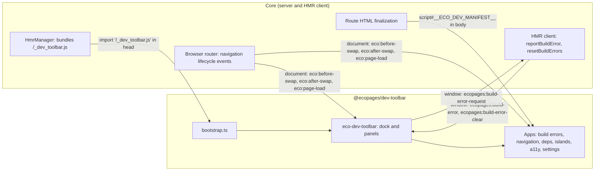

# Dev toolbar client

`@ecopages/dev-toolbar` is the reference client of the toolbar that core delivers during `ecopages dev`. What core owns (enablement, the per-page manifest, bundling and injecting `/_dev_toolbar.js`) is in [Dev toolbar](/dev/dev-toolbar); this page covers what runs in the browser once that script loads. Configuration and the built-in apps from a user's side are in the public [Dev toolbar](/docs/core/dev-toolbar) docs.

## Client and core

The package never talks to the dev server. Everything it knows arrives through three channels that core or the browser runtime already provides.

| Message | Direction | Carries |
| --- | --- | --- |
| `#__ECO_DEV_MANIFEST__` | core to client | The route, Integration name, Page Browser Graph assets, vendor and dev-transform URLs of the rendered page. Read from the document when a panel needs it (`readDevManifestFromDocument`); a missing element or invalid JSON reads as `undefined`. |
| `ecopages:build-error` | core to client | A cancelable `CustomEvent<BuildErrorDetail>` on `window`. The toolbar calls `preventDefault()` so core does not show its in-page fallback. |
| `ecopages:build-error-clear` | core to client | Dispatched when the next non-error HMR message arrives. The toolbar drops its messages and badge. |
| `ecopages:build-error-request` | client to core | Dispatched when the toolbar mounts. Core replays every active message, so a toolbar that mounts after an error still receives it. |
| Navigation lifecycle events | router to client | `ECO_NAVIGATION_LIFECYCLE_EVENTS` from `@ecopages/core/client`: `eco:before-swap`, `eco:after-swap` and `eco:page-load`, listened for on `document`. |
| `window.__ECO_HMR_CONNECTED__` | core to client | A flag the Navigation app reads for its HMR status. |

The event names and `BuildErrorDetail` come from core's build error contract. The manifest contract is mirrored in `src/api/manifest-contract.ts` rather than imported, because the toolbar is bundled for the browser separately and Rolldown cannot resolve core's export subpaths from the client entry; `manifest-contract.test.ts` keeps the mirror in step with `dev-toolbar-manifest-contract.ts` in core. `src/api/build-error-contract.ts` re-exports the type from `@ecopages/core/client` and repeats the three event names, which `build-error-contract.test.ts` guards the same way.

## Package layout

| Folder | Holds |
| --- | --- |
| `src/bootstrap.ts` | The entry core bundles: it injects styles, starts navigation telemetry and mounts the toolbar element. |
| `src/config.ts` | `devToolbar()`, the `devToolbar` block for `defineConfig` (exported as `@ecopages/dev-toolbar/config`). It sets `package` to the package name and `enabled` only when given. |
| `src/shell/` | The dock: the `eco-dev-toolbar` custom element, its styles, icons, the stealth controller, the navigation spinner and the legacy app host. |
| `src/apps/` | One custom element per built-in app, plus the helpers the Deps and A11y apps use (`deps/`, `a11y/`). |
| `src/runtime/` | Preferences, constants, the shared navigation event dispatcher, navigation telemetry and element highlighting. |
| `src/api/` | Types and contracts: `DevToolbarApp`, `DevToolbarBadge`, `DevToolbarPanelContext`, the manifest mirror and the manifest reader and writer. Exported as `@ecopages/dev-toolbar/api`. |
| `src/islands/` | Island discovery and record building for the Islands app. |

## Startup and the shell

`bootstrap.ts` runs three steps: `ensureDevToolbarStyles()` adds the stylesheet once, `initNavigationTelemetry()` starts timing routes, and `EcoDevToolbar.mount()` appends an `<eco-dev-toolbar>` to `document.documentElement` unless one exists. The host carries `data-eco-persist="eco-dev-toolbar"`, the persist attribute of the [Browser router](/dev/browser-router), so a client navigation keeps the same element instead of recreating it.

`EcoDevToolbar` is a Radiant element. Its state is the dock placement, the stealth phase, the open panel, per-app badges and loading flags, and the build error messages. Three behaviors live in the shell:

- **Stealth.** With stealth on (the default), `DevToolbarStealthController` hides the dock off-screen and reveals it on hover or when a panel opens. After the pointer leaves it holds full opacity for 4 seconds, fades for 4 more, then hides again. Placement (`top`, `bottom`, `left`, `right`) and the stealth flag persist in `localStorage` through `runtime/preferences.ts`.
- **Navigation loading.** `DevToolbarNavigationLoading` shows a spinner on the Navigation button when a swap takes longer than 100 ms, and clears it on `AFTER_SWAP` or `PAGE_LOAD`, or after 8 seconds if neither arrives.
- **Panels stay mounted.** The first time an app opens, its panel element is created and kept in a hidden slot, so closing a panel does not lose its state. Apps that refresh on navigation check `isPanelSlotVisible` and refresh when the slot becomes visible again (`observePanelSlotVisibility`). A route change closes the open panel.

`subscribeToNavigationEvents` (`runtime/navigation-events.ts`) is the only way the shell and the apps listen to the router. It shares one DOM listener per event on the document and fans out to any number of subscribers, so several panels do not exhaust the event target's listener limit, and each unsubscribes independently.

## Built-in apps

| App id | Element | What it does |
| --- | --- | --- |
| `build-errors` | rendered by the shell | Lists the distinct messages from `ecopages:build-error`, sets an error badge with the count and opens itself. The clear event empties the list and closes the panel. |
| `navigation` | `eco-dev-toolbar-navigation` | Shows the route, the Integration from the manifest, HMR status and the telemetry history, with a button to clear it. |
| `deps` | `eco-dev-toolbar-deps` | Lists entry, chunk, vendor and dev-transform URLs from the manifest. It sends a `HEAD` request per URL for the size, except for a vendor URL: the dev server serves each module of a package as its own file, so the app fetches the entry and the files it imports (up to 300) and sums them. It flags large vendor files and refreshes (debounced by 250 ms) after navigations. |
| `islands` | `eco-dev-toolbar-islands` | Lists the island hosts on the page and highlights the one you pick. |
| `a11y` | `eco-dev-toolbar-a11y` | Runs axe-core (with built-in fallback checks) over the page, excluding the toolbar, groups the issues and sets a badge. |
| `settings` | `eco-dev-toolbar-settings` | Writes placement and stealth through `applyPreferences`. |

### Navigation telemetry

`initNavigationTelemetry()` subscribes to the lifecycle events and records one entry per initial load or client navigation: route, previous route, duration, swap and hydration time, the navigation owner and the browser's navigation timing. The history keeps 50 entries and is stored in `localStorage` (`ecopages:dev-toolbar:nav-telemetry`). The current snapshot is also written as JSON to `<script id="__ECO_DEV_NAV_TELEMETRY__">` in `document.head`, with the persist attribute, and exposed as `window.__ECO_DEV_NAV_TELEMETRY__` (`getSnapshot`, `clearHistory`) so a script or an agent can read timings without the UI.

### Island discovery

`readIslandRecords()` finds hosts from several signals at once, because a navigation can leave only one of them: `<eco-island>` elements, `data-eco-island`, `data-eco-component-key`, `data-eco-component-id`, and the `window.__ECO_PAGES__.islandRoots` registry. Records are deduplicated by component id, ordered by document position and given a status. `data-eco-hydrated` means `hydrated`. An unmarked React host is `ssr-only`. A registered custom element is `hydrated` once it has no `defer-hydration` attribute and reports `hasUpdated`, otherwise `registered`. Any other host is `hydrated` when its component id is in the island roots, else `ssr-only`. `resolveIslandElement` finds the live node again by component id first, then by component key, then by the stored selector. See [Islands hydration](/dev/islands-hydration) for what stamps those attributes.

## Registering an app

Built-in apps are compiled into the shell, so adding one touches four places in `src/shell/eco-dev-toolbar.tsx` and one new file:

1. Write the panel as a Radiant custom element named `eco-dev-toolbar-<id>` in `src/apps/`. Reach the dock through `this.closest('eco-dev-toolbar')` to call `setAppBadge(appId, badge)`.
2. Import the file in the shell so the element is defined.
3. Add `{ id, label }` to `BUILT_IN_APPS`; this also puts the id in the set of shell-rendered apps.
4. Add a `case` for the id in `renderRadiantPanelSlot` that renders the element.
5. Add a `case` in `renderAppIcon` and the icon in `shell/icons.tsx`; an id with no icon falls back to its first letter.

An app that needs the current page reads the manifest with `readDevManifestFromDocument()` and subscribes to navigation with `subscribeToNavigationEvents`.

Apps from outside the shell go through `DevToolbarLegacyAppHost`. At connect time the shell calls each factory in `window.__ECO_DEV_TOOLBAR_APPS__`; a factory returns a `DevToolbarApp` (`id`, `label`, `icon`, `mount`). The dock then shows a button for it, and opening it calls `mount` with a `DevToolbarPanelContext`: the document, the parsed manifest, the empty `mountTarget` element, `onBadgeChange` and `onRouteChange`. `mount` may return a cleanup function, which runs when the panel closes. The registry is internal to the package and carries no stability promise. A project that wants its own toolbar replaces `devToolbar.package` with its own client, as [Dev toolbar](/dev/dev-toolbar) describes, and uses the same event contract above.

## Tests

Pure logic (preferences, badges, navigation events and telemetry, the a11y checks, manifest and build error contracts) is covered by `*.test.ts` files in the `shared-core` Vitest project. Tests that need a DOM (`build-errors.test.browser.ts`, `read-island-records.test.browser.ts`, the browser a11y test) run in the `browser` project. See [Testing](/dev/testing).
