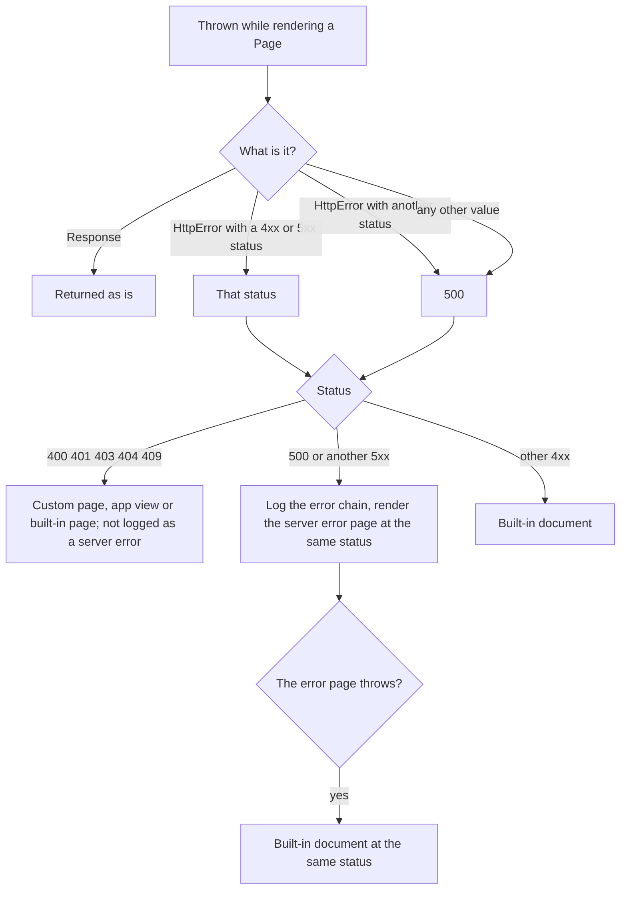

# Errors and utilities

`errors/` and `utils/` sit in the Foundation layer of [core's source layers](/dev#core-source-layers): they import nothing from the systems that use them. `errors/` is exported as `@ecopages/core/errors`. This page lists what is thrown and by whom, then groups the utilities that carry real behavior. Error pages as a rendering feature are in [Route rendering](/dev/route-rendering#error-pages).

## Error classes

| Class | Thrown when | What the user sees |
| --- | --- | --- |
| `HttpError` | A Page, endpoint handler or middleware throws one, usually through a factory: `BadRequest` (400), `Unauthorized` (401), `Forbidden` (403), `NotFound` (404), `Conflict` (409), `InternalServerError` (500). | An endpoint answers `{ error, status, details? }` as JSON with that status. A Page renders the semantic error page for the status (see below). |
| `LocalsAccessError` | Page code reads or writes `locals` on a page that is not `cache: 'dynamic'` (the locals object is a Proxy that throws on every trap), or a Page has file route middleware but is not dynamic. | The message names the Page and says to set `cache: 'dynamic'`; the page fails like any render error. The React hydration payload catches it and omits locals instead. |
| `UndeclaredComponentDependencyError` | A `dependencies.components` entry is not an `eco.component()`, `eco.layout()` or `eco.html()` result, so it has no component identity. | The message says the entry must be one of those, names the declaring file when known, and fails that Page. |

`HttpError.isHttpError` matches by `name` and a numeric `status` as well as `instanceof`, because a Page bundle can carry its own copy of the class. Code that catches errors from pages uses it and `HttpError.responseFor`, which rebuilds the response from the error's fields, instead of relying on identity.

### From a throw to a response

`http-error-page-contract.ts` is the table the adapters read: the six semantic statuses (400, 401, 403, 404, 409, 500), the kind for each (`badRequest`, `unauthorized`, `forbidden`, `notFound`, `conflict`, `serverError`) and the built-in copy and CSS modifier of each page. `classifyPageFailure` maps a thrown value to a status, a kind and whether to log it as a server error.

A 5xx Page failure is logged with `formatErrorChain`; a 4xx is not. For an endpoint, `api-request-pipeline` and `server-route-handler` turn an `HttpError` into `HttpError.responseFor(error)` and let anything else fall to a custom error handler or a plain 500 `Internal Server Error`.

## Utilities

Most modules in `utils/` are small and named for what they do. These carry behavior worth knowing, grouped by purpose.

### Paths and files

| Module | Behavior |
| --- | --- |
| `path-containment` | `isPathInside` is true for the directory itself or a descendant, `isPathStrictlyInside` excludes the directory. Both delegate to `path.isWithin`, so `src/public-api` is not inside `src/public`, and neither follows symlinks. |
| `root-relative-path` | `toRootRelativePath` returns a path relative to a root with forward slashes. |
| `package-path` | Names a file inside an installed package as `<name>@<version>/<path>` (`toPackagePath`), finds the package root from the nearest named `package.json`, and resolves that name back to a real path by looking in `node_modules` upward from a directory (`resolvePackagePath`). Dependency keys for node-module scripts use it. |
| `file-roles` | Role suffixes `.api`, `.server` and `.script` before a script extension; `matchRoleSuffix` reads a file's role and `findMisplacedRole` reports a role segment in the wrong place, which the build rejects. See [Routing](/dev/routing). |
| `static-file-extensions`, `server-utils.module` | The list of static asset extensions, content types, and `resolveStaticFilePath`, which tries the path, then `<path>.html`, then `<path>/index.html`. |
| `resolve-work-dir` | `resolveInternalWorkDir` picks the work directory from the resolved absolute path, else the root plus `workDir`, else the default; `resolveInternalExecutionDir` falls back to the root's default work directory when that directory is inside `node_modules`. |

### Entry and runtime

| Module | Behavior |
| --- | --- |
| `entry-command-flags` | `ENTRY_COMMAND_FLAGS` (`keep-going` for `build`, `serve-only` for `preview`) is the one list read both by the `ecopages` wrapper, to decide which flags a command accepts, and by the entry's parser. See [CLI](/dev/cli). |
| `parse-cli-args` | `resolveEntryCommand` reads the command flags and options with no side effects; `parseCliArgs` calls it and sets the runtime mode. It recognizes the `ecopages` binary's own entry, not another tool's `cli.js`. |
| `resolve-entry-file` | The one precedence chain for the entry file: explicit argument, then `ECOPAGES_ENTRY_FILE`, then `--entry-file` or `-e`, then `app.ts`. |
| `runtime`, `app-runtime` | `getProcessRuntime` names Bun or Node by `process.versions.bun`; `requireAppRuntime` throws when a config skipped finalization. See [App runtime](/dev/app-runtime). |
| `server-bundle-context` | Records the folder of the running production server bundle, scoped by `AsyncLocalStorage` on Node and by a global fallback for Bun, and emits the loader source that sets it. See [Ledger and start](/dev/ledger-and-start). |

### Watching and matching

| Module | Behavior |
| --- | --- |
| `additional-watch-paths` | Resolves an `additionalWatchPaths` entry against the root: a literal path, or a glob split into the directory before its first glob segment (what the watcher subscribes to) and the rest (what is matched against it). Only entries containing `*` count as globs. See [Watcher and invalidation](/dev/hmr-watcher-invalidation). |
| `path-pattern` | `normalizePathname` and `matchPathPattern`, which supports an exact path or a `/**` suffix and treats anything else as exact. Not a glob engine. |
| `node-builtin` | `isNodeBuiltinSpecifier`, true for a Node built-in with or without the `node:` prefix; the browser guard and the React client graph both ask it. |

### Text and data

| Module | Behavior |
| --- | --- |
| `html-escaping` | `escapeHtml` for text, `escapeHtmlAttribute` for a double-quoted attribute and `escapeXmlText` for sitemap values. |
| `html-entities` | `decodeHtmlEntities` decodes numeric references and a short list of named ones in one pass; `decodeHtmlEntitiesUntilStable` repeats until nothing changes. |
| `content-hash` | `contentHash` is a SHA-256 hex digest, optionally cut to a prefix of 1 to 64 characters; it throws `RangeError` outside that range. |
| `deep-merge`, `regex-escaping` | Recursive merge of two objects or arrays into a new value, and a regex escape. |
| `format-error-chain` | Joins an error's stack with each `cause` as `Caused by:` lines, stopping at a repeated error, because the logger prints only `stack`. |
| `invariant` | Throws a prefixed `Error` when the condition is false and forwards `ErrorOptions`, so a caller can keep the original failure as `cause`. |
| `locals-utils`, `ecopages-route-info` | `createRequire` builds the `require` of an endpoint context, which throws the `onMissing` response when a local is `undefined` or `null`; `toEcopagesRouteInfo` and `resolveAppStartRoutes` map static routes to the slim route shape. |

Everything else in the folder is a constant or a one-line helper. A new utility belongs here only if more than one layer needs it; a helper used by one system lives with that system, because Foundation code must not know about the code that calls it.
