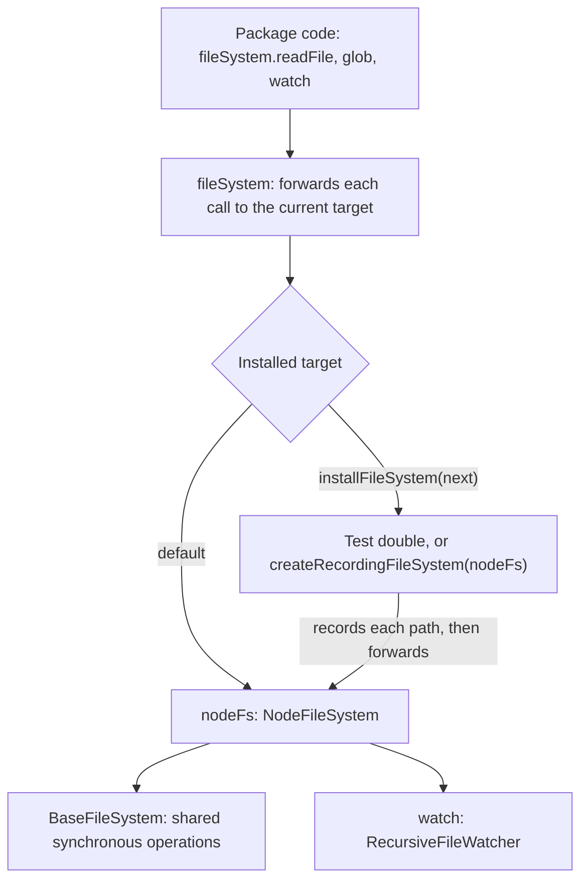

# File system

Every package reaches the disk through `@ecopages/file-system`. It gives one `FileSystem` interface, one process-wide instance, and a watcher whose behavior does not depend on the host. The path half of the package, `@ecopages/file-system/path`, is covered in [Paths](/dev#paths); this page covers the rest.

## The shared instance

`fileSystem` implements `FileSystem` by forwarding each method to a current target, which starts as `nodeFs`. The adapter is Node's on every runtime, including Bun, so a path or a glob behaves the same under `ecopages dev --runtime bun`. `BaseFileSystem` holds the operations that share one implementation, such as `exists`, `verifyFileExists`, directory copying and gzip; `NodeFileSystem` adds the asynchronous, glob, hash and watch members. `stat`, `lstat`, `readdir`, `readlink`, `mkdtemp`, `rename` and `linkNew` throw Node's error unchanged, so a caller can branch on its `code`. `linkNew` and `linkNewAsync` install a file at a path only if nothing is there, with `link(2)`, which fails with `EEXIST` atomically: the call returns `false` instead of throwing for that one error, and exactly one of several processes that call it at once returns `true`. `node:fs` implements it the same under Bun, so no adapter code differs. A volume without hard links, or a path on another volume, still throws (`EPERM`, `EXDEV`). Paths that leave the package, from `realpath`, `glob`, `readdir`, `readlink`, `mkdtemp`, `tempDir` and watcher events, are converted to forward slashes inside it.

Package code never imports `node:fs` or calls `Bun.write` and `Bun.file`; `check:portability` fails the second ([Testing](/dev/testing#smoke-scripts)). When a capability is missing, the package is extended rather than bypassed.

## Install and recording

`installFileSystem(next)` replaces the target until the function it returns runs, which tests use to swap in a fake. `createRecordingFileSystem(inner)` wraps any `FileSystem`, records every path argument of every method, and forwards the call; `recordedPaths` lists them. A glob records its `cwd`, not its patterns; a copy or rename records both paths; a watch records every path it is given, including those added later. The `production-server-modules` e2e fixture installs a recording wrapper, starts the app from a moved `dist/`, and asserts that no recorded path lies outside the deploy folders, which is how [Ledger and start](/dev/ledger-and-start) proves that `ecopages start` reads no source.

## The recursive watcher

`fileSystem.watch(paths, { onChange, onError, ignored })` returns a `FileWatcher` with `ready`, `add(paths)` and `close()`. `NodeFileSystem` builds a `RecursiveFileWatcher` over native `fs.watch`, which [Watcher and invalidation](/dev/hmr-watcher-invalidation) consumes.

- **Roots.** Each watched directory becomes a recursive root, with nested ones merged. A watched file, or a path that does not exist yet, gets a non-recursive watch on its parent or nearest existing ancestor, and each created ancestor is followed in turn until the target appears.
- **Indexing.** Before `ready` resolves the watcher indexes the existing entries so a later rename can be told apart as an add, a replacement or a directory removal. Indexing reports nothing; events that arrive while it runs are replayed afterwards.
- **Readiness.** `fs.watch` has no registration-ready event, so `ready` and `add()` wait 50 ms and then reconcile once, which catches an edit made in the registration window. On macOS under Node the native event stream can start later than `fs.watch` returns, and an edit made in the first moments after `ready` can go unreported; the safety rescan below reports it within its bounded delay.
- **Dropped events.** On macOS, `fseventsd` drops events for every watcher on the volume while other processes write many files, and neither Node nor Bun passes the drop flag on. A raw `fs.watch` lost 8 edits in 10 with six writers, and waiting longer did not bring them back. The watcher therefore rescans on macOS, under both runtimes. A timer starts a rescan once the first registration is done: each recursive root goes through the reconcile scheduler used for an event with no file name, which diffs the root against the index; each non-recursive root has only the paths it exists to watch checked, and a missing watched path is followed to its deepest existing ancestor. Whatever differs from the index is reported as the event the native watcher would have sent: `add`, `change`, `unlink`, `addDir` or `unlinkDir`, a directory before the entries it holds. A rescan report is remembered for ten intervals, so a native `change` that was only late, for the same size, times and inode, is swallowed and a change is reported once; a newer edit is reported. The wait before the next rescan is ten times the duration of the last, never less than the interval (two seconds) and never more than five intervals, so a large tree is scanned rarely and a dropped change is reported within about ten seconds, and `close()` stops the timer. The `ignored` callback runs once for every entry on every rescan. Linux and Windows signal an overflow instead of dropping silently, as an event with no file name, and run no rescan. The policy lives in `safety-rescan.ts` (`nextRescanWaitMs` and the `RescanReports` ledger, with their own tests). A rescan costs about 30 µs per entry and one `ignored` call per entry on an idle tree, measured with `pnpm --filter @ecopages/file-system run benchmark:rescan [folder]` on an Apple M4: the kitchen-sink playground (445 entries) takes 12 ms, `apps/docs` (305) 8 ms, `e2e` (550) 15 ms, `packages` (1,582) 37 to 46 ms and `templates` (1,887) 49 to 71 ms. A scan walks a folder before its children, so it asks `ignored` about each entry once and takes the answer for its ancestors from the scan itself; asking about every ancestor of every entry took about five calls per entry and the same time, since reading and stating the entries is the cost. At the two-second floor that is under 4% of the time for any of them, and the ten-times rule keeps it at about 10% up to roughly 30,000 entries (a one-second rescan, a ten-second wait). Beyond that the five-interval cap takes over: a 60,000-entry tree uses about a sixth of the time and a dropped change still surfaces about twelve seconds after the edit at worst (a ten-second wait and a two-second scan). The factor and the cap are those numbers' trade-off: a higher cap would lower the cost of a very large tree and delay the report of a dropped change by as much. `RecursiveFileWatcher` takes `safetyRescanMs` and `rescans` as internals and exposes `rescanNow()`, which the timer, its tests and the benchmark call.
- **Ignoring.** `ignored(path, stats?)` is tested before a directory is read. A stats-free answer is also passed to Node as the recursive watch's `ignore`, so a tree such as `node_modules` costs no kernel watches on releases that support the option.
- **Coalescing.** Native events for a path are held for 50 ms and flushed once. A new directory is flushed before the entries it holds, since Windows reports the file first. An event with no file name triggers a reconcile of its root, which reports `rescan` after comparing what is on disk with what was indexed.
- **Changes.** `add`, `change`, `unlink`, `addDir`, `unlinkDir` and `rescan` carry the path as the caller requested it, not the resolved real path.

`add()` calls queue behind each other, and a failed registration rejects that call without stopping later ones. `close()` clears every timer and native watcher and is safe to call twice. A watch failure, such as a permission or watch-limit error, goes to `onError`.
