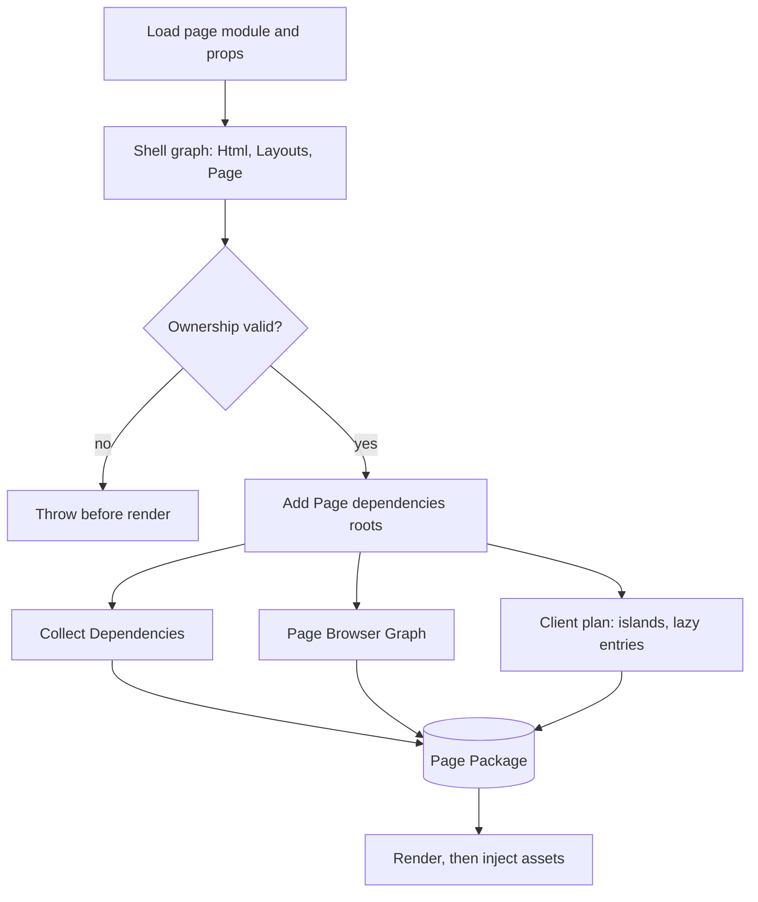

# From graph to HTML

Before any Component renders, route preparation decides every asset the Page ships. Asset processing turns each Dependency into an output, the Page Browser Graph resolves the scripts, and both land in one Page Package that the HTML transform injects into the rendered document. [Pages, layouts and components](/dev/pages-layouts-components) covers how Dependencies are discovered; [Build pipeline](/dev/build-pipeline) and [Dev server](/dev/dev-server) cover where the script URLs come from.

## Route preparation

`RouteRenderOrchestrator.prepareRenderOptions()` runs before any Component renders:

1. `prepareRouteShellGraph` builds a `PreparedComponentGraph` from the Html shell, Layouts and Page, following `config.dependencies.components` (explicit and discovered). Each node records its owner, identity file and own assets.
2. `OwnershipValidationService` rejects a Foreign Child without identity or with an unregistered owner.
3. The Page's `dependencies` function (for example `getEntryDependencies`) adds request-time roots to the same graph.
4. Dependency collection, the Page Browser Graph, the page client plan, Integration runtimes and lazy-trigger injectors produce the asset list that becomes the Page Package. The global scripts of every Integration the Page uses come first, in config order (`collectPageIntegrationDependencies`). The owning Integration's come from its render session and the others from the Integrations named by the page client plan, merged into that one order. Component Dependencies follow. A global script such as Lit's hydration support therefore runs before any Component script defines a custom element, and the order is the same whichever Integration owns the Page. Each of these scripts carries `data-eco-global-script`, which is how a client navigation tells them from Component scripts and loads them first ([React router](/dev/react-router)).

Only nodes with an identity file, under parents that also have one, take part in dependency collection. The Page Package is fixed before render: renders return HTML and root attributes only, and the HTML transform injects the prepared package.

The graph has a guard. In development, `assertComponentInPreparedGraph` fails a render of a Component with `dependencies` and an identity file that preparation never reached, naming the file and the fix: import it statically from its declaring module (a named re-export is followed, `export *` is not), list it in the parent's `dependencies.components`, or return it from the Page's `dependencies`. A Component declared only under a parent without an identity file gets its own message, since preparation collects nothing below such a parent.

The guard sees only renders that pass through the renderer's component entrypoint. The Html shell, Layouts and Page are graph roots, so it catches Foreign Children, but only under a parent whose render installed a foreign-child runtime, which takes at least one declared Foreign Child descendant. Same-Integration children rendered inline, and the Page and Layouts of an Integration that composes one tree (React), never pass through it. Production renders and partial explicit views prepare no graph and are not checked, so a Component missing from the graph renders in production without its assets.

Production builds run the same preparation in two steps: planning collects bundleable scripts without processing them, and processing runs after the app-wide browser build. See [Ledger and start](/dev/ledger-and-start). Development invalidation of prepared graphs and cached HTML is covered in [Watcher and invalidation](/dev/hmr-watcher-invalidation).

## The Page Package

Route preparation builds one Page Package per render, before any Component renders. `PageBrowserGraphService` resolves the route's Page Browser Graph: it processes the Integration's contribution and splits the result into entry assets and dynamic chunks. In production, every grouped script resolves to the output the app-wide build recorded. In development, the graph is built on first request and cached in `page-browser-graph-session` until a tracked dependency changes, and its file scripts and Integration page modules point at transform URLs. A grouped script that no app-wide build recorded builds as one grouped bundle for that route, which no other route reuses.

`createPagePackage` merges those graph assets with the processed Dependencies of every Component the route reached, then sorts them into the page script, the page stylesheet, inline assets, separate assets and dynamic chunks. Three kinds of asset get no tag:

- an asset marked `excludeFromHtml`, such as an island entry that another script imports;
- a `runtime` asset, which modules import by URL;
- a source file already bundled into the page script or page stylesheet.

The HTML transform appends the remaining assets to `<head>` or `<body>` by position; stylesheets always go to `<head>`. It never writes a tag for a Page Browser Graph dynamic chunk: the entry that needs it imports it. Rendering cannot add assets to the package; an HTML Page writes the tags of its own declared assets into its markup instead ([HTML Pages](/dev/html-pages)).

## HTML rewriting

`HtmlTransformerService.transform()` receives the Page Package and the document contributions of one render as arguments and keeps no per-render state, so overlapping renders cannot consume each other's head or body contributions. It escapes generated URLs and attribute values before writing tags.

It rewrites through core's `HtmlRewriter`, a streaming implementation of the subset of the `HTMLRewriter` element API that core uses; `html-rewriter.test.ts` pins its output against lol-html. The lexical rules live in `html-tokenizer.ts`, shared with `html-source-parser.ts`, the positional parser that HTML Pages use to splice their source markup.
