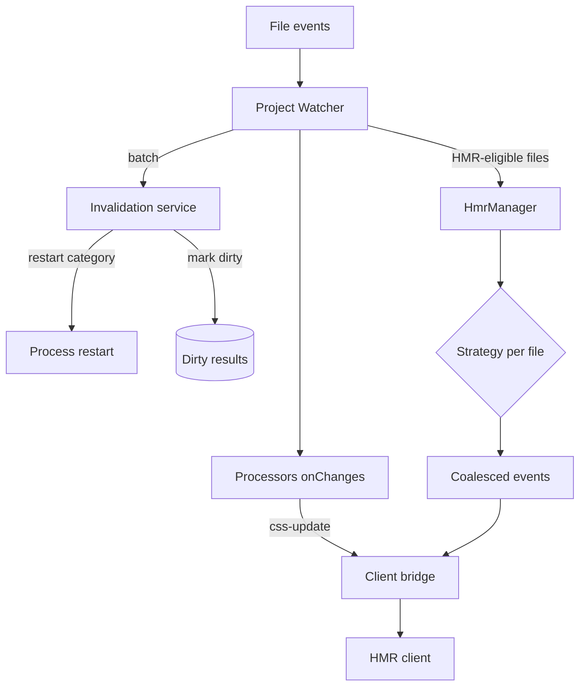
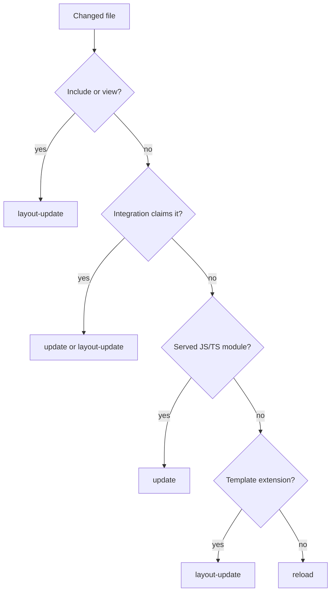
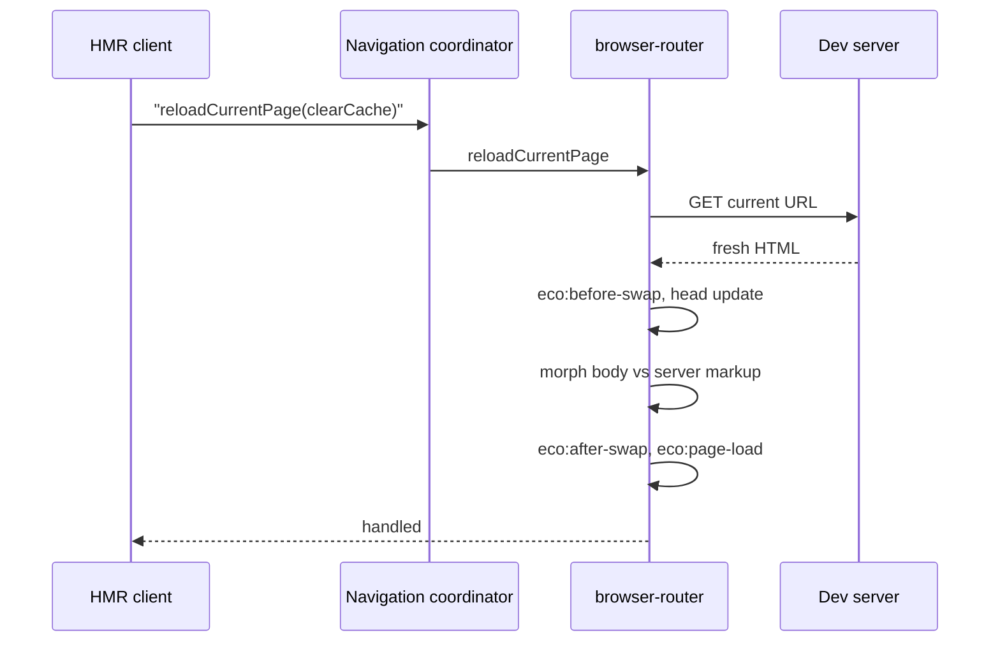

# HMR and navigation

A save in `ecopages dev` passes through three stages: the Project Watcher batches filesystem events, `DevelopmentInvalidationService` classifies each file and marks results dirty, and `HmrManager` picks one HMR strategy per file and broadcasts one coalesced set of events to the browser. The HMR client then swaps a module, refreshes a stylesheet, soft-reloads the page through the active navigation runtime, or reloads the document. Nothing rebuilds on the file event itself; dirty results rebuild on the next request that needs them. Module serving is covered in [Browser graph](/dev/browser-graph), process restarts in [Build and start](/dev/build-and-start).

## Detection: the Project Watcher

`ProjectWatcher` subscribes through `@ecopages/file-system` to the source directory, configured directories outside it, recorded build inputs, restart files, active linked-package roots and `additionalWatchPaths`. Events go into a trailing debounce (150 ms by default, `changeDebounceMs` or `ECOPAGES_WATCH_CHANGE_DEBOUNCE_MS` to override, `0` to disable), and a maximum-wait timer flushes a sustained stream within one second. Batches are processed one at a time behind a promise queue.

Why batch: one save often fires several events, and editors write several files at once. Handling a batch once means one invalidation pass, one Processor callback and one browser update instead of a storm of reloads.

For each batch the watcher:

1. Calls `applyDevFileChanges()` once. A restart category returns its path and the watcher hands it to the runtime owner without touching anything else.
2. Copies changed public files into `distDir` (or removes deleted ones) and refreshes the Route Registry once when the batch touches a route source or a pages directory.
3. Calls each Processor's `onChanges()` once with the batch files that match its extensions.
4. Sends every file whose plan has `delegateToHmr` to `HmrManager.handleFileChanges()` in one call.

When the batch needs a full reload (a public file, an `additionalWatchPaths` match, a deleted HMR file, or a shared server-and-island module), the watcher still runs the HMR manager with `broadcast: false` so its invalidation side effects happen, then sends one `reload` itself.

## Invalidation: classifying a change

`DevelopmentInvalidationService.planFileChange()` maps a path to a category, and a static table maps the category to flags.

| Category | Typical file | Invalidate server modules | Reload browser | Delegate to HMR |
| --- | --- | --- | --- | --- |
| `runtime-restart` | config imports, dotenv, linked package files | no | no | no |
| `public-asset` | file in the public directory | no | yes | no |
| `additional-watch` | `additionalWatchPaths` match | yes | yes | no |
| `processor-owned-asset` | asset a Processor can process, such as a stylesheet | no | no | no |
| `route-source` | file under the pages directory | yes | no | yes |
| `source` | recorded build input or server source | yes | no | yes |
| `other` | anything else | no | no | yes |

Two rules override the table. A file in the recorded closure of a server route module invalidates server modules whatever its category, because cached imports no longer re-hash their dependencies. A `source` file in both a server route closure and a browser entrypoint closure reloads the browser, because an island-only `update` would leave the server-rendered copy of that module stale.

Marking dirty evicts only the HTML cache entries and Page Browser Graph records that recorded the file, through the build-input index. An `additionalWatchPaths` match clears every cached document instead, because the framework cannot know which pages read an arbitrary watched file.

## Strategies: turning a change into an update

`HmrManager.handleFileChanges()` clears recorded dev-transform failures, then for each file invalidates the dev-transform modules of that file and of every entrypoint that imports it, selects a strategy, and collects its events. A missing file is skipped and its entrypoint registration cleared. A registered entrypoint first runs the Integrations' `onScriptEntrypointChanged` handlers, which Lit and Ecopages JSX (with Radiant) use to invalidate their custom-element SSR preload state.

Strategies extend `HmrStrategy` and are tried in descending `priority` (`type` plus `priorityOffset`); the first whose `matches()` returns true wins. Core registers three, Integrations add their own in their `hmr()` hook through `registerStrategy()`, and `DefaultHmrStrategy` sits outside the list as the last resort.

Why this split: core owns generic invalidation, Integrations own framework-specific update decisions, and adapters own the transport, so a new Integration can claim its files without core knowing its rendering model.

| Strategy | Owner | Priority | Claims | Sends |
| --- | --- | --- | --- | --- |
| `ServerRenderedTemplateHmrStrategy` | core | 150 | files in the includes directory or `src/views` | `layout-update` |
| `ReactHmrStrategy` | React | 100 | React entrypoints and files React-owned entrypoints import | `update` per module URL, or `layout-update` for a layout |
| `EcopagesJsxHmrStrategy` | Ecopages JSX | 100 | JSX Pages and Layouts, and files rendered under JSX ownership | `layout-update` |
| `JsHmrStrategy` | core | 25 | JS/TS in the source directory that is a watched entrypoint or that a served module imports | `update` per entrypoint URL, or `reload` |
| `TemplateSourceHmrStrategy` | core | 0 | any unclaimed template-extension file that is not a registered script entrypoint | `layout-update` |
| `DefaultHmrStrategy` | core | fallback | everything else | `reload` |

Design choices in the order:

- `ServerRenderedTemplateHmrStrategy` outranks Integrations because includes and views only shape server output, and an Integration strategy matching a shared dependency would otherwise send a module update that leaves the markup stale.
- `JsHmrStrategy` skips any entrypoint an Integration strategy above `SCRIPT` priority matches (`shouldProcessEntrypoint`), so a shared dependency does not produce a generic update that overrides the Integration's own.
- `JsHmrStrategy` claims only modules the dev transform has served or that a served module imports. A server-only module or an HTML Page classic script falls through, because a hot update would not apply it.
- `TemplateSourceHmrStrategy` never claims a registered script entrypoint: a soft reload keeps a head module script whose URL did not change, so the edited script would not run again.
- A strategy that returns `none` for a file that is not a registered dev-transform entrypoint becomes a `reload`, so no edit goes unapplied silently.

CSS does not go through strategies. A stylesheet is a `processor-owned-asset` with `delegateToHmr: false`; the owning Processor rebuilds it in `onChanges()` and calls `bridge.cssUpdate()`, as the PostCSS Processor does when its output changed.

### Coalescing and errors

The manager merges the batch before broadcasting: any `reload` replaces every other update, several `layout-update` events collapse into one, and other distinct events are all kept, so an edit shared by two islands hot-updates both. A file whose strategy throws becomes an `error` event without dropping the others. Errors go last because the client clears a shown error on every non-error event. With no browser connected the events are dropped rather than queued: a tab opened later already loads current HTML and versioned module URLs. Failed files and failed dev-transform modules are recorded and replayed to a socket that connects later through `sendPendingBuildErrors()`.

## The HMR client

`HmrManager` bundles the HMR client and serves it at `/_hmr_runtime.js`; every HTML response gets it as a module script at the start of `<head>`, so it runs before page scripts. It connects to `/_hmr` and handles each event:

| Event | Client behavior |
| --- | --- |
| `update` | Calls the module's registered `hmrHandlers` entry with a cache-busted URL. Without a handler, a dev-transform module that is the active page module asks the navigation runtime for a soft reload (`clearCache: false`); any other dev-transform module is re-imported. A non-dev-transform URL without a handler, an unhandled soft reload, or any throw falls back to `layout-update` handling. |
| `css-update` | Sets a `t` query on matching stylesheet `link` hrefs so the browser refetches them. |
| `layout-update` | Soft reload through the navigation runtime with `clearCache: true`; `location.reload()` if no runtime handles it. |
| `reload` | `location.reload()`. |
| `error` | Logs and offers the message to the Dev Toolbar, with an in-page fallback overlay. |

React islands and pages register `hmrHandlers` entries that import the new module and apply it to the mounted components. Before acting on `reload`, `layout-update` or `update`, the client waits up to five seconds for an in-flight navigation transaction to settle, so an update does not race a page swap.

## Soft reload

A soft reload refetches the current URL and commits it into the live document instead of reloading it. The HMR client calls `reloadCurrentPage()` on the navigation coordinator, which forwards it to the registered runtime of the active owner (browser-router or react-router).

In browser-router, `reloadCurrentPage` returns `false` while a navigation is pending, which makes the client fall back to a full reload. With `clearCache` it evicts the page from its prefetch cache and bypasses the cache on fetch, because the cached HTML predates the edit. It navigates with direction `replace`, `reload: true`, and no full-document fallback, so a failed soft reload reports unhandled instead of navigating away. The commit runs the same pipeline as a link navigation, so `eco:before-swap`, `eco:after-swap` and `eco:page-load` fire on every soft reload; code that must run after each HMR refresh can listen for `eco:page-load`.

Dev-transform local imports carry a content-hash `?v=` query, so after invalidation a re-imported page or layout resolves to a new ESM module-map key and the soft reload picks up the new code.

## State preservation

Two mechanisms keep state across a soft reload in browser-router.

**`data-eco-persist`.** An element carrying the persist attribute (or the configured `persistAttribute`) is never updated by the morph and is keyed by its persist value, so it survives every navigation and every soft reload when its ancestor structure stays compatible.

**Server-markup comparison.** When the HMR client starts it calls `enableReloadStatePreservation()`, and browser-router starts recording, for each live body element, a detached copy of the server markup it came from. On a reload of the same URL, `morphBody()` compares each element's previous server markup with its incoming server markup, not with the live element:

- Unchanged markup: the element is kept as it is, with its state, children, shadow root and runtime attributes.
- Changed custom element: replaced, so the browser runs its full lifecycle.
- Changed plain element: morphed, keeping its live attributes when its own server attributes did not change.

Why compare server markup: the live element always differs from fresh HTML once a component or script has touched it, so a live comparison would replace every hydrated component on every save. Why opt in: copying the body costs work on each commit, and production navigation never needs it, so only development pays for it.

Rerun scripts do not refresh elements on a reload, since replacing an ancestor would drop the unchanged elements inside it; a `data-eco-rerun` script must register handlers idempotently. Known limits: the first save after a full load compares against the body as the router found it at start, so a component that rendered before then is replaced once; and state follows tree position, so identical sibling hosts can trade state when an earlier sibling is inserted or removed. react-router implements `reloadCurrentPage` but not server-markup tracking.
