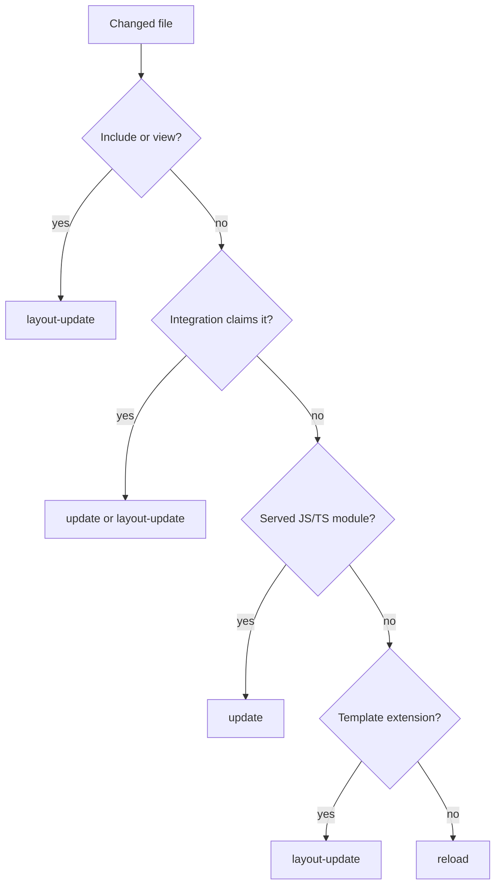

# Strategies

`HmrManager` receives the files the [watcher](/dev/hmr-watcher-invalidation) delegated to it and turns each into zero or more browser events. This page covers strategy selection and the coalescing of the result; [HMR client](/dev/hmr-client) covers how the browser applies each event.

`HmrManager.handleFileChanges()` clears recorded dev-transform failures, then for each file invalidates the dev-transform modules of that file and of every entrypoint that imports it, selects a strategy, and collects its events. A missing file is skipped and its entrypoint registration cleared. A registered entrypoint first runs the Integrations' `onScriptEntrypointChanged` handlers, which Lit and Ecopages JSX (with Radiant) use to invalidate their custom-element SSR preload state.

Strategies extend `HmrStrategy` and are tried in descending `priority` (`type` plus `priorityOffset`); the first whose `matches()` returns true wins. Core registers three, Integrations add their own in their `hmr()` hook through `registerStrategy()`, and `DefaultHmrStrategy` sits outside the list as the last resort.

Why this split: core owns generic invalidation, Integrations own framework-specific update decisions, and adapters own the transport, so a new Integration can claim its files without core knowing its rendering model.

| Strategy | Owner | Priority | Claims | Sends |
| --- | --- | --- | --- | --- |
| `ServerRenderedTemplateHmrStrategy` | core | 150 | files in the includes directory or `src/views` | `layout-update` |
| `ReactHmrStrategy` | React | 100 | React entrypoints and files React-owned entrypoints import | `update` per module URL, or `layout-update` for a layout |
| `EcopagesJsxHmrStrategy` | Ecopages JSX | 100 | JSX Pages and Layouts, and files rendered under JSX ownership | `layout-update` |
| `JsHmrStrategy` | core | 25 | JS/TS in the source directory that is a watched entrypoint or that a served module imports | `update` per entrypoint URL, or `reload` |
| `TemplateSourceHmrStrategy` | core | 0 | any unclaimed template-extension file that is not a registered script entrypoint | `layout-update` |
| `DefaultHmrStrategy` | core | fallback | everything else | `reload` |

Design choices in the order:

- `ServerRenderedTemplateHmrStrategy` outranks Integrations because includes and views only shape server output, and an Integration strategy matching a shared dependency would otherwise send a module update that leaves the markup stale.
- `JsHmrStrategy` skips any entrypoint an Integration strategy above `SCRIPT` priority matches (`shouldProcessEntrypoint`), so a shared dependency does not produce a generic update that overrides the Integration's own.
- `JsHmrStrategy` claims only modules the dev transform has served or that a served module imports. A server-only module or an HTML Page classic script falls through, because a hot update would not apply it.
- `TemplateSourceHmrStrategy` never claims a registered script entrypoint: a soft reload keeps a head module script whose URL did not change, so the edited script would not run again.
- A strategy that returns `none` for a file that is not a registered dev-transform entrypoint becomes a `reload`, so no edit goes unapplied silently.

CSS does not go through strategies. A stylesheet is a `processor-owned-asset` with `delegateToHmr: false`; the owning Processor rebuilds it in `onChanges()` and calls `bridge.cssUpdate()`, as the PostCSS Processor does when its output changed.

### Coalescing and errors

The manager merges the batch before broadcasting: any `reload` replaces every other update, several `layout-update` events collapse into one, and other distinct events are all kept, so an edit shared by two islands hot-updates both. A file whose strategy throws becomes an `error` event without dropping the others. Errors go last because the client clears a shown error on every non-error event. With no browser connected the events are dropped rather than queued: a tab opened later already loads current HTML and versioned module URLs. Failed files and failed dev-transform modules are recorded and replayed to a socket that connects later through `sendPendingBuildErrors()`.
