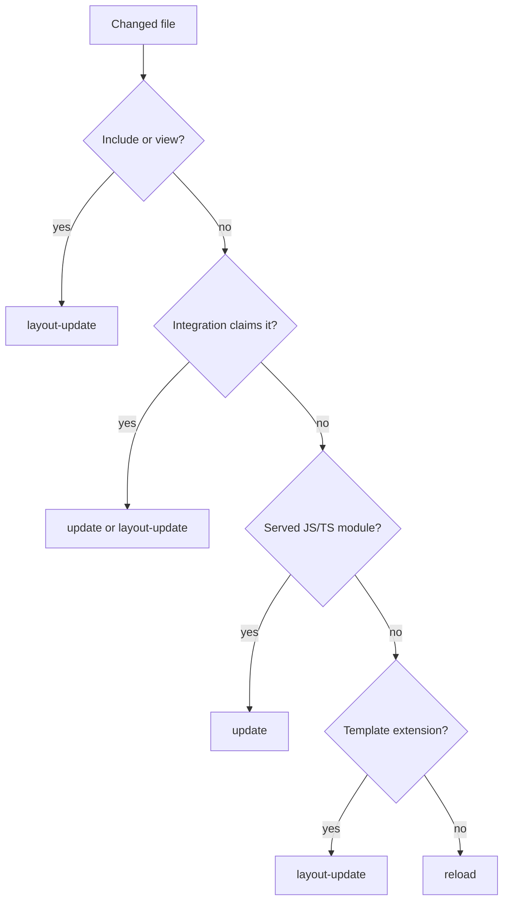

# Strategies

`HmrManager` receives the files the [watcher](/dev/hmr-watcher-invalidation) delegated to it and turns each into zero or more browser events. This page covers strategy selection and the coalescing of the result; [HMR client](/dev/hmr-client) covers how the browser applies each event.

`HmrManager.handleFileChanges()` clears recorded dev-transform failures and the build errors that requests reported (`reportBuildError`), then for each file invalidates the dev-transform modules of that file and of every entrypoint that imports it, selects a strategy, and collects its events. A missing file is skipped and its entrypoint registration cleared. A registered entrypoint first runs the Integrations' `onScriptEntrypointChanged` handlers, which Lit and Ecopages JSX (with Radiant) use to invalidate their custom-element SSR preload state.

Strategies only choose the browser update. The watcher batch already marked server modules and Page Browser Graph records dirty before the manager runs, and a registered entrypoint's server module is imported again on the next request, not on the file event. Generic invalidation policy stays in core services, framework-specific update behavior in strategies, and the WebSocket transport in the adapter.

Strategies extend `HmrStrategy` and are tried in descending `priority` (`type` plus `priorityOffset`); the first whose `matches()` returns true wins. Core registers three, Integrations add their own in their `hmr()` hook through `registerStrategy()`, and `DefaultHmrStrategy` sits outside the list as the last resort.

| Strategy | Owner | Priority | Claims | Sends |
| --- | --- | --- | --- | --- |
| `ServerRenderedTemplateHmrStrategy` | core | 150 | files in the includes directory or `src/views` | `layout-update` |
| `ReactHmrStrategy` | React | 100 | React entrypoints and files React-owned entrypoints import | `update` per module URL, or `layout-update` for a Layout |
| `EcopagesJsxHmrStrategy` | Ecopages JSX | 100 | JSX Pages and Layouts, and files rendered under JSX ownership | `layout-update` |
| `JsHmrStrategy` | core | 25 | JS/TS in the source directory that is a watched entrypoint or that a served module imports | `update` per entrypoint URL, or `reload` |
| `TemplateSourceHmrStrategy` | core | 0 | any unclaimed template-extension file that is not a registered script entrypoint | `layout-update` |
| `DefaultHmrStrategy` | core | fallback | everything else | `reload` |

Integration strategies ask the HMR context whether a file is a Page or a Layout (`isPageFile`, `isLayoutFile`) and never read a folder. A Page is a file the Route Registry holds as a Page route (`RouteRegistry.isPageFile`, reached through `AppRuntime.router`). A Layout is a module a rendered Page passed as `eco.page({ layout })`: route preparation records the file of every Layout node in `AppRuntime.layoutFiles`. The set only grows within a session and holds the Layouts that were rendered, so a Layout no Page has rendered yet takes the component path until one does, and a plain Layout function, which carries no identity, is known only through the Pages that import it. A file in `src/layouts/` that no Page references is not a Layout.

Design choices in the order:

- `ServerRenderedTemplateHmrStrategy` outranks Integrations because includes and views only shape server output, and an Integration strategy matching a shared dependency would otherwise send a module update that leaves the markup stale.
- `JsHmrStrategy` skips any entrypoint an Integration strategy above `SCRIPT` priority matches (`shouldProcessEntrypoint`), so a shared dependency does not produce a generic update that overrides the Integration's own.
- `JsHmrStrategy` claims only modules the dev transform has served or that a served module imports. A server-only module or an HTML Page classic script falls through, because a hot update would not apply it.
- `TemplateSourceHmrStrategy` never claims a registered script entrypoint: a soft reload keeps a head module script whose URL did not change, so the edited script would not run again.
- A strategy that returns `none` for a file that is not a registered dev-transform entrypoint becomes a `reload`, so no edit goes unapplied silently.

A linked stylesheet does not go through strategies. It is a `processor-owned-asset` with `delegateToHmr: false`; core's development stylesheet service rebuilds it and calls `bridge.cssUpdate(file)` when its output changed ([PostCSS processor](/dev/postcss-processor#development-lifecycle)), and the bridge sends the exact href `sourceRelativeStylesheetHref` names for that file. That rule lives in the shared `ClientBridge` (`adapters/shared/hmr/client-bridge.ts`), which every adapter's bridge extends with only its transport. A stylesheet outside `srcDir` has no stable href and sends nothing.

A stylesheet a served module imports as text also goes to HMR: the invalidation plan sets `delegateToHmr` when a browser entrypoint read it, and `JsHmrStrategy` sends an `update` for each watched entrypoint that imports it, whose new module URL names the new CSS. The dev transform server versions a stylesheet import by the output the stylesheet service last produced, not by the file's bytes (by those only when the service has no output for it), and the watcher plans a stylesheet whose output changed as changed, so an edit to an `@import` partial or to content Tailwind scans hot-updates the importers the same way. When the Processor throws, the dev transform server keeps serving the last compiled module and the error shows; the next save that compiles clears it, even one that restores the previous bytes.

### Coalescing and errors

The manager merges the batch before broadcasting: any `reload` replaces every other update, several `layout-update` events collapse into one, and other distinct events are all kept, so an edit shared by two islands hot-updates both. A file whose strategy throws becomes an `error` event without dropping the others. Errors go last because the client clears a shown error on every non-error event. With no browser connected the events are dropped rather than queued: a tab opened later already loads current HTML and versioned module URLs. A tab whose socket was reconnecting keeps its old page until the next change, because replaying a `reload` for it would also reload every freshly opened tab, and the server cannot tell the two apart.

Errors are the exception, and are replayed:

- A dev-transform compile failure is broadcast when the module is requested, which on a fresh page load can be before its HMR socket connects. `DevTransformServer` records the message under the module until the next `handleFileChanges()` clears every failure (the cause can be another file) or a request for that module succeeds. The module itself keeps answering with its last compiled form, so the error shows while the page keeps working.
- A file whose strategy or script-change handler throws is recorded under that file until it processes without error, so its error survives a `reload` that another file of the same save triggers.
- The Node host calls `sendPendingBuildErrors()` right after subscribing a socket, which sends one `error` event per recorded failure.

## Errors reported by a request

`reportBuildError(source, message)` shows an error found while answering a request, such as a stylesheet or script a Page request could not process in development, or an `ssr: true` script that failed to preload on the server, and keeps it for `sendPendingBuildErrors`, so a page that loads after the request still shows it. The next file change clears it, and a request that still fails reports it again. The errors of stylesheets the development stylesheet service holds as failed are appended to every batch as `error` events, after the updates, because the client clears a shown error on any other event.
