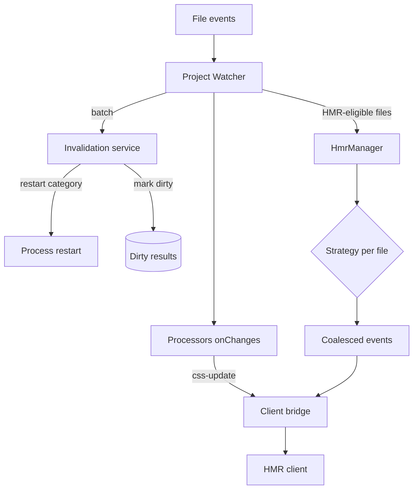

# Watcher and invalidation

A save in `ecopages dev` passes through three stages: the Project Watcher batches filesystem events, `DevelopmentInvalidationService` classifies each file and marks results dirty, and `HmrManager` picks one HMR strategy per file and broadcasts one coalesced set of events to the browser. Nothing rebuilds on the file event itself; dirty results rebuild on the next request that needs them. This page covers the first two stages. [Strategies](/dev/hmr-strategies) covers the third, and [HMR client](/dev/hmr-client) what the browser does with the events. Module serving is in [Dev server](/dev/dev-server).

## Detection: the Project Watcher

`ProjectWatcher` subscribes through `@ecopages/file-system` to the source directory, configured directories outside it, recorded build inputs, restart files, active linked-package roots and `additionalWatchPaths`. Recorded build inputs (module closures, files plugins declared with `addWatchFile`, and Processor watch roots) decide which caches a change invalidates; they never narrow what is watched under the source directory. The subscription ignores `node_modules`, `.git`, the work directory and `distDir`. Startup waits up to 30 seconds for it to become ready, so the first edit cannot race it, and a timeout or an earlier error closes it and fails startup. When a native event omits its filename, the filesystem adapter reports a `rescan`, which the watcher turns into a restart request because the changed path is unknown.

Events go into a trailing debounce (150 ms by default, `changeDebounceMs` or `ECOPAGES_WATCH_CHANGE_DEBOUNCE_MS` to override, `0` to disable), and a maximum-wait timer flushes a sustained stream within one second. Batches are processed one at a time behind a promise queue.

A batch is handled once: one invalidation pass, one `onChanges` call per Processor and one browser update.

For each batch the watcher:

1. Calls `applyDevFileChanges()` once. A restart category returns its path and the watcher hands it to the runtime owner without touching anything else.
2. Copies changed public files into `distDir` (or removes deleted ones) and refreshes the Route Registry once when the batch touches a route source or a pages directory.
3. Calls each Processor's `onChanges()` once with the batch files that match its extensions.
4. Sends every file whose plan has `delegateToHmr` to `HmrManager.handleFileChanges()` in one call.

A Processor whose `onChanges()` throws is logged and shown in the browser error overlay; the other Processors and the client update still run. A batch of only directory events under the pages directory refreshes the Route Registry and notifies nothing else. Closing the watcher drops batches that have not started.

When the batch needs a full reload (a public file, an `additionalWatchPaths` match, a deleted HMR file, or a shared server-and-island module), the watcher still runs the HMR manager with `broadcast: false` so its invalidation side effects happen, then sends one `reload` itself.

## Invalidation: classifying a change

`DevelopmentInvalidationService.planFileChange()` maps a path to a category, and a static table maps the category to flags.

| Category | Typical file | Invalidate server modules | Reload browser | Delegate to HMR |
| --- | --- | --- | --- | --- |
| `runtime-restart` | config imports, dotenv, linked package files | no | no | no |
| `entry-watched-config` | the config module, when a runtime entry watcher owns it | no | no | no |
| `public-asset` | file in the public directory | no | yes | no |
| `additional-watch` | `additionalWatchPaths` match | yes | yes | no |
| `processor-owned-asset` | asset a Processor can process, such as a stylesheet | no | no | no, unless a browser module imports the stylesheet as text |
| `route-source` | file under the pages directory | yes | no | yes |
| `source` | recorded build input or server source | yes | no | yes |
| `other` | anything else | no | no | yes |

When a runtime entry watcher owns the config module (`ECOPAGES_ENTRY_WATCH`), the module is `entry-watched-config` and is left out of the applied files, so only the entry watcher reacts to it. Files the config imports and dotenv files stay `runtime-restart`.

Two rules override the table. A file in the recorded closure of a server route module invalidates server modules whatever its category, because cached imports no longer re-hash their dependencies. A `source` file in both a server route closure and a browser entrypoint closure reloads the browser, because an island-only `update` would leave the server-rendered copy of that module stale.

Marking dirty evicts only the HTML cache entries and Page Browser Graph records that recorded the file, through the build-input index. An HTML entry records its route-module closure, its browser graph, the processed assets it used and its render-shell inputs, including the imports of the HTML template. An `additionalWatchPaths` match clears every cached document instead, because the framework cannot know which pages read an arbitrary watched file.

## Additional watch paths

Each `additionalWatchPaths` entry resolves against the root directory. An entry without `*` is watched as given and matches itself and everything inside it. An entry with `*` is a glob: the segments before the first glob segment form the base the watcher subscribes to (`content` for `content/**/*.md`, the root directory for `**/*.config.ts`), and the rest is matched with `path.matchesGlob` against paths relative to that base, so glob characters in the root path never reach the matcher. A path segment starting with `.` matches only a pattern segment starting with `.`, on Node and Bun alike. Files reached only through a glob base are ignored unless the pattern matches them, so a broad base does not feed unrelated files into the pipeline. A glob whose base is the filesystem root logs a warning.

## Linked packages

At startup the watcher resolves the app's declared dependencies, development dependencies and optional dependencies to their installed directories, following the declarations of each linked package to find transitive ones. A package whose real root lies outside `node_modules` is a linked root. A root is subscribed only once a recorded build input lies inside it, which covers server-only imports and subpath-only exports as soon as they are used; an input recorded after startup activates its root then, and a root whose activation fails while more of its inputs arrive is retried once. Inside a root, `node_modules` and dot entries are ignored. Discovery runs once per process, so changing dependency declarations or links needs a restart.

Any create, change or delete in an active root is a `runtime-restart`: vendor bundles live only in process memory (see [Dev server](/dev/dev-server)), and a new process rebuilds them and the server imports from the current package files.

## Restarts

The restart files are the config module, the project files it imports (`absolutePaths.configModuleFiles`) and the supported dotenv files in the root directory (`.env`, `.env.local`, `.env.<NODE_ENV>`, `.env.<NODE_ENV>.local`), watched whether or not they exist yet. A restart category skips invalidation, Processors and HMR. The watcher coalesces pending restart requests and hands one to the runtime owner; a watcher without a restart callback only logs a warning.

Under the CLI the owner stops the runtime gracefully and exits with code 100, and the supervisor in `packages/ecopages/bin/cli.js` launches a fresh child, so config modules and environment values load from scratch. A restarted child that exits with an error keeps the supervisor alive: it watches the whole project and every linked package (`resolveDevelopmentRecoveryWatch`, with the same ignores as the Project Watcher) from before the child launched, and relaunches on the next change, at once if a fix was saved while the child was loading.
