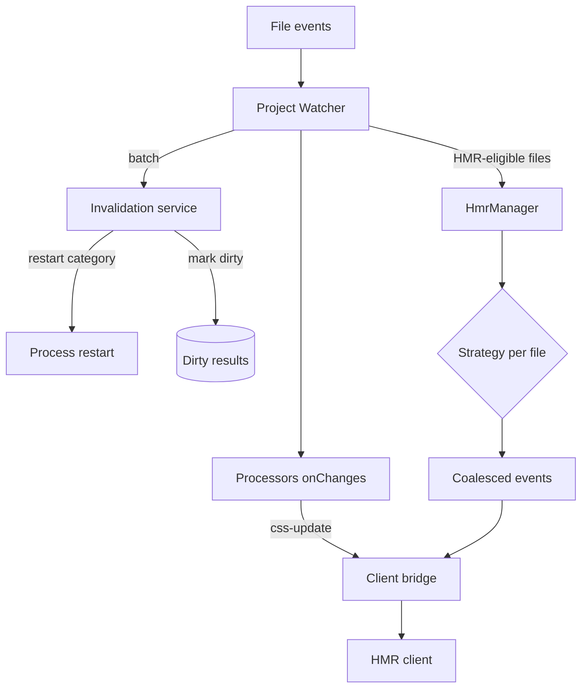

# Watcher and invalidation

A save in `ecopages dev` passes through three stages: the Project Watcher batches filesystem events, `DevelopmentInvalidationService` classifies each file and marks results dirty, and `HmrManager` picks one HMR strategy per file and broadcasts one coalesced set of events to the browser. Nothing rebuilds on the file event itself; dirty results rebuild on the next request that needs them. This page covers the first two stages. [Strategies](/dev/hmr-strategies) covers the third, and [HMR client](/dev/hmr-client) what the browser does with the events. Module serving is in [Dev server](/dev/dev-server); process restarts in [Ledger and start](/dev/ledger-and-start).

## Detection: the Project Watcher

`ProjectWatcher` subscribes through `@ecopages/file-system` to the source directory, configured directories outside it, recorded build inputs, restart files, active linked-package roots and `additionalWatchPaths`. Events go into a trailing debounce (150 ms by default, `changeDebounceMs` or `ECOPAGES_WATCH_CHANGE_DEBOUNCE_MS` to override, `0` to disable), and a maximum-wait timer flushes a sustained stream within one second. Batches are processed one at a time behind a promise queue.

Why batch: one save often fires several events, and editors write several files at once. Handling a batch once means one invalidation pass, one Processor callback and one browser update instead of a storm of reloads.

For each batch the watcher:

1. Calls `applyDevFileChanges()` once. A restart category returns its path and the watcher hands it to the runtime owner without touching anything else.
2. Copies changed public files into `distDir` (or removes deleted ones) and refreshes the Route Registry once when the batch touches a route source or a pages directory.
3. Calls each Processor's `onChanges()` once with the batch files that match its extensions.
4. Sends every file whose plan has `delegateToHmr` to `HmrManager.handleFileChanges()` in one call.

When the batch needs a full reload (a public file, an `additionalWatchPaths` match, a deleted HMR file, or a shared server-and-island module), the watcher still runs the HMR manager with `broadcast: false` so its invalidation side effects happen, then sends one `reload` itself.

## Invalidation: classifying a change

`DevelopmentInvalidationService.planFileChange()` maps a path to a category, and a static table maps the category to flags.

| Category | Typical file | Invalidate server modules | Reload browser | Delegate to HMR |
| --- | --- | --- | --- | --- |
| `runtime-restart` | config imports, dotenv, linked package files | no | no | no |
| `public-asset` | file in the public directory | no | yes | no |
| `additional-watch` | `additionalWatchPaths` match | yes | yes | no |
| `processor-owned-asset` | asset a Processor can process, such as a stylesheet | no | no | no |
| `route-source` | file under the pages directory | yes | no | yes |
| `source` | recorded build input or server source | yes | no | yes |
| `other` | anything else | no | no | yes |

Two rules override the table. A file in the recorded closure of a server route module invalidates server modules whatever its category, because cached imports no longer re-hash their dependencies. A `source` file in both a server route closure and a browser entrypoint closure reloads the browser, because an island-only `update` would leave the server-rendered copy of that module stale.

Marking dirty evicts only the HTML cache entries and Page Browser Graph records that recorded the file, through the build-input index. An `additionalWatchPaths` match clears every cached document instead, because the framework cannot know which pages read an arbitrary watched file.
