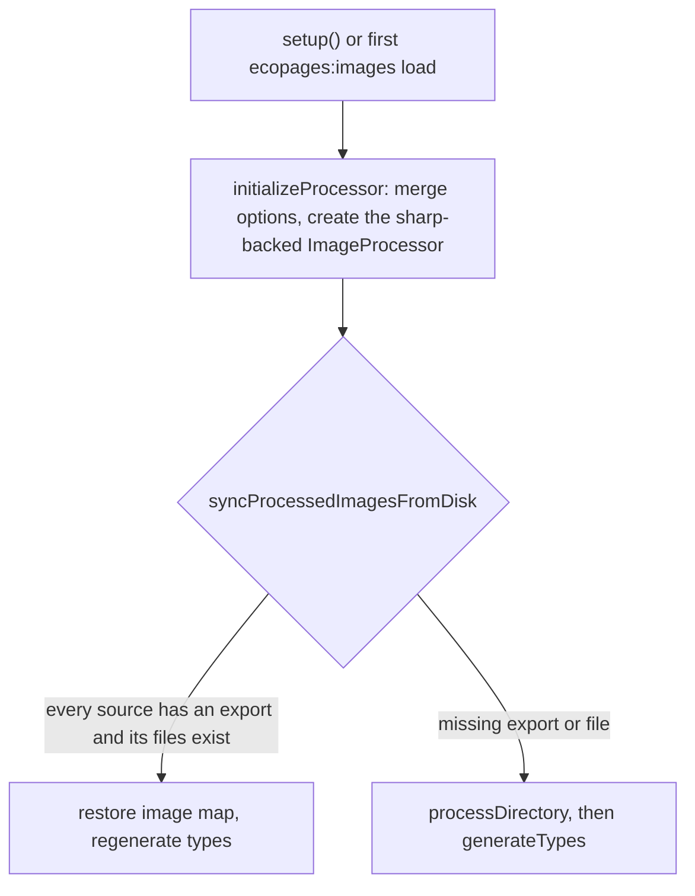

# Image processor

`ImageProcessorPlugin` is a Processor (see [/dev/plugin-pipeline](/dev/plugin-pipeline)) that encodes source images with sharp, writes content-hashed files, and exposes the result as the `ecopages:images` virtual module. It declares an `image` capability for the accepted extensions, so development invalidation treats those files as processor-owned.

## From source to variants

`processDirectory()` globs `sourceDir/**/*.{acceptedFormats}` (default `jpg`, `jpeg`, `png`, `webp`) and runs `processImage` on each. The image map is keyed by file basename, so two images with the same name in different folders collide.

For one image:

- With no configured `sizes`, one file is written at the original dimensions and `variants` is empty.
- Otherwise only sizes no wider than the source are used, widest first. If every size is wider than the source, the single widest configured size is used, and its width is clamped to the source width, so nothing is upscaled.
- The widest variant becomes `attributes.src`; `srcset` and `sizes` are derived from the variants.
- Every file is encoded as the configured `format` at `quality`.

## Hashed names and the two keys

There are two different identifiers, and they do different jobs.

| Key | Built from | Used for |
| --- | --- | --- |
| File name | A hash of the encoded bytes (`writeHashedBrowserAsset`) | The output file and its public URL |
| `cacheKey` | Source basename, source file hash, quality, format, and the `width:label` list | The Processor cache entry holding the finished specification |

The file name comes from the encoded bytes, not from the cache key. The cache key includes the encoding options so a quality or format change cannot reuse a previous variant. Identical encoded bytes share one file across source images.

The core Processor cache stores each entry as `<digest of key>.json`, so a key containing `:` or `/` (as this one does) is safe on every platform.

A cache hit is only accepted when the main file and every variant file still exist in `outputDir`; otherwise the image is re-encoded. `cacheEnabled` defaults to true.

The public `src` and every `srcset` entry are `publicPath` joined with the file name using `path.posix`, so they use `/` on every platform (`toPublicImageSrc`). It lives in its own module because `image-utils.ts` is imported by client code and cannot use `node:path`.

## The `ecopages:images` module

`plugins()` returns two build plugins with the same name, one per environment:

- `server`: `build.module('ecopages:images', ...)`, a virtual module.
- `browser`: `onResolve` into the `ecopages-images` namespace plus `onLoad` for it.

Both call `ensurePrepared()` and then emit one `export const <camelCase name> = <specification JSON>` per image. Both close over the same `processedImages` object, which is why the plugin mutates it in place (`replaceProcessedImages`) instead of reassigning.

`plugins()` does no work: core reads it once at config finalization and it must not do I/O, so generation is deferred to `setup()` or to the load callback.

## Setup versus restore

`setup()` always runs this preparation. In a process where `setup()` did not run, such as the Lit static render worker, the first `ecopages:images` load runs it through `ensurePrepared()`; the main thread already wrote the outputs, so the restore path usually succeeds without invoking sharp. The restore reads `<distDir>/cache/ecopages-image-processor/virtual-module.ts`, which is the same file `generateTypes` writes, and requires one export per current source image. The plugin does not override `restoreProductionRuntime`.

## Watch

The watch paths are set to `sourceDir` once the config resolves, and watch extensions are the accepted formats. `onChanges` re-processes created and changed images and, for deleted ones, removes the entry. Superseded outputs are deleted only when no remaining specification references the file name, because files are shared by hash. The superseded cache entry is deleted when its `cacheKey` changed.

## Generated types

`generateTypes()` runs after every prepare and change. It writes:

- The runtime module above, only when its content changed.
- Under `<rootDir>/node_modules/@types/ecopages-image-processor/`: `virtual-module.d.ts` (a `declare module "ecopages:images"` with one `ImageSpecifications` export per image), `index.d.ts`, and a `package.json`, so TypeScript loads it with no `tsconfig` entry. The app still imports `@ecopages/image-processor/types` once from `modules.d.ts`.
