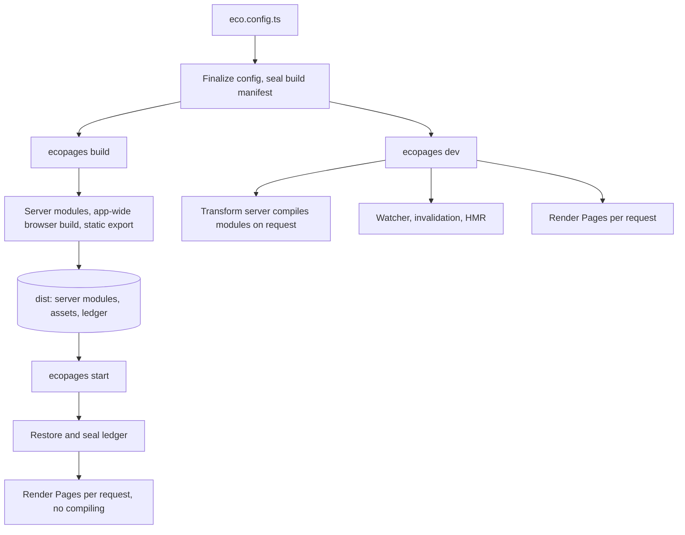

# Architecture

These pages explain how Ecopages works inside, for people who change the framework. Building an app does not need them: start with the [documentation](/docs/getting-started/introduction).

## Lifecycle

Three commands share one config and one set of plugins, and differ in when they compile.

- **Dev** compiles each browser module when the browser asks for it and rebuilds dirty results on the next request. See [Dev server](/dev/dev-server) and [Watcher and invalidation](/dev/hmr-watcher-invalidation).
- **Build** does all compiling once and records what it processed. See [Build pipeline](/dev/build-pipeline).
- **Start** restores those records and compiles nothing. See [Ledger and start](/dev/ledger-and-start).

Every path renders a Page the same way: route preparation collects its assets into a Page Package before the first Component renders; see [From graph to HTML](/dev/graph-to-html).

## Packages

| Package | What it is for |
| --- | --- |
| `packages/core` | The framework: config, routing, rendering, asset processing, build, dev server and HMR. Every other package plugs into it. |
| `packages/ecopages` | The CLI: `dev`, `build`, `start`, `preview` and project templates. |
| `packages/file-system` | The file system access every package goes through. |
| `packages/browser-router` | Client navigation for server-rendered documents. [Browser router](/dev/browser-router) |
| `packages/react-router` | Client navigation for React pages. [React router](/dev/react-router) |
| `packages/dev-toolbar` | The development toolbar. |
| `packages/codemod` | Codemods for migrating to current patterns. |
| `packages/integrations/react` | [React](/dev/react) |
| `packages/integrations/lit` | [Lit](/dev/lit) |
| `packages/integrations/kitajs` | [Kita](/dev/kita) |
| `packages/integrations/ecopages-jsx` | [Ecopages JSX](/dev/ecopages-jsx) |
| `packages/integrations/mdx` | [MDX](/dev/mdx) |
| `packages/processors/content-processor` | [Content processor](/dev/content-processor) |
| `packages/processors/image-processor` | [Image processor](/dev/image-processor) |
| `packages/processors/postcss-processor` | [PostCSS processor](/dev/postcss-processor) |
| `packages/__internals/testing` | Private test helpers shared by the packages. |

Integrations render files and own a JSX runtime; Processors own asset semantics. Both contribute build plugins through the contracts in [Plugin pipeline](/dev/plugin-pipeline) and [Integrations and foreign children](/dev/integrations-foreign-children).
