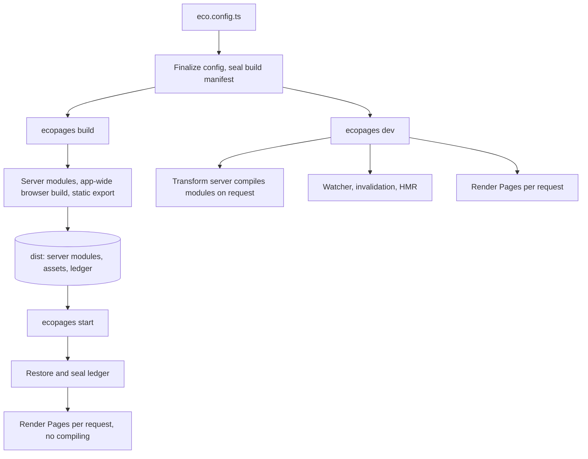

# Architecture

These pages explain how Ecopages works inside, for people who change the framework. Building an app does not need them: start with the [documentation](/docs/getting-started/introduction).

## Lifecycle

Three commands share one config and one set of plugins, and differ in when they compile.

- **Dev** compiles each browser module when the browser asks for it and rebuilds dirty results on the next request. See [Dev server](/dev/dev-server) and [Watcher and invalidation](/dev/hmr-watcher-invalidation).
- **Build** does all compiling once and records what it processed. See [Build pipeline](/dev/build-pipeline).
- **Start** restores those records and compiles nothing. See [Ledger and start](/dev/ledger-and-start).

Every path renders a Page the same way: route preparation collects its assets into a Page Package before the first Component renders; see [From graph to HTML](/dev/graph-to-html).

## Packages

| Package | What it is for |
| --- | --- |
| `packages/core` | The framework: config, routing, rendering, asset processing, build, dev server and HMR. Every other package plugs into it. |
| `packages/ecopages` | The CLI: `dev`, `build`, `start`, `preview` and project templates. |
| `packages/file-system` | The file system access and the path operations every package goes through. See [Paths](#paths). |
| `packages/browser-router` | Client navigation for server-rendered documents. [Browser router](/dev/browser-router) |
| `packages/react-router` | Client navigation for React pages. [React router](/dev/react-router) |
| `packages/dev-toolbar` | The development toolbar. |
| `packages/codemod` | Codemods for migrating to current patterns. |
| `packages/integrations/react` | [React](/dev/react) |
| `packages/integrations/lit` | [Lit](/dev/lit) |
| `packages/integrations/kitajs` | [Kita](/dev/kita) |
| `packages/integrations/ecopages-jsx` | [Ecopages JSX](/dev/ecopages-jsx) |
| `packages/integrations/mdx` | [MDX](/dev/mdx) |
| `packages/processors/content-processor` | [Content processor](/dev/content-processor) |
| `packages/processors/image-processor` | [Image processor](/dev/image-processor) |
| `packages/processors/postcss-processor` | [PostCSS processor](/dev/postcss-processor) |
| `packages/__internals/testing` | Private test helpers shared by the packages. |

Integrations render files and own a JSX runtime; Processors own asset semantics. Both contribute build plugins through the contracts in [Plugin pipeline](/dev/plugin-pipeline) and [Integrations and foreign children](/dev/integrations-foreign-children).

## Paths

Every path Ecopages holds uses forward slashes, on every host. An absolute path keeps its Windows drive letter as Node or the user spelled it (`D:/app/src/pages/index.tsx`); on POSIX it is the usual `/app/src/pages/index.tsx`. Paths therefore split on `/` and become URLs, cache keys and route names without a separator check.

The drive letter is not upper-cased on purpose: Node's ESM loader keys modules by URL and keeps the drive case, so a process started from a lower-case cwd loads its config as `file:///d:/...`, and an upper-cased path would load the same module a second time. Containment goes through `path.isWithin`, which compares drives without regard to case.

Package code takes its path operations from `@ecopages/file-system/path`, never from `node:path` (or its `posix` and `win32` subpaths), and takes `file:` URL conversion from it rather than from `node:url`; a lint rule enforces both in `packages/`. `packages/codemod` is exempt: its jscodeshift transforms run on their own and do not depend on Ecopages packages. The module mirrors the `node:path` operations Ecopages uses and returns every result in this form. Node's file system APIs accept forward slashes on Windows, so most code never needs the native form.

A native path is converted once, where it enters Ecopages:

| Where a path enters | Conversion |
| --- | --- |
| `fileSystem.realpath`, `glob`, `readdir`, `readlink`, `mkdtemp` and watcher events | Converted inside `@ecopages/file-system` |
| Config directories and `additionalWatchPaths` | `path.resolve` while the config is finalized; `path.fromNative` for a glob |
| `import.meta.url`, `import.meta.resolve` and other `file:` URLs | `path.fromFileUrl` |
| `import.meta.dirname`, `process.cwd()`, `require.resolve` and oxc-resolver results | `path.fromNative`, or `path.cwd()` |
| Rolldown module ids in hooks and build output | `fromRolldownModuleId` |

On the way out, `import()` of a file takes `path.toFileUrl(file).href`. A path a resolve hook hands back to Rolldown goes through `toRolldownModuleId`, which returns the native form on Windows: Rolldown keys modules by id, and its own resolver produces native paths, so a forward-slash id for the same file would become a second module. `path.toNative` is for any other consumer that needs backslashes.

A test that needs Windows behaviour on any host mocks `@ecopages/file-system/path` with `createPath('win32')`, as `route-registry.windows-paths.test.ts` does.
