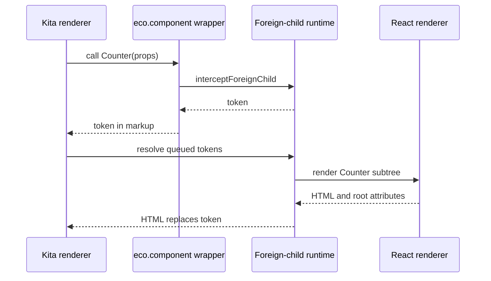

# Integrations and foreign children

Integrations turn Page files into HTML. One Page can mix Components owned by different Integrations, so the contract also decides who renders a Component whose owner differs from its parent. Such a boundary is also where an [Island](/dev/islands-hydration) starts. [Plugin pipeline](/dev/plugin-pipeline) covers the build plugins an Integration contributes; [Processors](#processors) covers the other plugin contract.

An Integration subclasses `IntegrationPlugin` ([`integration-plugin.ts`](https://github.com/ecopages/ecopages/blob/next/packages/core/src/plugins/integration-plugin.ts)). It declares data, and core decides when each hook runs.

| Member | Role |
| --- | --- |
| `name`, `extensions` | The file types it owns. `findIntegrationForFile` picks the Integration with the longest matching extension, so `.kita.tsx` beats `.tsx`. |
| `renderer` | The `IntegrationRenderer` class; `getRenderer()` caches one instance per runtime, shared by route renders, explicit views and Foreign Child handoffs. |
| `jsxImportSource` | The JSX runtime its files compile with; the identity transform prepends it as a pragma. |
| `integrationDependencies` | Global assets added to every Page the Integration takes part in, before Component assets and in config order whichever Integration owns the Page. |
| `plugins(app)` | Build plugins, read once during config finalization. See [Plugin pipeline](/dev/plugin-pipeline#contributing-plugins). |
| `setup()` / `hmr()` / `teardown()` | Runtime activation, development behavior, and release. `setup()` does not resolve `integrationDependencies`. When activation resolves them is fixed on the app runtime when it is created (`AppRuntime.globalScriptResolution`), so no caller chooses it. On an `'activation'` runtime (dev, `ecopages start`, request-only `app.fetch()`), activation (`ensureIntegrationRuntimeReady()`) calls `refreshResolvedIntegrationDependencies()` right after a successful `setup()`, including a later retry of a failed warmup. A `'browser-build'` runtime (a production export, or the Lit worker) never resolves at activation; it resolves once its browser build is known: after the app-wide browser build, or after the worker's ledger restore. The resolved list is one array updated in place, so a renderer that holds it sees each resolution; each `setup()` empties it, so a setup after a teardown shows nothing until the next resolution. A subclass updates it in place or calls `refreshResolvedIntegrationDependencies()`, and a third-party Integration must not read it inside `setup()`. |
| `staticExport()` | Export-wide work before the first page renders, returning a release. |
| `serverDom`, `acceptsParams`, `bundlesPageDependencies` | Server DOM installer, whether Pages take Params, and whether core may bundle Page assets. |
| `ssrScriptPreload` | Which `ssr: true` scripts its custom-element preloader evaluates: `'own'` or `'own-and-foreign'`. The preloader comes from this declaration: a renderer that builds one without it throws. See [Route rendering](/dev/route-rendering#custom-element-ssr-scripts). |
| `compilePageModule()` with `serializeCompiledPageModule()` / `reviveCompiledPageModule()` | For files that are not JavaScript modules: compile in process, and record the result for production. [HTML Pages](/dev/html-pages) use it. |

Core owns the order of these hooks; the public sequence is in [Plugin lifecycle](/docs/core/plugin-lifecycle). Two rules are not visible there:

- Before any Integration's `setup()` continues, core installs the configured server DOM surfaces process-wide: every `complete` installer, then every `repair`, whatever the config order, serializing concurrent callers so a second app is not skipped (`installConfiguredServerDom`). [Lit](/dev/lit#why-serverdom-is-a-repair) explains why.
- Shutdown and restart wait for in-flight `setup()` calls, prewarm renders and page-cache regenerations before calling `teardown()` on each activated Integration, so a late render cannot use released resources. A failed `teardown()` still clears activation, so the next start runs `setup()` again.

## SSR Policy and hydration

Each Integration owns its SSR Policy: how it renders on the server and what browser bootstrap that output needs. Ecopages JSX, for example, wraps renders in `EcopagesJsxRadiantSsrPolicy`, which loads Radiant's server runtime lazily and only when enabled. React composes the Page and Layouts into one tree and hydrates it with a page bootstrap. Lit prepends its `lit-hydrate-support` module script to its `integrationDependencies`.

## Foreign Children and Foreign Subtrees

A Component's owner is `config.integration`, then the build-time `config.identity.integration`, then the inherited owner (`getComponentOwner`). When a declared Component is called during a render whose current Integration differs, the `eco.component()` wrapper asks the active foreign-child runtime to intercept it. The runtime either resolves it at once or, in the queue model, returns a token and records the Component and props. Before the renderer returns, `resolveQueuedForeignSubtreeTokens` asks the owning renderer for each Foreign Subtree and splices its HTML over the token.

A route that still contains an unresolved `<eco-marker>` artifact fails in `executePrepared`; there is no route-level fallback.

Every possible Foreign Child of a static Component must be declared in `config.dependencies.components`; a Page `dependencies` function can add request-time roots for a Component loaded dynamically. `OwnershipValidationService` checks those declarations during preparation and throws before anything renders. At render time the renderer still discovers the actual Foreign Children through the active render context.

`renderComponentWithForeignChildren()` is the renderer entrypoint for mixed trees. It reuses the render session's owning-renderer cache, renders inline when the Component has no declared Foreign Child descendant, and otherwise installs a foreign-child runtime. Queueing is optional: a renderer that can resolve a Foreign Child inline returns its HTML at once. In the queue model, `resolveQueuedForeignSubtreeTokens` renders a token's children first, so nested tokens resolve before their parent, throws on a cycle, applies the owning renderer's root attributes to the first element of its HTML and splices the result over the token. The queue lives inside one render pass of one renderer; children of the same Integration never pass through it.

The browser has no render context. There, the browser `eco` factories hand a Component whose owner differs from the registered `window.__ECO_PAGES__.foreignChildHost` to that host, which renders a boundary that keeps the server HTML; React registers itself when it hydrates ([Islands and hydration](/dev/islands-hydration#foreign-subtrees-in-a-hydrated-tree)). Without a host, a browser Component renders inline. On the server, React wraps Foreign Subtrees in that boundary only in a tree that hydrates.

Markup a non-Lit Integration produces is not a dead end for Lit: after the route renders, core passes the document through the `renderCustomElements` hook of each Integration that was assigned `ssr: true` scripts, so a Lit element in a Kita Component or a spliced Foreign Subtree gets its declarative shadow root ([Route rendering](/dev/route-rendering#custom-element-ssr-scripts)).

Only a declared Component can be a Foreign Child. A plain function has no identity, so it renders inline in whatever Integration calls it. Discovery fails the build when a module renders a plain component of another Integration that compiles JSX with a different runtime, and suggests `eco.component()`. Lit, which leaves the runtime to the tsconfig, is not checked.

## Processors

A Processor subclasses `Processor` ([`processor.ts`](https://github.com/ecopages/ecopages/blob/next/packages/core/src/plugins/processor.ts)) and owns asset semantics, not rendering.

| Member | Role |
| --- | --- |
| `capabilities` | Asset kinds (`script`, `stylesheet`, `image`) and extension patterns, with an optional filename filter. They declare ownership. |
| `watch` | Paths and extensions that select changes; `onChanges` runs once per debounced batch. |
| `plugins(app)` | Build plugins, read once at finalization like an Integration's; see [Plugin pipeline](/dev/plugin-pipeline#contributing-plugins). |
| `setup()` | Generates files, loads configuration, warms caches. |
| `transformStylesheet(css, file)` | Called for each stylesheet matching the app's one `stylesheet` capability; returns `{ css, dependencies }`. See [Plugin pipeline](/dev/plugin-pipeline#stylesheet-processors). |
| `invalidateStylesheets(files)` | Names the stylesheets a change to other files makes stale in development. |
| `listProductionServerModuleEntries()` / `restoreProductionRuntime()` | Server modules for `server-modules.json`, and the restore that production `ecopages start` calls instead of `setup()`. |

Watch extensions only select which changes `onChanges` receives; ownership comes from `capabilities` alone, and it decides whether development invalidation skips server modules and HMR for an asset.

There is no invalidation hook. A Processor that keeps compiled server artifacts outside the route-module graph compares `moduleLoader.getDevelopmentGeneration()` on the app runtime, which development invalidation advances when it invalidates server modules, with the generation it built at, and rebuilds on a mismatch. The content Processor's collection bundles do this.

For the content Processor and its `ecopages:content` virtual modules, see [Content processor](/dev/content-processor).
