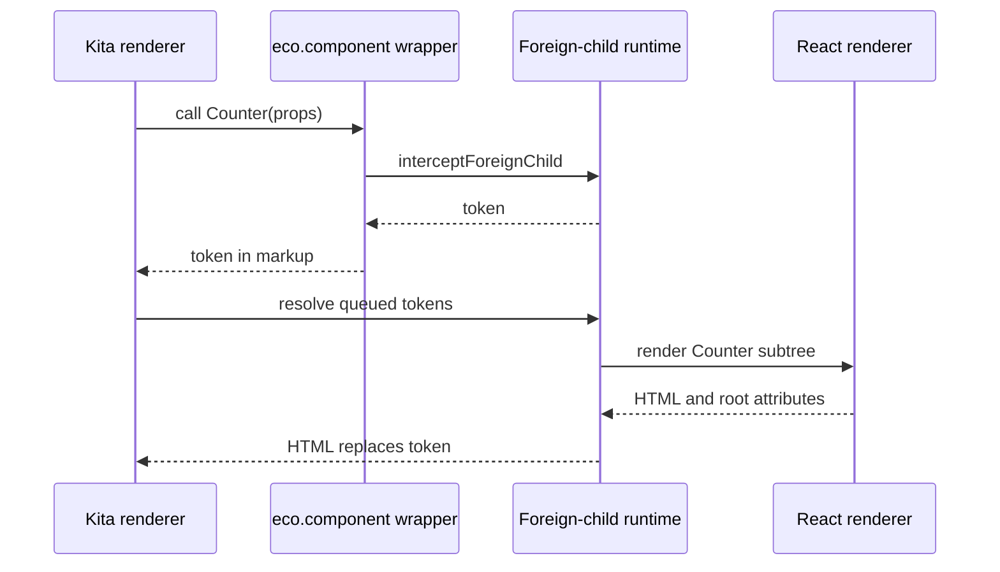

# Integrations and foreign children

Integrations turn Page files into HTML. One Page can mix Components owned by different Integrations, so the contract also decides who renders a Component whose owner differs from its parent. Such a boundary is also where an [Island](/dev/islands-hydration) starts. [Plugin pipeline](/dev/plugin-pipeline) covers the build plugins an Integration contributes; [Processors](#processors) covers the other plugin contract.

An Integration subclasses `IntegrationPlugin` ([`integration-plugin.ts`](https://github.com/ecopages/ecopages/blob/next/packages/core/src/plugins/integration-plugin.ts)). It declares data, and core decides when each hook runs.

| Member | Role |
| --- | --- |
| `name`, `extensions` | The file types it owns. `findIntegrationForFile` picks the Integration with the longest matching extension, so `.kita.tsx` beats `.tsx`. |
| `renderer` | The `IntegrationRenderer` class; `getRenderer()` caches one instance per runtime, shared by route renders, explicit views and Foreign Child handoffs. |
| `jsxImportSource` | The JSX runtime its files compile with; the identity transform prepends it as a pragma. |
| `integrationDependencies` | Global assets added to every Page the Integration takes part in. |
| `plugins(app)` | Build plugins, read once during config finalization. See [Plugin pipeline](/dev/plugin-pipeline#contributing-plugins). |
| `setup()` / `hmr()` / `teardown()` | Runtime activation, development behavior, and release. |
| `staticExport()` | Export-wide work before the first page renders, returning a release. |
| `serverDom`, `acceptsParams`, `bundlesPageDependencies` | Server DOM installer, whether Pages take Params, and whether core may bundle Page assets. |

## SSR Policy and hydration

Each Integration owns its SSR Policy: how it renders on the server and what browser bootstrap that output needs. Ecopages JSX, for example, wraps renders in `EcopagesJsxRadiantSsrPolicy`, which loads Radiant's server runtime lazily and only when enabled. React composes the Page and Layouts into one tree and hydrates it with a page bootstrap. Lit prepends its `lit-hydrate-support` module script to its `integrationDependencies`.

## Foreign Children and Foreign Subtrees

A Component's owner is `config.integration`, then the build-time `config.identity.integration`, then the inherited owner (`getComponentOwner`). When a declared Component is called during a render whose current Integration differs, the `eco.component()` wrapper asks the active foreign-child runtime to intercept it. The runtime either resolves it at once or, in the queue model, returns a token and records the Component and props. Before the renderer returns, `resolveQueuedForeignSubtreeTokens` asks the owning renderer for each Foreign Subtree and splices its HTML over the token.

A route that still contains an unresolved `<eco-marker>` artifact fails in `executePrepared`; there is no route-level fallback.

Only a declared Component can be a Foreign Child. A plain function has no identity, so it renders inline in whatever Integration calls it. Discovery fails the build when a module renders a plain component of another Integration that compiles JSX with a different runtime, and suggests `eco.component()`. Lit, which leaves the runtime to the tsconfig, is not checked.

## Processors

A Processor subclasses `Processor` ([`processor.ts`](https://github.com/ecopages/ecopages/blob/next/packages/core/src/plugins/processor.ts)) and owns asset semantics, not rendering.

| Member | Role |
| --- | --- |
| `capabilities` | Asset kinds (`script`, `stylesheet`, `image`) and extension patterns, with an optional filename filter. They declare ownership. |
| `watch` | Paths and extensions that select changes; `onChanges` runs once per debounced batch. |
| `plugins(app)` | Build plugins, read once at finalization like an Integration's; see [Plugin pipeline](/dev/plugin-pipeline#contributing-plugins). |
| `setup()` | Generates files, loads configuration, warms caches. |
| `transformStylesheet(css, file)` | Called for each stylesheet matching a `stylesheet` capability, in registration order, each Processor receiving the previous output. |
| `listProductionServerModuleEntries()` / `restoreProductionRuntime()` | Server modules for `server-modules.json`, and the restore that production `ecopages start` calls instead of `setup()`. |

Watch extensions only select which changes `onChanges` receives; ownership comes from `capabilities` alone, and it decides whether development invalidation skips server modules and HMR for an asset.

For the content Processor and its `ecopages:content` virtual modules, see [Content processor](/dev/content-processor).
