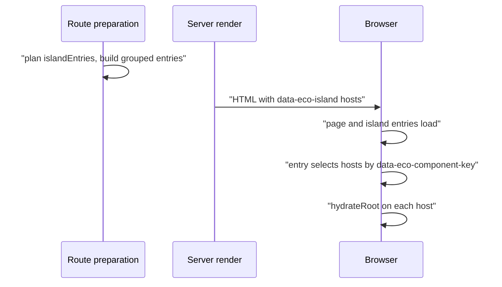

# Islands and hydration

An Island is a Component that hydrates in the browser inside a Page it does not own. The server stamps its root as an Island Host, route preparation builds a browser entry for it, and the owning Integration's bootstrap hydrates the host in place. A script can also be loaded later, on a trigger, instead of at page load. How a Component of another Integration is rendered on the server is covered in [Integrations and foreign children](/dev/integrations-foreign-children).

## Declaring and planning

An Island is a graph edge where a Component's Integration differs from its parent's, excluding the Html shell. `collectPageClientPlanFromGraph` lists these as `islandEntries`, and `selectHydrationIslandEntries` gives each hydrating Integration only the islands it owns on a Page owned by another Integration; the page owner's own tree is hydrated by its page bootstrap. The page owner asks every other island-hydrating Integration on the plan for its grouped client build, so a React island on a Kita Page still gets a hydration script.

At render, a resolved Foreign Subtree carries a component instance id. `finalizeIslandComponentRender` stamps the root as an Island Host (`data-eco-island`, `data-eco-island-integration`, `data-eco-component-id`) when the result has one root element and the Component's own Dependencies, excluding Foreign Children, include a script. React stamps through `buildIslandHostAttributes`, adds `data-eco-component-key` and base64 `data-eco-props`, and wraps the root in `<eco-island style="display:contents">`.

`data-eco-island` is an empty presence marker, so select hosts with `[data-eco-island]`. The attribute set does not depend on the Integration, which lets the dev toolbar find every Island; an Integration with extra host metadata should build on `buildIslandHostAttributes` rather than add its own selectors. `data-eco-props` is base64 of the UTF-8 JSON: `btoa` alone accepts Latin-1 only and throws on text such as `€`. Browser code that cannot import core (React's island bootstrap and the dev toolbar) keeps its own decoder, so a format change must update those too.

## Matching a host to its entry

A host is matched to its browser entry by identity, not by position. Each declaration has a component identity id, and each server render of a Component gets its own instance id, stamped as `data-eco-component-id`. React derives `data-eco-component-key` from the component file, relative to the app root, and its identity id (`getIslandComponentKey`), so every instance of one Component shares the key and the browser assets, but each host gets its own React root. The generated island entry selects hosts with `[data-eco-component-key="<key>"]` and passes the identity id as `componentRef`; `resolveComponent` then picks the export whose `config.identity.id` equals it. That matters when one file declares several Components. Only when no export carries the id does it fall back to the default export and then the first function.

## Bootstraps

Pages and Islands hydrate through two different bootstraps, and React ships both as package exports: `@ecopages/react/page-hydration` and `@ecopages/react/island-hydration`. A generated entry only wires its module to one of them.

| Bootstrap | Used by | Behavior |
| --- | --- | --- |
| `page-hydration` | the Page entry of a React Page | Owns the document tree, navigation ownership, cleanup and HMR for the page root. |
| `island-hydration` | one entry per React Island | `mountIslands` hydrates every matching host that has no root yet, and `readProps` decodes `data-eco-props`. |

Entries import the bootstrap, React and React DOM by package name, like any other module. In production every Page and island entry is an entry of the app-wide browser build, so the bootstrap and React are content-hashed chunks shared by all of them; in development the entries are unbundled scripts whose imports core rewrites to the one vendor URL of each package. A page therefore loads React once, whether it has a Page entry, island entries or both. The island bootstrap receives React as a value (`hydrateRoot`, `createElement`, `useEffect`) from its entry rather than importing it. All island entries share one runtime object on `window.__ECO_PAGES__`, with a single `MutationObserver` that unmounts the root of a host removed from the document. The host gets `data-eco-hydrated` after its first commit, and in development `registerIslandHmr` re-renders hosts with a hot-updated module; see [HMR client](/dev/hmr-client). The vendor graph and the app-wide build are described in [Dev server](/dev/dev-server) and [Build pipeline](/dev/build-pipeline).

## Foreign Subtrees in a hydrated tree

A React Page or Island hydrates the whole tree it rendered on the server, so the browser calls every Component in it again. A Component another Integration owns cannot render there: the server handed it to its owner as a Foreign Subtree, and in the browser its `render` returns that Integration's output, such as a Lit `TemplateResult`, which React rejects. Both sides therefore use one boundary element, defined in `hydration/foreign-subtree.ts`:

- On the server, `wrapForeignSubtreeTokens` puts each Foreign Subtree token React rendered inside `<eco-foreign-subtree data-eco-foreign-key="…" style="display:contents">` before the tokens resolve, so the owner's HTML lands inside it. It does so only in a tree the browser hydrates: an Island root (a React Component rendered with a component instance id, no resolved children and a single root element, so it gets an Island Host), or a Page, Layout or document whose Page hydrates (`hydratesPageTree`, the same rule as `shouldHydratePage`, decided once from the Page for the whole route render). A tree that never hydrates keeps the foreign element where the React Component put it, so a foreign `<tr>`, `<td>` or `<option>` stays in its table or select and child-combinator CSS sees no extra element. In a hydrating tree, a token before `<body` stays unwrapped, since a custom element would end the document head, and a React Component whose root is a Foreign Child gets its root attributes on the boundary.
- In the browser, the React build gives each React module the boundary of a foreign Eco Component. When Ecopages builds a React module for the browser (the production browser build and the development transform alike), `client-graph/foreign-boundary-rewrite.ts` rewrites its imports of a Component another Integration owns, by the owner of the file that declares it: `import X from`, named and aliased imports and namespace imports (wrapped in a proxy). It follows `export { a as b } from` and `export * from` chains, so a barrel that re-exports a foreign Component is covered at each React import site and is itself never rewritten, since another entry may share it. Each binding goes through `foreignBoundary()` (`hydration/browser/foreign-boundary.ts`), which returns a component type that renders `<eco-foreign-subtree>` with the server HTML as `dangerouslySetInnerHTML`, so hydration keeps the server DOM: a Lit element keeps its declarative shadow root and hydrates itself. A value that is not a foreign Eco Component, such as a constant, comes back unchanged. The rewrite runs on a module's source after it loads, so MDX, which compiles to `react/jsx-runtime` calls of its imported components, is covered by the same rule. Dynamic `import()` of a foreign module is not rewritten.
- The rewrite touches only a module that imports such a module. A React module that imports React components or React-owned Eco Components compiles to the same output as before, and a React-only Page or Island ships no boundary code; the tests compare both builds. A module that another graph also uses and that imports a foreign Component has two compiled forms, since a module has one compiled form per id: React's graph imports it under `<path>?eco-variant=react-boundary`, which gets the rewrite (and so do that variant's own imports of such modules), and the other entries keep the plain id, which is never rewritten. In production the build's entries tell which modules are shared; in development, where each module is served on its own URL, any module that React does not own by extension counts as shared, and the dev transform server compiles the variant URL through the React contributor (`ownsModule(path, variant)`). The two forms are two module instances, so state a shared module holds is held twice.
- The browser `eco` factories always call the Component's `render`, whoever calls it, so on a Lit, Kita or Ecopages JSX Page with one React Island their own `eco.component` calls return their own output. Nothing registers on `window.__ECO_PAGES__`; the boundary is a property of how React modules are built.

The key hashes the Component's identity id and its JSON-safe props, so the server and the browser compute the same one. Functions and React elements are left out, so two Foreign Subtrees that differ only in, say, React `children` share a key. Every mount reads the server HTML by key, first in the document a client navigation fetched (react-router publishes it as `page.document`), then in the live document; a direct HMR update, which has no router to refetch, fetches the current URL itself and publishes it as `page.document` before it re-renders, so a boundary whose props the edit changed, and a hydrated custom element whose live shadow root is no longer a declarative one, both find their server HTML; hydration keeps the existing DOM whatever it read. The boundary is keyed by that key, so new props re-mount it. React creates a boundary empty, because the boundary passes the same empty `dangerouslySetInnerHTML` object and the same `ref` on every render (React compares a custom element's props by reference, and a new object would rewrite the live DOM). The `ref` fills a boundary that has no children with `setHTMLUnsafe()`, not `innerHTML`, so a declarative shadow root is parsed and its custom element upgrades with the shadow root the server rendered. A Lit element then hydrates it, on a client navigation too, because the router has already loaded the next document's global scripts, Lit's hydration support among them, before it imports the Page module ([React router](/dev/react-router)). A browser without `setHTMLUnsafe()` falls back to `innerHTML`, and the element renders itself.

A boundary that finds no server HTML stays empty: the boundary cannot render the Component itself, since its `render` returns output React cannot render. Outside production it logs one warning per key that names the Component file. The supported path is a Foreign Subtree the server rendered inside the hydrating tree, rendered again with the same props. A foreign Component that first appears on the client, or whose props change on the client only, has no server HTML to keep.

A direct HMR update reads the props of the Page, and its module URL when the envelope carries one, from the `__ECO_PAGE_DATA__` of the document it fetched. The props go to `page.props` and the render, the module URL to `page.module`, so a changed `staticProps` result reaches both the React tree and the boundary keys.

A Foreign Child is only rendered by the server, so React children of a Foreign Child are part of its server HTML and are not hydrated.

## Lazy triggers

A script entry of a Component can declare when it loads with `lazy`:

| Trigger | Meaning |
| --- | --- |
| `{ 'on:idle': true }` | after page load, when the injector is idle |
| `{ 'on:interaction': 'mouseenter,focusin' }` | when one of the listed events fires |
| `{ 'on:visible': true }` or a margin string such as `'100px'` | when the Component enters the viewport, with an optional margin |

Collection turns each lazy script into a hidden entry: it is excluded from the HTML, joins the app-wide client bundle and carries a `data-eco-lazy-key`. Scripts of one Component that share a trigger form a group, and each group resolves to a `ResolvedLazyTrigger` whose `triggerId` is a hash of the component file and its sorted script URLs, so it does not depend on declaration order. The Component root receives `data-eco-trigger`, and the Page Package carries one global injector map (a script of type `ecopages/global-injector-map`) plus a bootstrap that imports `@ecopages/scripts-injector/global`, which loads the scripts for each trigger. `lazy` controls browser delivery only: a script with `ssr: true` is still imported on the server.

## Across Integrations

An Island is exactly a graph edge whose Integration differs from its parent, so the same mechanism covers a React Island on a Kita or Lit Page: the Page owner collects the grouped island build from every island-hydrating Integration on the plan. The server side of that edge, the Foreign Subtree handoff, is in [Integrations and foreign children](/dev/integrations-foreign-children). Each Integration page under Packages says what it contributes: [React](/dev/react), [Lit](/dev/lit), [Kita](/dev/kita), [Ecopages JSX](/dev/ecopages-jsx).
