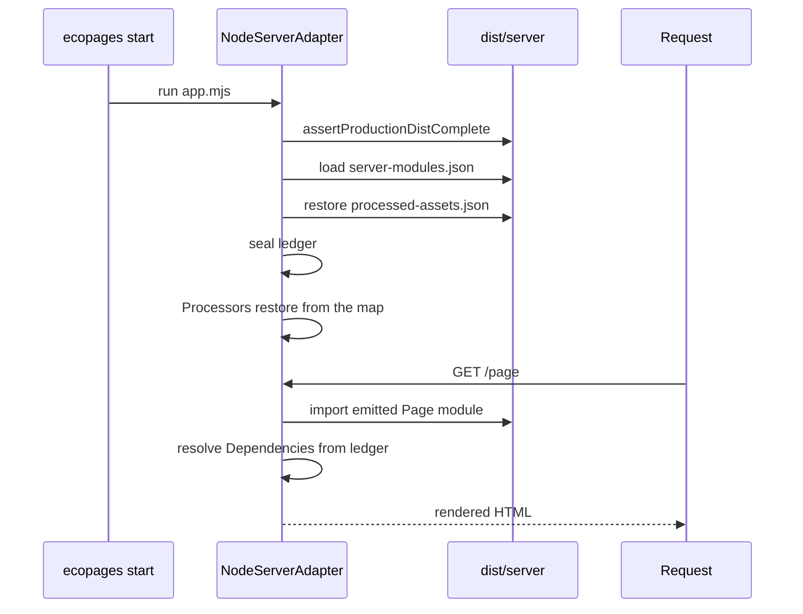

# Ledger and start

`ecopages start` restores the records a build wrote and serves requests from them. It still renders Pages per request, but it never runs the bundler, never runs a Processor and never writes into `dist/`. Anything the build did not produce is an error that says to run `ecopages build` again, not a fallback compile. [Build pipeline](/dev/build-pipeline) covers how those records are produced.

## The processed-asset ledger

`ProcessedAssetLedger`, stored on `AppRuntime.processedAssets`, maps a dependency key (`getAssetDependencyKey`) to the emitted asset. Two writers fill it during a build:

- `buildAppBrowserClient()` records each entry's output under the key of every dependency that declared it, then records every emitted file, chunks included, as `browserOutputs`.
- `AssetProcessingService` records every dependency it processes in production, stylesheets and content scripts included, as each one lands in its cache.

After the app-wide build, each planned route runs its preparation, so asset processing records every remaining dependency those routes are served with. A bundleable script the build already produced resolves to the recorded output instead of being bundled again. Inline assets keep their content and drop `filepath`, since no file reaches `dist/`. A bundled inline content script is built without chunks in a work-directory folder that is removed once read, so its bundle never reaches `dist/` either.

`writeProductionAssetLedger()` writes the ledger, plus the HTML module-script URLs by root-relative source, to `dist/server/processed-assets.json`. It runs right after prebuild, because the Lit static-render worker restores the ledger, unsealed, during the export. When the build has a server bundle, it runs again after rendering to add what rendering processed. A failed generation clears the file, so a retry records only its own outputs.

## What start restores

`ecopages start` does not load `eco.config.ts`. `createLaunchPlan()` finds the one directory with `server/manifest.json` (or the `--dist-dir` given), points the process at the emitted config the deploy manifest names, and runs `dist/server/app.mjs`. That loader records its directory, which marks the start as one from a complete `dist/`.

`NodeServerAdapter.initializeResources()` then:

1. Calls `assertProductionDistComplete()`: one build id across the manifests, the server entry, emitted config, route list, every listed server module and every ledger output must exist. It reads no source.
2. Loads the server-modules map with `requireProductionServerModules()`.
3. Restores the ledger with `restoreProductionBrowserBuild(appConfig, { seal: true })`. Every Integration activates after this, in `completeInitialization()` or on a request, and each activation resolves the Integration's global scripts through the restored ledger right after its `setup()`.
4. Runs `setupAppRuntimePlugins` with `skipProcessorSetup`, so each Processor calls `restoreProductionRuntime()` instead of `setup()`. Why: the deploy may hold no sources to scan, and the build already produced everything a Processor generates.

It does not copy the public directory or touch `dist/`, because the build already did. The route registry loads its routes from `routes.json` instead of scanning the pages directory.

## What start refuses

Once sealed, `AssetProcessingService.processDependencies()` is a pure lookup. It returns the recorded output of every dependency and runs no processor, writes no file and gzips nothing. Island and lazy entries resolve through the same ledger. Rendering never compiles, writes or reads the build machine's source tree.

| Missing at start | Result |
| --- | --- |
| A `dist/` file, a recorded output at startup, or mismatched build ids | Startup fails: ``... Run `ecopages build` again.`` |
| A `server-modules.json` entry or its file | Request fails: ``No compiled server module for <source>. Run `ecopages build`.`` |
| A dependency the ledger does not record | Request fails: ``The production build did not record the <kind> <name>. Run `ecopages build` again.`` |
| A recorded output removed from `dist/` after startup | Request fails: `The production build recorded <file> but it is missing.` |
| A ledger in an older format, or the earlier `browser-client-manifest.json` | Startup fails and asks for a new build |
| `processed-assets.json` itself | Startup continues unsealed and processes assets on request. A build always writes the file, so only a deploy that drops it reaches this case |

## A moved build

A build copied or moved to another folder starts like one that stayed. Every dependency key is free of the build machine's location: file paths are relative to the app root, a generated entry hashes its text with the files it imports written relative to the root, a package stylesheet (`fromPackage`) and a node-module script are keyed by package name, version and subpath rather than store folder, and no plugin `cacheKey` holds an absolute path. The emitted modules name their sources relative to the root too, so the dependencies rendering collects resolve against the new root and match the keys the build recorded. `processed-assets.json` is version 4; a file from an earlier format fails startup and asks for a new build.

Only a start from a complete `dist/` restores and seals the ledger. Any other start restores no ledger, so a source edited after the build is never served from stale outputs. For how content collections join this map, see [Content processor](/dev/content-processor).

## Desktop host

The Electrobun starter stages `dist/` and its production dependencies as application resources. Its Bun main process changes to the web app root, points `ECOPAGES_CONFIG_FILE` at the emitted config, and awaits the same `dist/server/app.mjs` loader before opening a window on the loopback origin. The Route Registry and the processed-asset ledger keep their usual startup and request-time behavior. The window and server share the main process lifetime. The SQLite database lives under Electrobun's user-data directory so app updates can replace the resources.

The starter uses Electrobun's draggable-region preload. macOS uses inset native window buttons to retain AppKit's minimize behavior. On Windows and Linux the app header draws the buttons, and the desktop host handles the three window commands from that webview. The window limits navigation to its loopback origin, and the server config applies a same-origin content policy. Run in a browser with `pnpm dev`, the same app sends no content policy, draws no window buttons, and opens GitHub sign-in in a second tab.

All starter Pages use `ShellLayout` for the window header and Zed Compact styles. Dashboard and Account pass `workspace` layout props to add the sidebar and content panel. The sign-in Page uses the same header and supplies its own content.

The Html shell applies the webview's `prefers-color-scheme` setting before loading styles and listens for changes. The desktop content policy allows the inline bootstrap by its SHA-256 hash.

Explicit Route handlers run Effect workflows for credentials, session lookup, and the GitHub handoff. The POST handlers check Host and Origin before parsing input with Effect Schema, and the GitHub GET handlers that the system browser calls check Host and turn workflow outcomes into redirects, cookies, or status codes. The app entry and Page bundles share one Effect runtime per process. Its auth Layer opens SQLite in a scope, uses Drizzle for app settings, and runs Better Auth's migrations on the same connection. The GitHub browser script runs an Effect with a timeout that cancels pending fetches.

`pnpm desktop:dev` launches the Ecopages development CLI from the native process and waits for the loopback server to answer before it opens the window. The development content policy permits the HMR bootstrap and the loopback WebSocket. The native process stops the CLI when the window closes. Packaged startup uses the compiled server and the platform icons declared in `electrobun.config.ts`.
