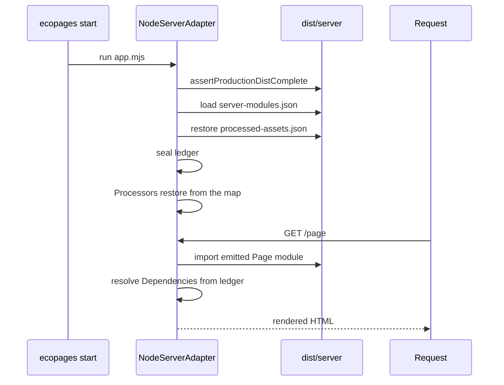

# Ledger and start

`ecopages start` restores the records a build wrote and serves requests from them. It still renders Pages per request, but it never runs the bundler, never runs a Processor and never writes into `dist/`. Anything the build did not produce is an error that says to run `ecopages build` again, not a fallback compile. [Build pipeline](/dev/build-pipeline) covers how those records are produced.

## The processed-asset ledger

`ProcessedAssetLedger`, stored on `AppRuntime.processedAssets`, maps a dependency key (`getAssetDependencyKey`) to the emitted asset. Two writers fill it during a build:

- `buildAppBrowserClient()` records each entry's output under the key of every dependency that declared it, then records every emitted file, chunks included, as `browserOutputs`.
- `AssetProcessingService` records every dependency it processes in production, stylesheets and content scripts included, as each one lands in its cache.

After the app-wide build, each planned route runs its preparation, so asset processing records every remaining dependency those routes are served with. A bundleable script the build already produced resolves to the recorded output instead of being bundled again. Inline assets keep their content and drop `filepath`, since no file reaches `dist/`.

`writeProductionAssetLedger()` writes the ledger, plus the HTML module-script URLs by root-relative source, to `dist/server/processed-assets.json`. It runs right after prebuild, because the Lit static-render worker restores the ledger, unsealed, during the export. When the build has a server bundle, it runs again after rendering to add what rendering processed. A failed generation clears the file. Why: a later `ecopages start` must never seal a partial build.

## What start restores

`ecopages start` does not load `eco.config.ts`. `createLaunchPlan()` finds the one directory with `server/manifest.json` (or the `--dist-dir` given), points the process at the emitted config the deploy manifest names, and runs `dist/server/app.mjs`. That loader records its directory, which marks the start as one from a complete `dist/`.

`NodeServerAdapter.initializeResources()` then:

1. Calls `assertProductionDistComplete()`: one build id across the manifests, the server entry, emitted config, route list, every listed server module and every ledger output must exist. It reads no source.
2. Loads the server-modules map with `requireProductionServerModules()`.
3. Restores the ledger with `restoreProductionBrowserBuild(appConfig, { seal: true })` and refreshes each Integration's resolved global scripts from it.
4. Runs `setupAppRuntimePlugins` with `skipProcessorSetup`, so each Processor calls `restoreProductionRuntime()` instead of `setup()`. Why: the deploy may hold no sources to scan, and the build already produced everything a Processor generates.

It does not copy the public directory or touch `dist/`, because the build already did. The route registry loads its routes from `routes.json` instead of scanning the pages directory.

## What start refuses

Once sealed, `AssetProcessingService.processDependencies()` is a pure lookup. It returns the recorded output of every dependency and runs no processor, writes no file and gzips nothing. Island and lazy entries resolve through the same ledger. Why: a request-time compile on the server could fail for reasons the build did not, and could serve output that differs from what the build verified.

| Missing at start | Result |
| --- | --- |
| A `dist/` file, or mismatched build ids | Startup fails: ``... Run `ecopages build` again.`` |
| A `server-modules.json` entry or its file | Request fails: ``No compiled server module for <source>. Run `ecopages build`.`` |
| A dependency the ledger does not record | Request fails: ``The production build did not record the <kind> <name>. Run `ecopages build` again.`` |
| A recorded output removed from `dist/` | Request fails: `The production build recorded <file> but it is missing.` |
| A ledger in an older format, or the earlier `browser-client-manifest.json` | Startup fails and asks for a new build |
| `processed-assets.json` itself | Startup continues unsealed and processes assets on request. A build always writes the file, so only a deploy that drops it reaches this case |

Only a start from a complete `dist/` restores and seals the ledger. Why: any other start must not serve stale outputs for a source edited after the build. For how content collections join this map, see [Content processor](/dev/content-processor).
