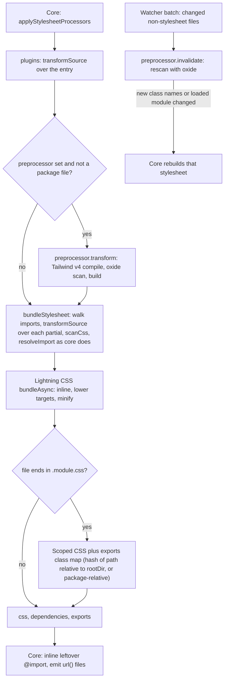

# Lightning CSS processor

`LightningCssProcessorPlugin` is a stylesheet Processor (see [/dev/plugin-pipeline](/dev/plugin-pipeline)) like the [PostCSS processor](/dev/postcss-processor): one `stylesheet` capability for `*.css`, narrowed by a filter, a transform and nothing else. Core owns the cache, the prewarm, the dependency map, the dev writes and `css-update`, and an app registers one stylesheet Processor, so this one replaces PostCSS. It handles plain CSS and scopes CSS Modules.

## Transform

`transformStylesheet(css, file)` resolves the options once, bundles the stylesheet and returns `{ css, dependencies }`.

- The native binding loads on the first call (`loadLightningCss`), never while config finalization constructs the Processor.
- `targets` are browserslist queries, turned into Lightning CSS targets with `browserslistToTargets`; unset, nothing is lowered. `minify` defaults to production. `include` and `exclude` take feature names, so the config never imports the native module. `projectRoot` is the app root, so hashes do not depend on the machine.
- Lightning CSS rejects an explicit `undefined` option, so unset options are left out.
- An error becomes an `Error` with `file:line:column` and the original as its cause. A warning is logged with its location through `warnStylesheetOnce`, once per stylesheet until it changes.
- Only native CSS nesting is supported by default. Lightning CSS parses Sass-style suffix nesting (`&--primary`, `&__element`) as the nesting selector followed by an element name, without an error or a warning, then keeps it as written for a browser to drop or lowers it to `--primary.button`, which matches nothing. `bundleStylesheet` composes `suffixNestingVisitor` with the visitors of the plugins and the app's `visitor` to collect every such selector with its file (from the stylesheet's `sources`), line and column, and throws one `StylesheetDiagnosticsError` that lists them all with a hint to write the full selector or add the `suffixNesting()` plugin. A selector with several pairs lists each of them, and a type selector after `&` (`&div`, which is invalid whatever the name) has its own message, since the suffix hint would be wrong for it. `toStylesheetError` returns the error unchanged, so a build fails and development shows the overlay and keeps the last good output. The check sits in `bundleStylesheet`, so it covers CSS Modules and the CSS the Tailwind preset hands over; it runs after the plugin visitors and before the app's, so anything a plugin leaves invalid still fails loudly.

## Bundling

`bundleStylesheet` first walks the imports depth first, in the order written, so what is hoisted and which import closes a cycle do not depend on the order Lightning CSS reads files in. It then calls `bundleAsync` with a resolver whose `read` serves the prepared CSS: the in-memory source of the entry, so the stylesheet that core hands over is the one bundled, and each partial from disk. Each file goes through core's CSS scanner (`scanCss`) as it is walked:

- The `transformSource` of the plugins runs on its source as it is read, before anything below.
- Its relative `url()` references are rebased onto the entry with `rebaseStylesheetReferences`. Lightning CSS does not rewrite them, and core resolves the output's references from the entry's directory.
- Its `@import` specifiers are resolved by `resolveImport`, as core does: a path relative to the importer or a sibling first, then a tsconfig alias (`resolveProjectImportPath`), then a package (`resolvePackageStylesheetPath`). Only a `.css` file that is not a dotfile is bundled.
- A specifier that names no file (root-relative, remote, `data:`), a missing file, a dotfile or a non-stylesheet is removed and kept as a statement to put at the top of the output. Lightning CSS refuses an external `@import` after a bundled one, where core hoists them all, so the Processor takes them out and puts them back in order. A missing `.css` file also counts as a dependency, and a warning names the importer.
- An `@import` that would close a cycle is removed with a warning. Lightning CSS drops the CSS of every stylesheet in a cycle, where core inlines each once, at its last import.

Lightning CSS then inlines the rest with the `layer()`, `supports()` and media conditions of each. For a stylesheet imported twice, the last import wins, as the cascade orders it, and core's scanner does the same. Importing one partial under two different `layer()` names fails in Lightning CSS ("Unsupported layer combination"), where core keeps the last import. Its nesting of the conditions can differ from core's too (`supports` outside `layer`), which selects the same rules.

`dependencies` are the partials `read` served and the missing `.css` files, so core rebuilds the entry when one is edited or created. After the Processor, core inlines any relative `@import` left and copies the files the output's `url()` references name by file type, never a dotfile.

## Plugins

The `plugins` option is a list of `LightningCssPlugin`: `{ name, transformSource?(css, file), visitor? }`. They run in array order and reach every stylesheet through three places:

- `transformStylesheet` runs `transformSourceWithPlugins` over the entry's source first, before the `preprocessor`, so CSS a plugin writes can use what the preprocessor handles (Tailwind's `@apply`).
- `StylesheetBundle.prepare` runs it over each partial as it reads the file, before the references are rebased and the `@import`s scanned. Reading is asynchronous, so `prepare` is too: it scans a file's `@import`s once to list them, walks them in order, then scans again to apply what it decided, which keeps the hoisting and cycle order the synchronous walk gave. CSS Modules take the same route, so a class is scoped after a plugin rewrote its rule.
- `bundleAsync` gets one visitor, built with Lightning CSS `composeVisitors` from the plugin visitors, then the Processor's `suffixNestingVisitor`, then the app's `visitor`.

A failure other than a `StylesheetDiagnosticsError` is rethrown naming the plugin.

### Suffix nesting

`suffixNesting()` (`plugins/suffix-nesting.ts`) rewrites `&--x`, `&__x` and `&-x` into native nesting in `transformSource`, using `tokenizeCss` from `@ecopages/core/processor` so strings, comments, escapes and `url()` are never read as CSS structure. `parseBlocks` turns the source into a tree of text and block nodes that keep their offsets in the original source, so errors name the real file, line and column.

- A child rule whose selectors all hold a suffix is moved out as a sibling right after its parent, with every `&`+suffix replaced by each parent selector plus the suffix: `.button, a.button { &--primary {} }` gives `.button--primary, a.button--primary {}`. The moved rule's body is walked again with the new selectors as parents, so `&--text { &:hover svg {} }` and several levels work. A rule nested in another rule needs no change in selector: as a sibling it keeps its implicit parent prefix.
- The parent keeps its place in the cascade: a declaration or rule that follows a moved rule goes in a second piece of the parent (the same prelude again), after the moved rule, so equal-specificity rules keep the order they were written in. This matches what `postcss-nested` produces for the selectors and declarations of the docs app, which the parity test checks file by file; it differs only in splitting the parent where a declaration follows a nested rule.
- Conditional at-rules (`@media`, `@supports`, `@container`, `@layer`) in the parent are walked, and the moved rule is wrapped in the same condition after the parent. Other at-rules, such as `@utility`, are left as written.
- A suffix inside `:is()`, `:where()` or `:not()` is expanded too; a suffix there, or one that is not the first thing in the selector, needs a parent that is not itself nested in a rule, since the moved rule would otherwise pick up an implicit parent prefix.
- Each parent selector must be a compound selector (no combinator or whitespace outside parentheses and brackets) that ends in a class, id, type or `&`. Otherwise, and for a rule that mixes suffix and other selectors or uses another `&`, the expander records the file, line, column and selector and leaves the rule as written; all are thrown together as one `StylesheetDiagnosticsError`.
- Line numbers after the expansion refer to the rewritten source, so a later Lightning CSS error or warning in a stylesheet that used suffix nesting is not at the line of the original; the expander's own errors always are.
- `transformSource` returns the source untouched when it holds no `&-` or `&_`, and when the braces do not balance, which Lightning CSS reports.

## CSS Modules

The `stylesheet` capability sets `cssModules: true`, so core delivers CSS Modules to this Processor (see [/dev/plugin-pipeline](/dev/plugin-pipeline#css-modules)). For a file ending in `.module.css`, `bundleStylesheet` passes `cssModules: { pattern }` to `bundleAsync` and the plugin returns `exports` beside the CSS.

- `pattern` is the `cssModules.pattern` option and defaults to `[hash]_[local]`. The hash is Lightning CSS's, of the path relative to `projectRoot`, which is the real path of `rootDir`, so two folders give the same names. For a CSS Module of a package, `packageScopeFile` gives Lightning CSS core's `toPackageScopeFile` as the file name (`<rootDir>/node_modules/<package name>/<path inside the package>`), for the entry and for every `composes ... from` partial, so the hash does not depend on the store layout; `StylesheetBundle` maps those names back to the real files for `read`, `resolve` and warnings. The `preprocessor` does not run on a package file, as a package ships built CSS.
- `serializeExports` turns each export into one string: the scoped name, then the scoped names it composes, separated by spaces, with the keys sorted so a reordered file gives the same map.
- `composes: x from './other.module.css'` is resolved like an `@import`, with the same walk, so the other file is read, scoped with the rest and listed in `dependencies`. A file that cannot be found fails the stylesheet, since the exported name would have no rule.

## Preprocessor and the Tailwind v4 preset

The `preprocessor` option is a `LightningCssPreprocessor`: `transform(css, file, { rootDir, transformSource? })` returns the CSS Lightning CSS reads in place of the source, with the files it read, and the optional `invalidate(files)` is the Processor's `invalidateStylesheets`. The plugin runs `transform` first, passes its CSS to `bundleStylesheet`, merges both sets of `dependencies`, and delegates `invalidateStylesheets` to `invalidate`. A failure in either stage goes through `toStylesheetError`, so a build stops and development keeps the last good output. The preprocessor stays its own option and does not become a plugin: a plugin's `transformSource` returns only a string, where a preprocessor also reports the files it read for `dependencies` and names the stylesheets a changed template makes stale in `invalidate`. Presets set the option; `tailwindV4Preset({ referencePath })` returns `{ preprocessor }`, so an app spreads it into `lightningCssProcessorPlugin` beside its own options.

The Tailwind preprocessor needs no PostCSS. `@tailwindcss/node`, `@tailwindcss/oxide` and `tailwindcss` are optional peers, imported on the first stylesheet that uses a Tailwind at-rule (`loadTailwind`), so config finalization and plain apps never load them. For one stylesheet:

- `withReference` decides what the source becomes. The reference file itself, and a file that already references or imports it, stay as written; `@import "tailwindcss"` becomes an import of the reference file, so the app's theme applies; a CSS Module, or a file that uses `@apply`, gets an `@reference`. `insertReference` puts it after the leading comments, `@charset`, `@import` and empty `@layer` statements, since an `@import` is inlined only while every statement before it is one of those, and keeps a leading byte order mark first. This is the rule of the PostCSS preset. That preset has no CSS Module case: its Processor does not declare `cssModules`, so a CSS Module never reaches it.
- Tailwind reads the partials it inlines itself, so the `transformSource` of the plugins cannot reach them through `bundleStylesheet`. When a plugin has one, the Processor passes it in the context, and the `customCssResolver` (`resolveImport`) runs it over each relative or tsconfig alias `.css` partial. A partial no plugin changes is left to Tailwind. One that changes is written to a copy in its own temporary folder (`RewrittenPartials`), with its `url()` references rebased onto that folder, and Tailwind reads the copy; imports inside a copy resolve from the folder of the partial it stands for, package imports through `resolvePackageStylesheetPath`, and `onDependency` reports the original file, never the copy.
- A stylesheet with no Tailwind at-rule is returned untouched and the Processor continues as it would without the preset.
- `compile(css, { base, from, onDependency })` from `@tailwindcss/node` reads the Tailwind entry and every `@import`, `@plugin` and `@config` file; `onDependency` becomes the returned `dependencies`. A `customCssResolver` resolves a tsconfig alias through `resolveProjectImportPath`, as the bundler does, since Tailwind's own resolver reads packages only. A compile that reports no feature returns the source.
- When the stylesheet emits utilities, oxide scans the app root and the stylesheet's `@source` directives (`scanSources`), and `build(candidates)` generates the CSS. The scanner is kept per stylesheet and reused while its sources are the same, so a rebuild does not scan the app again. Then `bundleStylesheet` bundles, lowers and minifies the result with the Processor's options; a CSS Module is scoped from the generated CSS, with `@property` fallbacks left out as in `@tailwindcss/postcss`.
- Tailwind declares its `Features` and `Polyfills` as ambient `const enum`s, which `verbatimModuleSyntax` cannot import, so `TAILWIND_FLAGS` repeats the four values the preset reads and a test pins them to the installed Tailwind.

`invalidate(files)` is the invalidation hook. Core calls it once per watcher batch with the changed files that are not stylesheets, before it rebuilds. For each stylesheet that has been transformed it returns the stylesheet when a changed file is one of the modules its compile loaded, or when rescanning raises a class name its last build lacks. A changed file the scanner already reads is rescanned alone (`scanFiles`). A file the scanner has not seen that matches one of its globs is new, so the scanner is replaced by a fresh one, which also tells whether Tailwind would read the file at all (it skips ignored and binary files). A file that is gone, or that no glob matches, such as a lockfile, rebuilds nothing, and a stylesheet whose class names did not grow is not rebuilt. A failed transform keeps its state, so the next save of the template or the stylesheet rebuilds it. Tailwind caches a loaded `@plugin` module, so editing a plugin rebuilds the stylesheet but may not change its output until the dev server restarts.

## Contract tests

The package runs `stylesheetProcessorContract` from `@ecopages/core/processor/contract`, once with `cssModules: true`, and adds a bundling matrix, development rebuild tests and the `e2e/fixtures/lightningcss` production fixture. The preset has unit tests against fixture CSS, a development test where a new class in a template reaches the stylesheet, and `e2e/fixtures/tailwind-v4-parity`, which builds `playground/tailwind-v4` and `playground/tailwind-v4-lightningcss` and compares the classes they define.
