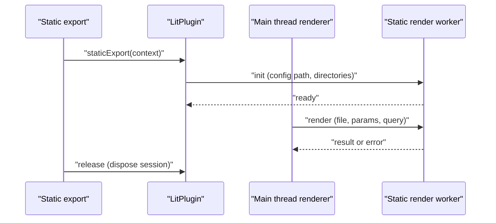

# Lit

`@ecopages/lit` owns `.lit.tsx` Pages and renders Lit custom elements for other Integrations when they hand it a Foreign Subtree. Lit SSR output uses declarative shadow DOM, so the browser keeps the server-rendered shadow roots and the element hydrates in place.

## What it plugs into core

| Contract                  | Lit                                                                                                                         |
| ------------------------- | --------------------------------------------------------------------------------------------------------------------------- |
| Plugin name / extensions  | `lit` / `['.lit.tsx']`; options can override `extensions`                                                                   |
| Declaration               | `LitPlugin extends IntegrationPlugin`, created by `litPlugin()`                                                             |
| `jsxImportSource`         | not declared                                                                                                                |
| Renderer                  | `createLitRenderer(getRenderSession)`, built on `createIntegrationRenderer`; the plugin overrides `createRenderer` to pass the session accessor |
| `serverDom`               | `{ kind: 'repair' }` calling `ensureLitDomShim()`                                                                           |
| Global dependency         | `@ecopages/lit/hydrate-support` as a head module script, `data-eco-script-id="lit-hydrate-support"`, unshifted so it is first |
| Build plugins             | none                                                                                                                        |
| HMR strategy              | none; `hmr()` only invalidates Lit SSR script preloads when a script entrypoint changes                                     |
| Static export             | `staticExport()` starts a worker session and returns a release                                                              |

## Why `serverDom` is a repair

Installing a complete surface after an incomplete one replaces `customElements` and drops defined elements. Core therefore runs every `complete` server DOM installer, then every `repair`, before Integration `setup()` continues, whatever the config order. Lit installs its shim only while no custom element registry exists, and installs no DOM globals as an import side effect or on first render.

## Hydration support

`lit-hydrate-support.ts` imports `@lit-labs/ssr-client/lit-element-hydrate-support.js` and `lit` from the app's own install, so the patched `LitElement` and `lit-html` are the ones the app's elements use. It is a module script of the app browser graph: it imports the app's `lit` instead of carrying its own copy.

A bundler can evaluate `lit-element` in a chunk before this module's body, and then the global hook has already been skipped. The module checks `Object.hasOwn(LitElement, 'observedAttributes')` and applies the patch itself only when missing, so it never patches twice. Core places every Integration's global scripts before Component scripts in `document.head`, in config order, on a Lit Page and on a Page another Integration owns, which is what makes the patch precede element definitions ([From graph to HTML](/dev/graph-to-html)). An element defined before the patch reuses its declarative shadow root without hydrating it and renders its template a second time.

## Renderer hooks

| Hook                   | Behavior                                                                                                                    |
| ---------------------- | --------------------------------------------------------------------------------------------------------------------------- |
| `transformDocumentHtml`| `normalizeLitHtml`                                                                                                          |
| `renderComponent`      | preloads the `ssr: true` scripts core assigns to Lit in the Component's tree (a Page's are preloaded by core before it renders), renders children to a string, calls the function component, serializes with `renderLitValueToString`, injects children at a slot marker |
| `renderQueuedChildren` | resolves queued foreign tokens in string children                                                                           |
| `renderCustomElements` | `renderLitCustomElementsInMarkup`: gives the registered elements in markup another Integration produced their declarative shadow root |
| `renderRemote`         | hands a Page to the static-export worker when a session exists                                                              |

Registered elements stay registered for the rest of that render, so every one renders with its shadow DOM. Preload state lives on the `AppRuntime` (`customElementSsrPreloadScopes`), so separate apps keep separate histories. Every in-process render, serving and static export alike, preloads through `createCustomElementServerModuleImporter`, which compiles the script with the app's server module loader into the work directory. Preload never runs the script through the browser asset pipeline, so a build emits no browser bundle for it beside the app-wide output. Every `ssr: true` script is preloaded, eager or lazy, so a Lit Component renders its element with its shadow DOM whichever Integration hosts it; `lazy` still controls browser loading. `LitPlugin` declares `ssrScriptPreload: 'own-and-foreign'`: Lit evaluates the scripts of its own Components and of Components whose Integration has no preloader, such as a Lit element declared on a Kita Component, but never a script another preloading Integration owns, such as a Radiant element's ([Route rendering](/dev/route-rendering#custom-element-ssr-scripts)). A stylesheet such a script imports with a binding (`static styles = unsafeCSS(styles)`) compiles to the app's processed CSS in the server build too, so the declarative shadow root carries the same styles hydration adopts ([Stylesheet imports](/dev/build-pipeline#stylesheet-imports)).

## Static export worker

Lit only renders a declarative shadow root for markup that passes through `@lit-labs/ssr`, so core passes the finished document of a Page that has `ssr: true` scripts assigned to Lit through `renderCustomElements`. That covers a Lit element in a Kita Component on a Kita Page and in a Foreign Subtree spliced into a Lit Page alike ([Route rendering](/dev/route-rendering#custom-element-ssr-scripts)). `renderLitCustomElementsInMarkup` renames the elements that already have a declarative shadow root to a placeholder while it renders, so what Lit rendered earlier is not rendered twice. `@lit-labs/ssr` emits that template for every Lit element, including one that renders into the light DOM, so the check holds for all of them. React bodies are complete strings, so a Lit element written as a raw tag in a React Component gets its shadow root the same way. A Page with no Lit-assigned script is not touched.

Serving renders every Lit Page in-process and starts no worker. `LitPlugin.staticExport()` starts a worker thread that bootstraps its own app runtime. Static export renders Lit-owned Page routes in the worker, which preloads their `ssr: true` scripts before each render so `@lit-labs/ssr` sees the registered custom element. The session only owns the worker; a Page that renders on the main thread preloads through `IntegrationRenderer.render()`, as in the worker.

- Pages with `locals` or explicit `props` decline the worker path and render in-process: request locals are not sent through the worker protocol, and explicit props are not passed because the worker re-imports the route module.
- The worker restores the production browser build from the asset ledger, so a Lit Page links the same app-wide outputs as any other Page. It loads its config with `globalScriptResolution: 'browser-build'`, so its activations resolve no global script, and it resolves the global scripts such as hydration support with `resolveIntegrationDependencies()` after that restore, not at init, so the worker bundles none of them on its own into `dist/client` ([Build pipeline](/dev/build-pipeline), [Ledger and start](/dev/ledger-and-start)).
- `ECOPAGES_LIT_STATIC_RENDER_WORKER=true` makes the worker skip processor `.setup()`; the main thread already prepared artifacts. Integration setup still runs in the worker.
- Teardown disposes the session; the release returned by `staticExport()` does the same so no worker outlives the export.

`staticExport()` throws without `appConfig.absolutePaths.config`, and passes the export's output and work directories with `context.baseUrl`. That triple is the worker's identity: a later start with the same identity reuses the worker, a different one disposes it and starts another. The `init` message carries the directories, so the worker reads the ledger of the build it exports even when the configured `distDir` holds an earlier build. Renders run one at a time, and a render that finds the module loader's development generation changed restarts the worker first.

| Message | Direction | Purpose |
| --- | --- | --- |
| `init` | main to worker | Load the config module with the export's directories and bootstrap the runtime |
| `ready` | worker to main | Worker initialized |
| `render` | main to worker | Render one Lit Page route (`filePath`, `params`, optional `query`) |
| `result` / `error` | worker to main | HTML with optional `cacheStrategy`, `sourceDependencyPaths` and `metadata`, or the error |
| `shutdown` | main to worker | Wait for active renders, tear down Integrations, close the port |
| `shutdown-complete` | worker to main | Teardown done; the client then waits for the worker to exit and terminates it after a timeout |

`postMessage` cannot carry an error's class, so `error` carries the status of a thrown `HttpError`, and the main thread rebuilds an `HttpError` with it; without the status, a Page throwing `HttpError.NotFound()` in the worker would render as a 500. The worker's name, message and stack stay on the rebuilt error's `cause`.

## Custom-element registration

`custom-element-define.ts` replaces a tag's definition on Lit's SSR registry during development reloads, since that registry warns on a second `define` and has no `delete`. A second definition during production SSR throws. The browser registry cannot replace a tag.

## HMR

Lit has no HMR strategy. Script HMR comes from core; the Integration's `hmr()` additionally drops the SSR preload record of a changed script ([HMR strategies](/dev/hmr-strategies)).

## See also

[Islands and hydration](/dev/islands-hydration), [Integrations and Foreign Children](/dev/integrations-foreign-children), [Kita](/dev/kita) (a common outer shell for Lit).
