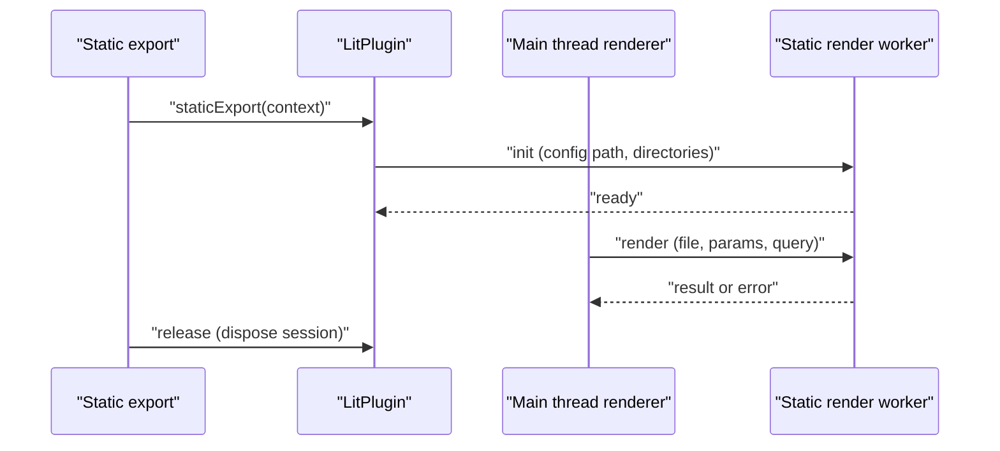

# Lit

`@ecopages/lit` owns `.lit.tsx` Pages and renders Lit custom elements for other Integrations when they hand it a Foreign Subtree. Lit SSR output uses declarative shadow DOM, so the browser keeps the server-rendered shadow roots and the element hydrates in place.

## What it plugs into core

| Contract                  | Lit                                                                                                                         |
| ------------------------- | --------------------------------------------------------------------------------------------------------------------------- |
| Plugin name / extensions  | `lit` / `['.lit.tsx']`; options can override `extensions`                                                                   |
| Declaration               | `LitPlugin extends IntegrationPlugin`, created by `litPlugin()`                                                             |
| `jsxImportSource`         | not declared                                                                                                                |
| Renderer                  | `createLitRenderer(getRenderSession)`, built on `createIntegrationRenderer`; the plugin overrides `createRenderer` to pass the session accessor |
| `serverDom`               | `{ kind: 'repair' }` calling `ensureLitDomShim()`                                                                           |
| Global dependency         | `@ecopages/lit/hydrate-support` as a head module script, `data-eco-script-id="lit-hydrate-support"`, unshifted so it is first |
| Build plugins             | none                                                                                                                        |
| HMR strategy              | none; `hmr()` only invalidates Lit SSR script preloads when a script entrypoint changes                                     |
| Static export             | `staticExport()` starts a worker session and returns a release                                                              |

## Why `serverDom` is a repair

Installing a complete surface after an incomplete one replaces `customElements` and drops defined elements. Core therefore runs every `complete` server DOM installer, then every `repair`, before Integration `setup()` continues, whatever the config order. Lit installs its shim only while no custom element registry exists, and installs no DOM globals as an import side effect or on first render.

## Hydration support

`lit-hydrate-support.ts` imports `@lit-labs/ssr-client/lit-element-hydrate-support.js` and `lit` from the app's own install, so the patched `LitElement` and `lit-html` are the ones the app's elements use. It is a module script of the app browser graph: it imports the app's `lit` instead of carrying its own copy.

A bundler can evaluate `lit-element` in a chunk before this module's body, and then the global hook has already been skipped. The module checks `Object.hasOwn(LitElement, 'observedAttributes')` and applies the patch itself only when missing, so it never patches twice. Core places the script first in `document.head`, which is what makes the patch precede element definitions.

## Renderer hooks

| Hook                   | Behavior                                                                                                                    |
| ---------------------- | --------------------------------------------------------------------------------------------------------------------------- |
| `beforeRender`         | preloads `ssr: true` scripts of the Page, Layout and `pageDependencyComponents`                                             |
| `transformDocumentHtml`| `normalizeLitHtml`                                                                                                          |
| `renderComponent`      | preloads the Component's SSR scripts, renders children to a string, calls the function component, serializes with `renderLitValueToString`, injects children at a slot marker |
| `renderQueuedChildren` | resolves queued foreign tokens in string children                                                                           |
| `renderRemote`         | hands a Page to the static-export worker when a session exists                                                              |

Registered elements stay registered for the rest of that render, so every one renders with its shadow DOM. Preload state lives on the `AppRuntime` (`customElementSsrPreloadScopes`), so separate apps keep separate histories. Every in-process render, serving and static export alike, preloads through `createCustomElementServerModuleImporter`, which compiles the script with the app's server module loader into the work directory. Preload never runs the script through the browser asset pipeline, so a build emits no browser bundle for it beside the app-wide output. `ssr: true` scripts execute on the server before render and are excluded from the HTML; `lazy` still controls browser loading.

## Static export worker

Serving renders every Lit Page in-process and starts no worker. `LitPlugin.staticExport()` starts a worker thread that bootstraps its own app runtime. Static export renders Lit-owned Page routes in the worker, which preloads their `ssr: true` scripts before each render so `@lit-labs/ssr` sees the registered custom element. The session only owns the worker; a Page that renders on the main thread preloads through the renderer's hooks.

- Pages with `locals` or explicit `props` decline the worker path and render in-process: request locals are not sent through the worker protocol, and explicit props are not passed because the worker re-imports the route module.
- The worker restores the production browser build from the asset ledger, so a Lit Page links the same app-wide outputs as any other Page. Its Integration setup defers the global scripts such as hydration support until that restore, so the worker bundles none of them on its own into `dist/client` ([Build pipeline](/dev/build-pipeline), [Ledger and start](/dev/ledger-and-start)).
- `ECOPAGES_LIT_STATIC_RENDER_WORKER=true` makes the worker skip processor `.setup()`; the main thread already prepared artifacts. Integration setup still runs in the worker.
- Teardown disposes the session; the release returned by `staticExport()` does the same so no worker outlives the export.

## Custom-element registration

`custom-element-define.ts` replaces a tag's definition on Lit's SSR registry during development reloads, since that registry warns on a second `define` and has no `delete`. A second definition during production SSR throws. The browser registry cannot replace a tag.

## HMR

Lit has no HMR strategy. Script HMR comes from core; the Integration's `hmr()` additionally drops the SSR preload record of a changed script ([HMR strategies](/dev/hmr-strategies)).

## See also

[Islands and hydration](/dev/islands-hydration), [Integrations and Foreign Children](/dev/integrations-foreign-children), [Kita](/dev/kita) (a common outer shell for Lit).
