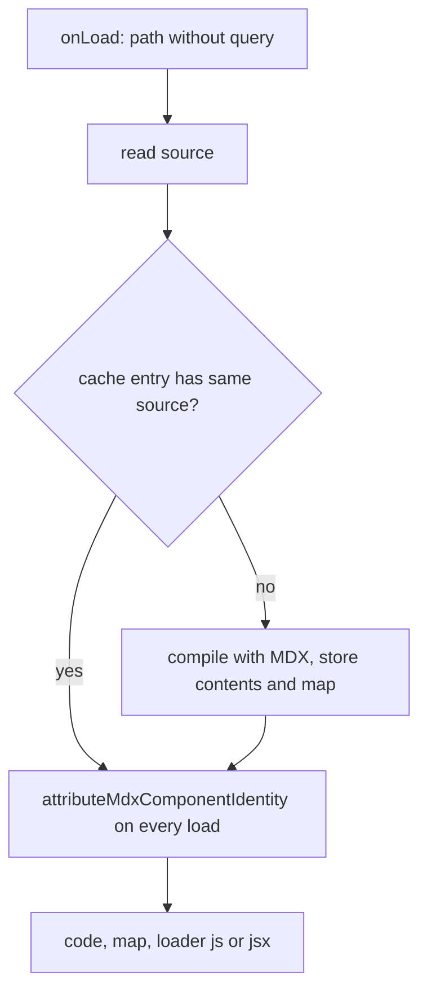

# MDX

`@ecopages/mdx` has two parts. The standalone `MDXPlugin` is an IntegrationPlugin for third-party JSX runtimes such as `@kitajs/html`. The `core` export (`@ecopages/mdx/core`) holds the shared loader and option helpers that the React and Ecopages JSX Integrations reuse for their own MDX. For where Integrations sit, see [/dev/plugin-pipeline](/dev/plugin-pipeline).

## The standalone plugin

`mdxPlugin({ compilerOptions })` extends `IntegrationPlugin` with the name `MDX`, the `MDXRenderer`, and `extensions` defaulting to `['.mdx']`.

- `compilerOptions.jsxImportSource` is required. The constructor throws for `react` (and `react/*`) and for `@ecopages/jsx` (and `@ecopages/jsx/*`), pointing at `reactPlugin({ mdx })` and `ecopagesJsxPlugin({ mdx })`.
- Defaults are `format: 'detect'`, `outputFormat: 'program'`, `jsxRuntime: 'automatic'`, and `development` from the runtime.
- `plugins(app)` returns one `mdx-loader` build plugin, with `projectRoot` set to `app.rootDir`.

The renderer uses core's shared route renderer with two hooks: `normalizePageModule` (requires a default function export, resolves layouts from `config`, and keeps the last layout as `layout`) and a Page Browser Graph contribution that adds the layouts' and the Page's `config` as components. See [/dev/pages-layouts-components](/dev/pages-layouts-components).

## Where the options live

| Plugin | MDX options | Plugin lists (`remarkPlugins`, `rehypePlugins`, `recmaPlugins`) |
| --- | --- | --- |
| `mdxPlugin` | `compilerOptions` (required `jsxImportSource`) | Inside `compilerOptions` |
| `reactPlugin({ mdx })` | `mdx` object enables MDX, omit it to disable | Top level of `mdx`, not accepted in `compilerOptions` |
| `ecopagesJsxPlugin({ mdx })` | Same shape as React | Top level of `mdx` |

React and Ecopages JSX both go through `resolveMdxCompilerOptions`, which forces their `jsxImportSource` and writes `mdx.extensions` over `mdxExtensions` instead of merging. Why: `['.react.mdx']` must not also claim plain `.mdx` through a leftover `mdxExtensions`.

## Extension handling and `.md`

The loader's filter is built from `[...mdxExtensions, ...mdExtensions]` of the compiler options, matched as a suffix that allows a trailing query string.

- `.md` is never claimed implicitly. The standalone plugin sorts its `extensions` into `mdxExtensions` and `mdExtensions`; only a declared `.md` lands in the latter. The React loader passes `defaultMdExtensions: []`.
- A `.md` file is compiled with `format: 'mdx'` unless a non-`detect` format is configured. Why: in `detect` mode `.md` is plain markdown, and top-level `import` and `export` would render as text.

## Scoping by extension

Each Integration registers its own loader, and a loader only matches its own extensions: `mdx-loader` for the standalone plugin, `react-mdx-loader`, and `ecopages-jsx-mdx-loader`. The extensions are also added to the Integration's `extensions`, so route matching and the loader agree on which files the Integration owns. Two Integrations can therefore compile MDX side by side as long as their extensions are disjoint, and an entry compiled by one is a Component owned by that Integration. See [/dev/integrations-foreign-children](/dev/integrations-foreign-children) and [/dev/content-processor](/dev/content-processor) for how an entry rendered under another lane is handed off or rejected.

## The loader and its compile cache

`createMdxLoaderPlugin` is one `onLoad` per file. `projectRoot` is required and the factory throws without it.

- The cache is a per-loader `Map` keyed by file path, reused while the source text is unchanged. One loader instance serves server builds, browser bundles and HMR rebuilds, so they share compiles. A new loader, for example after a config reload, starts empty.
- Only the compile is cached. Identity attribution runs on every load, so a change to an imported Component applies without recompiling the MDX.
- `attributeMdxComponentIdentity` binds Component identity (integration name and project root), discovers top-level Component and stylesheet imports, and attaches them to `config`. Stylesheet imports are stripped from the output. Imports inside code blocks and functions are left alone. See [/dev/plugin-pipeline](/dev/plugin-pipeline) for identity attribution.
- Source maps: the compiler map is composed with the identity edits and returned unless `includeSourceMap` is false. The Ecopages JSX loader sets it to false.
- The plugin's `cacheKey` fingerprints `projectRoot`, compiler options, extensions, `includeSourceMap` and `loader`. Functions such as remark plugins enter by name, so two loaders differing only in an anonymous plugin's closure share a key.
- `loader` is `jsx` when `compilerOptions.jsx` is set, otherwise `js`.
