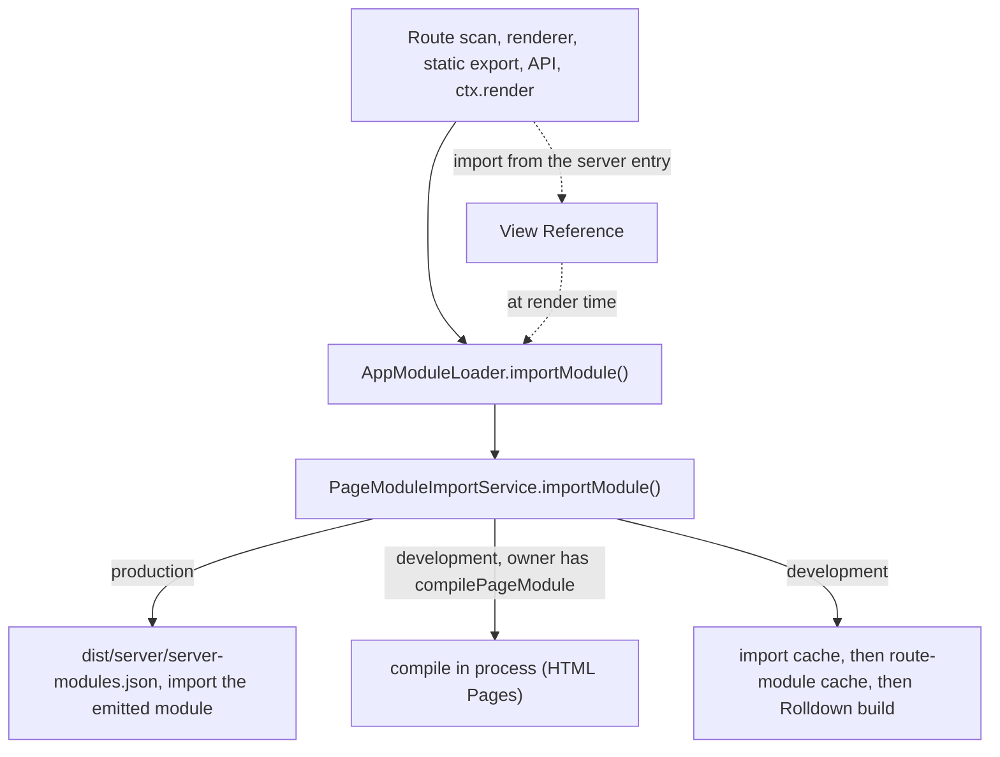

# Module loading

Every server-side import of an app module, whether a Page, a Layout, the Html shell, an error page or a view passed to `ctx.render`, goes through one loader. In production it imports the module `ecopages build` emitted; in development it compiles the source with Rolldown and imports the result. [Build pipeline](/dev/build-pipeline#server-modules) covers how the production map is emitted.

Config finalization creates one `AppModuleLoader` per `AppRuntime`, bound to that app's root and build queue; call sites reach it through `requireAppRuntime(appConfig).moduleLoader` and pass only the module path and request-specific options.

## View References

The server entry (`app.ts`) imports view files directly, but they cannot load as ordinary modules there: they need their Integration's compilation, and in production the emitted copy. An import of a file an Integration owns therefore becomes a View Reference, a stand-in that the app module loader resolves at render time. In development the CLI's `view-reference-preload.js` rewrites those imports; in production `createImportedViewPlugin()` does it while bundling the server entry, and records the paths so the views join the server-modules map.

A file becomes a View Reference only when it is a view: a script module with a default export (`isViewModule`). A file without one, such as a file of plain components, imports as itself. The reference replaces the whole module, so a named import from a view file fails. Files that are not script modules, such as `.html`, are always views; core claims `.html` for its HTML Pages Integration unless another Integration does.

## Production

`PageModuleImportService` imports from `dist/server/server-modules.json`, stored on `AppRuntime.productionServerModules`, whenever the map exists. A missing entry is an error naming the source and asking for `ecopages build`; nothing is compiled. Keys and the paths inside emitted modules (`identity.file`, View References) are relative to the app root, so lookups resolve against the deploy's root wherever it was built. The Lit static-render worker uses the same map; [Lit](/dev/lit) covers the worker.

## Development caches

Two caches sit in front of a Rolldown build:

1. **Import promise cache** (`PageModuleImportService.importCache`). A bundled import is keyed by file path, the canonical identity of its `BuildOptions` (`createRouteModuleReuseIdentity`) and the file's source hash; a `compilePageModule` import by file path, Integration name and source hash. A hit does not re-hash dependencies. `bypassCache` skips only this cache.
2. **Route-module build cache** (`RouteModuleBuildCache`, one per app and output directory on `AppRuntime.routeModuleBuildCaches`). It reuses compiled output while the dependency hashes match, keyed by the same `BuildOptions` identity plus `hashAppConfigFile()`, a hash of the config module and the project files it imports. An entry is reused only while every local file its output imports still exists. It lives in memory for the current process; output goes to `.eco/.server-modules`.

Each compiled server module registers its entry closure, the files plugins declared with `addWatchFile` included, in the build-input index, also when it loads from cache. HTML cache entries include the route's closure, and compiled-artifact checks follow the emitted chunk graph without reparsing JavaScript.

## Invalidation

Because neither cache re-hashes on a hit, invalidation is explicit. When a watcher batch touches a recorded server module closure, `DevelopmentInvalidationService.invalidateServerModules()`:

- calls `AppModuleLoader.invalidateDevelopmentGraph()`, which clears the import cache and advances the app's development generation;
- clears the app's route-module build caches, because an externalized generated module can change without appearing in a route bundle's dependency graph.

The generation is the one "server source changed" counter. Compiled output filenames include it, because a URL query alone does not make Bun load a new module for the same path, and caches that outlive one import compare it instead of keeping a counter of their own: compiled content collections (named `<collection>-<buildIdentity>-<generation>.mjs`, see [Content processor](/dev/content-processor)) and the Lit render worker. [Watcher and invalidation](/dev/hmr-watcher-invalidation) covers when a batch counts as a server change.

`buildServerModule()` (`build/server-module.ts`) builds an independent server entry through the same request policy and returns its emitted path; the content processor uses it for collection modules and owns their build identity and caching.
