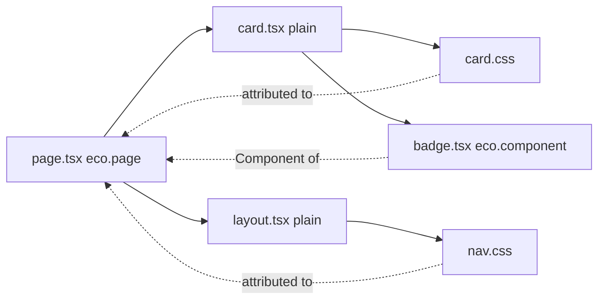

# Pages, layouts and components

A Page is a module that calls `eco.page()`; Layouts and Components are declared the same way with `eco.layout()` and `eco.component()`. Rendering needs the assets of every one of them before the first Component renders, so the build attaches an identity to each declaration and discovers the Components, stylesheets and plain modules it imports. This page covers that discovery, Layouts and the children check. [From graph to HTML](/dev/graph-to-html) covers how route preparation turns the result into a Page Package.

## Identity and discovery

The `eco-component-identity-attribution` plugin runs on every build request. For a module that calls `eco.page()`, `eco.layout()`, `eco.html()` or `eco.component()`, it wraps the factory options with `bindComponentIdentity()` and runs `discoverComponentImports`:

- Static named or default imports of local Eco Components become deferred Component references; named `export { X } from` barrels are followed for the imported binding.
- Relative and aliased side-effect CSS imports become inferred stylesheets and are removed from the output, so the asset pipeline owns CSS delivery.
- Plain local modules (no `eco.*()` call) are walked through their static imports, stopping at Eco modules, packages and `.server` modules. Their side-effect CSS and the Eco Components they import are attributed to the declaration that imports them.
- Every imported Eco module, barrel hop and walked plain module is a watch file.

`export *`, namespace imports, dynamic imports and package CSS are not followed. A plain module's side-effect CSS import that no declaration reaches fails the build in `onEnd`, as does a CSS Module or a package stylesheet in a module discovery reaches.

A plain component attaches to the nearest declared owner: a plain function has no config to carry Dependencies. Discovery is module-scoped, so every declaration in one file shares its discovered imports even when a render branch omits one.

At runtime, `attachDiscoveredDependencies` turns `config.dependencies.components` into a getter that merges explicit Components with discovered ones, keeping only declared Components. Inferred stylesheets stay on the identity, not in the public bag, so copying or merging `dependencies` cannot turn one into an explicit stylesheet; collection prefers explicit declarations by resolved path.

## Layouts

`eco.page({ layout })` normalizes one Layout or an outer-to-inner array into `config.layouts`. `mergeLayoutDependencies` adds only `eco.layout()` results to `dependencies.components`; a plain Layout function carries no config, so it is composed but not a graph node, and its imports reach the Page through plain-module discovery. Use `eco.layout()` only when a Layout needs browser scripts, `modules`, stylesheet attributes, an `integration` override or rendering by another Integration.

Layouts persist by reference. A Layout module has one URL in the browser, so every Page that imports it gets the same function. With react-router's `persistLayouts` (on by default), a layout tier stays mounted while consecutive Pages pass the same function, and React keeps its state; with it off, each Page's tree is keyed so its layouts remount.

A Layout must render its `children`. The type cannot prove it, since a function with fewer parameters is still assignable, so sequential layout composition passes a marker in `children` and reports a `LayoutChildrenNotRenderedError` when the marker is missing from the output. A static build throws it, so `ecopages build` fails. A development request logs a warning and returns the HTML. A production request returns it silently, because a layout may render a sign-in gate instead of the page on purpose.
