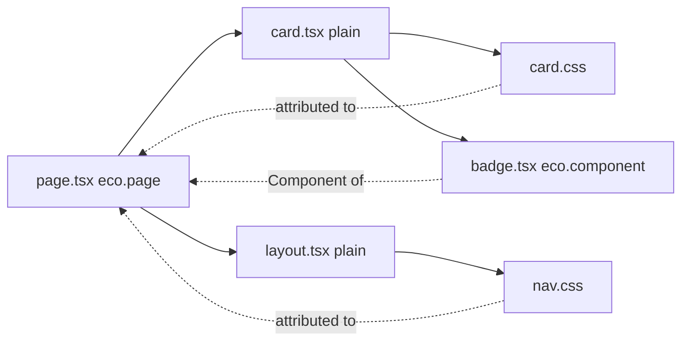

# Pages, layouts and components

A Page is a module that calls `eco.page()`; Layouts and Components are declared the same way with `eco.layout()` and `eco.component()`. Rendering needs the assets of every one of them before the first Component renders, so the build attaches an identity to each declaration and discovers the Components, stylesheets and plain modules it imports. This page covers that discovery, Layouts and the children check. [From graph to HTML](/dev/graph-to-html) covers how route preparation turns the result into a Page Package.

## Identity and discovery

The `eco-component-identity-attribution` plugin runs on every build request. For a module that calls `eco.page()`, `eco.layout()`, `eco.html()` or `eco.component()`, it wraps the factory options with `bindComponentIdentity()` and runs `discoverComponentImports`:

- Static named or default imports of local Eco Components become deferred Component references; named `export { X } from` barrels are followed for the imported binding.
- Relative and aliased side-effect CSS imports become inferred stylesheets and are removed from the output, so the asset pipeline owns CSS delivery. A side-effect import of a package stylesheet is handled the same way (see [Package stylesheets](#package-stylesheets)).
- Plain local modules (no `eco.*()` call) are walked through their static imports, stopping at Eco modules, packages and `.server` modules. Their side-effect CSS and the Eco Components they import are attributed to the declaration that imports them.
- Every imported Eco module, barrel hop and walked plain module is a watch file.

`export *`, namespace imports, dynamic imports and the modules of packages are not followed. A plain module's side-effect CSS import that no declaration reaches fails the build in `onEnd`, as does a CSS Module in a module discovery reaches.

A plain component attaches to the nearest declared owner: a plain function has no config to carry Dependencies. Discovery is module-scoped, so every declaration in one file shares its discovered imports even when a render branch omits one.

## Package stylesheets

A side-effect import whose specifier is a package, in a declaration or in a plain module it reaches, is a package stylesheet when `resolvePackageStylesheetPath` resolves it to a `.css` file:

- A specifier ending in `.css` (`some-lib/style.css`, `some-lib/dist/x.css`) resolves through the package's `exports` with the `style` condition first, then `browser`, `import` and `default`. A package that does not provide it fails the build.
- Any other specifier (`swiper/css`, `@fontsource/inter`) resolves as a browser script import would, without `style`, and is a stylesheet only when that resolves to a `.css` file. A bare `import 'some-lib'` whose entry is a script stays a script import, even when the package also publishes a `style` condition.

Discovery lists it by the folder of the module that imports it and its package path, name, version and subpath (`src/components|some-lib@1.2.0/css/style.css`), beside local CSS, in source order, attached to the nearest declared owner, and marks it in `packageStylesheets`. Collection orders it like any discovered stylesheet, links it once per Page, and creates its asset with `fromPackage` set to that package path, which keys it however the package is installed. The asset pipeline then handles it apart from app CSS:

- No Processor transforms it, so an app's PostCSS or Tailwind setup never runs on third-party CSS, and the production Page stylesheet bundle does not merge it.
- `preparePackageStylesheet` tokenizes the CSS (strings, comments and escapes are honoured, so `content: "url(x)"` is left alone) and emits each file a relative `url()` or `image-set()` string names (fonts, images) to `dist/client/assets` under a content hash, rewriting the reference to that name, or to its root-relative URL when the stylesheet is inlined. Root-relative, `data:` and remote URLs stay as written. Relative and package `@import`s are inlined, inside `@layer`, `@supports` and `@media` blocks for their conditions; root-relative, `data:` and remote `@import`s and the first `@charset` are hoisted to the top. A relative reference that resolves outside the stylesheet's package (the nearest folder with a named `package.json`), or names a missing file, fails the build.
- The stylesheet is written under its own content hash in development and production. `ecopages build` records it in the asset ledger like any stylesheet, so a sealed `ecopages start` serves it without reading the package.

A stylesheet in a linked workspace package is a watch path, and any edit in that package restarts the development server, which covers the files it `@import`s or references; one under `node_modules` is not, since the watcher ignores that directory. A package CSS Module (`.module.css`) fails like a local one. An HTML Page module script that imports a package stylesheet still fails: only declarations deliver CSS.

At runtime, `attachDiscoveredDependencies` turns `config.dependencies.components` into a getter that merges explicit Components with discovered ones, keeping only declared Components. Inferred stylesheets stay on the identity, not in the public bag, so copying or merging `dependencies` cannot turn one into an explicit stylesheet; collection prefers explicit declarations by resolved path.

## Layouts

`eco.page({ layout })` normalizes one Layout or an outer-to-inner array into `config.layouts`. `mergeLayoutDependencies` adds only `eco.layout()` results to `dependencies.components`; a plain Layout function carries no config, so it is composed but not a graph node, and its imports reach the Page through plain-module discovery. Use `eco.layout()` only when a Layout needs browser scripts, `modules`, stylesheet attributes, an `integration` override or rendering by another Integration.

Layouts persist by reference. A Layout module has one URL in the browser, so every Page that imports it gets the same function. With react-router's `persistLayouts` (on by default), a layout tier stays mounted while consecutive Pages pass the same function, and React keeps its state; with it off, each Page's tree is keyed so its layouts remount.

A Layout must render its `children`. The type cannot prove it, since a function with fewer parameters is still assignable, so sequential layout composition passes a marker in `children` and reports a `LayoutChildrenNotRenderedError` when the marker is missing from the output. A static build throws it, so `ecopages build` fails. A development request logs a warning and returns the HTML. A production request returns it silently, because a layout may render a sign-in gate instead of the page on purpose.
