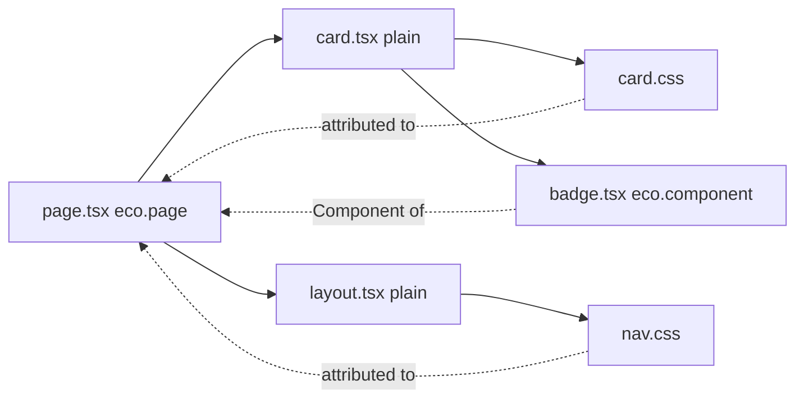

# Pages, layouts and components

A Page is a module that calls `eco.page()`; Layouts and Components are declared the same way with `eco.layout()` and `eco.component()`. Rendering needs the assets of every one of them before the first Component renders, so the build attaches an identity to each declaration and discovers the Components, stylesheets and plain modules it imports. This page covers that discovery, Layouts and the children check. [From graph to HTML](/dev/graph-to-html) covers how route preparation turns the result into a Page Package.

## Identity and discovery

The `eco-component-identity-attribution` plugin runs on every build request. For a module that calls `eco.page()`, `eco.layout()`, `eco.html()` or `eco.component()`, it wraps the factory options with `bindComponentIdentity()` and runs `discoverComponentImports`:

- Static named or default imports of local Eco Components become deferred Component references; named `export { X } from` barrels are followed for the imported binding.
- Relative and aliased side-effect stylesheet imports (`.css`, plus an extension the stylesheet Processor declares; see [/dev/plugin-pipeline](/dev/plugin-pipeline#stylesheet-kinds)) become inferred stylesheets and are removed from the output, so the asset pipeline owns CSS delivery. A side-effect import of a package stylesheet is handled the same way (see [Package stylesheets](#package-stylesheets)).
- Plain local modules (no `eco.*()` call) are walked through their static imports, stopping at Eco modules, packages and `.server` modules. Their side-effect CSS and the Eco Components they import are attributed to the declaration that imports them.
- Every imported Eco module, barrel hop and walked plain module is a watch file.

`export *`, namespace imports, dynamic imports and the modules of packages that ship no CSS Module are not followed (see below for those that do). A plain module's side-effect CSS import that no declaration reaches fails the build in `onEnd`. A CSS Module import is a third result of `classifyStylesheetImport`, for any import form: the meta plugin keeps a binding import, since the module uses the class map, and discovery records the module as a stylesheet of the declaration it attributes the import to, exactly like side-effect CSS. A side-effect import of a CSS Module is stripped like plain CSS. Without a Processor that declares `cssModules`, the classification throws with the importer, the specifier and `@ecopages/lightningcss-processor`, and a CSS Module from a package is classified the same way, as a package stylesheet: any import of it delivers it, and it throws with the same error when no Processor scopes CSS Modules. A CSS Module that no declaration reaches is not an error: a browser script may import the class map of a stylesheet its component lists.

A plain component attaches to the nearest declared owner: a plain function has no config to carry Dependencies. Discovery is module-scoped, so every declaration in one file shares its discovered imports even when a render branch omits one.

`export *` and namespace imports are left out on purpose: following them would pull a whole component kit into the Page's asset graph. A route that needs such a Component lists it in `dependencies.components`; a development render of a Component the route never declared fails ([From graph to HTML](/dev/graph-to-html)).

### The identity

`identity.file` is the module's path relative to the app root, with forward slashes (`../` for a linked workspace package). Discovered stylesheets and watch files are written the same way, and core resolves them against the app root at load (`resolveDiscoveredStylesheets`, `resolveDiscoveredWatchFiles`), so an emitted module holds no path of the machine that built it.

`identity.id` hashes the root-relative file, the name of the declaration the call belongs to (the nearest variable or function binding, or `default` inside `export default`) and how many earlier calls in the file share that name. Two declarations in one file never share an id, and a named declaration keeps its id while unrelated code changes; calls bound to no name are numbered in source order, so adding an earlier one renumbers them. Key per-component state on `id` and per-module work (bundles, watch paths) on `file`. An MDX module has one identity for the file ([MDX](/dev/mdx)).

### Plain modules and the reach check

Because a build may transform a plain module before the declaration that imports it, the meta plugin strips side-effect stylesheet imports from every plain module, local or from a package, and checks in `onEnd` that some declaration reached each one. Reach is recorded per declaration: each discovery replaces what that declaration reached before, the development watcher forgets a deleted file (`forgetDiscoveryOwner`), and a module counts as reached while some declaration's latest discovery walked it. A module outside the app root, such as a linked workspace package, is treated as a package and never reach-checked.

The transforms of one build share module indexes and plain-module walks through a per-build `DiscoveryCache`; across builds, the only cache is the process-wide module index keyed by a hash of each file's contents.

Collection places a plain module's stylesheet after the CSS of every declaration that imports it: a declaration's own CSS comes first, and a stylesheet several declarations on the Page reach takes the position of its last occurrence. CSS under a persisted Layout therefore stays with that Layout.

## Package stylesheets

A side-effect import whose specifier is a package, in a declaration or in a plain module it reaches, is a package stylesheet when `resolvePackageStylesheetPath` resolves it to a `.css` file:

- A specifier ending in `.css` (`some-lib/style.css`, `some-lib/dist/x.css`) resolves through the package's `exports` with the `style` condition first, then `browser`, `import` and `default`. A package that does not provide it fails the build.
- Any other specifier (`swiper/css`, `@fontsource/inter`) resolves as a browser script import would, without `style`, and is a stylesheet only when that resolves to a `.css` file. A bare `import 'some-lib'` whose entry is a script stays a script import, even when the package also publishes a `style` condition.

Discovery lists it by the folder of the module that imports it and its package path, name, version and subpath (`src/components|some-lib@1.2.0/css/style.css`), beside local CSS, in source order, attached to the nearest declared owner, and marks it in `packageStylesheets`. Collection orders it like any discovered stylesheet, links it once per Page, and creates its asset with `fromPackage` set to that package path, which keys it however the package is installed. The asset pipeline then handles it apart from app CSS:

- No Processor transforms it, so an app's PostCSS or Tailwind setup never runs on third-party CSS, and the production Page stylesheet bundle does not merge it.
- `preparePackageStylesheet` scans the CSS with core's CSS scanner (strings, comments and escapes are honoured, so `content: "url(x)"` is left alone; the same scanner serves app stylesheets, see [/dev/postcss-processor](/dev/postcss-processor)) and emits each file a relative `url()` or `image-set()` string names (fonts, images) to `dist/client/assets` under a content hash, rewriting the reference to that name, or to its root-relative URL when the stylesheet is inlined. Root-relative, `data:` and remote URLs stay as written. Relative and package `@import`s are inlined, inside `@layer`, `@supports` and `@media` blocks for their conditions; root-relative, `data:` and remote `@import`s and the first `@charset` are hoisted to the top. A reference that names a missing file fails the build. Only a font (`woff2`, `woff`, `ttf`, `otf`, `eot`), image (`png`, `jpg`, `jpeg`, `gif`, `webp`, `avif`, `svg`, `ico`, `bmp`, `apng`, `jxl`, `tif`, `cur`) or media file (`mp4`, `webm`, `mov`, `ogg`, `mp3`, `m4a`, `wav`) is copied, never a dotfile; a reference to any other file is left as written with a warning, so a reference such as `url(../../.env)` cannot publish a secret. The rule goes by file type, not location, because in a monorepo the app's packages sit outside its folder and a package may name a sibling dependency's files. A relative `@import` must name a `.css` file.
- The stylesheet is written under its own content hash in development and production. `ecopages build` records it in the asset ledger like any stylesheet, so a sealed `ecopages start` serves it without reading the package.

A package must ship built CSS: core never runs a Processor on a package stylesheet, so a package file only counts when it resolves to `.css`. The one exception is a package CSS Module (`.module.css`), which the Processor that declares `cssModules` scopes, with no other app processing: `FileStylesheetProcessor` calls `applyStylesheetProcessors` for it, the Lightning CSS Processor skips its `preprocessor`, and the files its `url()` references name are still emitted by `emitPackageStylesheetReferences`, so a missing file fails the build as it does for any package stylesheet. Its class names hash on `toPackageScopeFile(file, rootDir)`: `<rootDir>/node_modules/<package name>/<path inside the package>`, found from the nearest named `package.json`, so they are identical across machines, folders, store layouts (pnpm, hoisted) and versions. The class map reaches the importer through `compileStylesheetModule` as for an app CSS Module.

A package module can import its own CSS Module (`import styles from './button.module.css'` in `ui-kit/dist/button.js`). Discovery follows a bare import into a package that ships a CSS Module (`packageShipsCssModules`, answered once per package root), resolving it as a browser script import would (`resolvePackageModulePath`), and walks the module and the modules of its own package like a plain local module. Of a module under `node_modules` it delivers only the CSS Modules, as package stylesheets of the declaration that reached it (the importer's folder and the package path, as above); a linked workspace package outside `node_modules` is walked like any plain module. Each module walked counts as reached. When the stylesheet module plugin compiles a CSS Module that a package module imports and no declaration reached that module (a dynamic import, an `export *`, or a browser script that imports it directly), the build fails with `createUndeliverablePackageCssModuleError`, naming both files; outside production it warns once through `reportUndeliverable`, as for a package's side-effect CSS. A side-effect import of a package file with an extension the stylesheet Processor declares (`import 'some-lib/theme.scss'`) fails the build, naming the importer and the specifier, instead of reaching the browser unprocessed.

A stylesheet in a linked workspace package is a watch path, and any edit in that package restarts the development server, which covers the files it `@import`s or references; one under `node_modules` is not, since the watcher ignores that directory. An HTML Page module script that imports a package stylesheet still fails: only declarations deliver CSS.

## Runtime

At runtime, `attachDiscoveredDependencies` turns `config.dependencies.components` into a getter that merges explicit Components, first, with discovered ones in import order, removing duplicates and keeping only declared Components. The getter reads the import bindings when the graph is traversed, after every module has initialized. Inferred stylesheets stay on the identity, not in the public bag, so copying or merging `dependencies` cannot turn one into an explicit stylesheet; collection prefers explicit declarations by resolved path.

Component factories render through a context in `eco/component-render-context.ts`. The route renderer opens one per render with `runWithComponentRenderContext`, supplying the foreign-child runtime that hands off Components another Integration owns ([Integrations and foreign children](/dev/integrations-foreign-children)). The context lives in `AsyncLocalStorage`, so nested and concurrent renders keep their own across async work, and the storage is attached to `process` rather than module state, so duplicate module instances in development share it.

A Page declares its data only through the `staticPaths`, `staticProps` and `metadata` options of `eco.page()`, one options object that keeps the Page's concerns together and lets its props type flow to every hook. `PageModuleLoaderService.assertNoLegacyPageExports` fails a module that still exports `getStaticPaths`, `getStaticProps` or `getMetadata`, naming the `migrate-to-eco-page` codemod. MDX cannot call `eco.page()`, so the MDX-capable Integrations move its `getMetadata` export onto the Page with `moveMdxMetadataOntoPage` before core sees the module. The authoring API is in the [eco namespace reference](/docs/reference/eco-namespace).

## Layouts

`eco.page({ layout })` normalizes one Layout or an outer-to-inner array, where an entry may be `{ component, props }`, into `config.layouts` and `config.layoutEntries` at factory time (`normalizePageLayouts`). Layouts are never inferred from `src/layouts/` or route folders. `mergeLayoutDependencies` adds only `eco.layout()` results to `dependencies.components`; a plain Layout function carries no config, so it is composed but not a graph node, and its imports reach the Page through plain-module discovery. Use `eco.layout()` only when a Layout needs browser scripts, `modules`, stylesheet attributes, an `integration` override or rendering by another Integration.

Layouts persist by reference. A Layout module has one URL in the browser, so every Page that imports it gets the same function. With react-router's `persistLayouts` (on by default), a layout tier stays mounted while consecutive Pages pass the same function, and React keeps its state; with it off, each Page's tree is keyed so its layouts remount.

A Layout must render its `children`. The type cannot prove it, since a function with fewer parameters is still assignable, so sequential layout composition passes a marker in `children` and reports a `LayoutChildrenNotRenderedError` when the marker is missing from the output. A static build throws it, so `ecopages build` fails. A development request logs a warning and returns the HTML. A production request returns it silently, because a layout may render a sign-in gate instead of the page on purpose.
