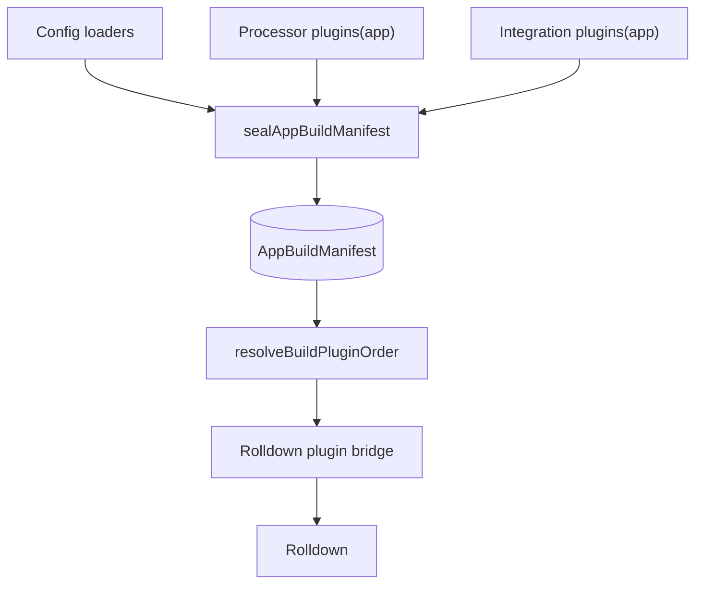
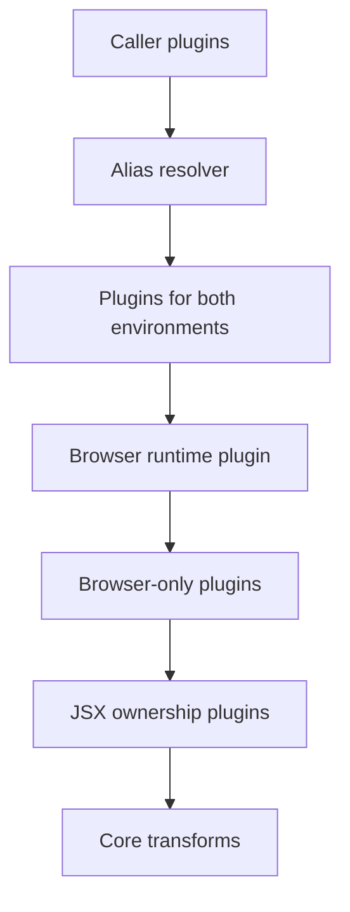
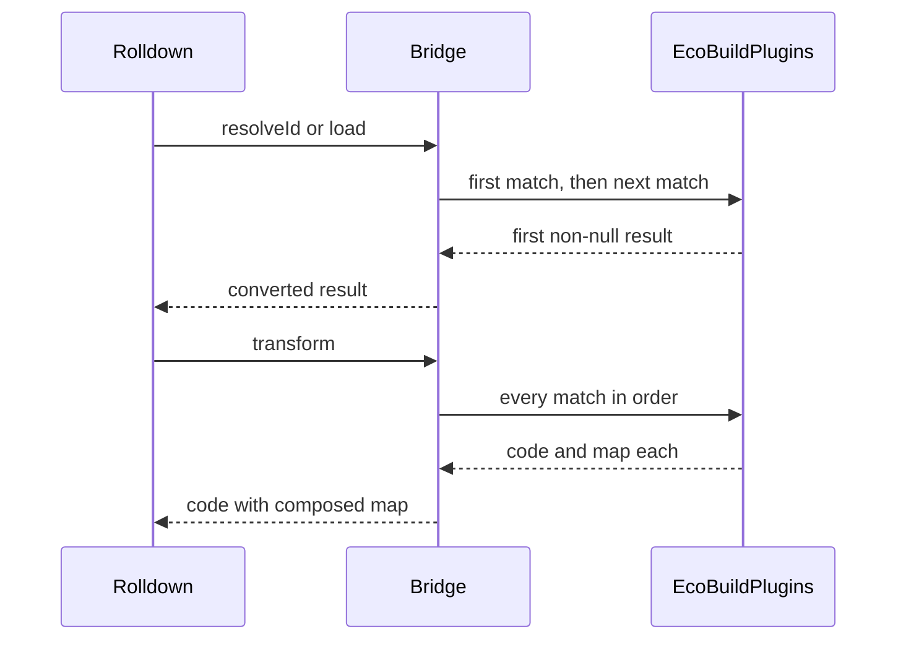

# Plugin pipeline

Every server and browser build in Ecopages runs Rolldown with a plugin list that core assembles. Integrations, Processors and config `loaders` never hand Rolldown a plugin directly: they return `EcoBuildPlugin` objects, core seals them once into an app build manifest split by environment, orders them per build request, and a single bridge plugin runs them inside Rolldown. This page follows a plugin from declaration to hook call. For what triggers builds see [Build and start](/dev/build-and-start); for what a browser build emits see [Browser graph](/dev/browser-graph).



## The EcoBuildPlugin contract

The contract lives in `packages/core/src/types/build-types.ts` and is re-exported from `build/contracts/build-types.ts`:

```ts
export type EcoBuildPlugin = {
	name: string;
	environments?: Array<'server' | 'browser'>;
	setup: (build: EcoBuildPluginBuilder) => void | Promise<void>;
	cacheKey?: string;
};
```

`setup` receives an `EcoBuildPluginBuilder` and registers handlers on it:

| Builder member | Maps to Rolldown | Use |
| --- | --- | --- |
| `onResolve({ filter, namespace? }, cb)` | `resolveId` | Redirect or externalize a specifier. The callback also gets `importer`, `namespace` and the import `kind`. |
| `onLoad({ filter, namespace? }, cb)` | `load` | Supply module contents, or an `object` loader whose `exports` become a module. |
| `module(specifier, cb)` | `resolveId` + `load` | Declare a virtual module by name. |
| `transform({ filter }, cb)` | `transform` | Rewrite source after load, optionally returning a source map. |
| `onEnd(cb)` | `buildEnd` | Check the finished build; skipped when the build already failed, and a throw fails it. |
| `entrypoints` | (data) | The entry names and paths of this build request, the same map for every plugin of the build. |

Handlers must be registered before `setup` returns or its promise resolves; a later call throws. Rolldown reads hook filters when a plugin is registered, so the bridge closes registration before it builds the Rolldown plugin object.

`cacheKey` exists because a build request is identified by its plugins' names in order. A factory that captures an output-changing option, such as the MDX loader with its compiler options or the foreign JSX override with its import source, sets `cacheKey` so two builds that differ only in that option are not deduplicated into one.

Why an Ecopages-owned contract instead of raw Rolldown plugins: the contract is the boundary between Integrations and the bundler backend, so plugin authors stay free of Rolldown types (a transform `map` is `unknown`) and core can switch or upgrade the backend without breaking every Integration and Processor. It also lets core run every contributed hook in one place, where it attributes errors, records build inputs and composes source maps.

## Contributing plugins

`IntegrationPlugin` and `Processor` both expose one method, `plugins(app): EcoBuildPlugin[]`, whose default returns `[]`. Config `loaders` are `EcoBuildPlugin`s passed directly in the app config.

Core calls `plugins(app)` exactly once per app, from `sealAppBuildManifest()` during config finalization (`finalizeEcoPagesConfig()` creates the app runtime, which seals the manifest). It is the only plugin method finalization calls, so it must be a pure read: no I/O, no generation. State a plugin needs is created in `setup()` or lazily in the plugin's own callbacks. The content and image Processors do the latter: their plugins close over an `ensure...()` callback that prepares state on first use, because a build can run before `setup()` has.

Why read once and keep it pure: the manifest is sealed before any Processor `setup()` runs, and a server started from a complete `dist/` calls `restoreProductionRuntime()` instead of `setup()`. Declaring plugins must therefore not depend on lifecycle state, and the declaration stays cheap and repeatable.

Real contributors:

| Contributor | Plugins | Environments |
| --- | --- | --- |
| MDX Integration | MDX loader | both |
| React and Ecopages JSX Integrations | MDX loader, when MDX is enabled | both |
| Content Processor | content plugin, plus browser collection plugins | `server`, `browser` |
| Image Processor | image plugin, image bundler plugin | `server`, `browser` |
| PostCSS Processor | runtime CSS loader, build CSS loader | both, `browser` |

## Environments

`BuildEnvironment` is `'server' | 'browser'`. A plugin with no `environments` applies to both. `createAppBuildManifest()` validates every registration once and stores two lists, `server` and `browser`, that readers take as they are without filtering again.

A name identifies a plugin within an environment. Registering the same name twice for one environment throws at finalization and names both contributors, for example `Build plugin "x" for browser is registered by both Processor "a" and Integration "b"`. The same name may be registered once for `server` and once for `browser`.

Why reject duplicates instead of letting the later one win: a silent replacement would drop one contributor's hooks with no signal, and request identity and caches key on plugin names.

The browser list is not plain registration order. It holds the plugins that also apply to the server first, then the browser runtime plugin that core synthesizes from each Integration's `browserRuntimeManifest`, then the browser-only plugins. The browser runtime plugin resolves manifest specifiers to public URLs and marks them external. Vendor URL rewrites are data on the Integration, not a plugin it writes.

## Order

Position in the list is priority. The bridge asks `onResolve` and `onLoad` registrations in list order and the first non-null result wins; `transform` runs every matching registration in list order, each one on the previous output. `resolveBuildPluginOrder()` in `build/runtime/build-request-policy.ts` is the one place that decides that list for a request:

1. Caller plugins that apply to the environment and whose name no app plugin has. A caller cannot replace an app plugin of the same name; it gets first refusal on resolves and loads instead, which React's vendor and alias rewrites rely on.
2. App plugins: the alias resolver, then the manifest list for the environment, then the JSX ownership plugins. Within the manifest, registration order is loaders, then Processors, then Integrations, each in config order. A browser request can drop app plugins it replaces by name with `excludeAppBuildPlugins`.
3. Core transforms: component identity attribution (`eco-component-identity-attribution`), then any the request passes, such as the `import.meta` rewrite on development server requests. A contributed plugin with a core transform's name throws.

Why core transforms run last: they must see each module after every contributed load and rewrite, and no contributed plugin should see their output. Why caller plugins first: per-request rewrites have to win over the general app loaders without being able to silently remove one.



The diagram shows a browser request; a server request has no browser runtime plugin and takes the manifest's `server` list in registration order.

## The Rolldown bridge

`createRolldownPluginBridge()` in `build/rolldown/rolldown-plugin-bridge.ts` turns the ordered `EcoBuildPlugin[]` into one Rolldown plugin named `ecopages-plugin-bridge`. The Rolldown adapter first filters the request's plugins by `environments` again, then creates a new bridge for every build, so registrations never carry over between builds.

The bridge runs every `setup` up front and collects the registrations. Each Rolldown hook declares the union of its registrations' filters as a native hook filter, so Rolldown calls into JavaScript only for ids at least one registration might match; the exact filter is then tested in JavaScript.



What the bridge adds on top of the hook mapping:

- **Namespaces.** Rolldown has no namespace field, so the bridge encodes one as a `<namespace>:` id prefix and strips it before calling back. A namespaced filter matches only ids with that prefix. `module(specifier)` uses a fresh `ecopages-module-<n>` namespace per virtual module. A Windows drive prefix such as `C:\` is never read as a namespace.
- **Build inputs.** Every matched `onLoad` records the loaded path through the per-build recorder and Rolldown's `addWatchFile`, so caches and the watcher know which files a plugin read. [HMR and navigation](/dev/hmr-and-navigation) covers how those inputs drive invalidation.
- **Source maps.** Chained transforms compose their maps in order. A transform that changes code without a map clears earlier mappings and returns empty `mappings`, so debug locations never point at stale positions; `map: null` declares that the transform moves no code and keeps the incoming map.
- **Error attribution.** Rolldown overwrites `plugin` on a thrown error with the hosting plugin's name, which is the bridge. The bridge wraps every throw in an `EcoBuildPluginError` that keeps the `EcoBuildPlugin` name, and `BuildLog.plugin` reports that name.

Why one merged plugin instead of one Rolldown plugin each: one hook loop gives first-wins semantics in exactly the order core decided, and one place to attribute errors, record inputs and compose maps.

Around the bridge, the adapter places a few native Rolldown plugins that are not part of the contract: the installed-package externalizer when packages are external, a server-only import guard on browser platform builds, a CSS shim on server builds, and, after the bridge, the Worker entries plugin on browser builds.

## Scoping by module ownership

A plugin applies to every module of a build that its filters match. One browser build can serve the entries of several Integrations, and a module has one URL and so one compiled form whichever entry reached it. Plugins therefore decide whether to handle a module by the module itself: its path, extension or specifier.

Ownership is by extension. `findIntegrationForFile()` returns the Integration with the longest registered extension the path ends with, so `about.kita.tsx` belongs to the Integration that registers `.kita.tsx` even when another registers `.tsx`. Plugins build their filters from the same extensions:

- **Loaders** filter on the extensions they compile. The MDX loader's filter comes from its configured MDX extensions, so it never claims another Integration's files.
- **JSX ownership plugins.** `getJsxOwnershipPlugins()` creates one `transform` per JSX-capable `(Integration, extension)` pair, longest extensions first. Each prepends that Integration's `@jsxImportSource` pragma to its files, unless the file already has one, and excludes longer extensions that end with its own, so the `.tsx` owner skips `.kita.tsx` files.
- **Component identity attribution** looks up the owning Integration of each script module and attributes identity with that Integration's name and JSX runtime. It skips `node_modules` and leaves a module no Integration owns alone unless it is a plain module inside the app root or one discovery reached. [Content and Integrations](/dev/content-and-integrations) covers discovery.
- **Host-scoped overrides.** An Integration that bundles foreign files into its own client graph uses `getHostScopedJsxOwnershipPlugins()`, which compiles other Integrations' JSX extensions with the host's runtime. Its `scope` option narrows that per build: React's scope claims a foreign file only when a React entry reaches it, and fails the build when entries of both Integrations reach it.

Why scope by ownership: without it, every JSX file would compile with the project tsconfig's JSX runtime, and a Kita file bundled into a React client graph would emit HTML strings instead of React elements. Deriving every filter from the owning Integration's extensions keeps each file compiled by the runtime that renders it, whichever Integration's entry pulled it in.
