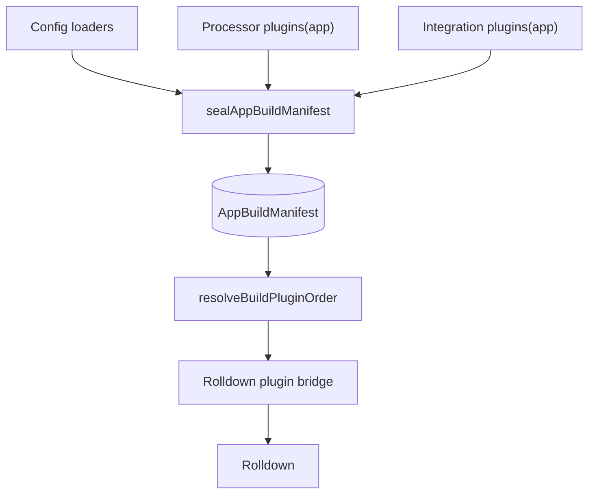
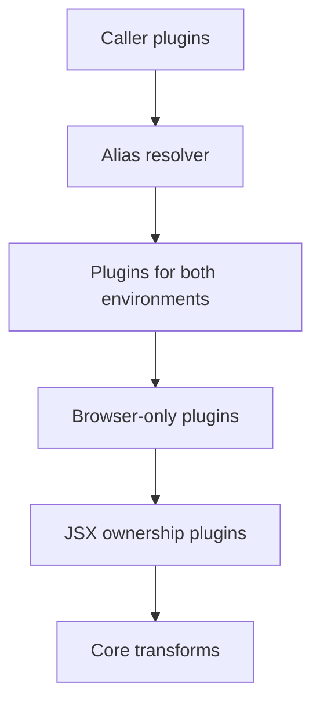
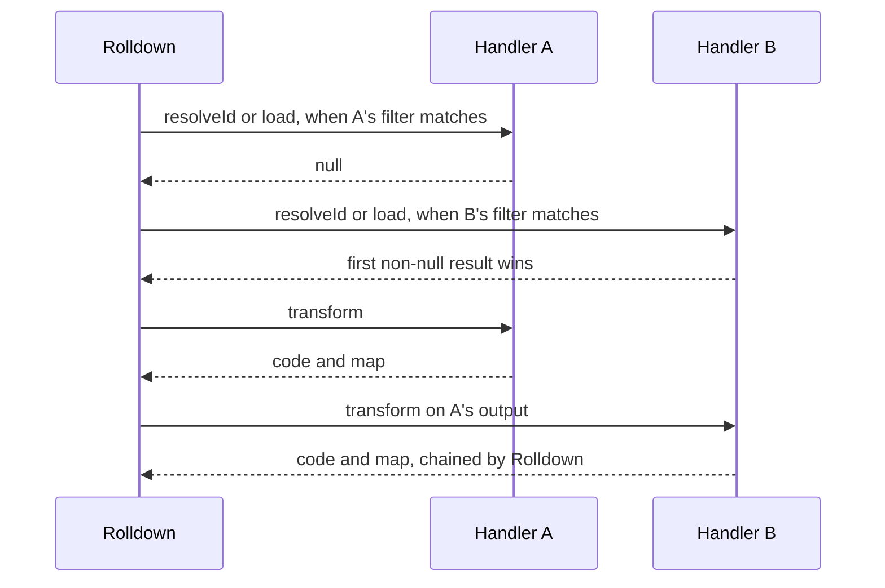
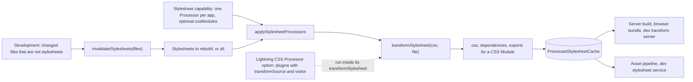

# Plugin pipeline

Every server and browser build in Ecopages runs Rolldown with a plugin list that core assembles. Integrations, Processors and config `loaders` never hand Rolldown a plugin directly: they return `EcoBuildPlugin` objects, core seals them once into an app build manifest split by environment, orders them per build request, and the bridge turns each handler they register into a Rolldown plugin. This page follows a plugin from declaration to hook call. For what triggers builds and what a browser build emits see [Build pipeline](/dev/build-pipeline).



## The EcoBuildPlugin contract

The contract lives in `packages/core/src/types/build-types.ts` and is re-exported from `build/contracts/build-types.ts`:

```ts
export type EcoBuildPlugin = {
	name: string;
	environments?: Array<'server' | 'browser'>;
	setup: (build: EcoBuildPluginBuilder) => void | Promise<void>;
	cacheKey?: string;
};
```

`setup` receives an `EcoBuildPluginBuilder` and registers handlers on it:

| Builder member | Maps to Rolldown | Use |
| --- | --- | --- |
| `onResolve({ filter, exclude? }, cb)` | `resolveId` | Redirect or externalize a specifier. The callback gets `path` and `importer`; a virtual module's path starts with `\0`. |
| `onLoad({ filter, exclude? }, cb)` | `load` | Supply module contents as `js`, `jsx`, `ts` or `tsx`. |
| `module(specifier, cb)` | `resolveId` + `load` | Declare a virtual module by name; it gets the id `\0<specifier>`. |
| `transform({ filter, exclude? }, cb)` | `transform` | Rewrite source after load, optionally returning a source map. |
| `onEnd(cb)` | `buildEnd` | Check the finished build; skipped when the build already failed, and a throw fails it. |
| `addWatchFile(path)` | `this.addWatchFile` | Declare a file the running `onLoad` or `transform` callback read, so an edit to it rebuilds the module. |
| `resolve(specifier, importer)` | `this.resolve` | Resolve a specifier the way the build does, from inside an `onLoad` or `transform` callback. |
| `entrypoints` | (data) | The entry names and paths of this build request, the same map for every plugin of the build. |

Handlers must be registered before `setup` returns or its promise resolves; a later call throws. Rolldown reads hook filters when a plugin is registered, so the bridge closes registration before it hands its plugins to Rolldown. Rolldown tests `filter` and `exclude` itself, against ids with `/` separators, so `exclude: /\/node_modules\//` keeps installed packages out of a handler on every platform.

`cacheKey` exists because a build request is identified by its plugins' names in order. A factory that captures an output-changing option, such as the MDX loader with its compiler options or the foreign JSX override with its import source, sets `cacheKey` so two builds that differ only in that option are not deduplicated into one. A `cacheKey` holds no absolute path: it also joins the dependency key of every script that declares the plugin, and a moved build must find those keys in its ledger, so a factory names a file relative to the app root.

The contract is the boundary between Integrations and bundler backends, so plugin authors stay free of Rolldown types (a transform `map` is `unknown`).

## Contributing plugins

`IntegrationPlugin` and `Processor` both expose one method, `plugins(app): EcoBuildPlugin[]`, whose default returns `[]`. Config `loaders` are `EcoBuildPlugin`s passed directly in the app config.

Core calls `plugins(app)` exactly once per app, from `sealAppBuildManifest()` during config finalization (`finalizeEcoPagesConfig()` creates the app runtime, which seals the manifest). It is the only plugin method finalization calls, so it must be a pure read: no I/O, no generation. State a plugin needs is created in `setup()` or lazily in the plugin's own callbacks. The content and image Processors do the latter: their plugins close over an `ensure...()` callback that prepares state on first use, because a build can run before `setup()` has.

The manifest is sealed before any Processor `setup()` runs, and a server started from a complete `dist/` calls `restoreProductionRuntime()` instead of `setup()`, so declaring plugins cannot depend on lifecycle state.

Real contributors:

| Contributor | Plugins | Environments |
| --- | --- | --- |
| MDX Integration | MDX loader | both |
| React and Ecopages JSX Integrations | MDX loader, when MDX is enabled | both |
| Content Processor | content plugin, plus browser collection plugins | `server`, `browser` |
| Image Processor | image plugin (`module('ecopages:images')`) | both |

## Environments

`BuildEnvironment` is `'server' | 'browser'`. A plugin with no `environments` applies to both. `createAppBuildManifest()` validates every registration once and stores two lists, `server` and `browser`, that readers take as they are without filtering again.

A name identifies a plugin within an environment. Registering the same name twice for one environment throws at finalization and names both contributors, for example `Build plugin "x" for browser is registered by both Processor "a" and Integration "b"`. The same name may be registered once for `server` and once for `browser`.

Overlapping registrations are rejected instead of silently dropping a contributor's hooks; request identity and caches key on plugin names.

The browser list is not plain registration order. It holds the plugins that also apply to the server first, then the browser-only plugins. No plugin rewrites framework packages such as React to fixed URLs: they resolve like any other import.

## Order

Position in the list is priority. The bridge keeps that order for the Rolldown plugins it creates, so Rolldown asks `onResolve` and `onLoad` handlers in list order and the first non-null result wins, and `transform` runs every matching handler in list order, each one on the previous output. `resolveBuildPluginOrder()` in `build/runtime/build-request-policy.ts` is the one place that decides that list for a request:

1. Caller plugins that apply to the environment and whose name no app plugin has. A caller cannot replace an app plugin of the same name; it gets first refusal on resolves and loads instead.
2. App plugins: the alias resolver, then the manifest list for the environment, then the JSX ownership plugins. Within the manifest, registration order is loaders, then Processors, then Integrations, each in config order. A browser request can drop app plugins it replaces by name with `excludeAppBuildPlugins`.
3. Core transforms: component identity attribution (`eco-component-identity-attribution`), then any the request passes, such as the `import.meta` rewrite on development server requests. A contributed plugin with a core transform's name throws.

Core transforms run last, so no contributed plugin runs after them. Caller plugins run first so per-request rewrites win over the general app loaders without being able to silently remove one.



The diagram shows a browser request; a server request takes the manifest's `server` list in registration order.

## The Rolldown bridge

`createRolldownPluginBridge()` in `build/rolldown/rolldown-plugin-bridge.ts` turns the ordered `EcoBuildPlugin[]` into Rolldown plugins: one per registered handler, named after its `EcoBuildPlugin`, in the order of the list and of the handlers inside each plugin. The Rolldown adapter first filters the request's plugins by `environments` again, then runs the bridge for every build, so registrations never carry over between builds.

The bridge runs every `setup` up front. Each handler's `filter` and `exclude` become the native hook filter of its own Rolldown plugin, so Rolldown calls into JavaScript only for ids that handler matches, and stops asking at the first `resolveId` or `load` that answers.



What the bridge adds on top of the hook mapping:

- **Virtual modules.** `module(specifier)` resolves the exact specifier to `\0<specifier>` and loads that id. `transform` handlers never see a `\0` id, so a virtual module stays as its plugin wrote it. An id with a query, even one holding a `:`, is a normal id: transform filters are tested with the query and hash stripped.
- **Watch files.** `addWatchFile(path)` calls Rolldown's `addWatchFile` and records the file under the module the running callback is for. The adapter adds those files to the closure of every entry whose graph holds the module, which is what caches and the Project Watcher bind to. The React client-graph boundary declares each file it inlines this way. [Watcher and invalidation](/dev/hmr-watcher-invalidation) covers how closures drive invalidation.
- **Source maps.** Rolldown chains the maps of transforms in order. A transform that changes code without a usable map returns empty `mappings`, so debug locations never point at stale positions; `map: null` declares that the transform moves no code and keeps the incoming map.
- **Error attribution.** Each Rolldown plugin carries its `EcoBuildPlugin` name, so Rolldown reports that name as the error's `plugin` and `BuildLog.plugin` shows it. The bridge throws a copy of a callback's error with the module id it failed on, because Rolldown sets no `id` and writes onto the thrown value; the copy keeps that value as `cause` unchanged, so a plugin can share or freeze it. A `setup` error, thrown before Rolldown runs, gets the plugin name from the bridge.

One Rolldown plugin per handler leaves first-wins `resolveId` and `load`, ordered `transform` with chained source maps, native filters and plugin names in errors to Rolldown, so the bridge only translates between the two contracts.

Around the bridge, the adapter places a few native Rolldown plugins that are not part of the contract: the installed-package externalizer when packages are external, a server-only import guard on browser platform builds, the stylesheet module plugin on every build (see [Stylesheet kinds](#stylesheet-kinds)), and, after the bridge, the Worker entries plugin on browser builds.

## CSS Modules

A stylesheet Processor opts in with `cssModules: true` on its `stylesheet` capability and returns `exports` from `transformStylesheet` for every CSS Module: each local class name mapped to its scoped name followed by the names it composes, separated by spaces. It scopes from the path relative to `rootDir`, so names do not depend on the folder. For a file of an installed package it scopes from `toPackageScopeFile(file, rootDir)` (exported from `@ecopages/core/processor`) instead, the package name and the path inside the package under the app's `node_modules`, so names do not depend on the store layout either; a package CSS Module is scoped by the Processor but gets no other app processing.

`applyStylesheetProcessors` is the one place that calls the Processor, and its cached result carries both the scoped `css` and the `exports`. It rejects a CSS Module when no Processor scopes them, or when a Processor that declares the capability returns no `exports`. The class map reaches every environment through `compileStylesheetModule`, which compiles a CSS Module to its class map in server builds, browser bundles and the dev transform server, and the scoped CSS reaches the Page through the file stylesheet processor from the same cached result, so one edit runs the Processor once.

In development, `DevelopmentStylesheetService.keepsClassMap(file)` says whether the batch rebuilt a CSS Module and left its class map as it was. The Project Watcher then sends `css-update` for the delivered href and does not hot-update the modules that import the class map; a changed class map is a module `update` of those importers. The version of a CSS Module in the dev transform server is the digest of its class map, so a CSS-only edit keeps the importer's URL.

The class map module also has a named export for each class name that `isCssModuleExportName` accepts: a JavaScript identifier that is not a reserved word. Names are not renamed, so `is-active` stays on the default export only. One function, `toClassMapModule`, builds the module, so the exports are the same in every environment.

Core types the default export of every CSS Module in `css-imports.d.ts` as `{ readonly [key: string]: string }`, which cannot name the classes of one file. `css-module-types.ts` declares each module instead, from the same `exports`: `writeCssModuleDeclaration` writes `<name>.module.css.d.ts` into the generated `@types/ecopages-css-modules` package, at the module's path under `srcDir`, with the default map keyed by literal class names and `export declare const` for each named export. `ecopages types` (`config/write-types.ts`) calls `writeCssModuleDeclarations`, which clears the package and declares every CSS Module in `srcDir` that the Processor accepts, logging and skipping one it rejects. `DevelopmentStylesheetService` rewrites the declaration whenever it processes a CSS Module, which includes the prewarm at startup, and removes it when the module is deleted. TypeScript finds a declaration only through `rootDirs` (and, for an alias such as `@/*`, a second `paths` candidate) that list the package folder; a module without one keeps the ambient default export. The official templates list them, and `warnMissingCssModuleRootDirs` (run after `ecopages types` and after the dev prewarm) logs the lines to add when `loadTsconfigResolutionOptions` finds the folder missing.

## Stylesheet kinds

One core module, `stylesheet-kinds.ts`, decides which files are stylesheets. A file is a stylesheet when it is `.css` or has an extension the registered stylesheet Processor declares in its `stylesheet` capability (`*.scss`, `.sass`, `*.{less,styl}`; the bare `*` names none). It is a CSS Module when it ends in `.module.css`, or in `.module.<ext>` for an extension declared by a `stylesheet` capability that sets `cssModules`; with the capabilities `{*.css, cssModules}` and `{*.scss}`, `card.module.scss` is a plain stylesheet. `serializeStylesheetModuleDeclarations` follows the same rule, so detection and the generated types agree. Core names no other extension, so an app with no stylesheet Processor handles plain `.css` only.

These sites ask the module, so they cannot disagree:

- Discovery and the component meta plugin: which side-effect imports are delivered as Page stylesheets, and which are CSS Modules, which are delivered when the Processor declares `cssModules` (`StylesheetKinds.scopesCssModules`) and fail the build otherwise. A package stylesheet is still a `.css` file that `resolvePackageStylesheetPath` resolves, and a package CSS Module is delivered by any import of it.
- The stylesheet module plugin: server and browser requests put the extensions in `BuildOptions.stylesheets`, so Rolldown never parses a declared stylesheet as JavaScript and compiles each import of one.
- The dev transform server: it serves a stylesheet import as the same compiled module.
- The stylesheet pipeline (`applyStylesheetProcessors`) and the copy list of files a stylesheet `url()` may emit (`isEmittableReferenceFile`).

At most one Processor may declare a `stylesheet` capability. Config finalization fails when two do, naming both, so `transformStylesheet` has one owner and there is no chain. When that Processor declares `*.scss`, `import './card.scss'` is discovered and kept out of every build, and `import styles from './card.scss'` compiles to the Processor's output. When none does, both are left alone. The ambient `*.css` and `*.module.css` declarations are the ones core ships. A Processor that declares another extension writes its own from `setup()`: `serializeStylesheetModuleDeclarations(capabilities)` in `plugins/processor.ts` builds the `declare module '*.<ext>'` text, with `*.module.<ext>` first when the capability sets `cssModules`, and the Processor writes it with `writeGeneratedTypesPackage` and `resolveGeneratedPath`, as the content and image Processors do. Core writes nothing for an extension itself.

## Stylesheet Processors

The stylesheet Processor is a transform with an optional invalidation hook; core owns everything around it.

- `transformStylesheet(css, file)` returns `{ css, dependencies }`. `dependencies` are the absolute paths of the other files the transform read, taken from the transform itself (PostCSS `dependency` messages, Lightning CSS `dependencies`), never from a scan of the source. `applyStylesheetProcessors` keeps the ones that are stylesheets, without the file itself: a Processor that scans content, such as Tailwind, reports every file it scanned too, and a content edit must not invalidate every Page and module that uses the stylesheet. The stylesheet module plugin declares them with `addWatchFile`, the file stylesheet processor adds them to the asset's `bundledSourceFilepaths`, and the development stylesheet service keeps the reverse map that rebuilds a stylesheet when one changes.
- `invalidateStylesheets(files)` is called in development with the changed paths of a batch that are not stylesheets, and returns the stylesheets to rebuild or `'all'` for every entry stylesheet. It is where a Processor whose output depends on content, such as Tailwind, resets its state. Without it, a change to a file that is not a stylesheet rebuilds none.
- One edit runs the Processor once. `applyStylesheetProcessors` reads through the app's `ProcessedStylesheetCache` (`runtime.processedStylesheets`), so the dev stylesheet service, the dev transform server, server builds, browser bundles and the asset pipeline share one output per stylesheet. The dev stylesheet service empties it at the start of each watcher batch and again after the invalidation hook, so any changed input, including content Tailwind scans and files only the Processor knows it read, is transformed again; a transform that started before an eviction stores nothing. Between batches an entry is reused only while the source and its reported dependencies hash the same. Outside development no source changes while the process runs. Concurrent misses share one transform, and a failure is not cached.
- Core persists, caches, queues and broadcasts in development (`DevelopmentStylesheetService`, see [PostCSS processor](/dev/postcss-processor#development-lifecycle)); with no stylesheet Processor, plain CSS passes through as written.



`@ecopages/core/processor/contract` exports `stylesheetProcessorContract({ createProcessor })`, cases any test runner can register to check a stylesheet Processor against this contract; the PostCSS Processor runs them.

## Scoping by module ownership

A plugin applies to every module of a build that its filters match. One browser build can serve the entries of several Integrations, and a module has one URL and so one compiled form whichever entry reached it. Plugins therefore decide whether to handle a module by the module itself: its path, extension or specifier.

Ownership is by extension. `findIntegrationForFile()` returns the Integration with the longest registered extension the path ends with, so `about.kita.tsx` belongs to the Integration that registers `.kita.tsx` even when another registers `.tsx`. Plugins build their filters from the same extensions:

- **Loaders** filter on the extensions they compile. The MDX loader's filter comes from its configured MDX extensions, so it never claims another Integration's files.
- **JSX ownership plugins.** `getJsxOwnershipPlugins()` creates one `transform` per JSX-capable `(Integration, extension)` pair, longest extensions first. Each prepends that Integration's `@jsxImportSource` pragma to its files, unless the file already has one, and excludes longer extensions that end with its own, so the `.tsx` owner skips `.kita.tsx` files.
- **Component identity attribution** looks up the owning Integration of each script module and attributes identity with that Integration's name and JSX runtime. It skips `node_modules` and leaves a module no Integration owns alone unless it is a plain module inside the app root or one discovery reached. [Pages, layouts and components](/dev/pages-layouts-components) covers discovery.
- **Host-scoped overrides.** An Integration that bundles foreign files into its own client graph uses `getHostScopedJsxOwnershipPlugins()`, which compiles other Integrations' JSX extensions with the host's runtime. Its `scope` option narrows that per build: React's scope claims a foreign file only when a React entry reaches it, and fails the build when entries of both Integrations reach it. The override is a `transform`, not an `onLoad`, so it composes with an earlier loader such as React's client-graph boundary instead of replacing its output.

A file bundled into another Integration's client graph must compile with the runtime that renders it, not the project default; deriving every filter from the owning Integration's extensions keeps it so.
