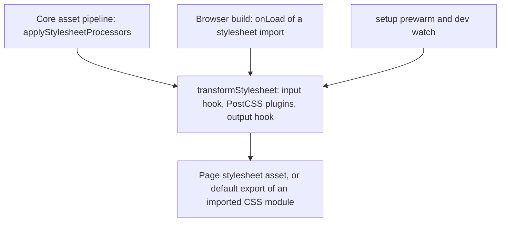

# PostCSS processor

`PostCssProcessorPlugin` is a Processor (see [/dev/plugin-pipeline](/dev/plugin-pipeline)) that owns stylesheets. Its single `stylesheet` capability matches `*.{css,scss,sass,less}` and is narrowed by a filename filter, default `/\.css$/`. Files inside the app's public directory are excluded: the build copies them as written, so a processed copy would be linked by no Page.

## Two routes to the page

CSS reaches the page by two routes that share one function, `transformStylesheet(css, file)`.

- Asset pipeline: for every `.css`, `.scss`, `.sass` or `.less` dependency, core calls `transformStylesheet` on each Processor whose `stylesheet` capability matches, in registration order, each receiving the previous output. This is how `config.dependencies.stylesheets` and content stylesheets get processed. For a file stylesheet, core then resolves each relative `url()` and `image-set()` string in the output from the real directory of the source file, emits the file it names to `dist/client/assets` under a content hash, and rewrites the reference relative to where the stylesheet is written, or root-relative when it is inlined (`emitStylesheetReferences`). A reference to a missing file is left as written with a warning, since Tailwind can generate a `url()` from a class it finds in content. Only a font (`woff2`, `woff`, `ttf`, `otf`, `eot`), image (`png`, `jpg`, `jpeg`, `gif`, `webp`, `avif`, `svg`, `ico`, `bmp`, `cur`) or media file (`mp4`, `webm`, `ogg`, `mp3`, `wav`) is copied, never a dotfile; a reference to any other file is left as written with a warning, so a reference such as `url(../../.env)` cannot publish a secret. The rule goes by file type, not location, because in a monorepo the app's packages sit outside its folder and a package may name a sibling dependency's files. A package stylesheet that discovery found (`import 'some-lib/style.css'`, an asset with `fromPackage`) skips this step: core only rewrites its `url()` references and inlines its `@import`s, so Tailwind and the preset plugins never run on third-party CSS (see [/dev/pages-layouts-components](/dev/pages-layouts-components#package-stylesheets)).
- Browser build loader: `plugins()` returns one loader with `environments: ['browser']`. It runs PostCSS on any matching stylesheet a browser build imports and returns it as the module's `default` export (`loader: 'object'`), including files outside `srcDir` or added after the prewarm.

Server builds register nothing for CSS: the bundler replaces their stylesheet imports with an empty module before any plugin loads them.

## Per-environment handling

| Environment | Behavior |
| --- | --- |
| `server` build | No plugin from this Processor. |
| `browser` build | Build loader above. |
| Development | `setup()` prewarms the runtime cache; `onChanges` keeps it current and broadcasts. |
| Production runtime | `setup()` prewarms the runtime cache and writes nothing to `distDir`. |

In development `persistProcessedCss` writes each processed stylesheet at its source-relative path under `distDir/assets`, rewritten only when the bytes change, so CSS HMR refreshes that href. Only stylesheets inside `srcDir` are persisted. It calls core's `writeSourceRelativeStylesheet` (from `@ecopages/core/processor`), the function core's stylesheet pipeline uses for the same file, so the files its relative `url()` references name are emitted and the references rewritten after an edit as on first load. The runtime cache records a stylesheet only after that write succeeds. Production persists nothing: the stylesheet pipeline writes each stylesheet a Page links under a hash of its bytes, and a bundle that imports CSS carries it, so a copy from this plugin would be a file no Page references.

## Config loading

The plugin list loads lazily, once, on the first `transformStylesheet` (`ensurePostcssPlugins`); a failed load is dropped so the next stylesheet retries. Config finalization does not load the plugins, so a build that starts before `setup()` and an app without stylesheets both work.

Resolution order in `resolvePostcssPluginsFromSources`:

1. `postcss.config.{js,cjs,mjs,ts}` in `rootDir`, imported dynamically. It may export `pluginFactories` and `plugins` (array or record). An import error is logged and yields no config.
2. Otherwise `options.plugins` or `options.pluginFactories`.
3. Otherwise a warning and an empty plugin list.

Note that a config file wins over options.

`PostCssProcessor.processStringOrBuffer` runs the plugins and the `transformOutput` hook. On a PostCSS error it logs and returns `''`, so a broken stylesheet becomes empty CSS rather than a thrown error.

## Presets

`src/presets/` holds `tailwindV3Preset()` and `tailwindV4Preset({ referencePath })`. Both return `plugins` for immediate use and `pluginFactories`, with `postcss-import` (app-aware, resolving from the app root), nesting, Tailwind, autoprefixer and cssnano. `createAppAwarePostcssImport` runs `postcss-import` and then, through core's `rebaseStylesheetReferences` and its stylesheet tokenizer, rebases the relative `url()` references of every declaration it inlined from another file onto the importing stylesheet, so `url(files/font.woff2)` from `@import '@fontsource/inter'` still names the package's file when core resolves it from the app's stylesheet. Both ends are real paths, since `postcss-import` reads an imported file through its symlinks.

Factories exist because Tailwind keeps internal caches in long-lived plugin instances: when a non-CSS file changes, `refreshConfiguredPlugins` rebuilds the list from them so newly used classes are found.

The v4 preset also sets `dependencyEntryPaths: [referencePath]` and a `transformInput` that rewrites `@import 'tailwindcss'` to the reference file, or prepends `@reference` to files that use `@apply`, so component stylesheets see the theme. It skips the reference file itself and files that already reference it.

## Runtime cache and `css-update`

`runtimeCssCache` maps a stylesheet path to its last output. `setup()` fills it for every matching file in `srcDir` and builds a map from imported files to the entry stylesheets that `@import` them (relative imports only, followed transitively).

In `onChanges` (queued, so batches run in order):

- A changed CSS file that is an import of an entry rebuilds that entry, not the file.
- A changed non-CSS file (watch extensions include `.ts`, `.tsx`, `.mdx`, `.html` and others) rebuilds the entries from `dependencyEntryPaths`, or every tracked entry when none is set.
- `processAndBroadcast` re-runs the transform and calls `bridge.cssUpdate(file)` only when the output differs from the cached one. A failure calls `bridge.error`.

The bridge sends a `css-update` message and the client refreshes matching stylesheet `link` hrefs; see [/dev/hmr-watcher-invalidation](/dev/hmr-watcher-invalidation) and [/dev/hmr-client](/dev/hmr-client). CSS does not go through HMR strategies.
