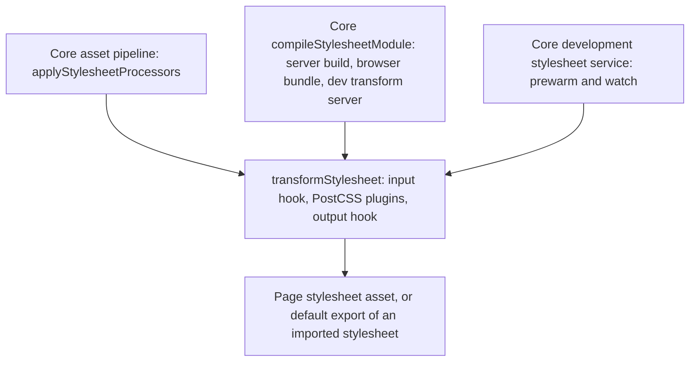

# PostCSS processor

`PostCssProcessorPlugin` is a Processor (see [/dev/plugin-pipeline](/dev/plugin-pipeline)) that transforms stylesheets. Its single `stylesheet` capability matches `*.css` and is narrowed by a filename filter, default `/\.css$/`. It declares no Sass or Less extension, so those files are not stylesheets in an app that registers it, and an app can register only one stylesheet Processor (see [/dev/plugin-pipeline](/dev/plugin-pipeline#stylesheet-kinds)). It is a transform and an invalidation hook only: core owns the cache, the prewarm, the watch queue, the dependency map, the dev writes and `css-update` ([Development lifecycle](#development-lifecycle)).

## Two routes to the page

CSS reaches the page by two routes that share one function, `transformStylesheet(css, file)`, and core calls it for both. It returns `{ css, dependencies }`: the `dependencies` are the `file` of each PostCSS message of type `dependency`, which `postcss-import` sends for every stylesheet it inlines, whatever the form of the `@import` (a `layer()`, a media query, an unquoted `url()`, an alias). Tailwind's own `dependency` messages are left out: they name every file it scanned for class names, stylesheets included, which would make each scanned stylesheet look like a partial of the Tailwind entry; a change to scanned content reaches it through `invalidateStylesheets` instead.

- Asset pipeline: for every `.css` dependency, core calls `transformStylesheet` on the one Processor that declares a `stylesheet` capability, when that capability matches the file. This is how `config.dependencies.stylesheets` and content stylesheets get processed. For a file stylesheet, core then resolves each relative `url()` and `image-set()` string in the output from the real directory of the source file, emits the file it names to `dist/client/assets` under a content hash, and rewrites the reference relative to where the stylesheet is written, or root-relative when it is inlined (`emitStylesheetReferences`). A reference to a missing file is left as written with a warning, since Tailwind can generate a `url()` from a class it finds in content. A `url()` that holds another function, such as `url(var(--hero))`, names no file and is skipped without a warning. Only a font (`woff2`, `woff`, `ttf`, `otf`, `eot`), image (`png`, `jpg`, `jpeg`, `gif`, `webp`, `avif`, `svg`, `ico`, `bmp`, `apng`, `jxl`, `tif`, `cur`) or media file (`mp4`, `webm`, `mov`, `ogg`, `mp3`, `m4a`, `wav`) is copied, never a dotfile; a reference to any other file is left as written with a warning, so a reference such as `url(../../.env)` cannot publish a secret. The rule goes by file type, not location, because in a monorepo the app's packages sit outside its folder and a package may name a sibling dependency's files. A package stylesheet that discovery found (`import 'some-lib/style.css'`, an asset with `fromPackage`) skips this step: core only rewrites its `url()` references and inlines its `@import`s, so Tailwind and the preset plugins never run on third-party CSS (see [/dev/pages-layouts-components](/dev/pages-layouts-components#package-stylesheets)).
- Stylesheet imports: `import styles from './card.css'` gets the module core's `compileStylesheetModule` returns, `export default "<css>"` with this Processor's output, in server builds, browser bundles and the dev transform server alike (see [/dev/build-pipeline](/dev/build-pipeline#stylesheet-imports)). The Processor contributes no build plugin for it.

## Per-environment handling

| Environment | Behavior |
| --- | --- |
| `server` and `browser` builds | No plugin from this Processor; core calls `transformStylesheet` for each imported stylesheet. |
| Development | Core's development stylesheet service calls `transformStylesheet` to prewarm and to rebuild after an edit, and `invalidateStylesheets` for a template or script edit. `setup()` does nothing. |
| Production runtime | Nothing runs until a stylesheet is processed; nothing is written to `distDir` from here. |

## Config loading

The plugin list loads lazily, once, on the first `transformStylesheet` (`ensurePostcssPlugins`); a failed load is dropped so the next stylesheet retries. Config finalization does not load the plugins, so a build that starts before `setup()` and an app without stylesheets both work.

Resolution order in `resolvePostcssPluginsFromSources`:

1. `postcss.config.{js,cjs,mjs,ts}` in `rootDir`, imported dynamically. It may export `pluginFactories` and `plugins` (array or record). An import error is logged and yields no config.
2. Otherwise `options.plugins` or `options.pluginFactories`.
3. Otherwise a warning and an empty plugin list.

Note that a config file wins over options.

`transformWithPostcss` runs the plugins and the `transformOutput` hook and returns the CSS with its dependencies; `PostCssProcessor.processStringOrBuffer` returns only the CSS. A PostCSS error rejects, and a `CssSyntaxError` names the file, line and column in its message. Nothing returns empty CSS for a failed stylesheet.

## Errors and warnings

Where the error goes depends on who called `transformStylesheet`:

| Caller | On a PostCSS error |
| --- | --- |
| Core asset pipeline | `applyStylesheetProcessors` lets it propagate, the asset rejects `processDependencies`, and `ecopages build` fails without writing a stylesheet for the file (see [/dev/asset-processing](/dev/asset-processing)). |
| Core `compileStylesheetModule`, for a stylesheet imported with a binding | A server build or browser bundle fails, so `ecopages build` fails. The dev transform server shows the error and keeps serving the stylesheet's last compiled module until a save compiles again ([/dev/dev-server](/dev/dev-server)). |
| Development watch | Core's development stylesheet service logs it and calls `bridge.error`, which shows the error overlay. Its cache and the file under `distDir/assets` keep the last good output, and no `css-update` is sent. The file is remembered as failed, so the first save that succeeds sends `css-update` even when its output equals the last good one, which clears the overlay; the byte-change check applies again after that. |
| Development prewarm | Logged per file and skipped, so one broken stylesheet does not stop the dev server from starting; the watcher reports it again when the file changes. |

Recovery needs no restart: core caches no failed asset (the asset service stores only successes and drops its in-flight entry), so a Page requested while the stylesheet is broken fails that request and renders normally once the stylesheet is fixed.

PostCSS `result.warnings()` are logged with the file, line and column. A stylesheet goes through several processing passes (once per Page that links it, linked and inlined, and once per build that imports it as text), so `warnStylesheetOnce` logs a warning once per stylesheet and message until the stylesheet's contents change. Core's warnings about a `url()` that names a missing or non-copyable file use the same function.

## Presets

`src/presets/` holds `tailwindV3Preset()` and `tailwindV4Preset({ referencePath })`. Both return `plugins` for immediate use and `pluginFactories`, with `postcss-import` (app-aware, resolving from the app root), nesting, Tailwind, autoprefixer and cssnano. `createAppAwarePostcssImport` runs `postcss-import` and then, through core's `rebaseStylesheetReferences` and its stylesheet tokenizer, rebases the relative `url()` references of every declaration it inlined from another file onto the importing stylesheet, so `url(files/font.woff2)` from `@import '@fontsource/inter'` still names the package's file when core resolves it from the app's stylesheet. Both ends are real paths, since `postcss-import` reads an imported file through its symlinks.

Factories exist because Tailwind keeps internal caches in long-lived plugin instances. `invalidateStylesheets(files)` is the Processor's invalidation hook: when a batch changes a template or script (`.ts`, `.tsx`, `.js`, `.jsx`, `.mdx`, `.html`, `.svelte`, `.vue`), it rebuilds the plugin list from the factories, so newly used classes are found, and names the stylesheets to rebuild: `dependencyEntryPaths`, or `'all'` (every entry stylesheet) when that option is unset. A batch with no such file invalidates nothing.

The v4 preset also sets `dependencyEntryPaths: [referencePath]` and a `transformInput` that rewrites `@import 'tailwindcss'` to the reference file, or prepends `@reference` to files that use `@apply`, so component stylesheets see the theme. It skips the reference file itself and files that already reference it.

## Development lifecycle

Core's `DevelopmentStylesheetService` (`dev/stylesheets/development-stylesheet.service.ts`) keeps the stylesheets current for whichever stylesheet Processor the app registers, so this package holds no cache, graph or queue of its own. When the Project Watcher subscribes, the service processes every stylesheet the Processor owns in `srcDir`, except the public directory, and records each output and the `dependencies` its transform reported. For each watcher batch, queued behind the previous one:

- A changed file rebuilds every stylesheet whose transform read it, so an edit to an `@import` partial rebuilds the stylesheets that inline it. A changed stylesheet that no other stylesheet read is rebuilt itself; a partial is not rebuilt alone.
- The changed files that are not stylesheets go to `invalidateStylesheets`.
- A rebuild writes the output at its source-relative path under `distDir/assets` through core's `writeSourceRelativeStylesheet`, so the files its relative `url()` references name are emitted after an edit as on first load. Only stylesheets inside `srcDir` are written; the service runs only in development, so production writes nothing. It sends `bridge.cssUpdate(file)` only when the bytes changed, or on the first success after a failure.

The bridge sends a `css-update` message with the exact href the stylesheet was delivered at, and the client refreshes that one `link`; see [/dev/hmr-watcher-invalidation](/dev/hmr-watcher-invalidation) and [/dev/hmr-client](/dev/hmr-client). A stylesheet whose output changed while its own bytes did not, such as one whose partial changed, is then planned as changed, so a module that imports it as text is hot-updated by core's HMR and the server modules that embed it are rebuilt ([/dev/hmr-strategies](/dev/hmr-strategies)).

## Contract tests

`@ecopages/core/processor/contract` exports `stylesheetProcessorContract({ createProcessor })`, the cases every first-party stylesheet Processor runs: the dependencies a transform reports drive rebuilds of the server modules that embed the stylesheet and of the stylesheet in development, a transform that throws fails the build, a failure in development keeps the last good output until a save fixes it, and plain CSS passes through with no Processor. Each case is `{ name, run }`, so any runner can register them; this package runs them with `postcss-import` in `src/test/stylesheet-processor-contract.test.ts`.
