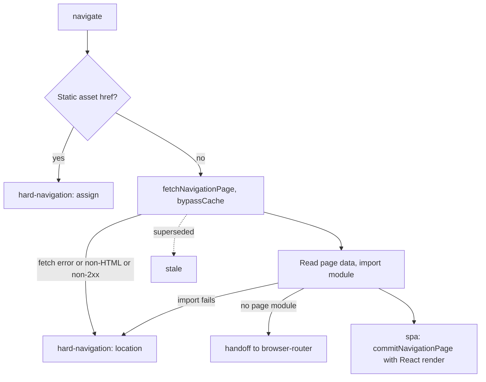

# React router

`@ecopages/react-router` is the client navigation runtime for pages the React Integration owns. Where [Browser router](/dev/browser-router) morphs the incoming body into the DOM, react-router leaves the DOM to React: it fetches the next document, imports that page's module and renders the new Page component into the existing root. Everything around the swap (head reconciliation, stylesheet staging, script activation, view transitions, `eco:before-swap`, `eco:after-swap`, `eco:page-load`) is the shared `commitNavigationPage()` pipeline in core, covered in [Navigation](/dev/navigation).

## Wiring

The React plugin takes `router: ecoRouter()`, an adapter that names the package of the browser entry (`importPath: '@ecopages/react-router/browser'`), the `EcoRouter` and `PageContent` components, and a `getRouterProps()` string that carries serialized options into the generated entry. See [React](/dev/react) for the plugin side. The Page hydration entry (`createPageEntrySource()`) then builds its tree as `EcoRouter` wrapping `PageContent`, and passes `hasRouter: true` to `startPageHydration()`. The entry imports the router by package name, like React: production bundles both into the app-wide build's shared chunks and development serves each from its one vendor URL, so the router, the Layouts and every Page use one copy of React.

`EcoRouter` is a component, not an object like browser-router's. It owns the current `PageState` (`Component` plus `props`), `isNavigating` (exposed through `useRouter()` with `navigate`), and the capture-phase `pointerdown`, `click` and `popstate` listeners. Link interception uses the same core policy as browser-router (`getLinkNavigationDecision()`), the same pointer-intent recovery and the same queued-click replay; only the effects differ.

## How it plugs into Page hydration

Two registrations happen, in order, and the second replaces the first because the coordinator keys registrations by owner.

1. `startPageHydration()` runs from the Page bootstrap script. With `hasRouter` it calls `registerRouterOwnership()`: unless a `react-router` runtime that can navigate is already registered, it registers a minimal one whose only capability is `cleanupBeforeHandoff` (unmount the Page root) and claims ownership. This makes the document owner correct before React has run any effect.
2. `EcoRouter`'s effect registers the full runtime (`navigate`, `reloadCurrentPage`, `cleanupBeforeHandoff`), claims ownership and schedules the first `eco:page-load`.

`mount()` with a router and an existing `pageRoot` returns without re-rendering; the router changes Pages inside the same root through `setCurrentPage`. Without a router, a rerun calls `root.render()` itself.

The bootstrap script is emitted with `data-eco-rerun`, `data-eco-persist` and, when a router adapter is configured, `data-eco-page-bootstrap="react-router"`. The shared script queue would run it again on every navigation, so the SPA commit passes `skipScriptActivation` for scripts whose `data-eco-script-id` starts with `ecopages-react-` (not `ecopages-react-island-`) or whose `src` is a React page asset, and `includeBodyScripts: false`. Island scripts are not skipped.

## Navigation outcomes

`resolveReactNavigation()` fetches and decides, with no DOM or React side effects, and returns one outcome:

Every step checks `isStale()` and returns `stale` instead of acting, so a newer navigation never races an older one; `isNavigating` is cleared by non-stale terminals only. A failed fetch or module import becomes a full document navigation so the link never goes dead. Fetches always pass `bypassCache`: react-router does not read the prefetch cache that browser-router fills.

Module discovery reads the `#__ECO_PAGE_DATA__` JSON envelope (`EcoPropsScript` renders it in the Html shell), then `window.__ECO_PAGES__.page.module` for the current document, then the `src` of `script[data-eco-page-bootstrap="react-router"]`. Hydration JavaScript is never parsed. In development the import URL gets a `t=<timestamp>` query so a revisited page is not served from the module cache; production URLs are content-hashed and used as they are.

The SPA swap renders inside `startTransition()` and awaits a deferred that `EcoRouter`'s effect resolves once the committed page state matches, so `eco:after-swap` and the view transition snapshot happen after React has rendered. History updates before the swap (`pushState` for forward, `replaceState` for replace or a redirect to another path).

## Layout persistence

`PageContent` composes the Page with its layout stack through `composeLayoutPageTree()`. Layouts persist by reference: a layout module has one URL in development and production, so every Page that imports it gets the same function, and React keeps a layout tier mounted while consecutive Pages pass the same function at the same position. Two routes with `[AppShell, DocsSection]` and `[AppShell, SettingsSection]` share one mounted `AppShell` while the inner tier swaps.

With `persistLayouts: false` (default `true`), `PageContent` wraps the tree in a Fragment keyed per Page component, so every Page change remounts its layouts. An HMR edit to a layout imports a new module version, so the new function replaces the mounted tier. The Page HMR handler passes `clearCache` to `reloadCurrentPage` only when the layout stack differs from the previous version by reference.

## Handoff to browser-router

A fetched document with no discoverable React page module resolves to `handoff`. The router asks the coordinator to hand the already-fetched document to `browser-router` (`requestHandoff()` with `source: 'react-router'`), so there is no second request. If browser-router is not registered, or declines, it falls back to `location.assign`. Cleanup of the React root is deliberately not part of the handoff request: browser-router's commit calls `cleanupOwner('react-router')` after the head is prepared, so a stale or aborted handoff never blanks the current page. That calls `cleanupBeforeHandoff`, which unregisters the runtime, marks it inactive and unmounts the Page root.

The reverse direction needs no code here: browser-router sees that another runtime owns the document and routes clicks to the coordinator. While the React runtime is inactive, react-router's own listeners ignore events and its queued-click replay goes through `requestNavigation()`.

## Scroll

Window scroll uses the shared `manageWindowScroll()` (`top`, `preserve` or `auto`; hashes scroll to the element), run from `EcoRouter`'s effect when the committed URL changes.

Scroll inside elements is separate. Elements with `data-eco-persist="scroll"` and an `id` or `data-testid` are captured before the commit (`saveScrollPositions`, keyed by the leaving path, passed in because `window.location` already points at the destination on back/forward) and restored after render (`restoreScrollPositions`). Back/forward restores what was stored for the destination path; a link click carries the current snapshot to the next Page, which is what keeps a persisted layout's sidebar position. Restore retries every 50 ms, up to 20 times, until all captured keys are found.

## Reload and errors

`reloadCurrentPage` returns `false` while a navigation is active or `isNavigating` is set. Otherwise it navigates to the current URL, including its fragment, as a `replace` without a view transition, optionally with `moduleUrl` as the module override, so HMR keeps the hot module entry instead of the static bootstrap asset in the HTML. `clearCache` invalidates the document and its redirect target in the shared navigation cache. react-router does not register `enableReloadStatePreservation`, so no server-markup tracking exists: React reconciles the new tree and keeps state by position and type.

`PageErrorBoundary` wraps the page content. A render error after the first committed navigation (a failed `React.lazy` chunk, a throw in the next Page) calls `window.location.reload()`: the URL is already the destination, so the server renders it. Before any navigation the error is rethrown so Page hydration can restore the server HTML; reloading then would loop for as long as the failure lasts. A Page-level error boundary of the author's own catches first, and the router does not reload.
