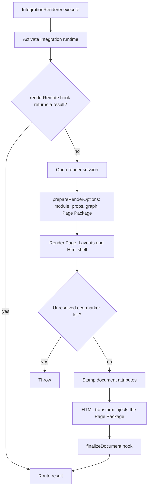

# Route rendering

Once a request matches a Page or an explicit view ([Routing](/dev/routing)), one Integration renderer turns it into HTML. Every path, whether a filesystem Page, `ctx.render`, `app.static`, an error page or static export, converges on `IntegrationRenderer.execute()`. This page covers that pipeline. What preparation puts in the Page Package is in [From graph to HTML](/dev/graph-to-html); how Components of other Integrations render inside it is in [Integrations and foreign children](/dev/integrations-foreign-children).

## Choosing the renderer

`RouteRendererFactory` maps a route file to its Integration (`findIntegrationForFile`) or an explicit view to the Integration it names, and returns that Integration's shared renderer. The same instance serves route renders, explicit views and Foreign Child handoffs. Integrations build renderers with `createIntegrationRenderer()` and hooks ([Custom Integration](/docs/plugins/custom-integration)); `StringMarkupRenderer` is a typed base for string-markup Integrations with no behavior of its own.

## The execute pipeline

`execute()` activates the Integration runtime, gives the optional `renderRemote` hook first refusal, then opens a render session and hands off to `RouteRenderOrchestrator`:

1. `prepareRenderOptions()` loads the Page module and final props, builds and validates the prepared component graph and builds the Page Package. Route params and query take precedence over extra props of the same name. A planned route from static export passes its preparation back in, so its data hooks run once per build.
2. The renderer renders the Page, Layouts and Html shell. Foreign Children go to their owning renderer.
3. `executePrepared()` captures the body and throws if an `<eco-marker>` artifact is left: there is no route-level fallback. It then stamps document attributes, runs the HTML transform with the prepared Page Package, and lets the Integration's `finalizeDocument` hook reconcile its own markup.

Core wraps whatever the route render throws as `Error rendering page`, with the original error as `cause`, and passes an `HttpError` through unchanged, so a Page that throws `NotFound` still answers 404. A `renderRoute` hook must not catch and re-wrap. A renderer with its own document model, such as the HTML Page renderer, overrides `renderRouteDocument()` rather than `render()`, so its errors are wrapped the same way.

### Render sessions and context

Each `execute()` opens a session that holds the render's Integration dependencies and its cache of owning renderers. The component render context, which names the current Integration and holds the foreign-child runtime, lives in `node:async_hooks` `AsyncLocalStorage`. Nested and concurrent renders therefore never see each other's state, and static export can render several Pages of one Integration at once. Every component render runs under a context that names its Integration, even with no foreign-child runtime, so an ownership guard such as the content Processor's `getComponent()` can tell which Integration is rendering.

### Document shell

`composeDocumentShell` wraps the Page in its Layouts and the Html template as strings, one tier at a time. An Integration that composes a single tree, such as React, supplies `composeChildren` instead and still delegates Foreign Subtrees through `renderComponentWithForeignChildren`. Sequential wrapping checks that each Layout rendered its `children`; [Pages, layouts and components](/dev/pages-layouts-components#layouts) covers the outcome per mode.

## Explicit views

An explicit view is an `eco.page()` value passed to `ctx.render`, `app.static()` or an error-page helper rather than found on disk.

- `resolveExplicitViewRenderer` finds the view's renderer without reading `staticProps`, so static export can plan a dynamic route before any slug exists. `prepareExplicitStaticRender` then runs `staticProps` with the route's Params.
- A full render goes through `executeExplicitView` (route result with metadata, used by static export for sitemap eligibility) or `renderExplicitView` (a response). Both call `execute` with the view as the Page module and `skipStaticProps`, so the view gets the same Layouts, metadata and client plan as a filesystem Page, and the call's props, Params, query and locals reach the view and its `metadata`.
- A partial render (`ctx.renderPartial`) stays on the component path: it opens its own session, builds no browser assets and is not checked against a prepared graph.

## Error pages

`ErrorPageRenderer` serves the semantic statuses 400, 401, 403, 404, 409 and 500, for requests and static export alike. Any other 5xx uses the 500 page; any other 4xx gets a built-in document. The source is chosen in order:

1. a filesystem page (`src/pages/404.*` and the like), which still counts when the source is gone but `ecopages build` recorded it in the server-modules map;
2. a view registered with `app.notFound()` and similar, prepared with `prepareExplicitStaticRender`;
3. the built-in document.

A failing custom page propagates its error; the request adapter then calls `renderBuiltIn()`, which never re-enters a custom source. Built-in pages show diagnostics only for a 5xx in development, with the stack of every wrapped `cause`; production pages never include a stack. During static export, `SemanticErrorPageExporter` writes one file per semantic status pathname (`/404`, …) unless a generated route already owns it. Adapters classify route failures and build the HTTP response; the renderer only chooses and renders the source.

## Page cache

`PageCacheService` stores rendered HTML for request-time Pages under their cache strategy. The strategies and their headers are in [Caching](/docs/server/caching). Internally:

- A stale `revalidate` hit returns the stored HTML and regenerates once in the background, deduplicated per key. App shutdown waits for in-flight regenerations before Integration teardown.
- Invalidations advance a generation counter before waiting for in-flight writes, so a render that began earlier cannot repopulate an entry after an invalidation.
- Each entry is bound to the source files it read (`collectHtmlCacheSourceDependencyPaths`): the route module closure, identity files and watch hops of the whole declared Component graph, Page Browser Graph inputs, processed assets and the Html template's imports. A development edit evicts only the entries bound to the changed file; see [Watcher and invalidation](/dev/hmr-watcher-invalidation). Path invalidation also releases the entry's build-input bindings.
- `PageRequestCacheCoordinator` applies the policy to one request and builds the response headers, including the ETag and 304 for `static` HTML.

## Custom-element SSR scripts

Lit and Ecopages JSX register custom elements on the server by importing the `dependencies.scripts` entries marked `ssr: true` before they render, through a shared `CustomElementScriptPreloader`. Each preloader has a `cacheScope` on the app's `AppRuntime`, which deduplicates imports across concurrent renders and lets development invalidation clear only that app's state.

A script is always evaluated through the preloader's `importServerModule`, never by a native import, because a native import skips the server loaders for its CSS, MDX and asset imports. Two importers exist:

| Importer | Used by | Why |
| --- | --- | --- |
| `createCustomElementServerModuleImporter` | Lit | Compiles through the app module loader into a separate outdir per registry under the work directory. |
| `createSharedServerModuleImporter` | Ecopages JSX | Compiles into the shared page server-module outdir, since a separate copy would load a second Radiant graph and break host SSR. |

Every `ssr: true` entry is preloaded, eager or lazy. Ecopages JSX sets `collectForIntegration` so it never preloads another Integration's scripts in a shared Dependency tree. Neither path builds a browser bundle for a preloaded script; `lazy` still controls browser loading. Per-Integration details: [Lit](/dev/lit), [Ecopages JSX](/dev/ecopages-jsx).
