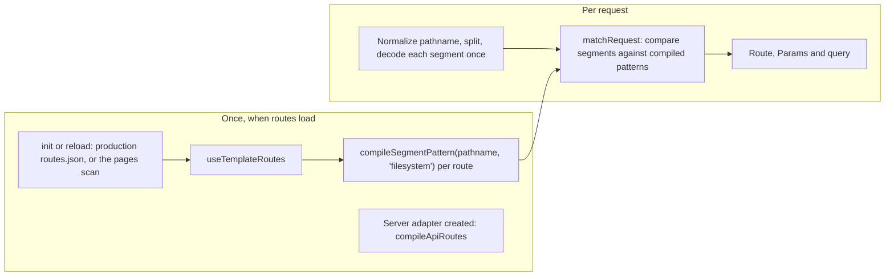

# Routing

`RouteRegistry` (`packages/core/src/router/server/route-registry.ts`) answers which filesystem route a request runs; [Route rendering](/dev/route-rendering) answers how it renders. The registry holds the canonical template routes of one app, each with a role (`page` or `endpoint`) and a kind (`exact`, `dynamic`, `catch-all`). Request order across Explicit Routes, `app.static` routes and the registry is in [App runtime](/dev/app-runtime#request-order); the user-facing rules are in [Routing](/docs/core/routing) and [Endpoint Files](/docs/server/endpoint-files).

## Discovery

`init()` and `reload()` rebuild the route list. Development scans the pages directory for every registered template extension and every endpoint marker. Production `ecopages start` loads the list `ecopages build` wrote to `dist/server/routes.json` and scans nothing.

| File | Role | Kind | Route |
| --- | --- | --- | --- |
| `about.tsx` | `page` | `exact` | `/about` |
| `blog/[slug].tsx` | `page` | `dynamic` | `/blog/[slug]` |
| `docs/[...slug].tsx` | `page` | `catch-all` | `/docs/[...slug]` |
| `api/users/index.api.ts` | `endpoint` | `exact` | `/api/users` |

- A route drops the longest registered extension the file ends with, so `about.kita.tsx` is `/about` and `v1.2.html` is `/v1.2`; `index` is stripped.
- The kind comes from the path inside the pages directory, so brackets in the project path do not make routes dynamic.
- `utils/file-roles.ts` is the one definition of file roles: `<name>.<role>.<ext>` with `api`, `server` or `script` as the role and `.ts`, `.tsx`, `.js` or `.jsx` as the extension. `ENDPOINT_FILE_EXTENSIONS` (the `api` suffixes) is shared with config finalization, which rejects an Integration that registers any role suffix. An endpoint drops the whole marker, so `users.api.tsx` is the endpoint `/users` even when `.tsx` is a template extension.
- The scan skips, before it matches a template extension, every `.server.*` and `.script.*` file and every file with a `_`-prefixed path segment under the pages directory (`isPrivatePath()`). They are never routes, so they can sit beside Pages. The client graph and the Rolldown browser build read the `.server` boundary from the same module (`isServerOnlyModuleSpecifier()`).
- An endpoint has no Integration owner, Layout, Cache Strategy or `paths`, and its dynamic segments need no `acceptsParams`. Static expansion, the sitemap and the browser-graph prebuild read `page` routes only.

Discovery fails, naming the files, when:

- two files produce the same route, whatever their parameter names: `segmentPathPatternKey()` drops names and syntax, so `blog/[slug].tsx` and `blog/[id].api.ts` collide;
- a role segment sits anywhere but directly before a script extension (`card.server.kita.tsx`, `nav.script.lit.tsx`, `users.api.html`), because the file would be a server-only module or a Page of that Integration and the build will not pick one (`findMisplacedRole()`); a private file is exempt; the router checks route files, and every Rolldown build also runs `createFileRoleGrammarPlugin`, which fails any compiled module outside `node_modules` with the same rule, so `src/components/card.server.kita.tsx` fails the server and browser builds and a dev rebuild after a rename succeeds;
- an endpoint's pathname ends in a known static file extension (`feed.xml.api.ts`), because the server never sends such a URL to a file route; the error points to `app.ts`;
- a dynamic Page belongs to an Integration with `acceptsParams: false`, such as `[slug].html`, because HTML Pages have no `paths` source.

## Matching

The scan sorts routes once: `exact` first (`/` before the rest), then `dynamic`, then `catch-all`. Within the dynamic routes, and within the catch-alls, segments (a catch-all's prefix) are compared from left to right and an earlier literal wins over a parameter, so `/api/[id]` answers `/api/5` before `/[section]/[slug]`. On a tie the longer pattern wins, then pathname order, so the result does not depend on discovery order. Pages and endpoints share this one order.

`matchRequest()` returns the first route that matches, with the requested pathname, Params and query. Each pattern is compiled once when the registry loads its routes (`compileSegmentPattern()`), so a request only compares segments. The server skips the registry for a pathname that ends in a known static extension (`hasKnownStaticExtension()`).

The request pathname is normalized once (`normalizePathname` adds a leading slash and drops trailing ones; empty segments between repeated slashes are ignored), split on `/`, then each segment is decoded once, so an encoded slash stays inside its segment. A malformed percent escape throws an HTTP 400 error, subject to `app.onError`, even when no route would match. A catch-all also matches its bare prefix, with an empty array.

## One segment grammar

`segment-path-matcher.ts` serves every server route kind. Each syntax sets which parameter forms it reads and how a catch-all is captured:

| Syntax | Used by | Parameters | Catch-all | Catch-all value |
| --- | --- | --- | --- | --- |
| `filesystem` | Pages, endpoint files | `[name]` | `[...name]` | array of segments |
| `api` | `app.get()` and other API handlers | `:name`, `[name]` | `[...name]`, `*` (no value) | array of segments |
| `explicit` | `app.static` routes | `:name`, `[name]` | `:...name`, `[...name]` | segments joined with `/` |
| `websocket` | `app.websocket` routes | `:name` | none | none |

A parameter segment can end in a literal suffix, `:handle.md` or `[handle].md`. Parsing splits at the first dot of a colon param and after the first `]` of a bracket param; the suffix is decoded once, like a literal segment. A match needs the suffix and a non-empty name before it, and captures the name. A suffixed parameter scores 75 against 100 for a literal and 50 for a bare parameter, `segmentPathPatternKey()` keeps the suffix so `/blog/[slug].md` and `/blog/[slug]` are different routes, and `buildSegmentPath()` appends it. The registry orders a suffixed segment between a literal and a bare parameter the same way (`getSegmentRank`). An endpoint file whose URL ends in a known static extension is refused, so `[handle].md.api.ts` fails the build, while an explicit route is tried first and answers it.

API handlers and WebSocket routes are compiled once, when the server adapter is created and when the WebSocket upgrade handler is attached, and ordered by the specificity score of their compiled pattern; `app.static` routes keep declaration order. `buildSegmentPath()` is the inverse: it fills a pattern from Params one segment at a time, so a param `id` never rewrites `:idx` and a catch-all array becomes one segment per value. Static export and the registry share it. `parseSearchParams()` gives every route kind the same query shape: a repeated key becomes an array in order, a single value stays a string.

## Static expansion

The registry runs no `paths()` during discovery. The static generator asks for expansions later, and the registry loads Page modules through an injected adapter:

- `listStaticPathExpansions()` expands dynamic `page` routes whose `cache` is not `'dynamic'`. In a build, such a route must declare `paths`; `props` is optional, since the render always receives the route's `params`. `paths` lists the Params known at build and `props` receives them, from `paths` at build and from the request at run time.
- `listDynamicPagePathExpansions()` returns the `paths` Params of Dynamic Pages (`cache: 'dynamic'`). They are not Static Path Expansions, since the HTML still renders per request; the build plans one Page Browser Graph per Params list so its scripts are in the asset ledger. A Dynamic Page without `paths` gets the parameter-free template plan.
- `listStaticGenerationRoutes()` returns the exact `page` routes and the static path expansions, each with its request URL.

## Endpoint files at request time

A matched endpoint goes to `EndpointRouteHandler`, the one loader shared by requests and the build. It loads the file through the server-module loader Pages use: production imports the module `ecopages build` emitted, and a development save drops the cached module. It picks the export named after the request method and runs it with the registry's Params through `ApiRequestPipeline.execute`, so schemas, middleware and `app.onError` behave as for an Explicit Route. A method the file does not export answers 405 with `Allow` listing the exported methods in `API_HANDLER_METHODS` order.

A load error (no method export, or one that is not a handler, is built for another method, or sets `path`) fails `ServerStaticBuilder.build()` after the server bundle is published and server modules are emitted, before static generation. Requests check it again, since development edits files between requests. An Explicit Route on an endpoint's pathname logs one warning per route and file pair; every registry init, including a development route refresh, checks again without repeating a pair already reported.

## Middleware

An API route, a group and a Page each declare a `middleware` list of entries: middleware made by `createMiddleware` or `composeMiddleware`, and plain `(ctx, next)` functions. `flattenMiddleware` turns the list into the ordered stages a pipeline runs, and rejects a list that holds the same stage twice, naming both positions. The routes and Pages are checked when they are defined (`eco.page`, the route registration), so the mistake fails at startup instead of on the first request.

`runMiddlewareChain` runs the stages for both the API pipeline and the Page pipeline. Each stage gets a `next` that continues the chain once: a second call throws before the chain advances, also when a later stage makes it while the first is still running, since a shared cursor would let it resume past a guard that had already answered. `next` also throws once its stage has returned or thrown, so a stage that answered cannot start the rest of the chain from a timer. `next(locals)` defines each key the stage provides on `ctx.locals` before the next stage runs, a later key overriding an earlier one; keys are defined rather than assigned, so a `__proto__` key stays a plain local. When a stage continues, every key an earlier stage provided must still hold its value, so a plain function that overwrote or deleted one makes its own `next` throw instead of leaving readers with a value their types do not describe. A stage answers with what it returns: the response `next` resolved with, edited, or a response that wraps or replaces it, which an outer stage needs to add headers to an immutable `Response.redirect()`. A stage that returns or throws before the rest of the chain it started settles waits for it first, so the handler never runs after the request was answered. `next` returns a `Promise` subclass (`ContinuationPromise`) that records whether the stage looked at it: awaiting it, returning it, or calling `then`, `catch` or `finally` on it, since `await` calls `then` on a promise whose `constructor` is not `Promise`. When the rest of the chain fails, a stage that looked keeps its own result, so `try { await next() } catch { return fallback }` answers with the fallback; a stage that never looked, as in `next(); return new Response('ok')`, has dropped the failure, so the chain rethrows it after the stage returns, also when the failure comes later. The two factories store a middleware's stages in a non-enumerable property, so a spread copy, which keeps the brand in its type, has none and `flattenMiddleware` rejects it when the route or Page is defined.

The types follow the same order. A made middleware carries the locals it leaves available in a brand: a required property keyed by a symbol the package does not export (`types/locals-brand.ts`), so only `createMiddleware` and `composeMiddleware` make one, and invariant in its locals, so a middleware cannot be upcast to one that proves fewer keys. `ListLocals` folds a list in order with the runtime's override rule, starting from the group's locals for a group route. A list that is not a fixed tuple, such as a spread array, may overwrite any key its elements provide, so the fold widens those keys and keeps no proof from before it. An entry of unknown locals, typed `AnyEcoMiddleware`, in the fixed part or the rest, turns every key before it into `unknown`; a later entry proves its own keys again. A route list typed exactly `MiddlewareList` is read as no list, because that is the default an inferred list falls back to when the route declares none. `next` has two overloads, `next()` and `next(locals)`, so a stage cannot claim locals it does not pass. Handlers read the result as `ctx.locals`, and `eco.page` types the `locals` of a Dynamic Page's `props` hook and inline layout factories from the list (`PageOptionsWithTypedLocals`); `render` receives no `locals`. The typed overload infers the list as a `const` generic, so a call that names the page's props or element type explicitly gives up the inference and sees no locals keys. Nothing else types locals: core declares no global locals interface, so a list is the only source, and the base it folds onto is `{}`. A plain function's context (`ApiMiddlewareContext`, `FileRouteMiddlewareContext`) types `ctx.locals` as the untyped `Record<string, unknown>` store it shares with the pipeline: it may write any key, and the fold counts it as providing nothing.
