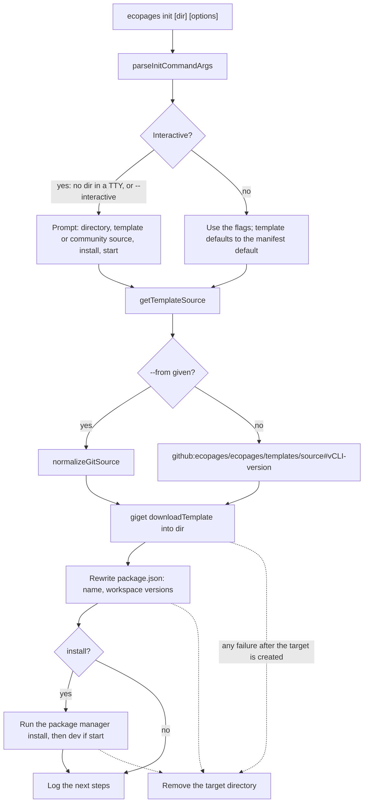

# Templates and init

`ecopages init` creates a project from a template. It shares the `ecopages` binary with `dev`, `build` and `start`, but takes no part in launching an app: it downloads files, rewrites one `package.json` and optionally runs the package manager. The launch side is in [CLI](/dev/cli).

## Flow

`bin/cli.js` loads `bin/init.js` only for `init`, so the other commands do not pay for `giget` or `@clack/prompts`.

### Arguments

`parseArgs` runs in strict mode, so an unknown option fails. Rules `init.js` enforces:

- At most one positional argument, the target directory; it must not exist yet.
- `--template` and `--from` are mutually exclusive. `--repo` was removed and fails with a pointer to `--from`.
- `--install` with `--no-install`, `--interactive` with `--no-interactive`, and `--start` with `--no-start` are mutually exclusive. `--start` implies an install and fails with `--no-install`.
- With no directory, a TTY gets the interactive creator; outside a TTY the directory is required.

Interactive mode prompts only for what the flags left out: directory, then the template (the official ones from the manifest, or "Community template" and a source), then install and start. Non-interactive runs install only with `--install` or `--start`. The package manager is taken from `npm_config_user_agent`: Bun or pnpm if it starts with that name, npm otherwise.

### Official and community sources

The official list is `packages/ecopages/templates.json`, sorted by `order`; the entry with `"default": true` (currently `jsx`) is used when no template is named. Each entry has an `id`, display text, a `category`, the `source` folder under `templates/`, the `packageDirectory` inside it that holds `package.json` (`.` except for `llm-wiki`, which uses `app`), and the Integrations it uses.

An official template resolves to `github:ecopages/ecopages/templates/<source>#v<version>`, where the version is the CLI's own `package.json` version. The publish workflow pushes the `v<version>` tag after a release, so a published CLI downloads templates from the commit it was released from. The download only works once the tag for the CLI's version exists.

A community source goes through `normalizeGitSource`. A string that already starts with `github:`, `gitlab:`, `bitbucket:` or `sourcehut:` is a giget source and passes unchanged. A URL on `github.com`, `gitlab.com`, `bitbucket.org` or `git.sr.ht` is converted to one: the provider helpers read the `tree`, `blob` or `src` marker, the ref and the sub-path out of the URL path, so a link to a folder at a tag becomes `github:owner/repo/folder#tag`, and a trailing `.git` is dropped. Any other host, a malformed URL, or a path without a repository fails with an error that names the problem. A community template has `packageDirectory` `.`.

### The project manifest

After the download, `updateProjectManifest` reads `<dir>/<packageDirectory>/package.json` and fails if it is missing. It sets `name` to the directory's base name. For an official template it also replaces each `workspace:*` in the four dependency blocks with the CLI's version, because templates live in the monorepo and depend on its packages by workspace link; if any `workspace:` range remains, it fails. A community template's `package.json` is left otherwise as it was.

If anything fails once the target directory exists, including the download, the directory is removed, so a failed `init` leaves nothing behind.

## Keeping templates valid

A template is a package in the monorepo workspace, so it is built and tested with the rest of the repository, and three checks guard what `init` later depends on.

| Check | What it verifies | Runs |
| --- | --- | --- |
| `pnpm check:templates` (`scripts/check-templates.ts`) | The manifest and the `templates/` folders list the same ids; `order` values are unique; exactly one default; each entry has its required fields and at least one Integration; each template's package is named `@ecopages/template-<id>`; its `tsconfig.json` does not set `compilerOptions.types`; every `@ecopages/*` and `ecopages` dependency on a workspace package is `workspace:*`; a `workspace:` range names a real package; no `latest`, `*`, `workspace:^` or `workspace:~`; no `-alpha.` or `-beta.` Ecopages prerelease; the external packages `@ecopages/jsx`, `@ecopages/radiant`, `@ecopages/radiant-ui` and `@ecopages/signals` are at the ranges the script pins. It then asserts the agent skill packs. | The `fast` CI job, as part of `test:ci:fast` |
| Agent skills (`scripts/sync-template-agent-skills.ts`) | The keys of `TEMPLATE_SKILL_PACKS` match the official ids, and each template's `.agents/skills` folder holds exactly the packs it maps to, with a `.agents/README.md`. `pnpm sync:template-skills` writes them. | Inside `check:templates` |
| `pnpm smoke:templates` | Each template builds with `pnpm run build` and emits `dist/client/index.html`; Electrobun, which has a server build, is checked for `dist/server/manifest.json` and runs its own tests. | The `fast` CI job |
| `pnpm smoke:packed` (`scripts/smoke-packed-templates.ts`) | Builds and packs every publishable package, then for each template creates a project from its folder with the workspace dependencies replaced by the tarballs, runs `pnpm install` and `ecopages build`, checks that no repository package was installed from the registry, and checks the build artifact. `html` is also served with `preview`, `ecoshop` with `start`, and `electrobun` with `start` after its `src` folder is deleted; each must answer `/` with HTML and stop on `SIGTERM`. Pass template ids to run a subset; the default list is `html`, `jsx`, `jsx-postcss`, `jsx-css-modules`, `react`, `react-postcss`, `lit-jsx`, `electrobun` and `ecoshop`. | The Packed templates workflow, only for the `changeset-release/main` pull request and manual dispatch |

`smoke:packed` is the one that proves what a user gets: `check:templates` and `smoke:templates` work inside the workspace, where `workspace:*` always resolves, while the packed run installs the same files the way a published project would. The test layers around it are in [Testing](/dev/testing).

## Adding or changing a template

1. Add the folder under `templates/`, named after the id, with a `package.json` named `@ecopages/template-<id>`, and workspace dependencies as `workspace:*`.
2. Add its entry to `packages/ecopages/templates.json` with a unique `order`.
3. Add its id to `TEMPLATE_SKILL_PACKS` and run `pnpm sync:template-skills`.
4. Run `pnpm check:templates` and `pnpm smoke:templates`; add the id to `defaultTemplateIds` in `smoke-packed-templates.ts` if the release check should cover it.
5. Update the list of ids in `packages/ecopages/README.md`.
6. If the template has Vitest tests, give it a `vitest.config.ts` with its own project name, then add that config to the root `vitest.config.ts` and the project to the `test:vitest` script and `scripts/test-vitest-windows.ts`, and list it in [Testing](/dev/testing).
