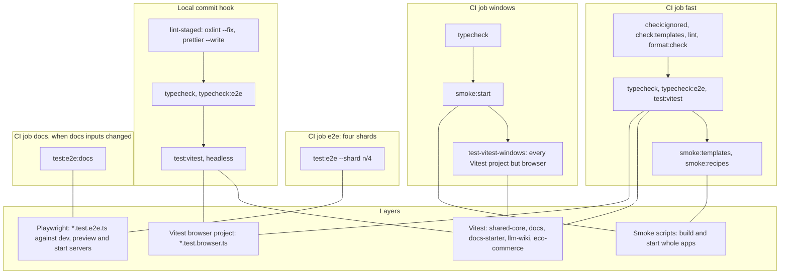

# Testing

Four layers test Ecopages: Vitest in Node, Vitest in a real browser, Playwright against running apps, and smoke scripts that build and start whole apps. Each layer is cheap where it can be and wired only where it is needed. The commit hook runs the Vitest layers and the type checks; CI adds the Playwright suites, the template and recipe builds and a Windows job. [Benchmarks and CI](/dev/benchmarks-and-ci) covers the benchmarks and the pull request stats comment that run beside them.

## Vitest

`vitest.config.ts` at the root defines the projects. `pnpm run test:vitest` runs `shared-core`, `browser`, `docs`, `docs-starter`, `llm-wiki` and `eco-commerce` with the browser headless; locally, Vitest uses half the cores so a commit hook leaves room for other checkouts.

| Project | Environment | What it holds |
| --- | --- | --- |
| `shared-core` | Node | Every `*.test.ts(x)` under `packages/core/src`, `codemod`, `ecopages`, `processors`, `integrations`, `file-system`, `react-router`, `dev-toolbar` and `__internals`, plus `scripts/`, `e2e/utils`, `e2e/playwright`, the `e2e/fixtures/*/*.test.ts` build-output tests and the kitchen-sink bench libraries. |
| `browser` | Chromium through `@vitest/browser-playwright` | `*.test.browser.ts(x)` under `packages` and `apps`, and `templates/docs-starter`. The router packages (`browser-router`, `react-router`) test DOM behavior here. |
| `docs` | Node | `apps/docs` scripts, lib and includes, with its own `@` alias and the Ecopages JSX runtime. |
| `docs-starter`, `llm-wiki`, `eco-commerce` | Node | The tests of those three templates, each with its own config. |

`packages/file-system` also has its own `pnpm test`, which runs the `shared-core` project filtered to that package. The Electrobun template has a `vitest.config.ts` with a `server` and a `browser` project; it runs from `smoke:templates`, not from the root.

## Contract suites

Two contracts keep third-party-shaped extension points honest.

- **Renderer contract.** `describeRendererContract()` from `@ecopages/testing/renderer-contract` registers the rows every Integration renderer owes core: structured output named after the Integration, the Foreign Subtree payload, Island Host stamping, foreign boundaries, a deferred layout, explicit view and filesystem Page parity, a Layout that drops its `children` being reported, and a failed render keeping core's error prefix and `cause`. Each Integration passes a harness with its own `createRenderer`, `makeComponent` and `makeView`; Kita, Lit, Ecopages JSX, React and MDX run it in their renderer tests. Framework-specific cases stay in each Integration's own tests.
- **Stylesheet Processor contract.** `stylesheetProcessorContract()` from `@ecopages/core/processor/contract` returns cases a runner registers with `it`: the stylesheets a transform reads drive rebuilds, development keeps the last good output on a CSS error, a build fails, and the CSS Module cases when the Processor declares `cssModules`. The PostCSS and Lightning CSS Processors run it in `stylesheet-processor-contract.test.ts`; a third-party Processor can run it the same way. See [Plugin pipeline](/dev/plugin-pipeline#stylesheet-processors).

## The testing package

`packages/__internals/testing` is `@ecopages/testing`, private and workspace-only. It holds `createTestAppConfig()` (the app-config baseline most renderer and plugin tests start from), `createStringMarkupIntegration()` and `createDeferredIntegrationPlugin()` for fixtures, the renderer contract, and the portable kitchen-sink shell Components that the playground and tests share. Use `finalizeEcoPagesConfig()` from `@ecopages/core/config` directly when the test is about config finalization itself. A helper moves into this package only after it proved stable across packages.

## Playwright

`playwright.config.ts` lists every project explicitly; there is no discovery. A project names its test glob (anchored to the repository root, so a copy in an ignored folder never runs), its timeout and, for a shared server, a `baseURL`. The config starts only the web servers that the selected projects use, and with `--shard` it asks Playwright's list reporter which projects have tests in the shard.

| Group | Projects | What they run |
| --- | --- | --- |
| Fixtures in `e2e/fixtures` | `browser-router-*`, `core-hmr-*`, `endpoints-only-e2e`, `html-pages-*`, `response-headers-*`, `react-production-start-*`, `react-router-*`, `react-lazy-first-load-e2e`, `css-modules-dev-e2e`, `web-workers-*`, `imported-views-*`, `browser-module-identity-dev-e2e`, `react-direct-hmr-dev-e2e`, `recipe-*`, `template-*` | Small purpose-built apps, and official templates (`templates/`), under `ecopages dev`, `preview` or `start` as the project name says. |
| Playground apps | `cross-integration-*`, `eco-blog-e2e` | The kitchen-sink playground (`playground/kitchen-sink/e2e`) and `playground/eco-blog`: every Integration on one site. The suffix names the mode: `dev`, `preview`, `fresh-dev` (a copy with no `.eco`), `moved-start`, `hmr-node`, and the Bun cells `bun-parity` and `bun-build`. |

Dev projects that edit sources use the worker app fixture (`e2e/app-fixture.ts`): a private copy of the app per worker with its own `ecopages dev` server, so tests mutate files in parallel without sharing edits. `serve: 'moved-start'` builds in one folder, renames it and runs `ecopages start`, which is how the moved-build projects check that `dist/` holds no absolute path. Preview projects build in the `webServer` command before the server starts. Kitchen-sink tests are tagged: `@parity` is the one spec the Bun cell runs, `@content` and `@stress` mark the specs `test:e2e:pr` keeps, and `test:gate` runs the `@stress` specs after the Vitest projects.

`playwright.docs.config.ts` is a separate config with one project, `docs-e2e`, which builds `apps/docs` and tests the output. The `e2e/fixtures/docs` specs are not part of the main suite. [e2e/README.md](https://github.com/ecopages/ecopages/blob/next/e2e/README.md) is the reference for adding a project.

## Smoke scripts

| Script | What it does |
| --- | --- |
| `smoke:start` (`scripts/smoke-start.ts`) | Builds a fixture app (`playground/explicit-routes`), runs `ecopages start` under Node and checks that `/` answers 200. Plain Node, so it runs on Windows too. |
| `smoke:templates` (`scripts/smoke-templates.ts`) | Builds every template (and runs the Electrobun template's own tests) and checks the files listed in its `buildOutputs` in `templates.json`, `dist/client/index.html` by default. |
| `smoke:recipes` | Runs `ecopages build` in every recipe fixture. |
| `smoke:packed` (`scripts/smoke-packed-templates.ts`) | Packs the publishable packages, installs each template against the tarballs and runs it. Not part of CI's job list; run it before a release. |

Four static checks run beside them: `check:ignored` finds tracked files that an ignore rule also matches, since `pnpm pack` would drop them; `check:templates` validates the template manifest and agent skills; `check:portability` (inside `typecheck`) enforces three rules across the packages: no `Bun.write` or `Bun.file` in packages outside `@ecopages/file-system`, no `@ecopages/core/bun` or `/node` subpath imports in apps, templates, playgrounds and fixtures, and no direct `process.env` writes in tests (use `vi.stubEnv`); `typecheck:e2e` type checks the Playwright code.

## What runs where

- **Commit hook** (`.husky/pre-commit`): `lint-staged` (oxlint and Prettier on staged files), then `test:pre-commit`: `typecheck`, `typecheck:e2e` and `test:vitest`. It runs no Playwright and no smoke. A docs-only commit still runs it unless committed with `--no-verify`.
- **`fast`** (pull requests): `test:ci:fast`, which is the hook's checks plus `check:ignored`, `check:templates`, `lint` and `format:check`, then `smoke:templates` and `smoke:recipes`.
- **`e2e`**: the four-shard `pnpm test:e2e` matrix behind one required check; each shard uploads its traces.
- **`windows`**: `typecheck`, `smoke:start` and `scripts/test-vitest-windows.ts`, which runs the Vitest projects except `browser`.
- **`docs`**: `test:e2e:docs`, only when `apps/docs`, the core packages it builds on, the docs specs or the Playwright config changed.

Pushes to `next` and `main` run the same workflow except `fast` and `windows`, which are limited to pull requests and manual runs.
