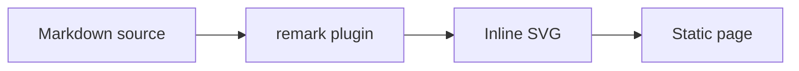

# Diagrams

Write a `mermaid` code fence in an MDX page and get an SVG in the static HTML. The page ships no diagram runtime, and the diagram follows your light and dark theme.



The diagram above is rendered by the plugin on this page. The docs app uses the same file as the fixture that CI builds.

## The problem

Mermaid's own library draws diagrams in the browser. That ships a large script to every reader, renders after the page loads, and needs its own theming and dark-mode handling.

[Pele](https://pele.run) renders the same Mermaid syntax to SVG synchronously and has no runtime dependencies. A remark plugin can run it while MDX compiles, so the SVG is part of the HTML you build.

## Install

```sh
pnpm add -D pele
```

## The plugin

The plugin replaces each `mermaid` code block with a `div` holding the SVG.

```ts file="examples/recipes/diagrams/src/lib/remark-mermaid.ts"
```

- **Build time only.** `render` runs while MDX compiles. Nothing of Pele reaches the browser.
- **A unique `idPrefix` per diagram.** Pele prefixes the ids inside each SVG, and two diagrams on one page must not share ids. The prefix comes from the page path and the diagram index, so it is unique within a page and the same on every build.
- **Errors fail the build.** A `PeleError` becomes an error that names the file, line and column of the mistake in the page, not in the diagram.
- **Trusted markup.** MDX drops raw HTML nodes and the JSX runtime escapes string children, so the plugin emits the SVG through `unsafeHtml` from `@ecopages/jsx`. That is safe here because the SVG comes from Pele, which escapes diagram text.

## Register it

Add the plugin to the MDX options of your JSX integration.

```ts file="examples/recipes/diagrams/eco.config.ts"
```

## Write a diagram

Put the diagram in a code fence in any MDX page. This page, from the fixture, has a flowchart and a sequence diagram:

```mdx file="examples/recipes/diagrams/src/pages/index.mdx"
```

## Theme it

Pele reads its colors and font from CSS variables, so you theme diagrams in your own CSS. Set the `--pele-*` variables on the wrapper the plugin emits, here `.diagram`, and map them to your own colors.

```css file="examples/recipes/diagrams/src/styles/diagram.css" region="theme"
```

Because the SVG uses the variables rather than fixed colors, a change of theme, such as flipping a `data-theme` attribute, restyles it without rendering again.

## Trade-offs

- Pele targets Mermaid 12.1.0 syntax with its own layout and visual style. A diagram can look different from Mermaid's, and a rarely used feature can be missing.
- The SVG is inlined into every page that uses it. Large diagrams add to the HTML size.
- Diagrams are static. There is no pan, zoom or click handling unless you add your own script.
- The plugin does not work in `.md` files unless your integration compiles them through the same remark pipeline.
